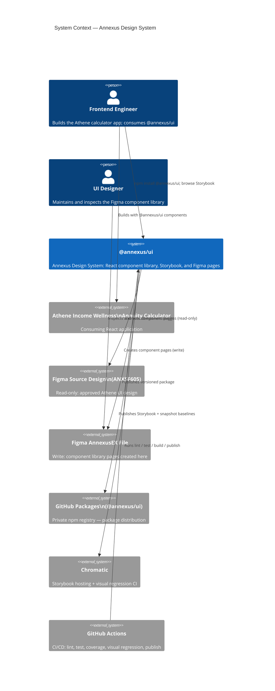
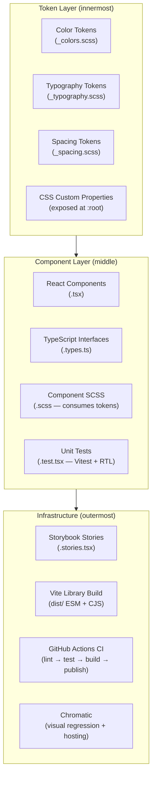
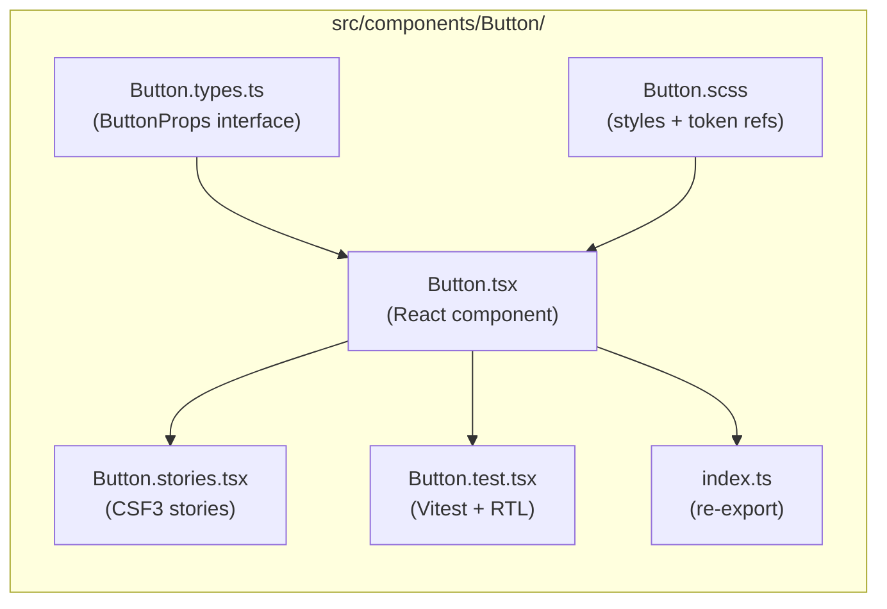
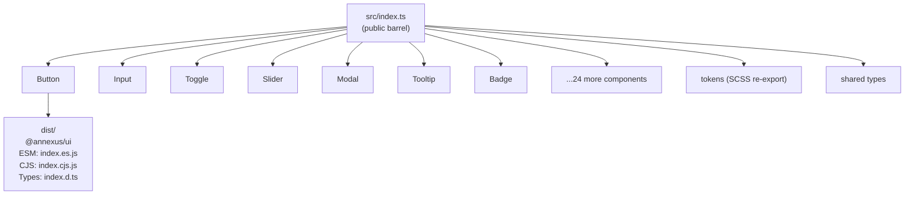
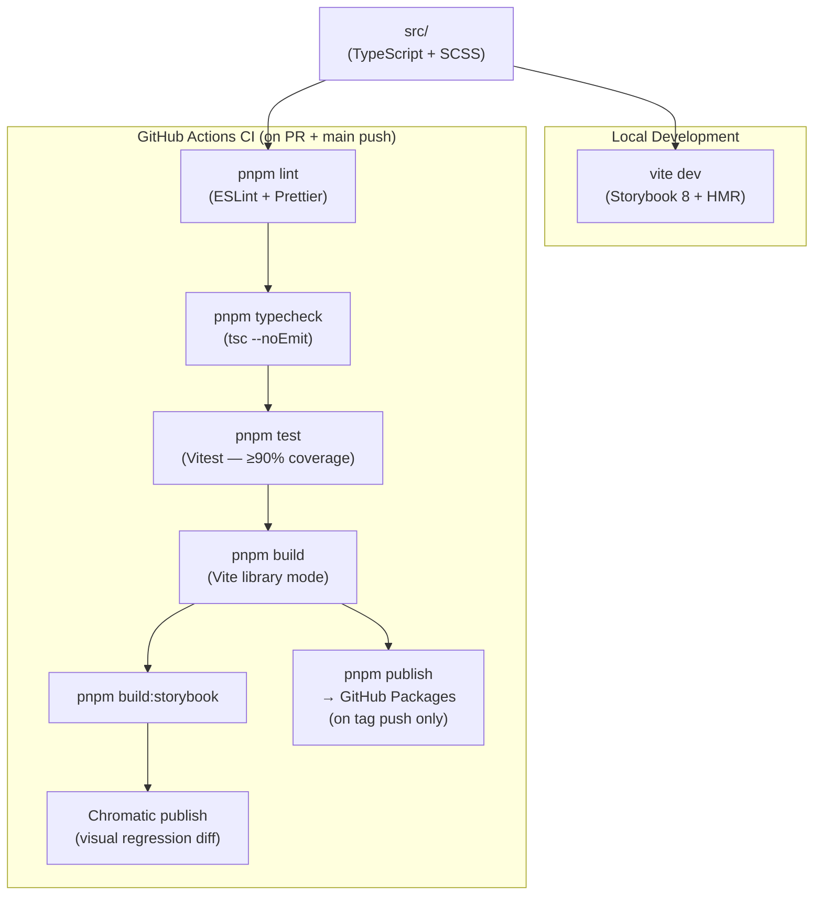
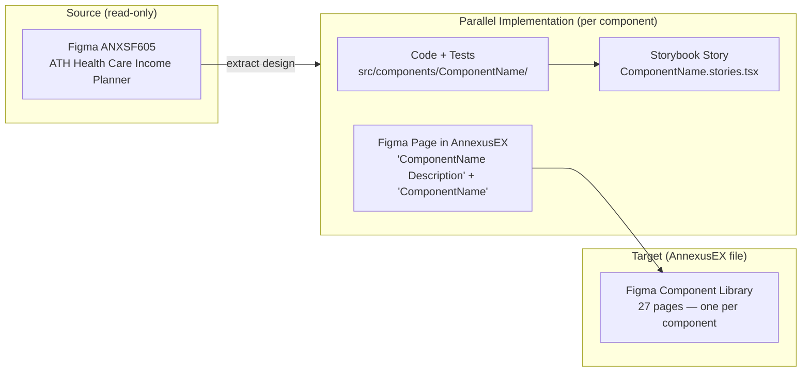

# Architecture Diagrams - Annexus Design System

**Source**: `docs/architecture/design/00-system-architecture-greenfield.md`
**Generated**: 2026-10-12

> This file contains Mermaid diagrams extracted from the architecture document for easy preview.
> For full architecture details, refer to the source document above.

---

## System Context Diagram



---

## Library Layer Architecture



---

## Per-Component Structure



---

## Package Export Map



---

## Token Architecture

```mermaid
flowchart LR
  FIG["Figma Variables\n(AnnexusEX)"] -->|manual sync| SCSS["SCSS Token Files\n(src/tokens/)"]
  SCSS -->|@use| COMP["Component .scss files"]
  SCSS -->|CSS custom props at :root| RUNTIME["Browser Runtime\n(var(--annexus-color-primary))"]
  COMP --> BUILD["Bundled CSS\ndist/style.css"]
```

---

## CI/CD Build Pipeline



---

## Figma Parallel Workflow


