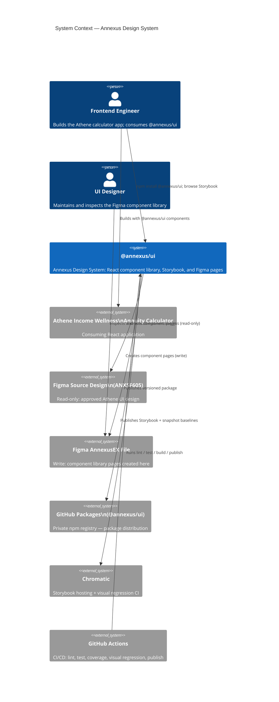
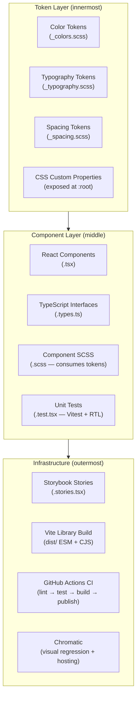
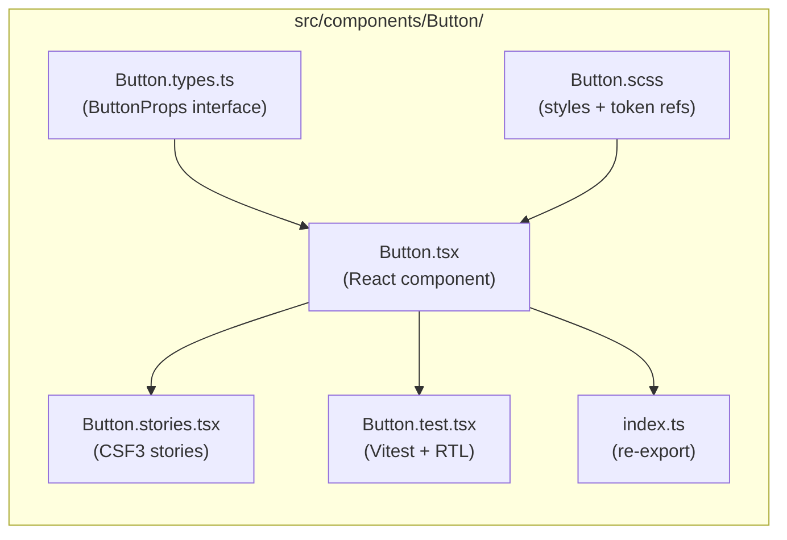
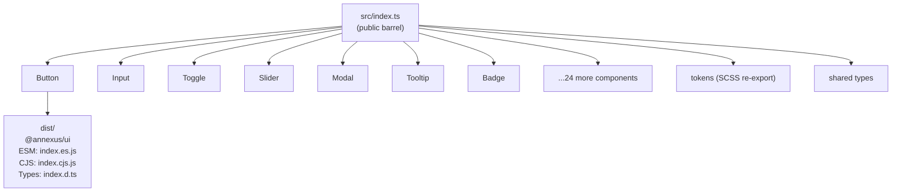
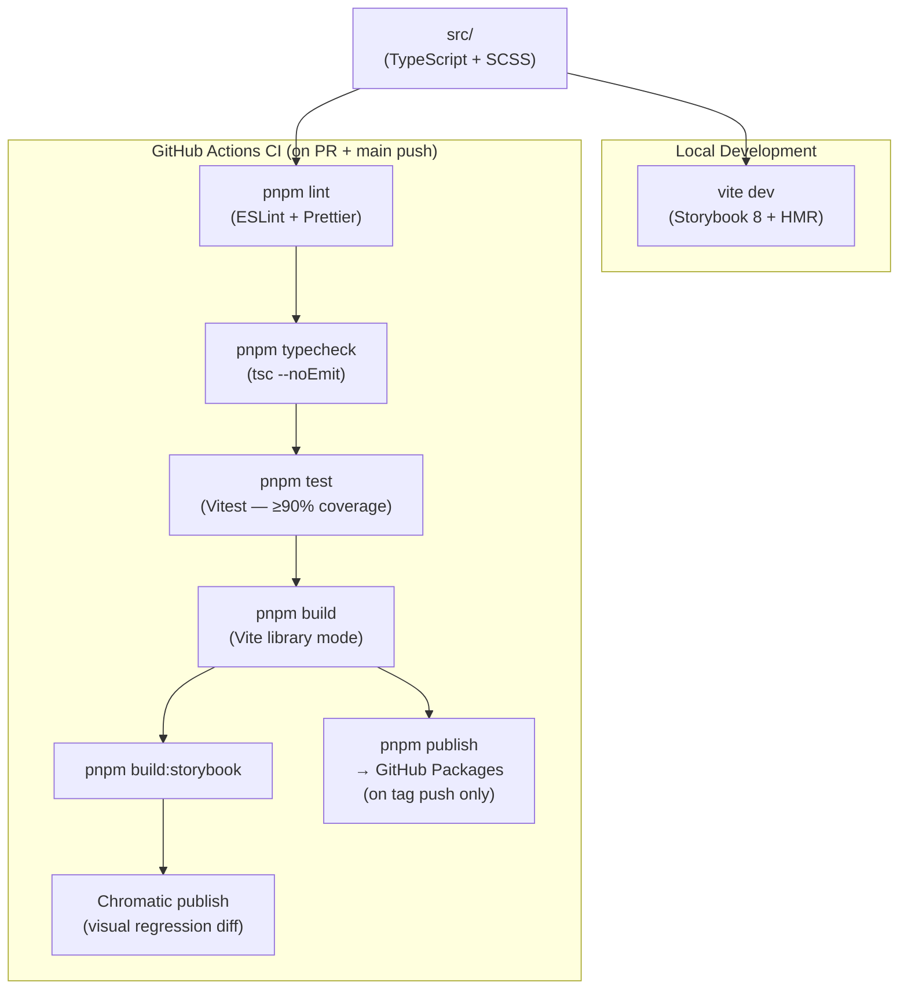
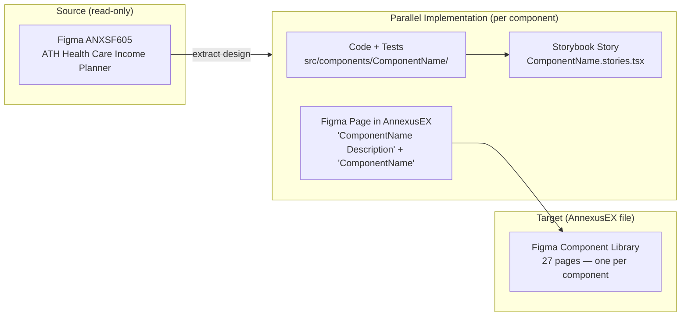

# System Architecture - Annexus Design System

**Date**: 2026-10-12
**Author**: ARCHITECT
**Status**: Approved
**Version**: 1.0

---

## Overview

### Purpose

The Annexus Design System (`@annexus/ui`) is a production-ready React component library delivering 27 UI components for the Athene Income Wellness Annuity Calculator. It ships as a private npm package (GitHub Packages), a Chromatic-hosted Storybook, and a Figma component library in the AnnexusEX file. All three outputs are produced in parallel per component.

### Architecture Style

**Library Package** — a publishable single-package artifact with no runtime server, no database, and no backend. Clean Architecture principles are applied at the library layer boundary: tokens are the innermost concern (pure values), component logic sits in the middle, and Storybook/build infrastructure is the outermost layer.

### Key Architectural Drivers

- **Speed to adoption**: Frontend engineers must be able to `npm install @annexus/ui` and render components within 4 working days
- **Agentic-friendly**: Storybook must be machine-readable — well-typed props, complete stories, auto-generated docs — so agentic frameworks can consume it as a reference
- **Fidelity**: Every component traces directly to the approved Athene Figma design; no visual deviation without sign-off
- **Parallel Figma delivery**: Each component also exists as a Figma page in AnnexusEX on the day it ships in code
- **WCAG 2.2 AA**: Stricter than the baseline — focus appearance, minimum target sizes, and non-drag alternatives for all interactive components

---

## Technology Stack

| Category | Technology | Version | Justification |
|----------|------------|---------|---------------|
| Language | TypeScript | 5.x (strict) | Zero `any`; full prop type inference; enables agentic code generation against the library |
| Framework | React | 18.x | Consuming application is React 18; hooks-first, concurrent-safe |
| Styling | SASS/SCSS | 1.x | Token variables as SCSS; no runtime CSS-in-JS overhead; straightforward for agentic consumption |
| Bundler | Vite | 6.x (library mode) | Native ESM, fast builds, tree-shaking, ESM + CJS dual output with `build.lib` |
| Storybook | Storybook | 8.x | CSF3 stories; auto-docs from TSDoc; Controls from TypeScript prop types; Chromatic integration built-in |
| Unit testing | Vitest | 2.x | Vite-native; fast; identical config to app build; no jest config divergence |
| Component testing | React Testing Library | 16.x | Behavior-driven; pairs with Vitest; accessibility queries by default |
| Visual regression | Chromatic | latest | Integrated with Storybook; PR-diff UI; handles Storybook hosting simultaneously |
| Node.js | Node.js | 26 LTS | Newest LTS (October 2026); native fetch, improved ESM; team targeting modern runtime |
| Package registry | GitHub Packages | — | Private scoped package; auth via `GITHUB_TOKEN`; collocated with source repo |
| CI/CD | GitHub Actions | — | Native integration with GitHub Packages + Chromatic; no additional tooling |
| Package manager | pnpm | 9.x | Faster installs; strict mode prevents phantom deps; lockfile consistency |

---

## System Context



---

## Component Architecture

### Library Layer Model

The library follows a **three-layer model** adapted from Clean Architecture. Dependencies point inward — components consume tokens, stories consume components, build infrastructure wraps everything.



### Per-Component Structure

Every component is a self-contained folder — implementation, types, styles, stories, and tests co-located:



### Package Export Map



---

## Token Architecture

Design tokens are the single source of truth for all visual values. They are defined in SCSS and simultaneously exposed as CSS custom properties at `:root` for runtime theming.

```mermaid
flowchart LR
  FIG["Figma Variables\n(AnnexusEX)"] -->|manual sync| SCSS["SCSS Token Files\n(src/tokens/)"]
  SCSS -->|@use| COMP["Component .scss files"]
  SCSS -->|CSS custom props at :root| RUNTIME["Browser Runtime\n(var(--annexus-color-primary))"]
  COMP --> BUILD["Bundled CSS\ndist/style.css"]
```

**Token naming convention**: `--annexus-{category}-{scale}-{variant}`
Examples:
- `--annexus-color-primary-500`
- `--annexus-spacing-4`
- `--annexus-font-size-body-md`
- `--annexus-radius-md`

**SCSS variable naming** (internal): `$color-primary-500`, `$spacing-4`, etc.

---

## Build Pipeline



### Vite Library Mode Output

```
dist/
├── index.es.js        # ESM (tree-shakable — primary)
├── index.cjs.js       # CJS (fallback for older toolchains)
├── index.d.ts         # TypeScript declarations
└── style.css          # Bundled component styles
```

`package.json` export map:
```json
{
  "name": "@annexus/ui",
  "exports": {
    ".": {
      "import": "./dist/index.es.js",
      "require": "./dist/index.cjs.js",
      "types": "./dist/index.d.ts"
    },
    "./style.css": "./dist/style.css"
  },
  "peerDependencies": {
    "react": ">=18.0.0",
    "react-dom": ">=18.0.0"
  }
}
```

---

## Accessibility Architecture (WCAG 2.2 AA)

WCAG 2.2 AA adds three key requirements beyond 2.1 AA that directly affect implementation:

| Criterion | ID | Requirement | Components Affected | Implementation |
|-----------|----|-------------|---------------------|----------------|
| Focus Appearance | 2.4.11 | Focus indicator ≥ 2px, 3:1 contrast ratio against adjacent colors | Button, Input, Toggle, Slider, Modal, Dropdown, Tooltip | SCSS `:focus-visible` outline on every interactive element |
| Target Size (Minimum) | 2.5.8 | Interactive targets ≥ 24×24px | Button (all sizes), Toggle, Age Tag, Group Item | Minimum `min-width: 24px; min-height: 24px` enforced via token |
| Dragging Movements | 2.5.7 | All drag-operated functionality has a single-pointer alternative | Slider | Arrow key navigation + click-on-track in addition to drag handle |

Additional WCAG 2.1 AA requirements (carried forward):
- Color contrast ≥ 4.5:1 for normal text, 3:1 for large text and UI components
- All interactive components keyboard-navigable (Tab, Enter, Space, arrow keys as appropriate)
- ARIA roles, labels, and live regions on Modal, Tooltip, Toggle, Slider

**Enforcement**: `axe-core` integrated with RTL via `@axe-core/react` in test environment; Storybook a11y addon enabled for all stories.

---

## Security Architecture

This is a UI library with no backend, no user sessions, and no data persistence. Security concerns are scoped to the distribution pipeline and consumer usage.

| Concern | Approach |
|---------|----------|
| Package integrity | Published to private GitHub Packages; only CI `GITHUB_TOKEN` can publish; consumers authenticate via `.npmrc` with `NODE_AUTH_TOKEN` |
| No secrets in source | ESLint `no-secrets` rule; pre-commit hook scans for high-entropy strings |
| XSS surface | Components never use `dangerouslySetInnerHTML`; all text content is React-rendered; no `innerHTML` |
| Dependency supply chain | `pnpm audit` runs on every CI pipeline; Dependabot enabled on repo |
| WCAG 2.2 AA | Accessibility is treated as a security/compliance gate — failures block merge |

### Roles & Permissions (library distribution)

Consistent with `docs/requirements.md` single-actor model — no auth within the library itself.

| Actor | Access | Auth mechanism |
|-------|--------|---------------|
| Frontend Engineer (consumer) | Read — install + import components | GitHub Packages token in `.npmrc` |
| CI/CD (GitHub Actions) | Write — publish new versions | `GITHUB_TOKEN` (automatic, scoped to repo) |
| UI Designer | Read — Figma AnnexusEX file | Figma sharing permissions (team access) |

---

## Error Handling

A component library has no runtime errors to catch in the traditional sense. Error handling is implemented as **defensive prop typing** and **graceful degradation**:

| Scenario | Handling |
|----------|----------|
| Invalid prop value | TypeScript compile-time error (strict types + no `any`) |
| Missing required prop | TypeScript compile-time error |
| Unexpected children | Explicit `children` prop typing; components that don't accept children have no `children` in interface |
| Network/async (none — library is synchronous) | N/A |
| Consumer error boundary | Components do not throw; consuming app owns error boundary |

**Pattern**: All components are **pure render functions** — no internal side effects beyond display. State is lifted to the consumer unless the component inherently requires internal state (e.g. Tooltip open/close, Toggle pressed).

---

## Observability

| Signal | Tool | Gate |
|--------|------|------|
| Unit test coverage | Vitest coverage (v8 provider) | ≥ 90% — CI fails below threshold |
| Visual regression | Chromatic snapshot diff | PR blocked until snapshots approved |
| TypeScript errors | `tsc --noEmit` | CI fails on any error |
| Lint errors | ESLint + Prettier | CI fails on any error |
| Accessibility | axe-core in Vitest + Storybook a11y addon | RTL `toHaveNoViolations()` on every component test |
| Bundle size | `vite-bundle-visualizer` (manual, pre-release) | Advisory — alert if any component exceeds 50KB gzipped |

---

## Figma Workflow Architecture



**Figma page convention per component**:
- Page name: `ComponentName` (e.g. `Button`)
- Left frame: `Button Description` — description, variant list, states, usage rules, do/don't
- Right frame: `Button` — component with all variants using Figma variables/tokens

---

## Technical Decision Records

### ADR-001: Package `@annexus/ui` on GitHub Packages (private)

**Decision**: Publish as `@annexus/ui` to GitHub Packages.
**Alternatives considered**:
- B: `@annexus/design-system` on public npm — rejected: exposes client-specific design assets publicly
- C: `annexus-ui` unscoped on public npm — rejected: no namespace protection

**Rationale**: Private registry appropriate for a client engagement. GitHub Packages collocates with source repo, auth uses existing `GITHUB_TOKEN` with no additional service accounts. Consuming app adds `.npmrc` with scoped registry config.

---

### ADR-002: Node.js 26 LTS

**Decision**: Node.js 26 LTS (entered LTS October 2026).
**Alternatives considered**:
- Node.js 20 LTS — wider compatibility but approaching end of active LTS
- Node.js 22 LTS — also valid; team chose to target newest LTS

**Rationale**: Team targets modern runtime. Node.js 26 brings native fetch stability, improved ESM performance, and built-in test runner (unused here, but signals platform maturity). All primary tools (Vite 6, Storybook 8, Vitest 2) support Node.js 26.

---

### ADR-003: WCAG 2.2 AA (not 2.1 AA)

**Decision**: WCAG 2.2 AA compliance required.
**Alternatives considered**:
- WCAG 2.1 AA — lower bar; misses focus appearance and target size improvements
- WCAG 2.2 AAA — impractical in a 4-day timeline

**Rationale**: WCAG 2.2 is the current standard (October 2023). Three new criteria directly improve UX for all users, not just those with disabilities. Implementation cost is bounded: Slider arrow-key navigation and `:focus-visible` outlines are straightforward patterns.

---

### ADR-004: Chromatic for Storybook hosting + visual regression

**Decision**: Use Chromatic for both.
**Alternatives considered**:
- GitHub Pages + Percy — two tools, two service accounts, separate PR diff UI
- Vercel + Chromatic — Vercel adds value for full apps but is excess for a static Storybook

**Rationale**: Chromatic is purpose-built for Storybook. One `npx chromatic --project-token=...` command in CI covers publish + regression. PR diff UI is embedded in GitHub PRs via the Chromatic GitHub App. Free tier (5,000 snapshots/month) is sufficient for 27 components × ~3 stories each ≈ 81 snapshots per build.

---

### ADR-005: Single package (not monorepo)

**Decision**: Single package with tokens + components co-located.
**Alternatives considered**:
- Monorepo (`packages/tokens` + `packages/components`) — cleaner separation, allows consuming tokens without components

**Rationale**: Monorepo tooling (Turborepo or pnpm workspaces) adds 1–2 days of setup overhead on a 4-day deadline. The Athene calculator is the only consumer — it needs both tokens and components together. Tokens can be extracted into a separate package in a future release when a second consumer emerges.

---

## Approval

| Role | Name | Date | Status |
|------|------|------|--------|
| Stakeholder | Nubia Barba | 2026-10-12 | Approved |
| Architect | AIRE_ARCHITECT | 2026-10-12 | Approved |
