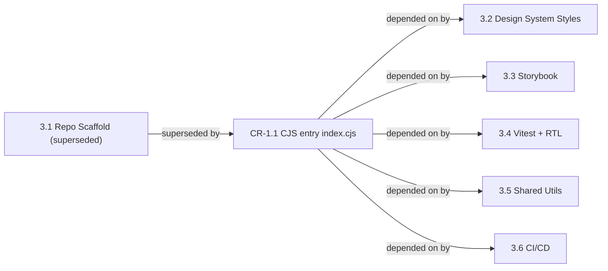

### Story CR-1.1: CommonJS entry as `dist/index.cjs` + `require()` smoke check

**File**: `docs/plans/builds/cycle-1/CR/CR-1/Epic 6 (Change Request)/CR-1.1.md`

**BUILDID**: CYCLE-1 | **AzureDevOps**: LOCAL | **Epic**: Epic-6 (Change Request) | **ID**: CR-1.1 | **CR**: CR-1 | **Date**: 2026-10-21
**Supersedes**: epic-3-story-3.1-repo-scaffold
**Traces to**: docs/requirements.md::Deliverables, docs/requirements.md::Explicit Scope, docs/requirements.md::Functional Requirements
**Impacts requirements**: docs/requirements.md::Deliverables, docs/requirements.md::Explicit Scope, docs/requirements.md::Functional Requirements
**Downstream stories**: 3.2, 3.3, 3.4, 3.5, 3.6
**Impacts epics**: Epic-3
**Wave**: 10
**Requires**: []
**Enables**: [3.2, 3.3, 3.4, 3.5, 3.6]
**Files Touched**:
  - package.json
  - tsconfig.json
  - vite.config.ts
  - .npmrc
  - .prettierrc
  - .eslintrc.cjs
  - pnpm-workspace.yaml
  - scripts/smoke-require.cjs
**Status**: done — implemented in commit `f9a4808` (merged via PR #14); QA verified 2026-10-21 (`docs/testing/validation-report-story-3.2-2026-10-21-v2.md`, TC-014; `docs/testing/regression-report-2026-10-21.md`)
**QA Candidate**: Yes — **Observable:** `pnpm build` produces `dist/index.es.js`, `dist/index.cjs`, `dist/index.d.ts`, `dist/style.css`; `node -e "console.log(Object.keys(require('@annexus/ui')))"` prints the public exports (today `['Input', 'designVariables']`); `import('@annexus/ui')` prints the same keys; `pnpm smoke:require` exits 0. **Mechanism:** `package.json` keeps `"type": "module"`; Node treats `.cjs` files as CommonJS regardless of `type`, so the CJS bundle is emitted with the `.cjs` extension. **Regression:** `pnpm smoke:require` runs in `prepublishOnly`; Story 3.6 adds it to CI.

---

## 📍 Impact within this CR

(none — this CR introduces only this story).

## 🔗 PRD source

- [docs/requirements.md — Deliverables](../../../../../../requirements.md#deliverables)
- [docs/requirements.md — Explicit Scope](../../../../../../requirements.md#explicit-scope)
- [docs/requirements.md — Functional Requirements](../../../../../../requirements.md#functional-requirements)

## ⏱️ Effort + scheduling

| Field | Value |
|---|---|
| **Effort estimate** | 0 remaining — implemented in `f9a4808` (≈ 0.5 day, recorded) |
| **Type** | Rework of shipped story (CR-supersede) |
| **Critical-path position** | No remaining work — merged to `main`; gates no open story |
| **Parallelizable with** | 3.3, 3.4, 3.5 |
| **Scheduled cycle** | CYCLE-1 (wave 10) |

## 📋 Plan slice impact

| Slice | Status |
|---|---|
| CYCLE-1 / Epic 3 — 3.1 Repo Scaffold | Superseded by CR-1.1 (wave 1 sealed, unchanged) |
| CYCLE-1 / Epic 3 — 3.6 CI/CD Pipeline | Direct-edited in CR-1 (adds `pnpm smoke:require` CI step) |
| CYCLE-4 / Epic 5 — 5.7 v1.0 Release | Direct-edited in CR-1 (release verification includes CJS entry) |
| CYCLE-1 / Epic 6 (Change Request) — CR-1.1 | Added, status done |

## 📜 Requirement context

```yaml
anchor: docs/requirements.md::Deliverables
anchor-mode: heading-anchored
change: modified
```

> - Vite library mode build producing `dist/` with ESM (`dist/index.es.js`) + CJS (`dist/index.cjs`) outputs

```yaml
anchor: docs/requirements.md::Explicit Scope
anchor-mode: heading-anchored
change: modified
```

> - Vite library mode build (ESM `dist/index.es.js` + CJS `dist/index.cjs` output)

```yaml
anchor: docs/requirements.md::Functional Requirements
anchor-mode: heading-anchored
change: modified (Feature: Component Library Package — acceptance criterion added)
```

> - The package can be consumed with both `import` and `require()`; both expose the same named exports

## 🌊 Impacted stories — ripple beyond this CR

| Story | Prerequisite citation | QA impact | DEV impact |
|---|---|---|---|
| 3.2 Design System Styles | `**Requires**: [3.1]` | `designVariables` reachable through `require('@annexus/ui')` (verified TC-014, 2026-10-21) | None — shipped |
| 3.3 Storybook 8.x Setup | `**Requires**: [3.1]` | None — Storybook builds from `src/`, not `dist/` | None |
| 3.4 Vitest + RTL Setup | `**Requires**: [3.1]` | None — tests run against `src/` | None |
| 3.5 Shared Utilities and Types | `**Requires**: [3.1]` | New exports appear in `require()` output; `smoke:require` asserts only `Input` and `designVariables` | None |
| 3.6 CI/CD Pipeline | `**Requires**: [3.1, 3.2, 3.3, 3.4, 3.5]` | CI run shows the `pnpm smoke:require` step green | Adds the CI step (direct-edited in this CR) |



**QA verification checklist**
- [x] `require('@annexus/ui')` returns the same keys and values as `import('@annexus/ui')` (TC-014, 2026-10-21)
- [x] `pnpm smoke:require` fails on an empty CJS bundle and passes on the real one (mutation check, 2026-10-21)
- [ ] After Story 3.5 merges: `require('@annexus/ui')` includes the new shared exports
- [ ] After Story 3.6 merges: the CI run includes a green `pnpm smoke:require` step

**DEV verification checklist**
- [x] `vite.config.ts` `fileName` emits `index.es.js` and `index.cjs`
- [x] `package.json` `main` and `exports["."].require` point to `./dist/index.cjs`
- [x] `prepublishOnly` runs `pnpm run smoke:require`
- [ ] Story 3.6 `ci.yml` runs `pnpm smoke:require` after Build

> **Honesty note**: Ripple stories were derived from the `**Requires**:` header of each foundation story, because no story in this project has a `## Prerequisites` section that names story ids or a `traces-to:` field. Stories that consume the package without declaring 3.1 in `**Requires**:` are not listed here.

---

#### 👤 User Reference

**Description**:
`@annexus/ui` ships two entry points: ESM (`dist/index.es.js`) for `import` and CommonJS (`dist/index.cjs`) for `require()`. The package declares `"type": "module"`, so Node treats every `.js` file in it as ESM. The scaffold story emitted the CommonJS bundle as `index.cjs.js`; Node loaded it as ESM and `require('@annexus/ui')` returned an empty object (BUG-002). This story emits the CommonJS bundle with the `.cjs` extension, points `main` and `exports["."].require` at it, and adds a smoke check that fails if `require()` stops exposing the public API. Every other part of the scaffold delivered by Story 3.1 (TypeScript, ESLint, Prettier, `.npmrc`, pnpm workspace) is unchanged.

**Acceptance Criteria** (plain-English):
- `pnpm build` produces `dist/index.es.js` (ESM), `dist/index.cjs` (CJS), `dist/index.d.ts` (types), `dist/style.css`
- `require('@annexus/ui')` and `import('@annexus/ui')` expose the same named exports with the same values
- `pnpm smoke:require` exits 0, and exits non-zero when the CJS bundle does not expose `Input` or `designVariables`
- `prepublishOnly` runs build, typecheck and `smoke:require`
- `package.json` keeps `"type": "module"`; `main` → `./dist/index.cjs`; `module` → `./dist/index.es.js`; `types` → `./dist/index.d.ts`

---

#### 🤖 AI Agent Reference

**Must Read**:
- `docs/plans/stories/epic-3-story-3.1-repo-scaffold.md` — the superseded scaffold contract (all non-CJS settings still apply)
- `docs/testing/bug-triage-2026-10-21.md` — BUG-002 root cause and remediation
- `docs/architecture/design/00-system-architecture-greenfield.md` — Vite library mode output, export map

**Acceptance Criteria** (comprehensive):
- `vite.config.ts` `build.lib.fileName: (format) => \`index.${format === 'es' ? 'es.js' : 'cjs'}\``; formats `['es', 'cjs']`
- `package.json`: `"type": "module"`, `"main": "./dist/index.cjs"`, `"module": "./dist/index.es.js"`, `"types": "./dist/index.d.ts"`, `exports["."]` = `{ types: ./dist/index.d.ts, import: ./dist/index.es.js, require: ./dist/index.cjs }`, `exports["./style.css"]` = `./dist/style.css`
- `package.json` scripts include `"smoke:require": "node scripts/smoke-require.cjs"` and `"prepublishOnly": "pnpm run build && pnpm run typecheck && pnpm run smoke:require"`
- `scripts/smoke-require.cjs` requires `../dist/index.cjs` and asserts `designVariables` and `Input` are present
- `pnpm build`, `pnpm typecheck`, `pnpm lint`, `pnpm test`, `pnpm smoke:require` exit 0
- `require.resolve('@annexus/ui')` resolves to `dist/index.cjs`; `pnpm pack --dry-run` lists `dist/index.cjs`

**Steps** (as implemented in `f9a4808`):

1. `vite.config.ts` — CJS output file name:
   ```typescript
   lib: {
     entry: resolve(__dirname, 'src/index.ts'),
     formats: ['es', 'cjs'],
     fileName: (format) => `index.${format === 'es' ? 'es.js' : 'cjs'}`,
   },
   ```
2. `package.json` — entry points and scripts:
   ```json
   "main": "./dist/index.cjs",
   "module": "./dist/index.es.js",
   "types": "./dist/index.d.ts",
   "exports": {
     ".": {
       "types": "./dist/index.d.ts",
       "import": "./dist/index.es.js",
       "require": "./dist/index.cjs"
     },
     "./style.css": "./dist/style.css"
   },
   "scripts": {
     "smoke:require": "node scripts/smoke-require.cjs",
     "prepublishOnly": "pnpm run build && pnpm run typecheck && pnpm run smoke:require"
   }
   ```
3. `scripts/smoke-require.cjs`:
   ```javascript
   // Verifies the built CommonJS entry exposes the public API (BUG-002 guard).
   const assert = require('node:assert');
   const ui = require('../dist/index.cjs');

   assert.ok(ui.designVariables, 'require() exposes designVariables');
   assert.ok(ui.Input, 'require() exposes Input');
   console.log('require smoke check passed');
   ```
4. Verify:
   ```bash
   rm -rf dist && pnpm build && ls dist
   node -e "console.log(Object.keys(require('@annexus/ui')))"
   node -e "import('@annexus/ui').then(m => console.log(Object.keys(m)))"
   pnpm smoke:require
   ```

**Tests**:
- `pnpm smoke:require` exits 0 on a fresh build
- Replacing `dist/index.cjs` with an empty module makes `pnpm smoke:require` exit 1
- `require('@annexus/ui')` and `import('@annexus/ui')` return identical `designVariables`

**OUT**:
- ❌ No change to ESM output, TypeScript, ESLint, Prettier, `.npmrc` or workspace settings from Story 3.1
- ❌ CI wiring of `smoke:require` belongs to Story 3.6

**Evidence**:
- `docs/testing/validation-report-story-3.2-2026-10-21-v2.md` — TC-014 (ESM + CJS identical), BUG-002 guard mutation
- `docs/testing/regression-report-2026-10-21.md` — entry points resolve, pack contents include `dist/index.cjs`
