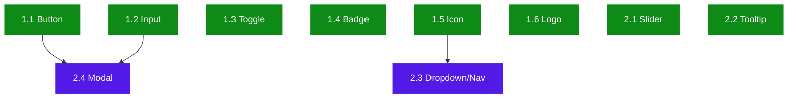

# Annexus Design System — Implementation Plan

**Project**: Annexus Design System | **Version**: 1.0 | **Created**: 2026-10-12 | **Updated**: 2026-10-20 (CR-001 re-baseline)
**Author**: PRODUCT_OWNER | **Status**: APPROVED — READY FOR DEV
**BUILDIDs**: CYCLE-1 (Sprint 1) · CYCLE-2 (Sprint 2) · CYCLE-3 (Sprint 3) · CYCLE-4 (Sprint 4)

---

## Dependency Graph

> If this Mermaid drifts from `docs/plans/dependency-graph.yml`, the YAML wins. Re-render from the YAML on any graph change.

### Wave Summary

| Wave | Stories | Notes |
|------|---------|-------|
| 1 | 3.1 | CYCLE-1 — repo scaffold (done) |
| 2 | 3.2, 3.3, 3.4, 3.5 | CYCLE-1 — design system styles, Storybook, Vitest, utils |
| 3 | 3.6 | CYCLE-1 — CI/CD; closes the cycle |
| 4 | 1.1, 1.2, 1.3, 1.4, 1.5, 1.6, 2.1, 2.2 | CYCLE-2 — 8 independent stories; all require 3.6 (strict cycle order) |
| 5 | 2.3, 2.4 | CYCLE-2 — Dropdown requires Icon (1.5); Modal requires Button (1.1) + Input (1.2) |
| 6 | 4.1–4.11 | CYCLE-3 — require all P0 stories |
| 7–9 | 5.1, 5.3–5.6 · 5.2 · 5.7 | CYCLE-4 — require all P1 stories |

### Wave Workload Distribution (team_size: 3 — 2 Dev + 1 QA)

| Wave | Stories | Per Dev | Dev Assignments | QA Assignments | Notes |
|------|---------|---------|----------------|----------------|-------|
| 2 | 4 | 2 each | Dev-1: [3.3, 3.4] / Dev-2: [3.2, 3.5] | QA-1: [3.1 regression, 3.2, 3.3, 3.4, 3.5] | ✅ All active |
| 3 | 1 | — | Dev-1: [3.6] | QA-1: [3.6] + CYCLE-1 sign-off | ✅ All active |
| 4 | 8 | 4 each | Dev-1: [1.1, 1.3, 1.5, 2.1] / Dev-2: [1.2, 1.4, 1.6, 2.2] | QA-1: all 8 — as each story leaves review | ✅ All active |
| 5 | 2 | 1 each | Dev-1: [2.3] / Dev-2: [2.4] | QA-1: [2.3, 2.4] + CYCLE-2 regression | ✅ All active |

**Assignees**: Dev-1 = Salvador · Dev-2 = Angel · QA-1 = Vicky

**QA role (QA-1: Vicky)**: validates every story after `aire-review-code` and before it is marked Done — runs `aire-qa-validate`, owns the test plan and validation report, and approves Chromatic snapshots, Storybook a11y results and WCAG 2.2 AA / keyboard checks. Devs do not sign off their own stories. QA-1 runs a regression pass at the end of each cycle.

---

## Styling Convention (CR-001, 2026-10-20)

Applies to every component story, whatever its text says about `--annexus-*` or `src/tokens/`:

1. `src/styles/pallete.color.scss` — all colors in hex; one variable per color named after the color (`$midnightBlue`); no repeated values or names.
2. `src/styles/design.variables.scss` — variables named after the section they style (`$inputFieldBorderColor: palette.$gray300`); the only variables component `.scss` may use. Fonts included (`$fontFamilyBase`, `$<section>FontSize`…).
3. `src/styles/design.variables.module.scss` + `designVariables.ts` — export of every design variable to JS.

Defined by Story 3.2; first used by Story 1.2 (Input), which is the reference implementation.

---

## 1. Overview

**Success Criteria**:
- All 10 P0 components importable: `import { Button, Input, Toggle, ... } from '@annexus/ui'`
- TypeScript strict — zero `any`, all props typed
- Vitest coverage ≥ 90% (lines, branches, functions, statements) per component
- Every variant and state has a named Storybook story
- Storybook a11y addon: zero violations for all P0 stories
- WCAG 2.2 AA — focus-visible-ring on all interactive elements, ≥24×24px touch targets
- Chromatic snapshots captured and approved
- CI pipeline green

**Epic Breakdown**:
- Epic 1: P0 Atom Components — 6 standalone primitives (Button, Input, Toggle, Badge, Icon, Logo)
- Epic 2: P0 Complex & Overlay Components — 4 composite/overlay components (Slider, Tooltip, Dropdown/Nav, Modal)

---

## EPIC 1: P0 ATOM COMPONENTS

**Owner**: DEV | **Goal**: Deliver 6 self-contained primitive components — each a complete vertical slice (component + types + SCSS tokens + Storybook stories + Vitest tests)

**Must Read References**:
- `docs/ui-ux/ui-ux-spec.md` — design tokens (colors, typography, spacing, elevation, border-radius)
- `docs/ui-ux/03-inspiration.md` — Figma-extracted dimensions (44px control height, border-radius sm/md)
- `docs/architecture/design/01-patterns-and-standards-greenfield.md` — BEM naming, SCSS patterns, CSF3 stories, Vitest AAA

**Prerequisites**: CYCLE-1 complete — repo scaffold, token files, Storybook, Vitest, CI/CD, Chromatic all operational
**Completion**: All 6 atoms importable from `@annexus/ui`, ≥90% test coverage each, Storybook a11y green

| Story | File | Objective |
|-------|------|-----------|
| 1.1: Button | `docs/plans/stories/epic-1-story-1.1-button.md` | 7-hierarchy Button × sizes × states, forwardRef, WCAG focus-visible-ring |
| 1.2: Input | `docs/plans/stories/epic-1-story-1.2-input.md` | 4-type Input × 3 states, aria-invalid, aria-describedby error wiring |
| 1.3: Toggle | `docs/plans/stories/epic-1-story-1.3-toggle.md` | Controlled/uncontrolled Toggle, aria-pressed, 4 interaction states |
| 1.4: Badge | `docs/plans/stories/epic-1-story-1.4-badge.md` | Display-only Badge, Type=Count/Status × Tone=Neutral/Info/Success/Warning/Danger |
| 1.5: Icon | `docs/plans/stories/epic-1-story-1.5-icon.md` | SVG React components — check-circle, chevron-down, winLose; aria-hidden/aria-label |
| 1.6: Logo | `docs/plans/stories/epic-1-story-1.6-logo.md` | Athene Logo SVG component, role="img", aria-label |

---

## EPIC 2: P0 COMPLEX & OVERLAY COMPONENTS

**Owner**: DEV | **Goal**: Deliver 4 complex components requiring WCAG keyboard interaction, overlay management, and composition of Epic 1 atoms

**Must Read References**:
- `docs/ui-ux/ui-ux-spec.md` — slider interaction rules, modal breakpoint behavior, touch target specs
- `docs/architecture/design/01-patterns-and-standards-greenfield.md` — useFocusTrap hook pattern, aria overlay roles

**Prerequisites**: CYCLE-1 complete; Icon (1.5) merged before 2.3 starts; Button (1.1) + Input (1.2) merged before 2.4 starts
**Completion**: All 4 complex components importable, focus trapping correct, keyboard nav complete, ≥90% test coverage each

| Story | File | Objective |
|-------|------|-----------|
| 2.1: Slider | `docs/plans/stories/epic-2-story-2.1-slider.md` | Slider with ControlHandle + NumberStrip, WCAG 2.5.7 arrow-key + click-on-track alternative |
| 2.2: Tooltip | `docs/plans/stories/epic-2-story-2.2-tooltip.md` | Pointer + keyboard trigger tooltip, role="tooltip", aria-describedby hookup |
| 2.3: Dropdown/Nav | `docs/plans/stories/epic-2-story-2.3-dropdown-nav.md` | Header navigation, Arrow/Escape/Enter keyboard nav, imports Icon (ChevronDown) |
| 2.4: Modal | `docs/plans/stories/epic-2-story-2.4-modal.md` | Focus-trap dialog, 2 states (Input + Add Benefits), Escape to close, imports Button + Input |

---

## EPIC 3: FOUNDATION SETUP

**Owner**: DEV | **BUILDID**: CYCLE-1 | **Goal**: Deliver a production-ready repo scaffold with design tokens, Storybook, Vitest, shared utilities, and CI/CD pipeline — the complete foundation that CYCLE-2 components build on

**Must Read References**:
- `docs/plans/builds/cycle-1/cycle-plan.md` — full scope, acceptance criteria, open items
- `docs/architecture/design/00-system-architecture-greenfield.md` — ADRs (Node 26, pnpm, Vite 6 library mode, GitHub Packages)
- `docs/architecture/design/01-patterns-and-standards-greenfield.md` — token naming, shared type conventions, BEM

**Prerequisites**: GitHub repository exists; Node.js 26 LTS available; Chromatic account and project token available; GitHub Packages write permission confirmed
**Completion**: `pnpm build` green; `pnpm test` green; `pnpm storybook` launches; CI pipeline passes on push; design tokens visible in DevTools at `:root`

| Story | File | Objective |
|-------|------|-----------|
| 3.1: Repo Scaffold | `docs/plans/stories/epic-3-story-3.1-repo-scaffold.md` | package.json, tsconfig strict, vite.config.ts library mode, .npmrc GitHub Packages, ESLint, Prettier, pnpm workspace — superseded by CR-1.1 |
| 3.2: Design System Styles | `docs/plans/stories/epic-3-story-3.2-design-tokens.md` | `pallete.color.scss` (hex palette) + `design.variables.scss` (section-named variables for fonts and colors) + JS export (`designVariables`) — re-scoped by CR-001 |
| 3.3: Storybook Setup | `docs/plans/stories/epic-3-story-3.3-storybook.md` | Storybook 8.x — main.ts, preview.ts, a11y addon wired, autodocs enabled |
| 3.4: Vitest + RTL Setup | `docs/plans/stories/epic-3-story-3.4-vitest.md` | vitest.config.ts, coverage thresholds ≥90%, RTL setup, test-utils barrel |
| 3.5: Shared Utilities + Types | `docs/plans/stories/epic-3-story-3.5-shared-utils.md` | classNames.ts, devWarning.ts, common.types.ts (Size/Variant/BaseProps), src/index.ts empty barrel |
| CR-1.1: CommonJS entry `index.cjs` | `docs/plans/builds/cycle-1/CR/CR-1/Epic 6 (Change Request)/CR-1.1.md` | CJS bundle as `dist/index.cjs`, `main`/`exports.require` updated, `smoke:require` check — CR-1, done |
| 3.6: CI/CD Pipeline | `docs/plans/stories/epic-3-story-3.6-cicd.md` | GitHub Actions ci.yml (lint→typecheck→test→build→Storybook→Chromatic) + publish.yml (on tag), README.md stub |

---

## EPIC 4: P1 COMPOSITION COMPONENTS

**Owner**: DEV | **BUILDID**: CYCLE-3 | **Goal**: Deliver 11 layout and composition molecules/organisms that compose P0 primitives — the complete UI scaffold for the Athene calculator

**Must Read References**:
- `docs/ui-ux/ui-ux-spec.md` — component layout specs, responsive behavior (lg/sm), color tokens
- `docs/plans/builds/cycle-3/cycle-plan.md` — component list, composition rules, wave assignments
- `docs/architecture/design/01-patterns-and-standards-greenfield.md` — composition patterns, BEM extension

**Prerequisites**: CYCLE-2 complete — all 10 P0 components merged to main before any P1 story starts
**Completion**: All 11 P1 components importable from `@annexus/ui`; ≥90% test coverage; Storybook a11y green; Chromatic baselines captured

| Story | File | Objective |
|-------|------|-----------|
| 4.1: Footer | `docs/plans/stories/epic-4-story-4.1-footer.md` | Responsive layout footer — composes Button (Link variants); multi-column lg, single-column sm |
| 4.2: HeaderSection | `docs/plans/stories/epic-4-story-4.2-header-section.md` | Top navigation header — composes Logo + Dropdown/Nav (P0); fixed top-bar, max-width 1280px |
| 4.3: Legend | `docs/plans/stories/epic-4-story-4.3-legend.md` | 2 states (Default, Monthly Income Only) — color-coded token-referenced legend rows |
| 4.4: AddonRow | `docs/plans/stories/epic-4-story-4.4-addon-row.md` | 2 types (Bundle, Pharmacy) × 2 states (Default, Added) — composes Badge (P0); role="row" |
| 4.5: HelpIcon | `docs/plans/stories/epic-4-story-4.5-help-icon.md` | Multiple contexts × 2 states (Default, Hover) — composes Tooltip + CheckCircle Icon (P0); aria-label per context |
| 4.6: GroupItem | `docs/plans/stories/epic-4-story-4.6-group-item.md` | 3 states (Default, Hover, Active) — keyboard-navigable list item; role="option" |
| 4.7: FrequencySelector | `docs/plans/stories/epic-4-story-4.7-frequency-selector.md` | 2 states (Monthly, Annually) — toggle-group pattern; composes Toggle (P0); role="group" + aria-label |
| 4.8: AgeTag | `docs/plans/stories/epic-4-story-4.8-age-tag.md` | 2 states (Target, Default) — display badge variant; token-referenced colors |
| 4.9: ButtonGroup | `docs/plans/stories/epic-4-story-4.9-button-group.md` | 3 states (Default, Hover, Active) — composes Button (P0); role="group" + aria-label |
| 4.10: Row | `docs/plans/stories/epic-4-story-4.10-row.md` | Line 2/3 × 2 states (Default, Added) — composes Badge (P0); structured add-on row layout |
| 4.11: AdjustInflationRate | `docs/plans/stories/epic-4-story-4.11-adjust-inflation-rate.md` | 2 states (Default, Active) — composes Slider + Input (P0); WCAG 2.5.7 keyboard alternative |

---

## EPIC 5: P2 COMPLEX COMPONENTS + v1.0 RELEASE

**Owner**: DEV | **BUILDID**: CYCLE-4 | **Goal**: Deliver 6 data-visualization and animated components + publish `@annexus/ui@1.0.0` to GitHub Packages — all 27 components shipped

**Must Read References**:
- `docs/plans/builds/cycle-4/cycle-plan.md` — P2 component specs, release gate checklist, open items
- `docs/ui-ux/ui-ux-spec.md` — chart variants, animation specs, summary panel modes
- `docs/architecture/design/01-patterns-and-standards-greenfield.md` — role="img" for chart, prefers-reduced-motion

**Prerequisites**: CYCLE-3 complete — all 21 P0+P1 components merged; Chromatic baselines for P0+P1 approved; GitHub Packages publish permission confirmed
**Completion**: All 27 components in `@annexus/ui@1.0.0`; package smoke-test passes in fresh consumer app; Chromatic approved; README with install instructions live

| Story | File | Objective |
|-------|------|-----------|
| 5.1: Chart/Bar | `docs/plans/stories/epic-5-story-5.1-chart-bar.md` | Target (1/10/20) × Variant (A/B) — SVG/CSS bar chart; role="img" with aria-label; prefers-reduced-motion |
| 5.2: GraphContainer | `docs/plans/stories/epic-5-story-5.2-graph-container.md` | 3 states (5%, 6%, 7%) — layout wrapper composing Chart/Bar; requires 5.1 merged first |
| 5.3: TopSummary | `docs/plans/stories/epic-5-story-5.3-top-summary.md` | Multiple modes (65/68, 65/65, 60/65 × benefit variants) — display-only summary panel |
| 5.4: BottomSummary | `docs/plans/stories/epic-5-story-5.4-bottom-summary.md` | 5 states (Start, Mid, End, Locked-in-10, Locked-in-20) — status-driven display component |
| 5.5: Premium | `docs/plans/stories/epic-5-story-5.5-premium.md` | 2 variants (Display, Edit) — Display-only amount view; Edit mode composes Input + Button (P0) |
| 5.6: AnimatedValues | `docs/plans/stories/epic-5-story-5.6-animated-values.md` | Multiple modes (income/projection/premium) — CSS counter animation; prefers-reduced-motion disables |
| 5.7: v1.0 Release | `docs/plans/stories/epic-5-story-5.7-v1-release.md` | Chromatic visual regression gate; browser smoke test; git tag v1.0.0; publish to GitHub Packages; README complete |

---

## QA Manual Testing Groups

### Epic 1: P0 Atom Components

**Group 1** — Stories: 1.1, 1.2, 1.3, 1.4, 1.5, 1.6
Once all 6 atom stories are complete, QA can verify: all atoms render in Storybook with all documented variants; focus-visible ring appears on keyboard Tab navigation for Button, Input, Toggle; Badge renders correct background colors per Tone; Icon components render at target sizes with aria-hidden when decorative and aria-label when standalone; Logo renders with role="img"; color contrast meets 4.5:1 for text and 3:1 for UI components; all interactive elements have ≥24×24px touch targets; Chromatic snapshots are approved for all variant states; `import { Button, Input, Toggle, Badge, Icon, Logo } from '@annexus/ui'` resolves in a fresh consumer app.

### Epic 2: P0 Complex & Overlay Components

**Group 2** — Stories: 2.1, 2.2
Verify Slider drag interaction (mouse) and arrow-key + click-on-track alternative (keyboard); verify value reflects in NumberStrip and aria-valuenow; verify Tooltip appears on pointer hover and keyboard focus on trigger element, and dismisses on Escape or focus loss. Both components are independent — QA can test as soon as each story is merged.

**Group 3** — Stories: 1.5 [foundation], 1.1 [foundation], 1.2 [foundation], 2.3, 2.4
Verify Dropdown/Nav opens on click and keyboard Enter, navigates options with Arrow keys, closes with Escape, and ChevronDown icon rotates on open; verify Modal opens with focus trapped inside (Tab/Shift-Tab cycles within modal), closes on Escape and close button, renders correctly in both Input state (with Input fields) and Add Benefits state (with Button action); verify backdrop click closes modal on desktop; verify full-screen sheet behavior at mobile breakpoint.

### Epic 3: Foundation Setup

**Group 4** — Stories: 3.1, 3.2, 3.3, 3.4, 3.5, 3.6
Verify `pnpm install` completes without peer dependency errors; `pnpm build` produces `dist/index.es.js`, `dist/index.cjs`, `dist/index.d.ts`, `dist/style.css`; `require('@annexus/ui')` exposes the public API (`pnpm smoke:require`, CR-1); `pnpm storybook` launches with empty component list (no errors); `pnpm test` passes with coverage report generated; `pnpm typecheck` zero TypeScript errors; `pnpm lint` zero ESLint errors; design tokens visible as CSS custom properties at `:root` in browser DevTools; GitHub Actions CI workflow executes all steps without failure; Chromatic project connected and baseline run complete; `.npmrc` correctly scopes `@annexus` to GitHub Packages registry.

### Epic 4: P1 Composition Components

**Group 5** — Stories: 4.1–4.11 (all parallel)
Once all 11 P1 stories complete, QA verifies: all 11 components importable from `@annexus/ui`; Footer renders correctly at lg (multi-column) and sm (single-column stacked); HeaderSection renders Dropdown + Logo correctly in fixed top-bar; Legend shows both Default and Monthly-Income-Only states with correct colors; AddonRow renders Bundle and Pharmacy types in Default and Added states with correct Badge; HelpIcon tooltip appears on hover/focus and aria-label is context-appropriate; GroupItem responds to keyboard selection (role="option"); FrequencySelector toggles Monthly/Annually with aria-pressed; AgeTag renders Target vs Default with correct token colors; ButtonGroup renders all 3 states with correct active indicator; Row renders Line 2/3 × Default/Added states; AdjustInflationRate slider moves correctly and keyboard arrow keys work (WCAG 2.5.7). Chromatic snapshots approved for all 11 components.

### Epic 5: P2 Complex + Release

**Group 6** — Stories: 5.1–5.6
Verify Chart/Bar renders all 6 variants (Target 1/10/20 × A/B) with role="img" and descriptive aria-label; verify GraphContainer wraps Chart/Bar correctly in 3 rate states (5%/6%/7%); verify TopSummary renders all 6 modes; verify BottomSummary transitions through all 5 states; verify Premium displays amount in Display mode and shows Input+Button fields in Edit mode; verify AnimatedValues runs counter animation and that setting `prefers-reduced-motion: reduce` in browser stops all animation. Storybook a11y zero violations for all 6 components.

**Group 7** — Story: 5.7 (Release gate)
Full visual regression: all 27 Chromatic snapshots approved (zero pending). Browser smoke test: Chrome, Firefox, Safari, Edge (last 2 versions) — render Button + Input + Slider + Modal manually. Package smoke test: install `@annexus/ui@1.0.0` in a fresh `npx create-react-app` TypeScript app, import Button and Input, confirm TypeScript resolves types with zero errors. Verify `@annexus/ui@1.0.0` visible on GitHub Packages. Confirm README install instructions are accurate.
