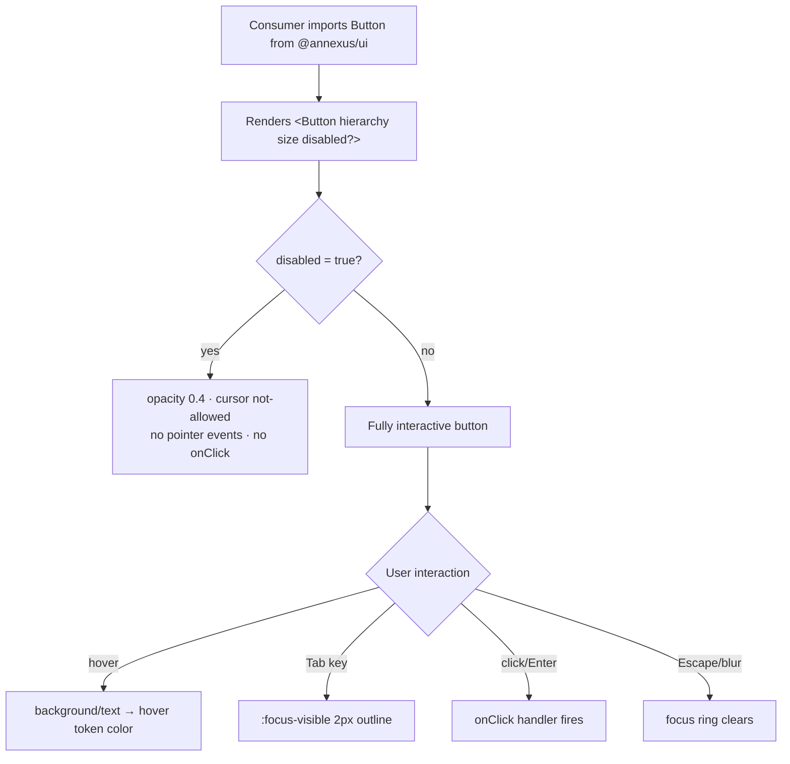

### Story 1.1: Button

**File**: `docs/plans/stories/epic-1-story-1.1-button.md`

**BUILDID**: CYCLE-2 | **AzureDevOps**: #23651 | **Epic**: 1 - P0 ATOM COMPONENTS | **ID**: 1.1 | **Date**: 2026-10-12
**Wave**: 4
**Requires**: [3.6]
**Enables**: [2.4]
**Files Touched**:
  - src/components/Button/Button.tsx
  - src/components/Button/Button.types.ts
  - src/components/Button/Button.scss
  - src/components/Button/Button.stories.tsx
  - src/components/Button/Button.test.tsx
  - src/components/Button/index.ts
  - src/index.ts
**Roles Ref**: docs/requirements.md#roles--permissions-matrix — single-actor — no role variation
**QA Candidate**: Yes — **Observable:** all 7 button hierarchies × 3 sizes × 4 interaction states (Default, Hover, Disabled, Focus) render with correct token-derived colors, heights, border-radius, and shadow; disabled state removes interactivity with no visual hover; `:focus-visible` outline appears on keyboard focus only, not on mouse click. **Mechanism:** `Button` renders a native `<button>` with BEM modifier classes (`annexus-button--{hierarchy}`, `annexus-button--{size}`, `annexus-button--disabled`); SCSS reads CSS custom properties from the CYCLE-1 token layer; `React.forwardRef` forwards the `ref` to the underlying DOM `<button>` node. **Authz & preconditions:** no RBAC — single actor; the `disabled` prop is the only interaction guard — it sets the native `disabled` attribute (removes from tab order) and `pointer-events: none`. **Edge/idempotency:** clicking a disabled button fires no `onClick` event; rendering with no `children` produces a valid but empty button (no crash); each click fires `onClick` exactly once with no side-effects on the component's internal state. **Regression:** Chromatic snapshots cover all 7 hierarchies × 4 states; unit tests assert disabled click suppression, `onClick` fires on enabled, ref forwarding resolves to the DOM element, and aria attributes are correct; a11y audit verifies `role="button"`, `:focus-visible` 2px outline, and ≥24×24px touch target per WCAG 2.5.8.

> **Styling (CR-001, 2026-10-20)**: wherever this story says `var(--annexus-*)`, `src/tokens/` or a hex value, implement it as a **design variable** instead. Add `$<section><Element><State><Property>` (camelCase, section-prefixed, never repeated) to `src/styles/design.variables.scss`, pointing to a color in `src/styles/pallete.color.scss`, and `@use '../../styles/design.variables' as *;` in the component SCSS. Component SCSS never uses hex values or palette variables. Every new design variable is also added to `src/styles/design.variables.module.scss` so it is exported to JS (`designVariables`). Fonts use `$fontFamilyBase` and section-named size/line-height/weight variables. Reference implementation: `src/components/Input/Input.scss`. Spec: Story 3.2.

---

#### 👤 User Reference

**Description**:
This story delivers the `Button` component — the primary call-to-action building block for the Athene Income Wellness Annuity Calculator. After this story, frontend engineers can import `Button` from `@annexus/ui` and render any of 7 visual styles (hierarchies), three sizes, and four interaction states. The component matches the approved Figma design pixel-for-pixel: brand-primary fill with skeuomorphic shadow for the Primary hierarchy, outlined styles for Secondary variants, borderless text-only for Tertiary variants, and underlined inline styles for Link variants. Engineers do not need to write custom CSS — design tokens are baked in. The component is accessible out of the box: it passes keyboard focus, shows a 2-pixel outline on Tab focus, suppresses all interaction when `disabled` is set, and is safe for assistive technologies. The `forwardRef` pattern lets consuming components access the underlying DOM node for focus management (e.g. the Modal story will programmatically focus a Button when the modal opens).

**Acceptance Criteria** (plain-English):
- Importing `Button` from `@annexus/ui` works in a fresh TypeScript project with zero type errors
- All 7 button styles render visually: Primary (dark blue filled), Secondary Color (blue-outlined), Secondary Gray (gray-outlined), Tertiary Color (blue text, no border), Tertiary Gray (gray text, no border), Link Color (underlined blue), Link Gray (underlined gray)
- Three sizes are available: `sm` (compact), `md` (standard, 44px height), `lg` (larger touch target)
- Hovering an enabled button changes the background or text color to the documented hover token
- A disabled button looks faded (40% opacity), shows a "not-allowed" cursor, and clicking it does nothing
- Pressing Tab to focus the button shows a 2-pixel blue outline; clicking the button with a mouse does not show any outline
- Passing a `ref` to `<Button ref={myRef}>` correctly gives access to the underlying DOM button element
- All button states are browsable in Storybook with live controls to switch hierarchy, size, and disabled
- No accessibility violations are reported by the Storybook a11y addon for any variant

**User Journey** (no role variation — single actor: Consumer / Frontend Engineer):
- **Import**: engineer installs `@annexus/ui` and writes `import { Button } from '@annexus/ui'`; TypeScript surfaces the `ButtonProps` interface with autocompletion for `hierarchy`, `size`, and `disabled` — no need to look up documentation.
- **Render**: `<Button hierarchy="primary" size="md">Get Quote</Button>` renders a 44px-tall dark-blue button with the skeuomorphic inset shadow from the Figma design; all 7 hierarchy values produce the documented visual style.
- **Interact**: clicking the button fires the passed `onClick` handler; hovering transitions the background to the hover token color within 150ms; pressing Tab shows the 2px blue `:focus-visible` outline; clicking with the mouse does not show the outline.
- **Disabled**: setting `disabled` renders the button at 40% opacity, replaces the cursor with "not-allowed", and ensures no click events fire — even if the consumer attaches an `onClick`, it is silently suppressed.
- **Storybook discovery**: browsing `http://localhost:6006` → Button shows every hierarchy as a named story; Knobs/Controls panel lets engineers change hierarchy, size, and disabled live; the a11y tab shows zero violations; Chromatic snapshots exist for each state.
- **Edge — no children**: `<Button />` renders a valid, accessible but empty button without crashing; engineers are expected to supply `children` but the component degrades gracefully.

**Flow Diagram**:



---

#### 🤖 AI Agent Reference

**Must Read**:
- `docs/ui-ux/ui-ux-spec.md` — design tokens: brand colors, border-radius sm=3px, shadow-xs-skeuomorphic, typography weights, spacing scale
- `docs/ui-ux/03-inspiration.md` — Figma-extracted dimensions: control height 44px, padding-x 12–14px, padding-y 8px, border-radius 3px
- `docs/architecture/design/01-patterns-and-standards-greenfield.md` — BEM naming (`annexus-{component}__{element}--{modifier}`), CSS custom property usage, `forwardRef` pattern, CSF3 story format, Vitest AAA pattern
- `docs/plans/builds/cycle-2/cycle-plan.md` — CYCLE-2 scope and acceptance criteria for P0 components

**Design Tokens**:
- **Colors**:
  - Primary bg: `--annexus-color-brand-primary: #11175E`
  - Primary hover: `--annexus-color-brand-hover: #1B3E80`
  - CTA (Secondary/Tertiary/Link Color): `--annexus-color-brand-cta: #0167AC`
  - White (Primary text): `--annexus-color-white: #FFFFFF`
  - Gray-300 (Secondary Gray border): `--annexus-color-gray-300: #D5D7DA`
  - Gray-500 (Link Gray text): `--annexus-color-gray-500: #717680`
  - Gray-700 (Secondary/Tertiary Gray text): `--annexus-color-gray-700: #404042`
  - Gray-50 (Secondary Gray hover bg): `--annexus-color-gray-50: #FAFAFA`
  - Gray-100 (Tertiary Gray hover bg): `--annexus-color-gray-100: #F5F5F5`
- **Elevation**: `--annexus-shadow-xs-skeuomorphic` (Primary Default state only)
- **Border radius**: `--annexus-radius-sm: 3px`
- **Typography**: `--annexus-font-family: 'Assistant', sans-serif`; weight 600 (labels); sm scale (14px/20px) for sm+md, md scale (16px/24px) for lg
- **Spacing** (from Figma): padding-y 8px, padding-x 12px (sm) / 14px (md/lg)
- **Touch targets**: md min-height 44px, lg min-height 48px, sm min-height 32px; WCAG 2.5.8 — all ≥24px in both axes

**Description**:
This story implements the `Button` React component as a self-contained vertical slice: TypeScript types, the component, SCSS styles using design tokens, Storybook CSF3 stories, and Vitest unit tests. The Button renders a native `<button>` element styled via BEM modifier classes driven by `hierarchy` and `size` props, reads every color and spacing value from CSS custom properties defined in the token layer (from CYCLE-1), and uses `React.forwardRef` so callers (including the CYCLE-2 Modal) can obtain the underlying DOM reference. The seven hierarchies map directly to the Figma component variants: Primary is the brand-primary filled CTA; Secondary variants add a border on a transparent background; Tertiary variants remove the border; Link variants render as inline underlined text. All interactive elements receive a `:focus-visible` outline per WCAG 2.4.11; disabled state uses the native `disabled` attribute so the element is correctly removed from the tab order.

**Acceptance Criteria** (comprehensive):
- `Button` is exported from `@annexus/ui` barrel (`src/index.ts`) as a named export
- `ButtonProps` TypeScript interface is exported from `src/components/Button/Button.types.ts`
- All 7 hierarchy values (`primary`, `secondary-color`, `secondary-gray`, `tertiary-color`, `tertiary-gray`, `link-color`, `link-gray`) render without TypeScript errors
- All 3 size values (`sm`, `md`, `lg`) render; `md` produces `min-height: 44px` (WCAG 2.5.8 / Figma spec)
- Primary hierarchy applies `background-color: var(--annexus-color-brand-primary)` and `box-shadow: var(--annexus-shadow-xs-skeuomorphic)` in the Default state
- Hover on Primary changes background to `var(--annexus-color-brand-hover)` via CSS transition (`:hover:not(:disabled)` guard)
- `disabled` prop sets native `disabled` attribute AND `aria-disabled="true"` on the `<button>` element
- A disabled button renders at 40% opacity (`opacity: 0.4`) and `cursor: not-allowed`
- Clicking a disabled button fires no `onClick` — verified by both unit test and `pointer-events: none` CSS rule
- `:focus-visible` applies `outline: 2px solid var(--annexus-color-brand-primary)` with `outline-offset: 2px`; `:focus:not(:focus-visible)` shows no outline (mouse-click focus invisible)
- `React.forwardRef` correctly forwards `ref` to the underlying `<button>` DOM node — tested with `React.createRef`
- Link hierarchy variants (`link-color`, `link-gray`) have `text-decoration: underline` and no horizontal padding
- All HTML attributes passable via `ButtonHTMLAttributes<HTMLButtonElement>` spread (e.g., `type`, `form`, `aria-*`)
- Vitest coverage ≥ 90% (lines, branches, functions, statements) for all Button files
- CSF3 Storybook stories: one story per hierarchy + a Disabled matrix story + a Sizes matrix story
- Storybook a11y addon reports zero violations on all Button stories
- `pnpm build` succeeds with Button in the ESM + CJS output

**RBAC Enforcement**:
No role-differentiated access — single actor.

**System responses + error cases**:

| Trigger | Response | Side-effect |
|---------|----------|-------------|
| Enabled button clicked (`onClick` prop set) | `onClick` handler invoked with native `MouseEvent`; button remains in current visual state | none — component is stateless |
| Enabled button clicked (`onClick` prop absent) | No event emitted; renders without error | none |
| Keyboard Enter/Space on focused enabled button | `onClick` fires (native `<button>` behavior) | none |
| Hover over enabled button | `:hover:not(:disabled)` CSS rule transitions background/text to hover token | none — pure CSS |
| Tab to button (keyboard focus) | `:focus-visible` 2px outline appears | none |
| Click button with mouse then inspect | `:focus:not(:focus-visible)` — no outline rendered (mouse-click focus is not `:focus-visible`) | none |
| `disabled={true}` button clicked | No `onClick` fires; `pointer-events: none` blocks all mouse events; element removed from tab order via native `disabled` attribute | none |
| `disabled={true}` button hovered | `:hover:not(:disabled)` guard prevents hover style change; `cursor: not-allowed` shown | none |
| `children` not provided (`<Button />`) | Empty button renders without crash; no content inside the button element | none |
| Unknown `hierarchy` value at runtime (JS only, TS prevents at compile time) | BEM class `annexus-button--undefined` applied; falls back to unmodified base styles | none |

**QA-observable behaviour**:
- Primary Default button computed `background-color` equals `rgb(17, 23, 94)` (`#11175E`); Primary Hover computed `background-color` equals `rgb(27, 62, 128)` (`#1B3E80`).
- `md` Button computed `min-height` equals `44px`; `sm` equals `32px`; `lg` equals `48px`.
- Disabled button: `button.disabled === true` in the DOM; computed `opacity` equals `0.4`; computed `pointer-events` equals `none`; element is NOT in the tab sequence.
- After keyboard Tab to a Primary button, `document.activeElement === buttonEl` AND the CSS `:focus-visible` pseudo-class is matched (`document.querySelector('.annexus-button:focus-visible')` returns the element); after mouse click + blur, that selector returns `null`.
- `React.createRef()` forwarded to `<Button ref={myRef}>` — `myRef.current` is an `HTMLButtonElement` instance (not `null`) after mount.
- Link hierarchy buttons: computed `text-decoration` includes `underline`; computed `padding-left` and `padding-right` equal `0px`.
- **What does NOT change**: no component internal state changes on any render; the DOM `<button>` element's `type` attribute defaults to `"button"` (prevents accidental form submission unless consumer explicitly sets `type="submit"`).

**Prerequisites**:
- CYCLE-1 complete: `src/styles/pallete.color.scss` and `src/styles/design.variables.scss` exist (Story 3.2); button variables are added there by this story
- `src/index.ts` barrel file exists (created in CYCLE-1 foundation)
- Storybook 8.x configured and running (`pnpm storybook`)
- Vitest + React Testing Library installed and configured in `vitest.config.ts`
- `clsx` package available in `package.json` (or equivalent `classNames` utility in `src/utils/classNames.ts`)

**Context**:
- `docs/ui-ux/ui-ux-spec.md`
- `docs/ui-ux/03-inspiration.md`
- `docs/architecture/design/01-patterns-and-standards-greenfield.md`
- `docs/plans/builds/cycle-2/cycle-plan.md`

**Patterns**: BEM naming, CSS custom properties, `forwardRef`, CSF3 Storybook stories, Vitest AAA — see `docs/architecture/design/01-patterns-and-standards-greenfield.md`

**Steps**:

1. **Create the component directory**:
   ```bash
   mkdir -p src/components/Button
   ```

2. **Create `src/components/Button/Button.types.ts`** — define all exported types:
   ```typescript
   export type ButtonHierarchy =
     | 'primary'
     | 'secondary-color'
     | 'secondary-gray'
     | 'tertiary-color'
     | 'tertiary-gray'
     | 'link-color'
     | 'link-gray';

   export type ButtonSize = 'sm' | 'md' | 'lg';

   export interface ButtonProps
     extends React.ButtonHTMLAttributes<HTMLButtonElement> {
     /** Visual style hierarchy — matches Figma component variants */
     hierarchy?: ButtonHierarchy;
     /** Height/padding scale */
     size?: ButtonSize;
     children?: React.ReactNode;
   }
   ```

3. **Create `src/components/Button/Button.tsx`** — forwardRef component:
   ```tsx
   import React, { forwardRef } from 'react';
   import clsx from 'clsx';
   import type { ButtonProps } from './Button.types';
   import './Button.scss';

   const Button = forwardRef<HTMLButtonElement, ButtonProps>(
     (
       {
         hierarchy = 'primary',
         size = 'md',
         disabled = false,
         className,
         children,
         type = 'button',
         ...rest
       },
       ref
     ) => (
       <button
         ref={ref}
         type={type}
         className={clsx(
           'annexus-button',
           `annexus-button--${hierarchy}`,
           `annexus-button--${size}`,
           { 'annexus-button--disabled': disabled },
           className
         )}
         disabled={disabled}
         aria-disabled={disabled || undefined}
         {...rest}
       >
         {children}
       </button>
     )
   );

   Button.displayName = 'Button';

   export { Button };
   ```
   > Default `type="button"` prevents accidental form submission — override with `type="submit"` explicitly.

4. **Create `src/components/Button/Button.scss`** — token-referenced BEM styles:
   ```scss
   .annexus-button {
     display: inline-flex;
     align-items: center;
     justify-content: center;
     border-radius: var(--annexus-radius-sm, 3px);
     font-family: var(--annexus-font-family, 'Assistant', sans-serif);
     font-weight: 600;
     cursor: pointer;
     border: 1px solid transparent;
     transition: background-color 0.15s ease, border-color 0.15s ease,
                 color 0.15s ease, opacity 0.15s ease;
     white-space: nowrap;
     text-decoration: none;
     line-height: 1;

     // ── Sizes ─────────────────────────────────────────────────────────────
     &--sm {
       padding: 4px 12px;
       font-size: 14px;
       line-height: 20px;
       min-height: 32px;
       min-width: 24px; // WCAG 2.5.8 minimum
     }

     &--md {
       padding: 8px 14px;
       font-size: 14px;
       line-height: 20px;
       min-height: 44px; // Figma spec — control height
       min-width: 24px;
     }

     &--lg {
       padding: 10px 18px;
       font-size: 16px;
       line-height: 24px;
       min-height: 48px; // comfortable touch target
       min-width: 24px;
     }

     // ── Focus (WCAG 2.4.11) ───────────────────────────────────────────────
     &:focus-visible {
       outline: 2px solid var(--annexus-color-brand-primary, #11175E);
       outline-offset: 2px;
     }

     // ── Hierarchies ───────────────────────────────────────────────────────
     &--primary {
       background-color: var(--annexus-color-brand-primary, #11175E);
       color: var(--annexus-color-white, #ffffff);
       border-color: transparent;
       box-shadow: var(
         --annexus-shadow-xs-skeuomorphic,
         0px 1px 2px 0px rgba(16, 24, 40, 0.05),
         inset 0px -2px 0px rgba(10, 13, 18, 0.05),
         inset 0px 0px 0px 1px rgba(10, 13, 18, 0.18)
       );

       &:hover:not(:disabled) {
         background-color: var(--annexus-color-brand-hover, #1b3e80);
       }
     }

     &--secondary-color {
       background-color: transparent;
       color: var(--annexus-color-brand-cta, #0167ac);
       border-color: var(--annexus-color-brand-cta, #0167ac);

       &:hover:not(:disabled) {
         background-color: rgba(1, 103, 172, 0.08);
       }
     }

     &--secondary-gray {
       background-color: transparent;
       color: var(--annexus-color-gray-700, #404042);
       border-color: var(--annexus-color-gray-300, #d5d7da);

       &:hover:not(:disabled) {
         background-color: var(--annexus-color-gray-50, #fafafa);
       }
     }

     &--tertiary-color {
       background-color: transparent;
       color: var(--annexus-color-brand-cta, #0167ac);
       border-color: transparent;

       &:hover:not(:disabled) {
         background-color: rgba(1, 103, 172, 0.08);
       }
     }

     &--tertiary-gray {
       background-color: transparent;
       color: var(--annexus-color-gray-700, #404042);
       border-color: transparent;

       &:hover:not(:disabled) {
         background-color: var(--annexus-color-gray-100, #f5f5f5);
       }
     }

     &--link-color {
       background-color: transparent;
       color: var(--annexus-color-brand-cta, #0167ac);
       border-color: transparent;
       text-decoration: underline;
       padding-left: 0;
       padding-right: 0;
       min-height: unset; // link variant — no enforced height

       &:hover:not(:disabled) {
         color: var(--annexus-color-brand-hover, #1b3e80);
       }
     }

     &--link-gray {
       background-color: transparent;
       color: var(--annexus-color-gray-500, #717680);
       border-color: transparent;
       text-decoration: underline;
       padding-left: 0;
       padding-right: 0;
       min-height: unset;

       &:hover:not(:disabled) {
         color: var(--annexus-color-gray-700, #404042);
       }
     }

     // ── Disabled ──────────────────────────────────────────────────────────
     &--disabled,
     &:disabled {
       opacity: 0.4;
       cursor: not-allowed;
       pointer-events: none;
     }
   }
   ```

5. **Create `src/components/Button/Button.stories.tsx`** — CSF3 format, all variants documented:
   ```tsx
   import type { Meta, StoryObj } from '@storybook/react';
   import { Button } from './Button';

   const meta: Meta<typeof Button> = {
     title: 'Atoms/Button',
     component: Button,
     parameters: {
       layout: 'centered',
       docs: {
         description: {
           component:
             '7-hierarchy Button matching Figma ANXSF605 variants. Sizes: sm/md/lg. All interactive states accessible via keyboard.',
         },
       },
     },
     argTypes: {
       hierarchy: {
         control: 'select',
         options: [
           'primary',
           'secondary-color',
           'secondary-gray',
           'tertiary-color',
           'tertiary-gray',
           'link-color',
           'link-gray',
         ],
       },
       size: { control: 'select', options: ['sm', 'md', 'lg'] },
       disabled: { control: 'boolean' },
     },
     tags: ['autodocs'],
   };

   export default meta;
   type Story = StoryObj<typeof Button>;

   export const Primary: Story = {
     args: { hierarchy: 'primary', size: 'md', children: 'Get Quote' },
   };

   export const SecondaryColor: Story = {
     args: { hierarchy: 'secondary-color', size: 'md', children: 'Learn More' },
   };

   export const SecondaryGray: Story = {
     args: { hierarchy: 'secondary-gray', size: 'md', children: 'Cancel' },
   };

   export const TertiaryColor: Story = {
     args: { hierarchy: 'tertiary-color', size: 'md', children: 'View Details' },
   };

   export const TertiaryGray: Story = {
     args: { hierarchy: 'tertiary-gray', size: 'md', children: 'Skip' },
   };

   export const LinkColor: Story = {
     args: { hierarchy: 'link-color', size: 'md', children: 'Read the fine print' },
   };

   export const LinkGray: Story = {
     args: { hierarchy: 'link-gray', size: 'md', children: 'More info' },
   };

   export const Disabled: Story = {
     args: { hierarchy: 'primary', size: 'md', disabled: true, children: 'Disabled' },
   };

   export const SizeMatrix: Story = {
     render: () => (
       <div style={{ display: 'flex', gap: '12px', alignItems: 'center' }}>
         <Button hierarchy="primary" size="sm">Small</Button>
         <Button hierarchy="primary" size="md">Medium</Button>
         <Button hierarchy="primary" size="lg">Large</Button>
       </div>
     ),
   };

   export const AllHierarchies: Story = {
     render: () => (
       <div style={{ display: 'flex', flexDirection: 'column', gap: '12px', alignItems: 'flex-start' }}>
         {(
           [
             'primary',
             'secondary-color',
             'secondary-gray',
             'tertiary-color',
             'tertiary-gray',
             'link-color',
             'link-gray',
           ] as const
         ).map((h) => (
           <Button key={h} hierarchy={h} size="md">
             {h}
           </Button>
         ))}
       </div>
     ),
   };
   ```

6. **Create `src/components/Button/Button.test.tsx`** — Vitest + RTL, AAA pattern:
   ```tsx
   import { describe, it, expect, vi } from 'vitest';
   import { render, screen, fireEvent } from '@testing-library/react';
   import userEvent from '@testing-library/user-event';
   import React from 'react';
   import { Button } from './Button';

   describe('Button', () => {
     // ── Rendering ────────────────────────────────────────────────────────
     it('renders children text', () => {
       render(<Button>Click me</Button>);
       expect(screen.getByRole('button', { name: 'Click me' })).toBeInTheDocument();
     });

     it('renders with default hierarchy=primary and size=md', () => {
       render(<Button>Label</Button>);
       const btn = screen.getByRole('button');
       expect(btn).toHaveClass('annexus-button--primary');
       expect(btn).toHaveClass('annexus-button--md');
     });

     it.each([
       'primary',
       'secondary-color',
       'secondary-gray',
       'tertiary-color',
       'tertiary-gray',
       'link-color',
       'link-gray',
     ] as const)('applies BEM class for hierarchy="%s"', (hierarchy) => {
       render(<Button hierarchy={hierarchy}>Label</Button>);
       expect(screen.getByRole('button')).toHaveClass(`annexus-button--${hierarchy}`);
     });

     it.each(['sm', 'md', 'lg'] as const)('applies BEM class for size="%s"', (size) => {
       render(<Button size={size}>Label</Button>);
       expect(screen.getByRole('button')).toHaveClass(`annexus-button--${size}`);
     });

     it('defaults type to "button" to prevent accidental form submission', () => {
       render(<Button>Submit</Button>);
       expect(screen.getByRole('button')).toHaveAttribute('type', 'button');
     });

     // ── Disabled ─────────────────────────────────────────────────────────
     it('disabled prop sets native disabled attribute', () => {
       render(<Button disabled>Disabled</Button>);
       expect(screen.getByRole('button')).toBeDisabled();
     });

     it('disabled prop applies --disabled BEM modifier class', () => {
       render(<Button disabled>Disabled</Button>);
       expect(screen.getByRole('button')).toHaveClass('annexus-button--disabled');
     });

     it('disabled prop sets aria-disabled="true"', () => {
       render(<Button disabled>Disabled</Button>);
       expect(screen.getByRole('button')).toHaveAttribute('aria-disabled', 'true');
     });

     it('does not fire onClick when disabled', async () => {
       const onClick = vi.fn();
       const user = userEvent.setup();
       render(<Button disabled onClick={onClick}>Disabled</Button>);
       await user.click(screen.getByRole('button'));
       expect(onClick).not.toHaveBeenCalled();
     });

     // ── Interaction ───────────────────────────────────────────────────────
     it('fires onClick when enabled and clicked', async () => {
       const onClick = vi.fn();
       const user = userEvent.setup();
       render(<Button onClick={onClick}>Click</Button>);
       await user.click(screen.getByRole('button'));
       expect(onClick).toHaveBeenCalledTimes(1);
     });

     it('fires onClick exactly once per click', async () => {
       const onClick = vi.fn();
       const user = userEvent.setup();
       render(<Button onClick={onClick}>Click</Button>);
       await user.click(screen.getByRole('button'));
       await user.click(screen.getByRole('button'));
       expect(onClick).toHaveBeenCalledTimes(2);
     });

     // ── forwardRef ────────────────────────────────────────────────────────
     it('forwards ref to the underlying button DOM element', () => {
       const ref = React.createRef<HTMLButtonElement>();
       render(<Button ref={ref}>Ref</Button>);
       expect(ref.current).toBeInstanceOf(HTMLButtonElement);
     });

     // ── Passthrough props ─────────────────────────────────────────────────
     it('passes arbitrary HTML attributes to the button element', () => {
       render(<Button data-testid="my-btn" aria-label="custom label">Label</Button>);
       const btn = screen.getByTestId('my-btn');
       expect(btn).toHaveAttribute('aria-label', 'custom label');
     });

     it('merges custom className with BEM classes', () => {
       render(<Button className="my-class">Label</Button>);
       const btn = screen.getByRole('button');
       expect(btn).toHaveClass('annexus-button');
       expect(btn).toHaveClass('my-class');
     });

     // ── Edge cases ────────────────────────────────────────────────────────
     it('renders without crashing when no children provided', () => {
       render(<Button />);
       expect(screen.getByRole('button')).toBeInTheDocument();
     });
   });
   ```

7. **Create `src/components/Button/index.ts`** — component barrel:
   ```typescript
   export { Button } from './Button';
   export type { ButtonProps, ButtonHierarchy, ButtonSize } from './Button.types';
   ```

8. **Update `src/index.ts`** — add Button to the public API barrel (append, do not overwrite other exports):
   ```typescript
   export * from './components/Button';
   ```

9. **Run tests and verify coverage**:
   ```bash
   pnpm test --coverage --reporter=verbose src/components/Button
   ```
   Assert: all tests green; coverage ≥ 90% lines/branches/functions/statements. Paste the coverage table as completion evidence.

10. **Run Storybook and verify a11y**:
    ```bash
    pnpm storybook
    ```
    Open each Button story; Storybook a11y tab must show zero violations. Chromatic snapshot captured on CI push.

**Tests** (manual):
- Open Storybook → Atoms/Button → Primary: verify dark blue background (`#11175E`), white text, inset shadow
- Tab to the button: 2px blue outline visible; click with mouse: no outline
- Hover Primary: background transitions to `#1B3E80`
- Render disabled: 40% opacity, "not-allowed" cursor, click fires nothing
- Verify Secondary Color: transparent bg, CTA blue (`#0167AC`) border and text
- Verify Link Color: underlined text, no horizontal padding, no border
- Inspect DOM: `type="button"` on all Button instances unless overridden

**Quality**: ESLint 0 errors, `pnpm type-check` 0 errors, Vitest coverage ≥ 90%, Storybook a11y addon zero violations, Chromatic snapshot approved

**OUT**:
- ❌ No icon support inside Button (icon buttons are out of scope for Story 1.1 — defer to consuming molecules in CYCLE-3)
- ❌ No loading/spinner state (consuming app owns loading — design system components are display-only)
- ❌ No animation beyond CSS transitions (AnimatedValues is a P2 organism)
- ❌ No ButtonGroup layout (CYCLE-3 P1 — Story 3.x)
- ❌ No Figma Code Connect for this story (optional enhancement, not a CYCLE-2 requirement)

**Evidence**:
- Vitest coverage output (≥90% all metrics) for `src/components/Button/**`
- Screenshot of all 7 hierarchy stories in Storybook a11y tab (zero violations)
- Chromatic snapshot URL for Button stories
- `pnpm build` output confirming Button in ESM + CJS bundle
