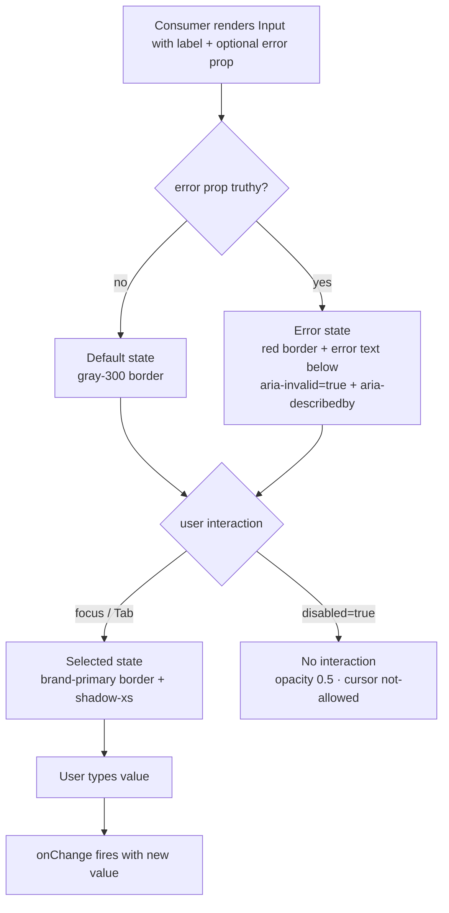

### Story 1.2: Input

**File**: `docs/plans/stories/epic-1-story-1.2-input.md`

**BUILDID**: CYCLE-2 | **AzureDevOps**: #23652 | **Epic**: 1 - P0 ATOM COMPONENTS | **ID**: 1.2 | **Date**: 2026-10-12
**Wave**: 4
**Requires**: [3.6]
**Enables**: [2.4]
**Files Touched**:
  - src/components/Input/Input.tsx
  - src/components/Input/Input.types.ts
  - src/components/Input/Input.scss
  - src/components/Input/Input.stories.tsx
  - src/components/Input/Input.test.tsx
  - src/components/Input/index.ts
  - src/index.ts
**Roles Ref**: docs/requirements.md#roles--permissions-matrix — single-actor — no role variation
**QA Candidate**: Yes — **Observable:** three visual states render correctly for all four Figma variants — Default (gray border), Selected/focus (brand-primary border + shadow-xs), and Error (red border + inline error text below the field); `aria-invalid` and `aria-describedby` are present on the DOM element in error state. **Mechanism:** `Input` wraps a native `<input>` element with a label, optional helper text, and optional error message; `forwardRef` forwards the ref to the `<input>` DOM node; error prop drives `aria-invalid`, a unique `errorId`, and the `aria-describedby` linkage. **Authz & preconditions:** no RBAC — single actor; no access guard — component is display-only with controlled/uncontrolled value. **Edge/idempotency:** passing an empty string as `error` does NOT trigger the error state (only a truthy non-empty string does); rendering without `label` produces a valid input (engineer must supply `aria-label` in that case); forwarded ref resolves to the `<input>` element, not the wrapper `<div>`. **Regression:** Chromatic snapshots cover Default / Selected / Error for all four Figma variants; unit tests assert aria-invalid toggling, aria-describedby linkage, disabled behavior, ref forwarding, and error message rendering; a11y audit verifies label association and keyboard focus.

> **Styling (CR-001, 2026-10-20)**: wherever this story says `var(--annexus-*)`, `src/tokens/` or a hex value, implement it as a **design variable** instead. Add `$<section><Element><State><Property>` (camelCase, section-prefixed, never repeated) to `src/styles/design.variables.scss`, pointing to a color in `src/styles/pallete.color.scss`, and `@use '../../styles/design.variables' as *;` in the component SCSS. Component SCSS never uses hex values or palette variables. Every new design variable is also added to `src/styles/design.variables.module.scss` so it is exported to JS (`designVariables`). Fonts use `$fontFamilyBase` and section-named size/line-height/weight variables. Reference implementation: `src/components/Input/Input.scss`. Spec: Story 3.2.

---

#### 👤 User Reference

**Description**:
This story delivers the `Input` component — the text field building block for the Athene calculator's four numeric entry fields (current age, current monthly need, income start age, and inflation rate). After this story, frontend engineers can import `Input` from `@annexus/ui` and render any of the three documented states: Default (a clean field ready for entry), Selected (focused, highlighted with a brand-colored border), and Error (with a red border and an inline error message displayed below the field). The component is fully accessible: labels are programmatically associated with the input, error messages are wired to the field via `aria-describedby` so screen readers announce them on focus, and `aria-invalid` signals the error state to assistive technologies. Engineers pass the error message as a prop — the component handles all the markup and ARIA wiring automatically.

**Acceptance Criteria** (plain-English):
- Importing `Input` from `@annexus/ui` works in a fresh TypeScript project with zero type errors
- Three visual states render correctly: Default (gray border), Selected (brand-primary border + shadow when focused), Error (red border + red error text below)
- The error message appears inline directly below the field when the `error` prop is a non-empty string
- When `error` is provided, the input border turns red and the field is marked as invalid for screen readers
- The label is visually associated with the input — clicking the label moves focus to the field
- Passing `disabled` grays the field and prevents typing or interaction
- A `ref` passed to `<Input ref={myRef}>` gives direct access to the underlying `<input>` DOM element
- All four Figma-named variants (currentAge, currentMonthlyNeed, incomeStartAge, inflationRate) are demonstrated as Storybook stories
- No accessibility violations are reported by the Storybook a11y addon for any state
- Passing an empty string as `error` does NOT show the error state — only a truthy non-empty string triggers it

**User Journey** (no role variation — single actor: Consumer / Frontend Engineer):
- **Import**: engineer writes `import { Input } from '@annexus/ui'`; TypeScript surfaces `InputProps` with autocompletion for `label`, `error`, `helperText`, `disabled`, and all standard HTML input attributes.
- **Default render**: `<Input label="Current Age" placeholder="e.g. 45" />` renders a 44px-tall field with a gray-300 border, the label above it, and the placeholder text inside — no error indicators.
- **Selected/focus**: user clicks or Tabs into the field — border transitions to brand-primary color and a shadow-xs appears under the field; label stays visible above; typing updates the value.
- **Error state**: engineer sets `error="Age must be between 18 and 99"` — the border turns red, the error text appears in red below the field, `aria-invalid="true"` is set on the `<input>`, and a screen reader announces the error when the field is focused.
- **Disabled**: `<Input label="Inflation Rate" disabled />` renders the field visually dimmed at 50% opacity; clicking or tabbing does not activate it; no error or focus state is reachable.
- **Edge — no label**: `<Input aria-label="Current Age" />` renders a valid, accessible input without a visible label element; no crash, no missing-label a11y violation because `aria-label` satisfies the accessibility requirement.

**Flow Diagram**:



---

#### 🤖 AI Agent Reference

**Must Read**:
- `docs/ui-ux/ui-ux-spec.md` — design tokens: colors, border-radius md=4px, shadow-xs, typography sm/xs scales
- `docs/ui-ux/03-inspiration.md` — Figma dimensions: control height 44px, padding-x 12–14px, padding-y 8px, border-radius 4px; error color #B73B3B from `Need (error)` Figma variable
- `docs/architecture/design/01-patterns-and-standards-greenfield.md` — BEM naming, CSS custom property usage, `forwardRef` pattern, CSF3 stories, Vitest AAA

**Design Tokens**:
- **Colors**:
  - Default border: `--annexus-color-gray-300: #D5D7DA`
  - Focus/selected border: `--annexus-color-brand-primary: #11175E`
  - Error border + error text: `--annexus-color-error: #B73B3B`
  - Label text: `--annexus-color-gray-700: #404042`
  - Placeholder: `--annexus-color-gray-400: #A4A7AE`
  - Input text: `--annexus-color-gray-900: #181D27`
  - Disabled background: `--annexus-color-gray-100: #F5F5F5`
  - White background: `--annexus-color-white: #FFFFFF`
- **Elevation**: `--annexus-shadow-xs: 0px 1px 2px rgba(10,13,18,0.05)` (focus state)
- **Border radius**: `--annexus-radius-md: 4px` (Input uses md per Figma)
- **Typography**: label — 14px/20px weight 600 (`--annexus-font-family`); input text — 14px/20px weight 400; error — 12px/18px weight 400
- **Spacing**: padding-y 8px, padding-x 12px; field min-height 44px; gap between label and field 4px; gap between field and error text 4px

**Description**:
This story implements the `Input` React component as a labelled text field with three visual states (Default, Selected, Error) matching the Figma source. The component renders a `<div>` wrapper containing a `<label>`, the native `<input>`, and an optional error `<span>`. The `error` prop (a string) drives the error state: when truthy, the component generates a stable `errorId` (`${id}-error`), sets `aria-invalid="true"` on the `<input>`, and links the error span via `aria-describedby`. `forwardRef` passes the ref to the native `<input>` element so callers (including the CYCLE-2 Modal) can programmatically focus the field. The four Figma variant names (currentAge, currentMonthlyNeed, incomeStartAge, inflationRate) are represented as Storybook stories demonstrating different label + placeholder combinations — they are not a distinct type union in the API (all variants share the same props interface).

**Acceptance Criteria** (comprehensive):
- `Input` and `InputProps` are exported from the `@annexus/ui` barrel
- Default state: `border: 1px solid var(--annexus-color-gray-300)` on the input element
- Selected/focus state: `:focus-within` on the wrapper applies `border-color: var(--annexus-color-brand-primary)` and `box-shadow: var(--annexus-shadow-xs)`
- Error state (truthy `error` prop): `border-color: var(--annexus-color-error)` on input, `color: var(--annexus-color-error)` on error span, `aria-invalid="true"` on `<input>`, `aria-describedby="${id}-error"` on `<input>`
- Empty string `error=""` does NOT trigger error state — only `error.length > 0` does
- The `<label>` element has `htmlFor={id}` matching the `<input id={id}>` — clicking label moves focus to field
- `disabled` prop: sets native `disabled` attribute on `<input>`, applies `opacity: 0.5` and `cursor: not-allowed` on wrapper, no hover or focus styles reachable
- `forwardRef` resolves to the `<input>` DOM element (not the wrapper `<div>`)
- `helperText` prop renders a `<span>` below the field in gray-500 (12px) when no error is present; hidden when `error` is truthy (error takes priority)
- All `input` HTML attributes passable via spread (e.g. `type`, `value`, `onChange`, `min`, `max`, `step`, `autoComplete`)
- `min-height: 44px` on the `<input>` element
- `border-radius: var(--annexus-radius-md, 4px)` on the `<input>` element
- Vitest coverage ≥ 90% for all Input files
- CSF3 stories: Default, Selected (focused), Error, Disabled, and the four Figma variant configurations
- Storybook a11y addon zero violations on all Input stories

**RBAC Enforcement**:
No role-differentiated access — single actor.

**System responses + error cases**:

| Trigger | Response | Side-effect |
|---------|----------|-------------|
| Input rendered without `error` prop (Default state) | `<input>` has gray-300 border, no aria-invalid, no aria-describedby | none |
| User focuses field (Selected state) | `:focus-within` applies brand-primary border + shadow-xs | none — pure CSS |
| `error="<message>"` prop set (Error state) | Red border, error span appears, `aria-invalid="true"`, `aria-describedby="${id}-error"` | none |
| `error=""` (empty string) | No error state — renders as Default | none |
| User types in enabled field | `onChange` fires with `InputEvent`; value updates if controlled | none |
| `disabled={true}` field interacted with | No focus, no change events; input is non-interactive; native `disabled` attribute set | none |
| `label` prop absent, `aria-label` not provided | Input renders without visible label; a11y violation present (engineer must supply `aria-label`) | none — component does not enforce this at runtime |
| `forwardRef` consumer calls `ref.current.focus()` | Native input receives programmatic focus; Selected state CSS activates | none |
| Repeat renders with the same props | Identical DOM output — no additional DOM nodes or side-effects | none |

**QA-observable behaviour**:
- Default state: `getComputedStyle(inputEl).borderColor` reflects the gray-300 token value; `inputEl.getAttribute('aria-invalid')` returns `null` (not set).
- Error state: `inputEl.getAttribute('aria-invalid')` equals `"true"`; `inputEl.getAttribute('aria-describedby')` equals `"${id}-error"`; the error `<span id="${id}-error">` is present in the DOM with non-empty text content.
- Empty string `error=""`: `aria-invalid` is `null` and no error `<span>` is rendered.
- `disabled` state: `inputEl.disabled === true`; wrapper computed `opacity` equals `0.5`.
- `forwardRef`: `myRef.current` is an `HTMLInputElement` instance after mount.
- Label association: `label.htmlFor === inputEl.id` — clicking the label moves `document.activeElement` to the input.
- **What does NOT change**: no component internal state is mutated on re-render with the same props; the `id` used for label association and the error `id` are stable across re-renders (derived from the `id` prop or a stable fallback).

**Prerequisites**:
- CYCLE-1 complete: `src/styles/pallete.color.scss` and `src/styles/design.variables.scss` (Story 3.2). **Status**: implemented on branch `feat/cycle-2-story-1.2-input` (Input design variables, `Input.scss`, tests); merges after Story 3.6
- `src/index.ts` barrel exists
- Storybook 8.x configured; Vitest + RTL installed

**Context**:
- `docs/ui-ux/ui-ux-spec.md`
- `docs/ui-ux/03-inspiration.md`
- `docs/architecture/design/01-patterns-and-standards-greenfield.md`

**Patterns**: BEM naming, CSS custom properties, `forwardRef`, CSF3, Vitest AAA — see `docs/architecture/design/01-patterns-and-standards-greenfield.md`

**Steps**:

1. **Create the component directory**:
   ```bash
   mkdir -p src/components/Input
   ```

2. **Create `src/components/Input/Input.types.ts`**:
   ```typescript
   export interface InputProps
     extends Omit<React.InputHTMLAttributes<HTMLInputElement>, 'id'> {
     /** Visible label text — recommended; supply aria-label if omitted */
     label?: string;
     /** Stable id shared between <label htmlFor> and <input id> */
     id: string;
     /** Truthy string triggers Error state + aria-invalid + aria-describedby */
     error?: string;
     /** Supplementary hint text shown below field when no error is present */
     helperText?: string;
   }
   ```

3. **Create `src/components/Input/Input.tsx`**:
   ```tsx
   import React, { forwardRef } from 'react';
   import clsx from 'clsx';
   import type { InputProps } from './Input.types';
   import './Input.scss';

   const Input = forwardRef<HTMLInputElement, InputProps>(
     ({ label, id, error, helperText, disabled, className, ...rest }, ref) => {
       const hasError = Boolean(error && error.length > 0);
       const errorId = `${id}-error`;

       return (
         <div
           className={clsx('annexus-input', {
             'annexus-input--error': hasError,
             'annexus-input--disabled': disabled,
           })}
         >
           {label && (
             <label className="annexus-input__label" htmlFor={id}>
               {label}
             </label>
           )}
           <input
             ref={ref}
             id={id}
             className={clsx('annexus-input__field', className)}
             disabled={disabled}
             aria-invalid={hasError || undefined}
             aria-describedby={hasError ? errorId : undefined}
             {...rest}
           />
           {hasError && (
             <span id={errorId} className="annexus-input__error" role="alert">
               {error}
             </span>
           )}
           {!hasError && helperText && (
             <span className="annexus-input__helper">{helperText}</span>
           )}
         </div>
       );
     }
   );

   Input.displayName = 'Input';

   export { Input };
   ```

4. **Create `src/components/Input/Input.scss`**:
   ```scss
   .annexus-input {
     display: flex;
     flex-direction: column;
     gap: 4px;

     // ── Label ─────────────────────────────────────────────────────────────
     &__label {
       font-family: var(--annexus-font-family, 'Assistant', sans-serif);
       font-size: 14px;
       line-height: 20px;
       font-weight: 600;
       color: var(--annexus-color-gray-700, #404042);
     }

     // ── Field (the <input>) ───────────────────────────────────────────────
     &__field {
       width: 100%;
       min-height: 44px;
       padding: 8px 12px;
       border: 1px solid var(--annexus-color-gray-300, #d5d7da);
       border-radius: var(--annexus-radius-md, 4px);
       background-color: var(--annexus-color-white, #ffffff);
       font-family: var(--annexus-font-family, 'Assistant', sans-serif);
       font-size: 14px;
       line-height: 20px;
       font-weight: 400;
       color: var(--annexus-color-gray-900, #181d27);
       transition: border-color 0.15s ease, box-shadow 0.15s ease;
       box-sizing: border-box;
       outline: none;

       &::placeholder {
         color: var(--annexus-color-gray-400, #a4a7ae);
       }

       // Selected (focus) state
       &:focus {
         border-color: var(--annexus-color-brand-primary, #11175e);
         box-shadow: var(--annexus-shadow-xs, 0px 1px 2px rgba(10, 13, 18, 0.05));
       }

       // Focus-visible outline for keyboard nav (WCAG 2.4.11)
       &:focus-visible {
         outline: 2px solid var(--annexus-color-brand-primary, #11175e);
         outline-offset: 2px;
       }
     }

     // ── Error state ───────────────────────────────────────────────────────
     &--error &__field {
       border-color: var(--annexus-color-error, #b73b3b);

       &:focus {
         border-color: var(--annexus-color-error, #b73b3b);
         box-shadow: none;
       }
     }

     &__error {
       font-family: var(--annexus-font-family, 'Assistant', sans-serif);
       font-size: 12px;
       line-height: 18px;
       font-weight: 400;
       color: var(--annexus-color-error, #b73b3b);
     }

     // ── Helper text ───────────────────────────────────────────────────────
     &__helper {
       font-family: var(--annexus-font-family, 'Assistant', sans-serif);
       font-size: 12px;
       line-height: 18px;
       font-weight: 400;
       color: var(--annexus-color-gray-500, #717680);
     }

     // ── Disabled ──────────────────────────────────────────────────────────
     &--disabled {
       opacity: 0.5;
       cursor: not-allowed;

       .annexus-input__field {
         cursor: not-allowed;
         background-color: var(--annexus-color-gray-100, #f5f5f5);
         pointer-events: none;
       }
     }
   }
   ```

5. **Create `src/components/Input/Input.stories.tsx`**:
   ```tsx
   import type { Meta, StoryObj } from '@storybook/react';
   import { Input } from './Input';

   const meta: Meta<typeof Input> = {
     title: 'Atoms/Input',
     component: Input,
     parameters: { layout: 'centered' },
     tags: ['autodocs'],
     argTypes: {
       error: { control: 'text' },
       helperText: { control: 'text' },
       disabled: { control: 'boolean' },
     },
   };

   export default meta;
   type Story = StoryObj<typeof Input>;

   // Default state
   export const Default: Story = {
     args: { id: 'input-default', label: 'Current Age', placeholder: 'e.g. 45' },
   };

   // Error state
   export const ErrorState: Story = {
     args: {
       id: 'input-error',
       label: 'Current Age',
       placeholder: 'e.g. 45',
       error: 'Age must be between 18 and 99',
     },
   };

   // Disabled
   export const Disabled: Story = {
     args: { id: 'input-disabled', label: 'Current Age', placeholder: 'e.g. 45', disabled: true },
   };

   // With helper text
   export const WithHelperText: Story = {
     args: {
       id: 'input-helper',
       label: 'Inflation Rate',
       placeholder: 'e.g. 3.0',
       helperText: 'Annual percentage, typically 2–4%',
     },
   };

   // Figma variant — currentAge
   export const CurrentAge: Story = {
     args: { id: 'current-age', label: 'Current Age', placeholder: '45', type: 'number', min: 18, max: 99 },
   };

   // Figma variant — currentMonthlyNeed
   export const CurrentMonthlyNeed: Story = {
     args: {
       id: 'monthly-need',
       label: 'Current Monthly Need',
       placeholder: '$5,000',
       type: 'text',
       inputMode: 'numeric',
     },
   };

   // Figma variant — incomeStartAge
   export const IncomeStartAge: Story = {
     args: {
       id: 'income-start-age',
       label: 'Income Start Age',
       placeholder: '65',
       type: 'number',
       min: 50,
       max: 85,
     },
   };

   // Figma variant — inflationRate
   export const InflationRate: Story = {
     args: {
       id: 'inflation-rate',
       label: 'Inflation Rate',
       placeholder: '3.0%',
       type: 'text',
       inputMode: 'decimal',
     },
   };
   ```

6. **Create `src/components/Input/Input.test.tsx`**:
   ```tsx
   import { describe, it, expect, vi } from 'vitest';
   import { render, screen } from '@testing-library/react';
   import userEvent from '@testing-library/user-event';
   import React from 'react';
   import { Input } from './Input';

   describe('Input', () => {
     // ── Rendering ────────────────────────────────────────────────────────
     it('renders with label and input', () => {
       render(<Input id="age" label="Current Age" />);
       expect(screen.getByLabelText('Current Age')).toBeInTheDocument();
     });

     it('associates label with input via htmlFor / id', () => {
       render(<Input id="test-input" label="My Label" />);
       const input = screen.getByRole('textbox');
       expect(input).toHaveAttribute('id', 'test-input');
       expect(screen.getByText('My Label').tagName).toBe('LABEL');
       expect(screen.getByText('My Label')).toHaveAttribute('for', 'test-input');
     });

     it('renders placeholder text', () => {
       render(<Input id="age" label="Age" placeholder="e.g. 45" />);
       expect(screen.getByPlaceholderText('e.g. 45')).toBeInTheDocument();
     });

     it('renders without label (no crash when label absent)', () => {
       render(<Input id="no-label" aria-label="Age" />);
       expect(screen.getByRole('textbox')).toBeInTheDocument();
     });

     // ── Default state ─────────────────────────────────────────────────────
     it('does not have aria-invalid by default', () => {
       render(<Input id="age" label="Age" />);
       expect(screen.getByRole('textbox')).not.toHaveAttribute('aria-invalid');
     });

     it('does not render error span by default', () => {
       render(<Input id="age" label="Age" />);
       expect(screen.queryByRole('alert')).toBeNull();
     });

     // ── Error state ───────────────────────────────────────────────────────
     it('sets aria-invalid="true" when error prop is truthy', () => {
       render(<Input id="age" label="Age" error="Required" />);
       expect(screen.getByRole('textbox')).toHaveAttribute('aria-invalid', 'true');
     });

     it('sets aria-describedby linking to error span id', () => {
       render(<Input id="age" label="Age" error="Required" />);
       const input = screen.getByRole('textbox');
       expect(input).toHaveAttribute('aria-describedby', 'age-error');
       expect(document.getElementById('age-error')).toHaveTextContent('Required');
     });

     it('renders error message text', () => {
       render(<Input id="age" label="Age" error="Age must be 18–99" />);
       expect(screen.getByRole('alert')).toHaveTextContent('Age must be 18–99');
     });

     it('applies --error BEM class when error is truthy', () => {
       const { container } = render(<Input id="age" label="Age" error="Err" />);
       expect(container.firstChild).toHaveClass('annexus-input--error');
     });

     it('does NOT trigger error state when error is an empty string', () => {
       render(<Input id="age" label="Age" error="" />);
       expect(screen.getByRole('textbox')).not.toHaveAttribute('aria-invalid');
       expect(screen.queryByRole('alert')).toBeNull();
     });

     // ── Helper text ───────────────────────────────────────────────────────
     it('renders helperText when no error', () => {
       render(<Input id="rate" label="Rate" helperText="Annual percentage" />);
       expect(screen.getByText('Annual percentage')).toBeInTheDocument();
     });

     it('hides helperText when error is present (error takes priority)', () => {
       render(<Input id="rate" label="Rate" helperText="Annual %" error="Required" />);
       expect(screen.queryByText('Annual %')).toBeNull();
       expect(screen.getByRole('alert')).toBeInTheDocument();
     });

     // ── Disabled ──────────────────────────────────────────────────────────
     it('disabled prop sets native disabled on input', () => {
       render(<Input id="age" label="Age" disabled />);
       expect(screen.getByRole('textbox')).toBeDisabled();
     });

     it('applies --disabled BEM class when disabled', () => {
       const { container } = render(<Input id="age" label="Age" disabled />);
       expect(container.firstChild).toHaveClass('annexus-input--disabled');
     });

     // ── Interaction ───────────────────────────────────────────────────────
     it('fires onChange when user types', async () => {
       const onChange = vi.fn();
       const user = userEvent.setup();
       render(<Input id="age" label="Age" onChange={onChange} />);
       await user.type(screen.getByRole('textbox'), '45');
       expect(onChange).toHaveBeenCalled();
     });

     // ── forwardRef ────────────────────────────────────────────────────────
     it('forwards ref to the underlying input element', () => {
       const ref = React.createRef<HTMLInputElement>();
       render(<Input id="age" label="Age" ref={ref} />);
       expect(ref.current).toBeInstanceOf(HTMLInputElement);
     });

     // ── Passthrough props ─────────────────────────────────────────────────
     it('passes type, min, max attributes to the input element', () => {
       render(<Input id="age" label="Age" type="number" min={18} max={99} />);
       const input = screen.getByRole('spinbutton');
       expect(input).toHaveAttribute('type', 'number');
       expect(input).toHaveAttribute('min', '18');
       expect(input).toHaveAttribute('max', '99');
     });
   });
   ```

7. **Create `src/components/Input/index.ts`**:
   ```typescript
   export { Input } from './Input';
   export type { InputProps } from './Input.types';
   ```

8. **Update `src/index.ts`** — append:
   ```typescript
   export * from './components/Input';
   ```

9. **Run tests and verify coverage**:
   ```bash
   pnpm test --coverage --reporter=verbose src/components/Input
   ```
   All tests green; coverage ≥ 90%. Paste output as evidence.

**Tests** (manual):
- Storybook → Atoms/Input → Default: gray border, label above, placeholder inside — click label to confirm focus moves to field
- Tab to field: brand-primary border + shadow appear (Selected state)
- Set `error="Required"`: red border, red error text below; inspect DOM for `aria-invalid="true"` and matching `aria-describedby`
- Set `error=""`: no red border, no error text (empty string is not an error)
- Set `disabled`: dimmed, no focus on click or Tab

**Quality**: ESLint 0 errors, `pnpm type-check` 0 errors, Vitest coverage ≥ 90%, Storybook a11y addon zero violations, Chromatic snapshots approved for Default / Error / Disabled states

**OUT**:
- ❌ No masking or number formatting (e.g. currency `$1,234` formatting — consuming app's responsibility)
- ❌ No built-in validation logic (validation is prop-driven per ux_logic.validation in ui-ux-spec.md)
- ❌ No multi-line textarea variant (out of scope for this library version)
- ❌ No inline icon (prefix/suffix) inside the input field — defer to a wrapper molecule in CYCLE-3

**Evidence**:
- Vitest coverage output (≥90% all metrics) for `src/components/Input/**`
- Screenshot of Default / Error / Disabled stories in Storybook with a11y tab showing zero violations
- Chromatic snapshot URL for Input stories
