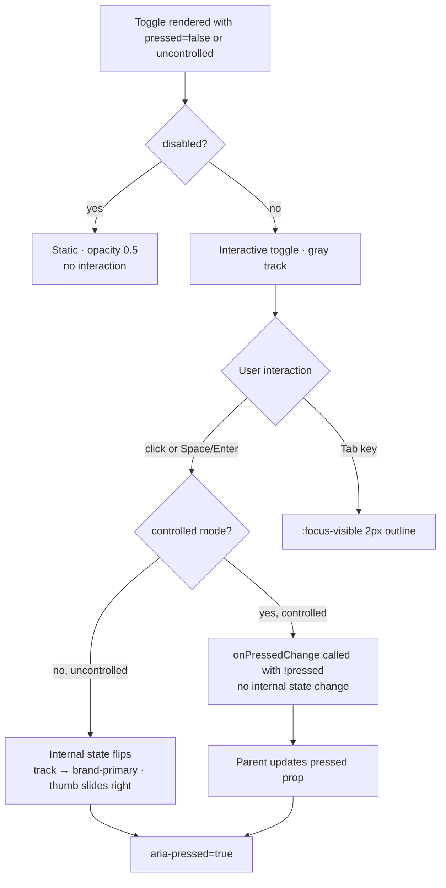

### Story 1.3: Toggle

**File**: `docs/plans/stories/epic-1-story-1.3-toggle.md`

**BUILDID**: CYCLE-2 | **AzureDevOps**: #23653 | **Epic**: 1 - P0 ATOM COMPONENTS | **ID**: 1.3 | **Date**: 2026-10-12
**Wave**: 1
**Requires**: []
**Enables**: []
**Files Touched**:
  - src/components/Toggle/Toggle.tsx
  - src/components/Toggle/Toggle.types.ts
  - src/components/Toggle/Toggle.scss
  - src/components/Toggle/Toggle.stories.tsx
  - src/components/Toggle/Toggle.test.tsx
  - src/components/Toggle/index.ts
  - src/index.ts
**Roles Ref**: docs/requirements.md#roles--permissions-matrix — single-actor — no role variation
**QA Candidate**: Yes — **Observable:** the Toggle track switches between off (gray `#CED6DB`) and on (brand-primary `#11175E`) with a sliding thumb; four interaction states (Default, Hover, Focus, Disabled) render correctly in both Pressed=True and Pressed=False; `aria-pressed` on the button reflects the current boolean state. **Mechanism:** Toggle renders as a `<button role="button">` with `aria-pressed` rather than a `<input type="checkbox">`, matching the Figma pattern; internal state tracks pressed via `useState` (uncontrolled) or is fully controlled via `pressed`/`onPressedChange` props; the thumb slides via CSS `transform: translateX`. **Authz & preconditions:** no RBAC — single actor; `disabled` prop is the only guard (prevents state change). **Edge/idempotency:** pressing a disabled Toggle fires no state change; pressing an enabled Toggle in controlled mode calls `onPressedChange` but does not mutate internal state; pressing and immediately re-pressing returns to the original state (idempotent toggle cycle). **Regression:** Chromatic snapshots cover Pressed=True/False × Default/Hover/Disabled; unit tests assert aria-pressed toggling, disabled suppression, controlled/uncontrolled duality, and keyboard Space/Enter activation.

---

#### 👤 User Reference

**Description**:
This story delivers the `Toggle` component — the on/off switch used in the Athene calculator (e.g. to toggle add-ons or options). After this story, frontend engineers can import `Toggle` from `@annexus/ui` and render a 51×28px sliding switch that matches the Figma design: a rounded track that is gray when off and brand-primary blue when on, with a circular thumb that slides between positions. The component supports both controlled usage (the parent manages the `pressed` state) and uncontrolled usage (the Toggle manages its own state internally), matching the React pattern for form controls. It is keyboard-accessible — Space and Enter activate it — and announces the current state to screen readers via `aria-pressed`. Four interaction states (Default, Hover, Focus, Disabled) are included for all on/off positions.

**Acceptance Criteria** (plain-English):
- Importing `Toggle` from `@annexus/ui` works with zero TypeScript errors
- The Toggle renders a 51×28px track with a 23px circular thumb matching the Figma dimensions
- Off state (Pressed=False): track is gray (`#CED6DB`); On state (Pressed=True): track is brand-primary blue (`#11175E`)
- Clicking or pressing Space/Enter toggles the state (uncontrolled) or calls `onPressedChange(newValue)` (controlled)
- The `aria-pressed` attribute on the element reflects the current on/off state as `"true"` or `"false"`
- Hovering the enabled Toggle slightly adjusts the track color to signal interactivity
- A disabled Toggle renders at reduced opacity and ignores all click and keyboard interaction
- `:focus-visible` shows a 2px outline on keyboard focus
- All four states are browsable in Storybook with live controls
- No accessibility violations reported by Storybook a11y addon

**User Journey** (no role variation — single actor: Consumer / Frontend Engineer):
- **Import**: engineer writes `import { Toggle } from '@annexus/ui'`; TypeScript surfaces `ToggleProps` with `pressed`, `onPressedChange`, `disabled`, and `aria-label` suggestions.
- **Uncontrolled render**: `<Toggle aria-label="Enable add-on" />` renders in the off state; clicking toggles on/off automatically; no parent state management needed.
- **Controlled render**: `<Toggle pressed={isEnabled} onPressedChange={setIsEnabled} aria-label="Enable add-on" />` renders with the parent-controlled state; pressing calls `setIsEnabled(true/false)`; the parent owns the truth.
- **Keyboard interaction**: user Tabs to the Toggle and sees the 2px `:focus-visible` outline; pressing Space or Enter flips the state; pressing Tab again moves focus away.
- **Screen reader**: when pressed=true, the element is announced as "Enable add-on, pressed"; when false, "Enable add-on, not pressed" — `aria-pressed` drives this.
- **Disabled**: `<Toggle disabled aria-label="Disabled option" />` renders at 50% opacity; clicking or pressing Space fires no state change and calls no callback.

**Flow Diagram**:



---

#### 🤖 AI Agent Reference

**Must Read**:
- `docs/ui-ux/ui-ux-spec.md` — toggle dimensions: 51×28px track, 23px thumb; control-off token `#CED6DB`; brand-primary `#11175E`; touch targets 44px comfortable
- `docs/ui-ux/03-inspiration.md` — Figma-extracted dimensions for Toggle
- `docs/architecture/design/01-patterns-and-standards-greenfield.md` — BEM naming, CSS custom properties, controlled/uncontrolled pattern, CSF3, Vitest AAA

**Design Tokens**:
- **Colors**:
  - Track off: `--annexus-color-control-off: #CED6DB`
  - Track on: `--annexus-color-brand-primary: #11175E`
  - Track hover (off→on): `--annexus-color-brand-hover: #1B3E80`
  - Thumb: `--annexus-color-neutral-white: #FFFFFF`
- **Border radius**: `--annexus-radius-full: 9999px` (track + thumb are fully rounded)
- **Typography**: none (no text in the Toggle itself; label is the engineer's responsibility via `aria-label` or adjacent `<label>`)
- **Dimensions** (from Figma — hard-coded, not tokenized): track 51×28px, thumb 23px diameter, thumb inset 2.5px from edge
- **Touch target**: comfortable touch area wrapper 44×44px minimum (achieved by padding on the `<button>`)
- **Focus**: `outline: 2px solid var(--annexus-color-brand-primary)` at `outline-offset: 2px`
- **Disabled**: `opacity: 0.5`

**Description**:
This story implements the `Toggle` React component as a `<button>` element with `aria-pressed` rather than a `<input type="checkbox">`. This matches the Figma design pattern (a standalone switch without a form-field role) and makes the touch target and keyboard behavior explicit. The component supports a **dual-mode controlled/uncontrolled pattern**: if `pressed` prop is passed, the component is fully controlled (no internal state; calls `onPressedChange` on activation); if omitted, it manages its own `useState`. The visual switch is built entirely with CSS — the track uses `border-radius: 9999px` and changes `background-color` via the `--pressed` modifier class; the thumb is a pseudo-element (`::after`) that slides with `transform: translateX` driven by the modifier class.

**Acceptance Criteria** (comprehensive):
- `Toggle` and `ToggleProps` exported from the `@annexus/ui` barrel
- Track renders at exactly `width: 51px`, `height: 28px`; thumb `diameter: 23px` (via `::after` pseudo-element)
- Off state: track `background-color: var(--annexus-color-control-off)`; thumb at left position
- On state: track `background-color: var(--annexus-color-brand-primary)`; thumb at right position (`translateX(23px)` approx.)
- Clicking an uncontrolled Toggle flips from off to on and back — internal `useState` drives rendering
- Controlled mode: passing `pressed={true}` renders on state; `onPressedChange` is called with `!pressed` on activation; internal state is NOT used
- `aria-pressed="true"` when on; `aria-pressed="false"` when off
- Space and Enter keyboard keys activate the Toggle (native `<button>` behavior)
- `:focus-visible` shows 2px outline; mouse-click focus shows no outline
- `disabled` prop: no state change on click/keyboard; `aria-disabled="true"` set; `opacity: 0.5`; element remains focusable (disabled Toggle should remain keyboard-reachable to announce its state — use `aria-disabled` + `pointer-events: none` rather than native `disabled` which removes from tab order)
- Thumb transition is `150ms ease` (`prefers-reduced-motion` exception: transition set to `0ms`)
- Vitest coverage ≥ 90%
- CSF3 stories: Off (uncontrolled), On (uncontrolled), Disabled Off, Disabled On, Controlled example
- Storybook a11y zero violations

**RBAC Enforcement**:
No role-differentiated access — single actor.

**System responses + error cases**:

| Trigger | Response | Side-effect |
|---------|----------|-------------|
| Uncontrolled Toggle clicked (off → on) | Internal state → true; track color changes to brand-primary; thumb slides right; `aria-pressed="true"` | none — stateless aside from internal useState |
| Uncontrolled Toggle clicked again (on → off) | Internal state → false; track reverts to control-off; thumb slides left; `aria-pressed="false"` | none |
| Controlled Toggle clicked | `onPressedChange(!pressed)` called; NO internal state change — parent re-renders with updated prop | none |
| Space or Enter on focused Toggle | Same as click (native `<button>` keyboard activation) | none |
| Disabled Toggle clicked | No state change; `onPressedChange` not called; `pointer-events: none` | none |
| Disabled Toggle keyboard Space | No state change (aria-disabled + pointer-events: none prevents activation) | none |
| Hover on enabled Toggle (off state) | Track color transitions to slightly darker shade (hover token) | none — pure CSS |
| `prefers-reduced-motion: reduce` in OS | Thumb transition duration set to `0ms`; instant state flip with no animation | none |
| Repeat click on controlled Toggle | Parent `onPressedChange` called each time with `!pressed`; component itself has no duplicate-call guard (parent is responsible for idempotency) | none |

**QA-observable behaviour**:
- Off state: `button.getAttribute('aria-pressed')` equals `"false"`; track computed `background-color` equals `rgb(206, 214, 219)` (`#CED6DB`).
- On state: `button.getAttribute('aria-pressed')` equals `"true"`; track computed `background-color` equals `rgb(17, 23, 94)` (`#11175E`).
- After clicking an uncontrolled Toggle, `aria-pressed` value flips; clicking again returns it to the original value (idempotent cycle).
- Disabled: `button.getAttribute('aria-disabled')` equals `"true"`; `button` is still reachable via Tab (NOT natively disabled); clicking fires no state change.
- `prefers-reduced-motion: reduce`: thumb `transition-duration` computed equals `0ms` (verify via `getComputedStyle`).
- **What does NOT change**: the `Toggle` component does not write to any external store or fire any network request; no other DOM nodes outside the Toggle's own subtree are modified on state change.

**Prerequisites**:
- CYCLE-1 complete: `--annexus-color-control-off`, `--annexus-color-brand-primary`, `--annexus-radius-full` defined in token files
- `src/index.ts` barrel exists
- Storybook 8.x, Vitest + RTL installed

**Context**:
- `docs/ui-ux/ui-ux-spec.md`
- `docs/ui-ux/03-inspiration.md`
- `docs/architecture/design/01-patterns-and-standards-greenfield.md`

**Patterns**: BEM naming, CSS custom properties, controlled/uncontrolled dual pattern, CSF3, Vitest AAA — see `docs/architecture/design/01-patterns-and-standards-greenfield.md`

**Steps**:

1. **Create the component directory**:
   ```bash
   mkdir -p src/components/Toggle
   ```

2. **Create `src/components/Toggle/Toggle.types.ts`**:
   ```typescript
   export interface ToggleProps
     extends Omit<React.ButtonHTMLAttributes<HTMLButtonElement>, 'onClick'> {
     /** Controlled pressed state — omit for uncontrolled usage */
     pressed?: boolean;
     /** Called with the new state when the toggle is activated */
     onPressedChange?: (pressed: boolean) => void;
     /** Use aria-label or aria-labelledby — Toggle has no visible text */
     'aria-label': string;
   }
   ```

3. **Create `src/components/Toggle/Toggle.tsx`** — controlled/uncontrolled dual pattern:
   ```tsx
   import React, { useState } from 'react';
   import clsx from 'clsx';
   import type { ToggleProps } from './Toggle.types';
   import './Toggle.scss';

   const Toggle: React.FC<ToggleProps> = ({
     pressed: controlledPressed,
     onPressedChange,
     disabled = false,
     className,
     ...rest
   }) => {
     const isControlled = controlledPressed !== undefined;
     const [internalPressed, setInternalPressed] = useState(false);
     const pressed = isControlled ? controlledPressed : internalPressed;

     const handleClick = () => {
       if (disabled) return;
       const next = !pressed;
       if (!isControlled) setInternalPressed(next);
       onPressedChange?.(next);
     };

     return (
       <button
         type="button"
         role="button"
         aria-pressed={pressed}
         aria-disabled={disabled || undefined}
         onClick={handleClick}
         className={clsx(
           'annexus-toggle',
           { 'annexus-toggle--pressed': pressed },
           { 'annexus-toggle--disabled': disabled },
           className
         )}
         style={disabled ? { pointerEvents: 'none' } : undefined}
         {...rest}
       />
     );
   };

   Toggle.displayName = 'Toggle';

   export { Toggle };
   ```

4. **Create `src/components/Toggle/Toggle.scss`**:
   ```scss
   .annexus-toggle {
     // Track dimensions from Figma
     display: inline-flex;
     align-items: center;
     width: 51px;
     height: 28px;
     border-radius: var(--annexus-radius-full, 9999px);
     background-color: var(--annexus-color-control-off, #ced6db);
     border: none;
     cursor: pointer;
     padding: 0;
     position: relative;
     transition: background-color 0.15s ease;

     // Minimum touch target — comfortable 44px area via padding on parent or wrapper
     // The button itself is 51×28; consumers should wrap in a 44px min-height zone
     // if needed for mobile layouts.

     // Focus (WCAG 2.4.11)
     &:focus-visible {
       outline: 2px solid var(--annexus-color-brand-primary, #11175e);
       outline-offset: 2px;
     }

     // Thumb (::after pseudo-element)
     &::after {
       content: '';
       position: absolute;
       width: 23px;
       height: 23px;
       border-radius: var(--annexus-radius-full, 9999px);
       background-color: var(--annexus-color-neutral-white, #ffffff);
       left: 2.5px;
       top: 50%;
       transform: translateY(-50%) translateX(0);
       transition: transform 0.15s ease;
       box-shadow: 0 1px 3px rgba(0, 0, 0, 0.15);
     }

     // Pressed (On) state
     &--pressed {
       background-color: var(--annexus-color-brand-primary, #11175e);

       &::after {
         transform: translateY(-50%) translateX(23px);
       }

       &:hover:not(.annexus-toggle--disabled) {
         background-color: var(--annexus-color-brand-hover, #1b3e80);
       }
     }

     // Hover — off state
     &:hover:not(.annexus-toggle--pressed):not(.annexus-toggle--disabled) {
       background-color: #b8c3ca; // slightly darker than control-off for hover feedback
     }

     // Disabled state
     &--disabled {
       opacity: 0.5;
       cursor: not-allowed;
     }

     // Reduced motion
     @media (prefers-reduced-motion: reduce) {
       transition-duration: 0ms;

       &::after {
         transition-duration: 0ms;
       }
     }
   }
   ```

5. **Create `src/components/Toggle/Toggle.stories.tsx`**:
   ```tsx
   import type { Meta, StoryObj } from '@storybook/react';
   import React, { useState } from 'react';
   import { Toggle } from './Toggle';

   const meta: Meta<typeof Toggle> = {
     title: 'Atoms/Toggle',
     component: Toggle,
     parameters: { layout: 'centered' },
     tags: ['autodocs'],
     argTypes: {
       pressed: { control: 'boolean' },
       disabled: { control: 'boolean' },
     },
   };

   export default meta;
   type Story = StoryObj<typeof Toggle>;

   export const Off: Story = {
     args: { 'aria-label': 'Enable add-on' },
   };

   export const On: Story = {
     args: { pressed: true, 'aria-label': 'Enable add-on' },
   };

   export const DisabledOff: Story = {
     args: { disabled: true, 'aria-label': 'Disabled option' },
   };

   export const DisabledOn: Story = {
     args: { pressed: true, disabled: true, 'aria-label': 'Disabled option' },
   };

   export const ControlledExample: Story = {
     render: () => {
       const [on, setOn] = useState(false);
       return (
         <div style={{ display: 'flex', alignItems: 'center', gap: '12px' }}>
           <Toggle
             pressed={on}
             onPressedChange={setOn}
             aria-label="Monthly income only"
           />
           <span style={{ fontFamily: 'Assistant, sans-serif', fontSize: '14px' }}>
             {on ? 'Monthly income only: ON' : 'Monthly income only: OFF'}
           </span>
         </div>
       );
     },
   };
   ```

6. **Create `src/components/Toggle/Toggle.test.tsx`**:
   ```tsx
   import { describe, it, expect, vi } from 'vitest';
   import { render, screen } from '@testing-library/react';
   import userEvent from '@testing-library/user-event';
   import React from 'react';
   import { Toggle } from './Toggle';

   describe('Toggle', () => {
     // ── Rendering ────────────────────────────────────────────────────────
     it('renders a button with role button', () => {
       render(<Toggle aria-label="Enable add-on" />);
       expect(screen.getByRole('button', { name: 'Enable add-on' })).toBeInTheDocument();
     });

     it('defaults to aria-pressed=false (off state)', () => {
       render(<Toggle aria-label="Enable add-on" />);
       expect(screen.getByRole('button')).toHaveAttribute('aria-pressed', 'false');
     });

     // ── Uncontrolled ──────────────────────────────────────────────────────
     it('toggles from off to on on click (uncontrolled)', async () => {
       const user = userEvent.setup();
       render(<Toggle aria-label="Enable" />);
       const btn = screen.getByRole('button');
       expect(btn).toHaveAttribute('aria-pressed', 'false');
       await user.click(btn);
       expect(btn).toHaveAttribute('aria-pressed', 'true');
     });

     it('toggles back from on to off on second click (uncontrolled)', async () => {
       const user = userEvent.setup();
       render(<Toggle aria-label="Enable" />);
       const btn = screen.getByRole('button');
       await user.click(btn);
       await user.click(btn);
       expect(btn).toHaveAttribute('aria-pressed', 'false');
     });

     // ── Controlled ────────────────────────────────────────────────────────
     it('renders on state when pressed=true (controlled)', () => {
       render(<Toggle pressed={true} onPressedChange={vi.fn()} aria-label="Enable" />);
       expect(screen.getByRole('button')).toHaveAttribute('aria-pressed', 'true');
     });

     it('calls onPressedChange with new state on click (controlled)', async () => {
       const onPressedChange = vi.fn();
       const user = userEvent.setup();
       render(<Toggle pressed={false} onPressedChange={onPressedChange} aria-label="Enable" />);
       await user.click(screen.getByRole('button'));
       expect(onPressedChange).toHaveBeenCalledWith(true);
     });

     it('does not mutate internal state in controlled mode', async () => {
       const onPressedChange = vi.fn();
       const user = userEvent.setup();
       render(<Toggle pressed={false} onPressedChange={onPressedChange} aria-label="Enable" />);
       await user.click(screen.getByRole('button'));
       // pressed prop unchanged (parent controls) — still renders false
       expect(screen.getByRole('button')).toHaveAttribute('aria-pressed', 'false');
     });

     // ── BEM classes ───────────────────────────────────────────────────────
     it('applies --pressed class when on', () => {
       render(<Toggle pressed={true} onPressedChange={vi.fn()} aria-label="Enable" />);
       expect(screen.getByRole('button')).toHaveClass('annexus-toggle--pressed');
     });

     it('does not apply --pressed class when off', () => {
       render(<Toggle aria-label="Enable" />);
       expect(screen.getByRole('button')).not.toHaveClass('annexus-toggle--pressed');
     });

     // ── Disabled ──────────────────────────────────────────────────────────
     it('applies --disabled class and aria-disabled when disabled', () => {
       render(<Toggle disabled aria-label="Enable" />);
       const btn = screen.getByRole('button');
       expect(btn).toHaveClass('annexus-toggle--disabled');
       expect(btn).toHaveAttribute('aria-disabled', 'true');
     });

     it('does not toggle state when disabled (uncontrolled)', async () => {
       const user = userEvent.setup();
       render(<Toggle disabled aria-label="Enable" />);
       const btn = screen.getByRole('button');
       await user.click(btn);
       expect(btn).toHaveAttribute('aria-pressed', 'false');
     });

     it('does not call onPressedChange when disabled (controlled)', async () => {
       const onPressedChange = vi.fn();
       const user = userEvent.setup();
       render(<Toggle pressed={false} onPressedChange={onPressedChange} disabled aria-label="Enable" />);
       await user.click(screen.getByRole('button'));
       expect(onPressedChange).not.toHaveBeenCalled();
     });

     // ── Keyboard ──────────────────────────────────────────────────────────
     it('toggles on Space key press (native button behavior)', async () => {
       const user = userEvent.setup();
       render(<Toggle aria-label="Enable" />);
       const btn = screen.getByRole('button');
       btn.focus();
       await user.keyboard(' ');
       expect(btn).toHaveAttribute('aria-pressed', 'true');
     });
   });
   ```

7. **Create `src/components/Toggle/index.ts`**:
   ```typescript
   export { Toggle } from './Toggle';
   export type { ToggleProps } from './Toggle.types';
   ```

8. **Update `src/index.ts`** — append:
   ```typescript
   export * from './components/Toggle';
   ```

9. **Run tests and verify coverage**:
   ```bash
   pnpm test --coverage --reporter=verbose src/components/Toggle
   ```
   All tests green; coverage ≥ 90%. Paste output as evidence.

**Tests** (manual):
- Storybook → Atoms/Toggle → Off: gray track, thumb left — click: track goes blue, thumb slides right
- Verify aria-pressed flips on each click (browser DevTools → Accessibility tab)
- Tab to Toggle: 2px blue focus ring appears; Space flips state
- Disabled: click/Space has no effect; still focusable via Tab
- ControlledExample story: label text updates in sync with toggle state

**Quality**: ESLint 0 errors, `pnpm type-check` 0 errors, Vitest coverage ≥ 90%, Storybook a11y zero violations, Chromatic snapshots approved (Off / On / Disabled-Off / Disabled-On)

**OUT**:
- ❌ No label text rendered inside the Toggle itself — engineers supply `aria-label` or an adjacent `<label>`
- ❌ No size variants (only one size per Figma spec — 51×28px)
- ❌ No intermediate / indeterminate state
- ❌ No animation config prop — motion-sensitive users handled via `prefers-reduced-motion` media query

**Evidence**:
- Vitest coverage output (≥90%) for `src/components/Toggle/**`
- Screenshot of all Toggle stories in Storybook with a11y tab zero violations
- Chromatic snapshot URL for Toggle stories
