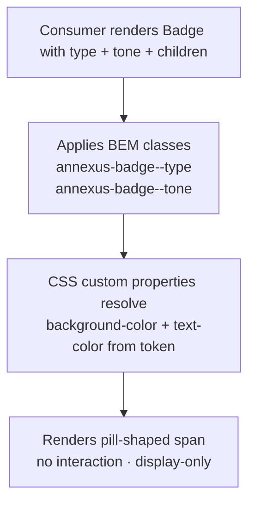

### Story 1.4: Badge

**File**: `docs/plans/stories/epic-1-story-1.4-badge.md`

**BUILDID**: CYCLE-2 | **AzureDevOps**: #23654 | **Epic**: 1 - P0 ATOM COMPONENTS | **ID**: 1.4 | **Date**: 2026-10-12
**Wave**: 4
**Requires**: [3.6]
**Enables**: []
**Files Touched**:
  - src/components/Badge/Badge.tsx
  - src/components/Badge/Badge.types.ts
  - src/components/Badge/Badge.scss
  - src/components/Badge/Badge.stories.tsx
  - src/components/Badge/Badge.test.tsx
  - src/components/Badge/index.ts
  - src/index.ts
**Roles Ref**: docs/requirements.md#roles--permissions-matrix — single-actor — no role variation
**QA Candidate**: Yes — **Observable:** all Type × Tone combinations render with correct background color, text color, and border-radius derived from design tokens; Badge is display-only (no interactive states, no click events). **Mechanism:** `Badge` renders a `<span>` with two BEM modifier classes — `annexus-badge--{type}` and `annexus-badge--{tone}` — driving background-color and text-color via CSS custom properties; no JavaScript logic beyond prop → class mapping. **Authz & preconditions:** no RBAC — single actor; no access guard — purely display. **Edge/idempotency:** rendering with no `children` produces an empty badge (no crash); rendering the same props repeatedly produces identical output. **Regression:** Chromatic snapshots cover all 2 types × 5 tones = 10 combinations; unit tests assert BEM class application for every Type and Tone value; a11y audit verifies semantic `<span>` and appropriate text contrast ratios.

> **Styling (CR-001, 2026-10-20)**: wherever this story says `var(--annexus-*)`, `src/tokens/` or a hex value, implement it as a **design variable** instead. Add `$<section><Element><State><Property>` (camelCase, section-prefixed, never repeated) to `src/styles/design.variables.scss`, pointing to a color in `src/styles/pallete.color.scss`, and `@use '../../styles/design.variables' as *;` in the component SCSS. Component SCSS never uses hex values or palette variables. Every new design variable is also added to `src/styles/design.variables.module.scss` so it is exported to JS (`designVariables`). Fonts use `$fontFamilyBase` and section-named size/line-height/weight variables. Reference implementation: `src/components/Input/Input.scss`. Spec: Story 3.2.

---

#### 👤 User Reference

**Description**:
This story delivers the `Badge` component — a small status label used throughout the Athene calculator to indicate states such as "Added" or "Count" with color-coded significance. After this story, engineers can import `Badge` from `@annexus/ui` and display compact, pill-shaped labels in two types (Count and Status) across five tones (Neutral, Info, Success, Warning, Danger). The component is purely display-only — it shows information but does not respond to clicks or trigger any actions. Color choices are drawn directly from the design token system so the badges automatically stay consistent with the rest of the design. Because the component is non-interactive, it needs no keyboard handling; accessibility is ensured by semantic HTML and sufficient color contrast ratios.

**Acceptance Criteria** (plain-English):
- Importing `Badge` from `@annexus/ui` works with zero TypeScript errors
- Two types are available: `count` (for numeric quantities) and `status` (for state labels)
- Five tones render with distinct background and text colors: Neutral (gray), Info (blue), Success (green), Warning (amber), Danger (red)
- The Badge always has a pill shape (fully rounded corners)
- Text inside the Badge uses the Assistant font at 12px, semibold weight
- The Badge is not clickable and fires no events — it is a display element only
- All 10 combinations (2 types × 5 tones) are visible in Storybook
- No accessibility violations reported by Storybook a11y addon (minimum 4.5:1 contrast ratio for all tones)

**User Journey** (no role variation — single actor: Consumer / Frontend Engineer):
- **Import**: engineer writes `import { Badge } from '@annexus/ui'`; TypeScript surfaces `BadgeProps` with `type` and `tone` options plus standard `span` HTML attributes.
- **Render count badge**: `<Badge type="count" tone="info">3</Badge>` renders a small rounded blue badge with white text showing "3".
- **Render status badge**: `<Badge type="status" tone="success">Added</Badge>` renders a green pill-shaped label with the word "Added".
- **All tones**: engineer browses Storybook and sees Neutral (gray), Info (blue), Success (green), Warning (amber), and Danger (red) variants side by side with live controls.
- **No interaction**: Badge has no hover, focus, or click behavior — it is a `<span>`, not a button; engineers do not pass `onClick` to it.
- **Composed usage**: Badge is composed by the AddonRow molecule (CYCLE-3) — this story only delivers the standalone atom.

**Flow Diagram**:



---

#### 🤖 AI Agent Reference

**Must Read**:
- `docs/ui-ux/ui-ux-spec.md` — design tokens: semantic colors (success, error), gray scale, brand colors; border-radius full=9999px; typography xs scale 12px/18px weight 600
- `docs/architecture/design/01-patterns-and-standards-greenfield.md` — BEM naming, CSS custom properties, CSF3 stories, Vitest AAA

**Design Tokens**:
- **Colors per tone** (background / text):
  - Neutral: bg `--annexus-color-gray-100: #F5F5F5` / text `--annexus-color-gray-700: #404042`
  - Info: bg `--annexus-color-brand-cta: #0167AC` (at 15% opacity) / text `--annexus-color-brand-cta: #0167AC`
    - Implement as: `background: rgba(1, 103, 172, 0.15); color: #0167AC`
  - Success: bg `rgba(7, 148, 85, 0.15)` / text `--annexus-color-success: #079455`
  - Warning: bg `rgba(180, 120, 0, 0.15)` / text `#B47800` (amber — not in token set; use hardcoded)
  - Danger: bg `rgba(183, 59, 59, 0.15)` / text `--annexus-color-error: #B73B3B`
- **Border radius**: `--annexus-radius-full: 9999px`
- **Typography**: 12px/18px (xs scale), font-weight 600, `--annexus-font-family`
- **Spacing**: padding 2px 8px (compact pill shape)

**Description**:
This story implements the `Badge` as a pure display component: a `<span>` element with two BEM modifier classes derived from the `type` and `tone` props. No `forwardRef` is needed (Badge is never programmatically focused or imperatively controlled). The component has no internal state, no event handlers, and no JavaScript branching beyond the class computation. SCSS drives all visual differentiation. Warning tone color is not in the token set and is hard-coded as an amber value consistent with the Figma design. All tones use semi-transparent backgrounds (15% opacity) over a white surface to ensure legibility.

**Acceptance Criteria** (comprehensive):
- `Badge` and `BadgeProps` exported from `@annexus/ui` barrel
- Renders a `<span>` element (not a `<div>` or `<button>`) — pure display semantics
- `type` prop: `'count' | 'status'` — currently drives no visual difference in this cycle (type differentiation applied by consuming molecules); BEM class applied for future extension
- `tone` prop: `'neutral' | 'info' | 'success' | 'warning' | 'danger'` — drives background-color and text-color
- Neutral: `background: var(--annexus-color-gray-100)`, `color: var(--annexus-color-gray-700)`
- Info: `background: rgba(1,103,172,0.15)`, `color: var(--annexus-color-brand-cta, #0167AC)`
- Success: `background: rgba(7,148,85,0.15)`, `color: var(--annexus-color-success, #079455)`
- Warning: `background: rgba(180,120,0,0.15)`, `color: #B47800`
- Danger: `background: rgba(183,59,59,0.15)`, `color: var(--annexus-color-error, #B73B3B)`
- `border-radius: var(--annexus-radius-full, 9999px)` on the `<span>`
- Font: 12px/18px semibold (weight 600), `--annexus-font-family`
- Padding: 2px 8px
- `children` rendered as text content inside the span
- No `onClick`, `onKeyDown`, or interaction event props exposed (extend `HTMLAttributes<HTMLSpanElement>` — click events ARE technically passable via spread but the component exposes no dedicated `onClick` prop)
- Rendering with no `children` produces an empty span without crash
- Vitest coverage ≥ 90%
- CSF3 stories: one per tone for each type + an AllTones matrix story
- Storybook a11y zero violations; all tone/text combos meet 4.5:1 contrast ratio

**RBAC Enforcement**:
No role-differentiated access — single actor.

**System responses + error cases**:

| Trigger | Response | Side-effect |
|---------|----------|-------------|
| Badge rendered with `tone="success"` | `<span>` has green background + green text via CSS | none — stateless |
| Badge rendered with no `children` | Empty `<span>` renders without crash; width collapses to padding only | none |
| Badge rendered with long text (`children` = "Very Long Status Label") | Text wraps within the span; pill shape maintained by border-radius | none |
| Same props rendered twice | Identical DOM output (pure function component) | none |
| `type` prop not provided (default: `'status'`) | BEM class `annexus-badge--status` applied; Neutral-tone colors apply if no `tone` either | none |
| `tone` not provided (default: `'neutral'`) | BEM class `annexus-badge--neutral` applied | none |

**QA-observable behaviour**:
- Success badge: `span.classList` contains `annexus-badge--success`; computed `color` equals `rgb(7, 148, 85)` (`#079455`).
- Danger badge: computed `color` equals `rgb(183, 59, 59)` (`#B73B3B`).
- All tones: computed `border-radius` equals `9999px`; computed `font-weight` equals `600`; computed `font-size` equals `12px`.
- No tone has a `cursor: pointer` or interactive styling — `cursor` equals the inherited default (`auto`).
- **What does NOT change**: Badge has no internal state; any re-render with unchanged props produces byte-identical HTML; no event listeners are attached to the DOM node.

**Prerequisites**:
- CYCLE-1 complete: `--annexus-color-success`, `--annexus-color-error`, `--annexus-color-gray-100`, `--annexus-color-gray-700`, `--annexus-radius-full` defined in token files
- `src/index.ts` barrel exists
- Storybook 8.x, Vitest + RTL installed

**Context**:
- `docs/ui-ux/ui-ux-spec.md`
- `docs/architecture/design/01-patterns-and-standards-greenfield.md`

**Patterns**: BEM naming, CSS custom properties, CSF3 — see `docs/architecture/design/01-patterns-and-standards-greenfield.md`

**Steps**:

1. **Create the component directory**:
   ```bash
   mkdir -p src/components/Badge
   ```

2. **Create `src/components/Badge/Badge.types.ts`**:
   ```typescript
   export type BadgeType = 'count' | 'status';
   export type BadgeTone = 'neutral' | 'info' | 'success' | 'warning' | 'danger';

   export interface BadgeProps extends React.HTMLAttributes<HTMLSpanElement> {
     type?: BadgeType;
     tone?: BadgeTone;
     children?: React.ReactNode;
   }
   ```

3. **Create `src/components/Badge/Badge.tsx`**:
   ```tsx
   import React from 'react';
   import clsx from 'clsx';
   import type { BadgeProps } from './Badge.types';
   import './Badge.scss';

   const Badge: React.FC<BadgeProps> = ({
     type = 'status',
     tone = 'neutral',
     className,
     children,
     ...rest
   }) => (
     <span
       className={clsx(
         'annexus-badge',
         `annexus-badge--${type}`,
         `annexus-badge--${tone}`,
         className
       )}
       {...rest}
     >
       {children}
     </span>
   );

   Badge.displayName = 'Badge';

   export { Badge };
   ```

4. **Create `src/components/Badge/Badge.scss`**:
   ```scss
   .annexus-badge {
     display: inline-flex;
     align-items: center;
     justify-content: center;
     padding: 2px 8px;
     border-radius: var(--annexus-radius-full, 9999px);
     font-family: var(--annexus-font-family, 'Assistant', sans-serif);
     font-size: 12px;
     line-height: 18px;
     font-weight: 600;
     white-space: nowrap;

     // ── Tones ─────────────────────────────────────────────────────────────
     &--neutral {
       background-color: var(--annexus-color-gray-100, #f5f5f5);
       color: var(--annexus-color-gray-700, #404042);
     }

     &--info {
       background-color: rgba(1, 103, 172, 0.15);
       color: var(--annexus-color-brand-cta, #0167ac);
     }

     &--success {
       background-color: rgba(7, 148, 85, 0.15);
       color: var(--annexus-color-success, #079455);
     }

     &--warning {
       background-color: rgba(180, 120, 0, 0.15);
       color: #b47800; // amber — not in token set, matched from Figma
     }

     &--danger {
       background-color: rgba(183, 59, 59, 0.15);
       color: var(--annexus-color-error, #b73b3b);
     }
   }
   ```

5. **Create `src/components/Badge/Badge.stories.tsx`**:
   ```tsx
   import type { Meta, StoryObj } from '@storybook/react';
   import React from 'react';
   import { Badge } from './Badge';
   import type { BadgeTone } from './Badge.types';

   const meta: Meta<typeof Badge> = {
     title: 'Atoms/Badge',
     component: Badge,
     parameters: { layout: 'centered' },
     tags: ['autodocs'],
     argTypes: {
       type: { control: 'select', options: ['count', 'status'] },
       tone: { control: 'select', options: ['neutral', 'info', 'success', 'warning', 'danger'] },
     },
   };

   export default meta;
   type Story = StoryObj<typeof Badge>;

   export const Neutral: Story = { args: { tone: 'neutral', children: 'Neutral' } };
   export const Info: Story = { args: { tone: 'info', children: 'Info' } };
   export const Success: Story = { args: { tone: 'success', children: 'Added' } };
   export const Warning: Story = { args: { tone: 'warning', children: 'Pending' } };
   export const Danger: Story = { args: { tone: 'danger', children: 'Error' } };

   export const CountBadge: Story = {
     args: { type: 'count', tone: 'info', children: '3' },
   };

   export const AllTones: Story = {
     render: () => (
       <div style={{ display: 'flex', gap: '8px', flexWrap: 'wrap' }}>
         {(['neutral', 'info', 'success', 'warning', 'danger'] as BadgeTone[]).map((tone) => (
           <Badge key={tone} tone={tone}>
             {tone.charAt(0).toUpperCase() + tone.slice(1)}
           </Badge>
         ))}
       </div>
     ),
   };
   ```

6. **Create `src/components/Badge/Badge.test.tsx`**:
   ```tsx
   import { describe, it, expect } from 'vitest';
   import { render, screen } from '@testing-library/react';
   import { Badge } from './Badge';

   describe('Badge', () => {
     it('renders children text inside a span', () => {
       render(<Badge>Added</Badge>);
       expect(screen.getByText('Added').tagName).toBe('SPAN');
     });

     it('applies base BEM class', () => {
       render(<Badge>Label</Badge>);
       expect(screen.getByText('Label')).toHaveClass('annexus-badge');
     });

     it.each(['count', 'status'] as const)('applies type BEM class for type="%s"', (type) => {
       render(<Badge type={type}>Label</Badge>);
       expect(screen.getByText('Label')).toHaveClass(`annexus-badge--${type}`);
     });

     it.each(['neutral', 'info', 'success', 'warning', 'danger'] as const)(
       'applies tone BEM class for tone="%s"',
       (tone) => {
         render(<Badge tone={tone}>Label</Badge>);
         expect(screen.getByText('Label')).toHaveClass(`annexus-badge--${tone}`);
       }
     );

     it('defaults to type=status and tone=neutral', () => {
       render(<Badge>Label</Badge>);
       const span = screen.getByText('Label');
       expect(span).toHaveClass('annexus-badge--status');
       expect(span).toHaveClass('annexus-badge--neutral');
     });

     it('renders without crashing when children is absent', () => {
       const { container } = render(<Badge />);
       expect(container.querySelector('.annexus-badge')).toBeInTheDocument();
     });

     it('merges custom className', () => {
       render(<Badge className="my-badge">Label</Badge>);
       expect(screen.getByText('Label')).toHaveClass('my-badge');
     });

     it('passes through HTML span attributes', () => {
       render(<Badge data-testid="my-badge">Label</Badge>);
       expect(screen.getByTestId('my-badge')).toBeInTheDocument();
     });

     it('is not interactive — no button role', () => {
       render(<Badge>Label</Badge>);
       expect(screen.queryByRole('button')).toBeNull();
     });
   });
   ```

7. **Create `src/components/Badge/index.ts`**:
   ```typescript
   export { Badge } from './Badge';
   export type { BadgeProps, BadgeType, BadgeTone } from './Badge.types';
   ```

8. **Update `src/index.ts`** — append:
   ```typescript
   export * from './components/Badge';
   ```

9. **Run tests and verify coverage**:
   ```bash
   pnpm test --coverage --reporter=verbose src/components/Badge
   ```
   All tests green; coverage ≥ 90%. Paste output as evidence.

**Tests** (manual):
- Storybook → Atoms/Badge → AllTones: verify 5 distinct background+text color combinations
- Verify each badge is a `<span>` (not a `<button>`) in browser DevTools
- Confirm no hover or cursor change on mouseover (display-only)
- Run a11y tab: confirm 4.5:1 contrast for all tones

**Quality**: ESLint 0 errors, `pnpm type-check` 0 errors, Vitest coverage ≥ 90%, Storybook a11y zero violations

**OUT**:
- ❌ No interactive click behavior (Badge is display-only — clickable badges are the consuming molecule's responsibility)
- ❌ No dismiss/close button variant
- ❌ No icon inside Badge — defer to molecule composition in CYCLE-3
- ❌ Warning amber color not added to the token system in this story — consumed from SCSS only; adding it to the token file is deferred to CYCLE-1 amendment if needed

**Evidence**:
- Vitest coverage output (≥90%) for `src/components/Badge/**`
- Storybook screenshot of AllTones story with a11y tab zero violations
- Chromatic snapshot URL for Badge stories
