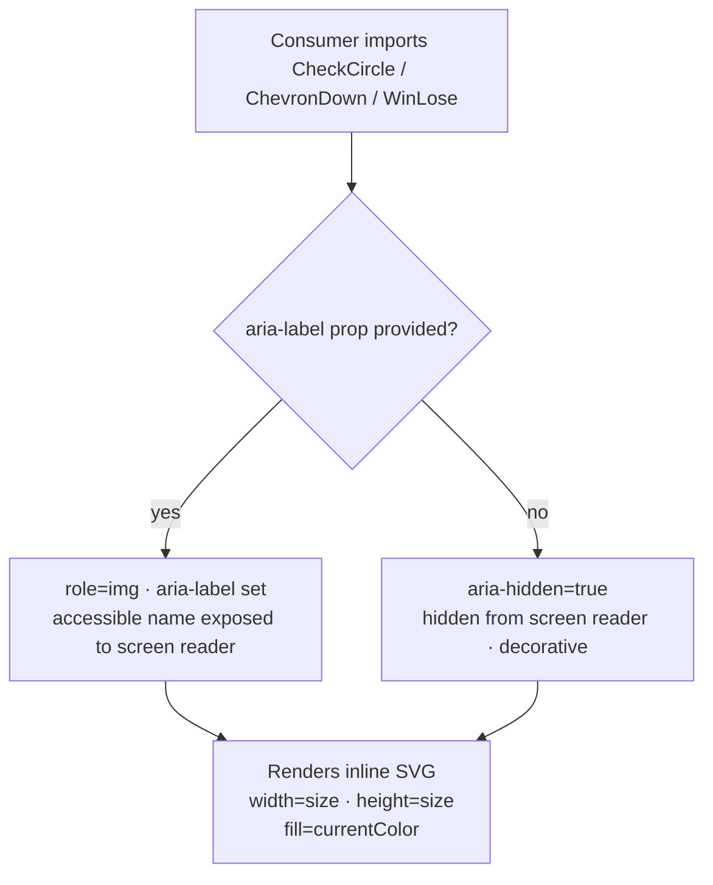

### Story 1.5: Icon

**File**: `docs/plans/stories/epic-1-story-1.5-icon.md`

**BUILDID**: CYCLE-2 | **AzureDevOps**: #23655 | **Epic**: 1 - P0 ATOM COMPONENTS | **ID**: 1.5 | **Date**: 2026-10-12
**Wave**: 1
**Requires**: []
**Enables**: [2.3]
**Files Touched**:
  - src/components/Icon/CheckCircle.tsx
  - src/components/Icon/ChevronDown.tsx
  - src/components/Icon/WinLose.tsx
  - src/components/Icon/Icon.types.ts
  - src/components/Icon/Icon.stories.tsx
  - src/components/Icon/Icon.test.tsx
  - src/components/Icon/index.ts
  - src/index.ts
**Roles Ref**: docs/requirements.md#roles--permissions-matrix — single-actor — no role variation
**QA Candidate**: Yes — **Observable:** three SVG React components (CheckCircle, ChevronDown, WinLose) render inline SVG at the specified size; decorative usage has `aria-hidden="true"` and no accessible name; standalone usage with `aria-label` prop exposes an accessible name to screen readers; SVG `currentColor` inherits the parent's text color. **Mechanism:** each icon is a functional React component wrapping an inline `<svg>` element extracted from the Figma source; `size` prop maps to `width`/`height` attributes; `aria-hidden` defaults to `"true"` (decorative) and is overridden by the `aria-label` prop (standalone); `currentColor` fill ensures the icon picks up the CSS `color` property of its parent. **Authz & preconditions:** no RBAC — single actor; purely display/structural. **Edge/idempotency:** rendering any icon without size prop defaults to `24`; rendering with `aria-label` removes `aria-hidden`; rendering the same icon twice produces identical SVG output. **Regression:** Chromatic snapshots cover all 3 icons at default and custom sizes; unit tests assert aria-hidden/aria-label mutual exclusion, size attribute, and role="img" when aria-label is set; Storybook a11y verifies each decorative usage has aria-hidden and standalone has sufficient labeling.

---

#### 👤 User Reference

**Description**:
This story delivers the `Icon` component set — three custom SVG icons extracted from the Figma source (CheckCircle, ChevronDown, and WinLose) packaged as React components. After this story, engineers can import any icon from `@annexus/ui` and drop it inline anywhere in their components. Icons automatically inherit the surrounding text color via CSS `currentColor`, so they adapt to any context without extra color props. When used as decoration (next to a label), the icon is hidden from screen readers by default. When used standalone (without adjacent text), the engineer passes an `aria-label` to give it an accessible name. The Dropdown/Nav component (Story 2.3) imports `ChevronDown` from this story — `Icon` must be merged before Story 2.3 begins on its branch.

**Acceptance Criteria** (plain-English):
- Importing `CheckCircle`, `ChevronDown`, and `WinLose` from `@annexus/ui` works with zero TypeScript errors
- Each icon renders as an inline SVG at the correct dimensions (default 24×24px)
- A `size` prop changes the icon's width and height uniformly
- Icons inherit the surrounding text color via `currentColor` — no color prop needed
- By default, icons are hidden from screen readers (`aria-hidden="true"`) for decorative use
- When `aria-label` is passed, the icon becomes visible to screen readers with that label (and `aria-hidden` is removed)
- All three icons are browsable in Storybook in decorative and standalone variants
- No accessibility violations reported by the Storybook a11y addon

**User Journey** (no role variation — single actor: Consumer / Frontend Engineer):
- **Import**: engineer writes `import { ChevronDown } from '@annexus/ui'`; TypeScript surfaces `IconProps` with `size` and `aria-label`.
- **Decorative usage**: `<ChevronDown />` renders a 24×24px SVG hidden from screen readers, inheriting the surrounding text color; no additional props needed.
- **Standalone usage**: `<CheckCircle aria-label="Success" />` renders the icon with `role="img"` and an accessible name — a screen reader announces "Success".
- **Custom size**: `<ChevronDown size={16} />` renders a smaller 16×16px icon for compact contexts.
- **Storybook discovery**: engineer browses Icon stories and sees all three icons rendered side by side, with a color-inheritance demo showing them in different text-color contexts.
- **Dropdown consumer**: the Dropdown/Nav story (2.3) imports `ChevronDown` and renders it as part of the navigation trigger — this is the key downstream consumer.

**Flow Diagram**:



---

#### 🤖 AI Agent Reference

**Must Read**:
- `docs/ui-ux/ui-ux-spec.md` — icons section: set=custom-svg, source=Figma DjPqMQEOe6khkoqIVQ8a9u, names=[check-circle, chevron-down, winLose], style=mixed
- `docs/ui-ux/03-inspiration.md` — icon source confirmation; no icon library dependency
- `docs/architecture/design/01-patterns-and-standards-greenfield.md` — SVG component pattern, aria-hidden/aria-label pattern, CSF3, Vitest AAA

**Design Tokens**:
- **Color**: icons use `fill="currentColor"` — they inherit the parent CSS `color` property; no dedicated color token
- **Size**: default `24`px (width + height); configurable via `size` prop
- **No border-radius, no shadow, no spacing tokens** — icons are raw SVG paths

**Description**:
This story implements three custom SVG icons as React functional components. Each icon component renders a native `<svg>` with hardcoded SVG path data extracted from the Figma source file (DjPqMQEOe6khkoqIVQ8a9u). The `size` prop controls both width and height; `aria-hidden` defaults to `"true"` for decorative use; passing `aria-label` overrides `aria-hidden` to `undefined` and adds `role="img"` so the SVG is treated as a meaningful image by assistive technologies. Using `currentColor` for fills means icons inherit the CSS `color` of their parent — no color prop is needed or exposed. The SVG path data below is representative; the actual paths must be extracted from the Figma file. `ChevronDown` is imported by the Dropdown/Nav story (2.3) — this story must be merged before 2.3 starts.

**Acceptance Criteria** (comprehensive):
- `CheckCircle`, `ChevronDown`, `WinLose` all exported from `@annexus/ui` barrel
- `IconProps` TypeScript interface exported from `src/components/Icon/Icon.types.ts`
- Each icon renders as `<svg>` with `width={size}` and `height={size}`; default size is `24`
- `viewBox` attribute set correctly for each icon (extracted from Figma SVG export)
- `fill="currentColor"` on all path/shape elements — inherits parent CSS `color`
- Decorative usage (no `aria-label`): `aria-hidden="true"` on `<svg>`, no `role` attribute
- Standalone usage (with `aria-label`): `aria-hidden` removed, `role="img"`, `aria-label` set on `<svg>`
- Icons do not hardcode any color values — all fills use `currentColor`
- `className` prop merges with the base `annexus-icon` class
- Rendering any icon in a parent with `color: red` causes the icon to render in red
- Vitest coverage ≥ 90% for all Icon files
- CSF3 stories: one story per icon in decorative mode, one per icon in standalone (aria-label) mode, one size demonstration story
- Storybook a11y zero violations

**RBAC Enforcement**:
No role-differentiated access — single actor.

**System responses + error cases**:

| Trigger | Response | Side-effect |
|---------|----------|-------------|
| `<ChevronDown />` (no aria-label) | `<svg aria-hidden="true">` rendered; not in accessibility tree | none |
| `<CheckCircle aria-label="Success" />` | `<svg role="img" aria-label="Success">` rendered; accessible name = "Success" | none |
| `<WinLose size={16} />` | `<svg width="16" height="16" aria-hidden="true">` rendered | none |
| Parent has `color: #079455` (success green) | SVG fill inherits via `currentColor` → rendered green | none |
| Same icon rendered twice with same props | Identical SVG output both times (pure function) | none |
| `aria-label=""` (empty string) provided | Treat as falsy — `aria-hidden="true"` applied, NOT standalone mode | none — guard: `Boolean(ariaLabel && ariaLabel.length > 0)` |

**QA-observable behaviour**:
- `ChevronDown` DOM: `svg.getAttribute('aria-hidden')` equals `"true"` when no aria-label; SVG `width` attribute equals `"24"` by default.
- `CheckCircle` with `aria-label="Done"`: `svg.getAttribute('role')` equals `"img"`; `svg.getAttribute('aria-label')` equals `"Done"`; `svg.getAttribute('aria-hidden')` equals `null`.
- `<WinLose size={32} />`: `svg.getAttribute('width')` equals `"32"` and `height` equals `"32"`.
- Color inheritance: wrapping in `<span style="color: #B73B3B"><ChevronDown /></span>` — SVG fill computed color equals `rgb(183, 59, 59)` (via currentColor CSS mechanism, visible in DevTools computed fill).
- **What does NOT change**: icons have no internal state; no event listeners; no network requests; DOM output is deterministic for a given set of props.

**Prerequisites**:
- CYCLE-1 complete: `src/index.ts` barrel exists; Storybook 8.x, Vitest + RTL installed
- Figma source file DjPqMQEOe6khkoqIVQ8a9u accessible for SVG path extraction (read-only)
- SVG paths extracted from Figma before authoring — see SVG extraction note in step 2

**Context**:
- `docs/ui-ux/ui-ux-spec.md`
- `docs/ui-ux/03-inspiration.md`
- `docs/architecture/design/01-patterns-and-standards-greenfield.md`

**Patterns**: inline SVG React component pattern, aria-hidden/aria-label accessible icon pattern, currentColor fill — see `docs/architecture/design/01-patterns-and-standards-greenfield.md`

**Steps**:

1. **Create the component directory**:
   ```bash
   mkdir -p src/components/Icon
   ```

2. **Create `src/components/Icon/Icon.types.ts`**:
   ```typescript
   export interface IconProps extends React.SVGAttributes<SVGElement> {
     /** Icon width and height in pixels (square) */
     size?: number;
     /** Accessible label — makes the icon standalone (role="img"); omit for decorative use */
     'aria-label'?: string;
   }
   ```

3. **Create `src/components/Icon/CheckCircle.tsx`**:

   > **SVG path extraction**: open Figma file `DjPqMQEOe6khkoqIVQ8a9u`, navigate to the Components page, select the `check-circle` icon, right-click → Copy as SVG. Replace the `<svg ...>` root attributes and inner path data below with the exact exported values.

   ```tsx
   import React from 'react';
   import clsx from 'clsx';
   import type { IconProps } from './Icon.types';

   export const CheckCircle: React.FC<IconProps> = ({
     size = 24,
     className,
     'aria-label': ariaLabel,
     ...rest
   }) => {
     const isStandalone = Boolean(ariaLabel && ariaLabel.length > 0);
     return (
       <svg
         width={size}
         height={size}
         viewBox="0 0 24 24"
         fill="none"
         xmlns="http://www.w3.org/2000/svg"
         className={clsx('annexus-icon', 'annexus-icon--check-circle', className)}
         aria-hidden={isStandalone ? undefined : 'true'}
         role={isStandalone ? 'img' : undefined}
         aria-label={isStandalone ? ariaLabel : undefined}
         {...rest}
       >
         {/* Replace with actual path data from Figma SVG export */}
         <path
           d="M12 2C6.477 2 2 6.477 2 12s4.477 10 10 10 10-4.477 10-10S17.523 2 12 2zm-1 14.414-3.707-3.707 1.414-1.414L11 13.586l5.293-5.293 1.414 1.414L11 16.414z"
           fill="currentColor"
         />
       </svg>
     );
   };

   CheckCircle.displayName = 'CheckCircle';
   ```

4. **Create `src/components/Icon/ChevronDown.tsx`**:
   ```tsx
   import React from 'react';
   import clsx from 'clsx';
   import type { IconProps } from './Icon.types';

   export const ChevronDown: React.FC<IconProps> = ({
     size = 24,
     className,
     'aria-label': ariaLabel,
     ...rest
   }) => {
     const isStandalone = Boolean(ariaLabel && ariaLabel.length > 0);
     return (
       <svg
         width={size}
         height={size}
         viewBox="0 0 24 24"
         fill="none"
         xmlns="http://www.w3.org/2000/svg"
         className={clsx('annexus-icon', 'annexus-icon--chevron-down', className)}
         aria-hidden={isStandalone ? undefined : 'true'}
         role={isStandalone ? 'img' : undefined}
         aria-label={isStandalone ? ariaLabel : undefined}
         {...rest}
       >
         {/* Replace with actual path data from Figma SVG export */}
         <path
           d="M6 9l6 6 6-6"
           stroke="currentColor"
           strokeWidth="2"
           strokeLinecap="round"
           strokeLinejoin="round"
         />
       </svg>
     );
   };

   ChevronDown.displayName = 'ChevronDown';
   ```

5. **Create `src/components/Icon/WinLose.tsx`** (same pattern as above):
   ```tsx
   import React from 'react';
   import clsx from 'clsx';
   import type { IconProps } from './Icon.types';

   export const WinLose: React.FC<IconProps> = ({
     size = 24,
     className,
     'aria-label': ariaLabel,
     ...rest
   }) => {
     const isStandalone = Boolean(ariaLabel && ariaLabel.length > 0);
     return (
       <svg
         width={size}
         height={size}
         viewBox="0 0 24 24"
         fill="none"
         xmlns="http://www.w3.org/2000/svg"
         className={clsx('annexus-icon', 'annexus-icon--win-lose', className)}
         aria-hidden={isStandalone ? undefined : 'true'}
         role={isStandalone ? 'img' : undefined}
         aria-label={isStandalone ? ariaLabel : undefined}
         {...rest}
       >
         {/* Replace with actual path data from Figma SVG export */}
         <path
           d="M12 2L15.09 8.26L22 9.27L17 14.14L18.18 21.02L12 17.77L5.82 21.02L7 14.14L2 9.27L8.91 8.26L12 2Z"
           fill="currentColor"
         />
       </svg>
     );
   };

   WinLose.displayName = 'WinLose';
   ```

   > **⚠️ SVG path data** above is representative. The authoritative paths MUST be extracted from the Figma file DjPqMQEOe6khkoqIVQ8a9u before this story is marked complete. Use the Figma MCP desktop tool or Figma → Export → SVG to get the exact `d` attributes and viewBox values.

6. **Create `src/components/Icon/Icon.stories.tsx`**:
   ```tsx
   import type { Meta, StoryObj } from '@storybook/react';
   import React from 'react';
   import { CheckCircle, ChevronDown, WinLose } from './index';

   const meta: Meta = {
     title: 'Atoms/Icon',
     parameters: { layout: 'centered' },
     tags: ['autodocs'],
   };

   export default meta;

   export const AllIcons: StoryObj = {
     render: () => (
       <div style={{ display: 'flex', gap: '16px', alignItems: 'center' }}>
         <CheckCircle />
         <ChevronDown />
         <WinLose />
       </div>
     ),
   };

   export const StandaloneWithAriaLabel: StoryObj = {
     render: () => (
       <div style={{ display: 'flex', gap: '16px', alignItems: 'center' }}>
         <CheckCircle aria-label="Success indicator" />
         <ChevronDown aria-label="Expand section" />
         <WinLose aria-label="Win/lose indicator" />
       </div>
     ),
   };

   export const CustomSize: StoryObj = {
     render: () => (
       <div style={{ display: 'flex', gap: '16px', alignItems: 'center' }}>
         <CheckCircle size={16} />
         <CheckCircle size={24} />
         <CheckCircle size={32} />
       </div>
     ),
   };

   export const ColorInheritance: StoryObj = {
     render: () => (
       <div style={{ display: 'flex', gap: '16px' }}>
         <span style={{ color: '#11175E' }}><ChevronDown /></span>
         <span style={{ color: '#079455' }}><CheckCircle /></span>
         <span style={{ color: '#B73B3B' }}><WinLose /></span>
       </div>
     ),
   };
   ```

7. **Create `src/components/Icon/Icon.test.tsx`**:
   ```tsx
   import { describe, it, expect } from 'vitest';
   import { render, screen } from '@testing-library/react';
   import { CheckCircle, ChevronDown, WinLose } from './index';

   describe('Icon', () => {
     // ── Decorative (default) ─────────────────────────────────────────────
     it('CheckCircle renders svg with aria-hidden=true by default', () => {
       const { container } = render(<CheckCircle />);
       const svg = container.querySelector('svg')!;
       expect(svg).toHaveAttribute('aria-hidden', 'true');
       expect(svg).not.toHaveAttribute('role');
     });

     it('ChevronDown renders svg with aria-hidden=true by default', () => {
       const { container } = render(<ChevronDown />);
       expect(container.querySelector('svg')).toHaveAttribute('aria-hidden', 'true');
     });

     it('WinLose renders svg with aria-hidden=true by default', () => {
       const { container } = render(<WinLose />);
       expect(container.querySelector('svg')).toHaveAttribute('aria-hidden', 'true');
     });

     // ── Standalone (aria-label) ───────────────────────────────────────────
     it('aria-label prop makes icon standalone: role=img, aria-label set, aria-hidden removed', () => {
       render(<CheckCircle aria-label="Success" />);
       const svg = screen.getByRole('img', { name: 'Success' });
       expect(svg).toBeInTheDocument();
       expect(svg).not.toHaveAttribute('aria-hidden');
       expect(svg).toHaveAttribute('aria-label', 'Success');
     });

     it('empty aria-label does not trigger standalone mode (stays decorative)', () => {
       const { container } = render(<CheckCircle aria-label="" />);
       expect(container.querySelector('svg')).toHaveAttribute('aria-hidden', 'true');
     });

     // ── Size prop ─────────────────────────────────────────────────────────
     it('renders at default size 24', () => {
       const { container } = render(<ChevronDown />);
       const svg = container.querySelector('svg')!;
       expect(svg).toHaveAttribute('width', '24');
       expect(svg).toHaveAttribute('height', '24');
     });

     it('renders at custom size', () => {
       const { container } = render(<ChevronDown size={16} />);
       const svg = container.querySelector('svg')!;
       expect(svg).toHaveAttribute('width', '16');
       expect(svg).toHaveAttribute('height', '16');
     });

     // ── BEM class ─────────────────────────────────────────────────────────
     it('applies base annexus-icon class', () => {
       const { container } = render(<CheckCircle />);
       expect(container.querySelector('svg')).toHaveClass('annexus-icon');
     });

     it('applies icon-specific BEM modifier class', () => {
       const { container } = render(<ChevronDown />);
       expect(container.querySelector('svg')).toHaveClass('annexus-icon--chevron-down');
     });

     // ── className passthrough ─────────────────────────────────────────────
     it('merges custom className with base classes', () => {
       const { container } = render(<WinLose className="my-icon" />);
       expect(container.querySelector('svg')).toHaveClass('my-icon');
       expect(container.querySelector('svg')).toHaveClass('annexus-icon');
     });
   });
   ```

8. **Create `src/components/Icon/index.ts`**:
   ```typescript
   export { CheckCircle } from './CheckCircle';
   export { ChevronDown } from './ChevronDown';
   export { WinLose } from './WinLose';
   export type { IconProps } from './Icon.types';
   ```

9. **Update `src/index.ts`** — append:
   ```typescript
   export * from './components/Icon';
   ```

10. **Run tests and verify coverage**:
    ```bash
    pnpm test --coverage --reporter=verbose src/components/Icon
    ```
    All tests green; coverage ≥ 90%. Paste output as evidence.

**Tests** (manual):
- Storybook → Atoms/Icon → AllIcons: three icons render visually at 24×24px
- ColorInheritance story: each icon matches the surrounding `color` CSS value
- StandaloneWithAriaLabel story: a11y tab shows each icon has an accessible name; no violations
- AllIcons story (decorative): a11y tab shows icons are absent from the accessibility tree (aria-hidden)
- Confirm SVG paths match the Figma design visually (checkpoint with Figma Chromatic comparison)

**Quality**: ESLint 0 errors, `pnpm type-check` 0 errors, Vitest coverage ≥ 90%, Storybook a11y zero violations, Chromatic snapshots approved; SVG paths verified against Figma source before marking complete

**OUT**:
- ❌ No icon library dependency (no `heroicons`, `lucide-react`, `react-icons`) — custom SVG only per architecture ADR
- ❌ No size tokens (icon size is a raw pixel number prop, not a token scale)
- ❌ No color prop — color is always inherited via `currentColor`
- ❌ No additional icons beyond the 3 specified (check-circle, chevron-down, winLose) — new icons are a change request
- ❌ No SVG sprite or icon font approach — inline SVG per component as specified

**Evidence**:
- Vitest coverage output (≥90%) for `src/components/Icon/**`
- Screenshot of AllIcons + ColorInheritance stories with a11y tab zero violations
- Chromatic snapshot URL
- Confirmation that SVG paths were verified against Figma source (comment in PR or screenshot comparison)
