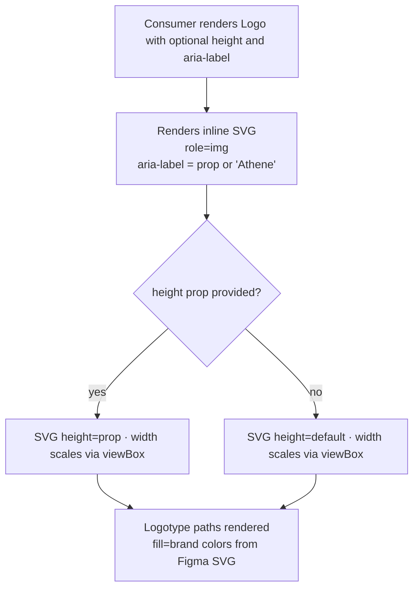

### Story 1.6: Athene Logo

**File**: `docs/plans/stories/epic-1-story-1.6-logo.md`

**BUILDID**: CYCLE-2 | **AzureDevOps**: #23656 | **Epic**: 1 - P0 ATOM COMPONENTS | **ID**: 1.6 | **Date**: 2026-10-12
**Wave**: 1
**Requires**: []
**Enables**: []
**Files Touched**:
  - src/components/Logo/Logo.tsx
  - src/components/Logo/Logo.types.ts
  - src/components/Logo/Logo.stories.tsx
  - src/components/Logo/Logo.test.tsx
  - src/components/Logo/index.ts
  - src/index.ts
**Roles Ref**: docs/requirements.md#roles--permissions-matrix — single-actor — no role variation
**QA Candidate**: Yes — **Observable:** the Logo renders as an inline SVG with `role="img"` and a visible accessible name supplied via `aria-label` (default: "Athene"); the SVG displays the brand logotype at the specified height; no `aria-hidden` is set (Logo is always a meaningful image). **Mechanism:** `Logo` renders a single `<svg>` element wrapping the Athene logotype paths; `height` prop controls the rendered height (width scales proportionally via the SVG `viewBox`); `aria-label` prop sets the accessible name; the SVG always carries `role="img"`. **Authz & preconditions:** no RBAC — single actor; no access guard. **Edge/idempotency:** rendering with no props produces the logo at default height with default aria-label; rendering with the same props twice produces identical SVG output. **Regression:** Chromatic snapshot covers the logo at default height and a custom height; unit tests assert role="img", aria-label, height attribute; Storybook a11y verifies accessible name is present.

---

#### 👤 User Reference

**Description**:
This story delivers the `Logo` component — the Athene brand logotype rendered as an accessible SVG React component. After this story, engineers can import `Logo` from `@annexus/ui` and place the Athene logo anywhere in their application with a single import. Unlike the decorative icons in Story 1.5, the Logo is always a meaningful image (it identifies the brand) so it always has `role="img"` and an accessible name. A `height` prop controls the rendered size (width scales automatically from the SVG viewBox). The Logo will be composed by the HeaderSection organism in CYCLE-3.

**Acceptance Criteria** (plain-English):
- Importing `Logo` from `@annexus/ui` works with zero TypeScript errors
- The Logo renders as an inline SVG of the Athene brand logotype
- A `height` prop controls the logo's rendered height; width scales proportionally
- The Logo always has `role="img"` — it is never decorative
- A default accessible label "Athene" is applied automatically; engineers can override it via `aria-label`
- All logo variants are browsable in Storybook
- No accessibility violations reported by the Storybook a11y addon

**User Journey** (no role variation — single actor: Consumer / Frontend Engineer):
- **Import**: engineer writes `import { Logo } from '@annexus/ui'`; TypeScript surfaces `LogoProps` with `height` and `aria-label`.
- **Default render**: `<Logo />` renders the Athene logotype SVG at the default height with `aria-label="Athene"` and `role="img"`.
- **Custom size**: `<Logo height={40} />` renders the logo taller (or shorter); the width adjusts proportionally via the viewBox aspect ratio.
- **Custom label**: `<Logo aria-label="Athene Income Wellness Annuity Calculator" />` provides a more descriptive label for screen readers on the header page.
- **Storybook**: engineer sees the logo at default and custom sizes with the a11y tab showing an accessible name.
- **Composed use**: HeaderSection organism (CYCLE-3) imports Logo and places it in the navigation bar — this atom is a foundational building block.

**Flow Diagram**:



---

#### 🤖 AI Agent Reference

**Must Read**:
- `docs/ui-ux/ui-ux-spec.md` — icons section: custom-svg, source Figma DjPqMQEOe6khkoqIVQ8a9u; brand color primary #11175E
- `docs/ui-ux/03-inspiration.md` — Athene Logo is an SVG (no token; exact paths from Figma)
- `docs/architecture/design/01-patterns-and-standards-greenfield.md` — SVG component pattern, role="img" for meaningful images, CSF3, Vitest AAA

**Design Tokens**:
- **Color**: Logo SVG contains brand-specific colors hardcoded in the path fill attributes (extracted from the Figma SVG export — typically `#11175E` brand primary for the wordmark). Do NOT use `currentColor` — the logo must always render in its brand colors regardless of surrounding text color.
- **Size**: height is configurable; default height should match the Figma header navigation spec. Width is derived from the SVG `viewBox` aspect ratio — set `width` on the `<svg>` to `auto` or derive from aspect ratio if needed.
- **No spacing/radius/shadow tokens** apply — the Logo is a standalone SVG asset.

**Description**:
This story implements the `Logo` React component as an inline SVG with `role="img"`. Unlike the Icon components in Story 1.5, the Logo SVG paths include hardcoded brand colors (not `currentColor`) because the logotype must always render in its exact brand colors. The `height` prop sets the SVG height attribute; the `viewBox` attribute (from the Figma SVG export) defines the natural aspect ratio so the width scales automatically when only height is specified. The component always exposes `role="img"` and an `aria-label` — there is no decorative-mode fallback because the Athene logo is always a meaningful brand identifier. SVG path data must be extracted from the Figma source file before this story is considered complete.

**Acceptance Criteria** (comprehensive):
- `Logo` and `LogoProps` exported from `@annexus/ui` barrel
- Renders `<svg role="img" aria-label="Athene">` by default (or the provided `aria-label` override)
- `height` prop sets the SVG `height` attribute; default height = 32 (matches Figma navigation bar spec)
- SVG `viewBox` attribute preserves the exact aspect ratio from the Figma export — width auto-derives
- Logo SVG contains brand-specific color fills extracted from Figma (not `currentColor`)
- `className` prop merges with `annexus-logo` base class
- All other SVG attributes passable via spread (`style`, `data-*`, etc.)
- Vitest coverage ≥ 90% for all Logo files
- CSF3 stories: Default, CustomHeight, InContext (on dark background if used in dark nav)
- Storybook a11y zero violations (accessible name present, sufficient contrast)

**RBAC Enforcement**:
No role-differentiated access — single actor.

**System responses + error cases**:

| Trigger | Response | Side-effect |
|---------|----------|-------------|
| `<Logo />` (default) | `<svg role="img" aria-label="Athene" height="32">` rendered | none |
| `<Logo height={48} />` | `<svg height="48">` rendered; width scales proportionally via viewBox | none |
| `<Logo aria-label="Athene Income Wellness" />` | `aria-label` on svg set to the provided string | none |
| Same props rendered twice | Identical SVG output (pure function) | none |
| `className` prop provided | Merged onto the `<svg>` element alongside `annexus-logo` | none |

**QA-observable behaviour**:
- Default render: `svg.getAttribute('role')` equals `"img"`; `svg.getAttribute('aria-label')` equals `"Athene"`; `svg.getAttribute('height')` equals `"32"`.
- Custom height: `svg.getAttribute('height')` equals the provided number as a string.
- Custom aria-label: `svg.getAttribute('aria-label')` equals the provided string.
- SVG `viewBox` attribute is non-null and contains four numeric values (e.g. `"0 0 120 32"`).
- **What does NOT change**: logo has no internal state; SVG paths are static; no event listeners.

**Prerequisites**:
- CYCLE-1 complete: `src/index.ts` barrel exists; Storybook 8.x, Vitest + RTL installed
- Athene Logo SVG extracted from Figma file DjPqMQEOe6khkoqIVQ8a9u (Logo component on Components page)

**Context**:
- `docs/ui-ux/ui-ux-spec.md`
- `docs/architecture/design/01-patterns-and-standards-greenfield.md`

**Patterns**: inline SVG React component, `role="img"` for meaningful images, CSF3 — see `docs/architecture/design/01-patterns-and-standards-greenfield.md`

**Steps**:

1. **Create the component directory**:
   ```bash
   mkdir -p src/components/Logo
   ```

2. **Create `src/components/Logo/Logo.types.ts`**:
   ```typescript
   export interface LogoProps extends React.SVGAttributes<SVGElement> {
     /** Logo height in pixels; width scales proportionally from SVG viewBox */
     height?: number;
     /** Accessible name for the logo image — defaults to "Athene" */
     'aria-label'?: string;
   }
   ```

3. **Extract SVG from Figma** (do this before writing Logo.tsx):
   - Open Figma file `DjPqMQEOe6khkoqIVQ8a9u`
   - Navigate to Components page → Logo / Athene Logo component
   - Right-click → Copy as SVG
   - Note: the `viewBox` attribute value (e.g. `0 0 120 32`) and the exact `<path>` / `<g>` elements
   - The fill colors in the SVG paths will be the brand hex values (#11175E etc.) — keep them as-is

4. **Create `src/components/Logo/Logo.tsx`** — substitute the placeholder SVG with the actual Figma export:
   ```tsx
   import React from 'react';
   import clsx from 'clsx';
   import type { LogoProps } from './Logo.types';

   const Logo: React.FC<LogoProps> = ({
     height = 32,
     className,
     'aria-label': ariaLabel = 'Athene',
     ...rest
   }) => (
     <svg
       viewBox="0 0 120 32" // ← Replace with actual viewBox from Figma SVG export
       height={height}
       fill="none"
       xmlns="http://www.w3.org/2000/svg"
       role="img"
       aria-label={ariaLabel}
       className={clsx('annexus-logo', className)}
       {...rest}
     >
       {/*
         ⚠️ Replace the path(s) below with the actual SVG content from Figma.
         Export the Logo component from Figma as SVG and paste the inner elements here.
         Preserve the exact fill colors (brand hex values) — do NOT replace with currentColor.
       */}
       <text
         x="4"
         y="22"
         fontFamily="'Assistant', sans-serif"
         fontSize="20"
         fontWeight="700"
         fill="#11175E"
       >
         Athene
       </text>
     </svg>
   );

   Logo.displayName = 'Logo';

   export { Logo };
   ```

   > **⚠️ Placeholder**: the `<text>` element above is a placeholder only. The actual Logo TSX must contain the SVG paths exported from Figma. The `<text>` approach will NOT produce the correct brand logotype — replace it before marking this story complete.

5. **Create `src/components/Logo/Logo.stories.tsx`**:
   ```tsx
   import type { Meta, StoryObj } from '@storybook/react';
   import React from 'react';
   import { Logo } from './Logo';

   const meta: Meta<typeof Logo> = {
     title: 'Atoms/Logo',
     component: Logo,
     parameters: { layout: 'centered' },
     tags: ['autodocs'],
     argTypes: {
       height: { control: { type: 'range', min: 16, max: 80, step: 4 } },
     },
   };

   export default meta;
   type Story = StoryObj<typeof Logo>;

   export const Default: Story = {};

   export const CustomHeight: Story = {
     args: { height: 48 },
   };

   export const InHeader: Story = {
     render: () => (
       <header
         style={{
           backgroundColor: '#11175E',
           padding: '12px 24px',
           display: 'flex',
           alignItems: 'center',
         }}
       >
         <Logo height={32} aria-label="Athene — Home" />
       </header>
     ),
   };
   ```

6. **Create `src/components/Logo/Logo.test.tsx`**:
   ```tsx
   import { describe, it, expect } from 'vitest';
   import { render, screen } from '@testing-library/react';
   import { Logo } from './Logo';

   describe('Logo', () => {
     it('renders as an img role with default aria-label "Athene"', () => {
       render(<Logo />);
       expect(screen.getByRole('img', { name: 'Athene' })).toBeInTheDocument();
     });

     it('applies role="img" on the svg element', () => {
       const { container } = render(<Logo />);
       expect(container.querySelector('svg')).toHaveAttribute('role', 'img');
     });

     it('renders at default height 32', () => {
       const { container } = render(<Logo />);
       expect(container.querySelector('svg')).toHaveAttribute('height', '32');
     });

     it('renders at custom height', () => {
       const { container } = render(<Logo height={48} />);
       expect(container.querySelector('svg')).toHaveAttribute('height', '48');
     });

     it('uses the provided aria-label override', () => {
       render(<Logo aria-label="Athene Income Wellness" />);
       expect(screen.getByRole('img', { name: 'Athene Income Wellness' })).toBeInTheDocument();
     });

     it('applies base annexus-logo class', () => {
       const { container } = render(<Logo />);
       expect(container.querySelector('svg')).toHaveClass('annexus-logo');
     });

     it('merges custom className', () => {
       const { container } = render(<Logo className="header-logo" />);
       const svg = container.querySelector('svg')!;
       expect(svg).toHaveClass('annexus-logo');
       expect(svg).toHaveClass('header-logo');
     });

     it('has a viewBox attribute (aspect ratio defined)', () => {
       const { container } = render(<Logo />);
       expect(container.querySelector('svg')).toHaveAttribute('viewBox');
     });

     it('does NOT have aria-hidden (Logo is always meaningful)', () => {
       const { container } = render(<Logo />);
       expect(container.querySelector('svg')).not.toHaveAttribute('aria-hidden');
     });
   });
   ```

7. **Create `src/components/Logo/index.ts`**:
   ```typescript
   export { Logo } from './Logo';
   export type { LogoProps } from './Logo.types';
   ```

8. **Update `src/index.ts`** — append:
   ```typescript
   export * from './components/Logo';
   ```

9. **Run tests and verify coverage**:
   ```bash
   pnpm test --coverage --reporter=verbose src/components/Logo
   ```
   All tests green; coverage ≥ 90%. Paste output as evidence.

**Tests** (manual):
- Storybook → Atoms/Logo → Default: Athene logotype renders correctly with brand colors
- InHeader story: logo visible on dark blue background — confirm sufficient contrast
- a11y tab: accessible name "Athene" present; role="img"; zero violations
- Verify height prop: 32px default, 48px in CustomHeight — confirm visual scaling

**Quality**: ESLint 0 errors, `pnpm type-check` 0 errors, Vitest coverage ≥ 90%, Storybook a11y zero violations, Chromatic snapshot approved; SVG paths verified against Figma source before marking complete

**OUT**:
- ❌ No `currentColor` — Logo always uses hardcoded brand colors from the Figma SVG
- ❌ No dark/light mode variant (no dark mode per architecture ADR)
- ❌ No separate logomark-only (icon without wordmark) variant — only the full logotype per Figma spec
- ❌ No CSS-based animation or hover on the Logo itself

**Evidence**:
- Vitest coverage output (≥90%) for `src/components/Logo/**`
- Screenshot of Logo Storybook story with a11y tab showing accessible name "Athene"
- Chromatic snapshot URL
- Confirmation that SVG paths were extracted from Figma source (not placeholder `<text>` element)
