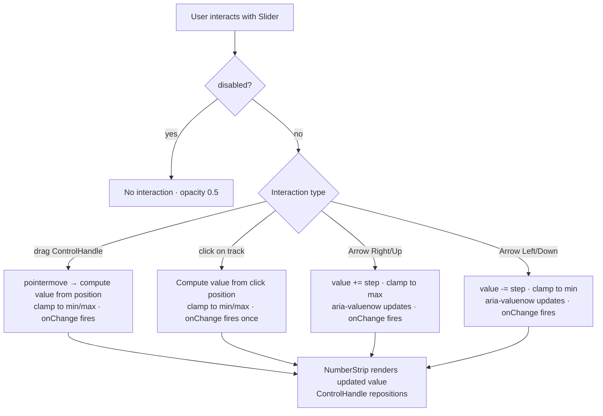

### Story 2.1: Slider

**File**: `docs/plans/stories/epic-2-story-2.1-slider.md`

**BUILDID**: CYCLE-2 | **AzureDevOps**: #23657 | **Epic**: 2 - P0 COMPLEX & OVERLAY COMPONENTS | **ID**: 2.1 | **Date**: 2026-10-12
**Wave**: 4
**Requires**: [3.6]
**Enables**: []
**Files Touched**:
  - src/components/Slider/Slider.tsx
  - src/components/Slider/Slider.types.ts
  - src/components/Slider/Slider.scss
  - src/components/Slider/Slider.stories.tsx
  - src/components/Slider/Slider.test.tsx
  - src/components/Slider/ControlHandle.tsx
  - src/components/Slider/NumberStrip.tsx
  - src/components/Slider/index.ts
  - src/hooks/useSlider.ts
  - src/index.ts
**Roles Ref**: docs/requirements.md#roles--permissions-matrix — single-actor — no role variation
**QA Candidate**: Yes — **Observable:** the Slider thumb (ControlHandle) drags along the track to set a value; the NumberStrip reflects the current numeric value; arrow keys increment/decrement the value when the slider is focused; `aria-valuenow` updates on every value change; clicking anywhere on the track jumps the thumb to that position (WCAG 2.5.7 dragging alternative). **Mechanism:** `Slider` renders a `<div role="slider">` with `aria-valuemin`, `aria-valuemax`, `aria-valuenow`; drag is implemented via `pointerdown` / `pointermove` / `pointerup` events on the track; keyboard arrow keys adjust value by `step`; ControlHandle is the styled thumb sub-element; NumberStrip renders the numeric value; a `useSlider` hook encapsulates value clamping and event handling. **Authz & preconditions:** no RBAC — single actor; `disabled` prop disables all interaction. **Edge/idempotency:** value is clamped to [min, max] at all times — dragging past the track end stops at max/min; clicking on the same position repeatedly does not re-fire `onChange` if value is unchanged; keyboard navigation wraps at bounds (arrow past max stays at max). **Regression:** Chromatic snapshots cover default, dragged-to-midpoint, and max-value states; unit tests verify aria-valuenow updates, keyboard arrow key increments, click-on-track jumping, value clamping, and disabled suppression; a11y audit verifies role="slider" and all required aria attributes.

> **Styling (CR-001, 2026-10-20)**: wherever this story says `var(--annexus-*)`, `src/tokens/` or a hex value, implement it as a **design variable** instead. Add `$<section><Element><State><Property>` (camelCase, section-prefixed, never repeated) to `src/styles/design.variables.scss`, pointing to a color in `src/styles/pallete.color.scss`, and `@use '../../styles/design.variables' as *;` in the component SCSS. Component SCSS never uses hex values or palette variables. Every new design variable is also added to `src/styles/design.variables.module.scss` so it is exported to JS (`designVariables`). Fonts use `$fontFamilyBase` and section-named size/line-height/weight variables. Reference implementation: `src/components/Input/Input.scss`. Spec: Story 3.2.

---

#### 👤 User Reference

**Description**:
This story delivers the `Slider` component — the range input used in the Athene calculator to select values such as Income Start Age and Target Age. After this story, engineers can import `Slider` from `@annexus/ui` and render an interactive sliding control where users drag a circular handle along a horizontal track to set a value. The current value is displayed in a number strip next to the handle. Full keyboard support is included per WCAG 2.5.7: users who cannot drag can instead use Arrow keys to step the value up and down, or click anywhere on the track to jump to that position. The Slider works in controlled mode (parent manages the value) and its sub-elements — the ControlHandle (the draggable thumb) and NumberStrip (the value display) — are delivered as part of this same story.

**Acceptance Criteria** (plain-English):
- Importing `Slider` from `@annexus/ui` works with zero TypeScript errors
- Dragging the handle along the track updates the displayed value smoothly
- Clicking anywhere on the track moves the handle to that position
- Arrow Left/Down key decreases the value by one step; Arrow Right/Up increases it
- The current value is displayed in the NumberStrip adjacent to the handle
- The `aria-valuenow` attribute always reflects the current value (screen readers announce changes)
- Setting `disabled` makes the slider non-interactive (no drag, no keyboard, no click)
- The value never goes below `min` or above `max` regardless of how far the user drags
- All Slider states are browsable in Storybook with live controls for min, max, value, and step
- No accessibility violations reported by the Storybook a11y addon

**User Journey** (no role variation — single actor: Consumer / Frontend Engineer):
- **Import**: engineer writes `import { Slider } from '@annexus/ui'`; TypeScript surfaces `SliderProps` with `min`, `max`, `value`, `step`, `onChange`, and `disabled`.
- **Default render**: `<Slider min={50} max={85} value={65} onChange={setAge} aria-label="Income Start Age" />` renders a horizontal track with a circular handle positioned at 65 out of the 50–85 range, with "65" displayed in the NumberStrip.
- **Drag interaction**: user grabs the ControlHandle and drags right — the handle moves along the track, `aria-valuenow` updates continuously, and `onChange(newValue)` fires; releasing the pointer finalizes the value.
- **Click on track**: user clicks on the track at the 75% position — the handle jumps to that position; `onChange` fires once with the calculated value.
- **Keyboard interaction**: user Tabs to the Slider (handle receives focus); pressing Arrow Right increments by `step` (default 1); Arrow Left decrements; value clamps at bounds.
- **Disabled**: `<Slider disabled />` renders the track dimmed; drag, click, and keyboard all fire no events.

**Flow Diagram**:



---

#### 🤖 AI Agent Reference

**Must Read**:
- `docs/ui-ux/ui-ux-spec.md` — slider section: `drag+keyboard` (lg), `touch+keyboard` (sm); WCAG 2.5.7 — arrow-key + click-on-track alternative; touch targets comfortable 44px
- `docs/ui-ux/03-inspiration.md` — control height 44px; design tokens for brand-primary track fill, gray track background
- `docs/architecture/design/01-patterns-and-standards-greenfield.md` — shared hooks in `src/hooks/`, BEM naming, CSS custom properties, CSF3, Vitest AAA
- `docs/plans/builds/cycle-2/cycle-plan.md` — Slider WCAG 2.5.7 requirement: "arrow-key + click-on-track alternative to dragging"

**Design Tokens**:
- **Colors**:
  - Track fill (filled portion, left of thumb): `--annexus-color-brand-primary: #11175E`
  - Track background (unfilled): `--annexus-color-gray-200: #E9EAEB`
  - ControlHandle background: `--annexus-color-white: #FFFFFF`
  - ControlHandle border: `--annexus-color-brand-primary: #11175E`
  - NumberStrip text: `--annexus-color-gray-700: #404042`
- **Dimensions** (from Figma / architecture): track height 4px; ControlHandle diameter 20px; NumberStrip font 14px/20px semibold
- **Border radius**: ControlHandle `--annexus-radius-full: 9999px`; track `--annexus-radius-full: 9999px`
- **Touch target**: handle min touch area 44×44px (achieved by `padding` or expanded hit area)
- **Focus**: ControlHandle `:focus-visible` 2px outline `--annexus-color-brand-primary`
- **Disabled**: opacity 0.5

**Description**:
This story implements the `Slider` component with two internal sub-elements: `ControlHandle` (the draggable thumb) and `NumberStrip` (the value display). A `useSlider` hook in `src/hooks/useSlider.ts` encapsulates the drag logic (pointer events), click-on-track logic, value clamping, and keyboard handler. The main `Slider` component renders a `<div role="slider">` with the required ARIA attributes, the visual track (with filled and unfilled portions), the ControlHandle, and the NumberStrip. Drag is implemented with `pointer` events (not `mouse` events) for cross-device touch support. The component is always controlled — engineers pass `value` and `onChange`; there is no internal uncontrolled mode (Slider values are always managed by the calculator form state).

**Acceptance Criteria** (comprehensive):
- `Slider`, `SliderProps` exported from `@annexus/ui` barrel
- Renders `<div role="slider" aria-valuemin={min} aria-valuemax={max} aria-valuenow={value} tabIndex={0}>`
- Track renders with two segments: filled (left of thumb, brand-primary) and unfilled (right of thumb, gray-200)
- Thumb position computed as `((value - min) / (max - min)) * 100` percent of track width
- Dragging the ControlHandle updates `aria-valuenow` and calls `onChange(newValue)` on every pointermove
- Clicking anywhere on the track fires `onChange(calculatedValue)` once (WCAG 2.5.7 dragging alternative)
- Arrow Right / Arrow Up: `onChange(Math.min(value + step, max))`
- Arrow Left / Arrow Down: `onChange(Math.max(value - step, min))`
- Home key: `onChange(min)`; End key: `onChange(max)`
- Value is always clamped to `[min, max]` — no value outside bounds ever passed to `onChange`
- `aria-label` or `aria-labelledby` prop required (no default — engineer must provide accessible label)
- ControlHandle has `min-width: 44px; min-height: 44px` touch target (expanded hit area via pseudo-element or padding)
- `:focus-visible` 2px outline on the slider wrapper when focused via keyboard
- `disabled` prop: sets `aria-disabled="true"` on the slider; no pointer or keyboard events fire; rendered at opacity 0.5
- NumberStrip displays the current numeric value adjacent to the ControlHandle
- `step` prop (default 1) drives the arrow key increment size
- Vitest coverage ≥ 90% for all Slider files
- CSF3 stories: IncomeStartAge (50–85), TargetAge (55–90), CustomStep (0–100 step 5)
- Storybook a11y zero violations; role="slider" and all required aria attributes present

**RBAC Enforcement**:
No role-differentiated access — single actor.

**System responses + error cases**:

| Trigger | Response | Side-effect |
|---------|----------|-------------|
| Drag ControlHandle to position P | `onChange(clamp(computedValue, min, max))` called; `aria-valuenow` reflects new value | none — parent owns value |
| Click track at position P | `onChange(calculatedValue)` called once | none |
| Arrow Right (value < max) | `onChange(value + step)` called | none |
| Arrow Right (value = max) | No event — value already at max; `aria-valuenow` unchanged | none |
| Arrow Left (value > min) | `onChange(value - step)` called | none |
| Arrow Left (value = min) | No event — value already at min | none |
| Home key | `onChange(min)` | none |
| End key | `onChange(max)` | none |
| `disabled={true}` drag/click/keyboard | No `onChange` called; `aria-disabled="true"` set | none |
| Drag past track end (left or right) | Value clamped to min or max — `onChange` called with the bound, not beyond | none |
| Same value clicked/dragged twice | `onChange` called with same value — parent decides whether to re-render | none |

**QA-observable behaviour**:
- `slider.getAttribute('role')` equals `"slider"`; `aria-valuemin`, `aria-valuemax`, `aria-valuenow` all set.
- After dragging to midpoint of a 50–85 range: `slider.getAttribute('aria-valuenow')` equals approximately `"68"` (halfway between 50 and 85, rounded to step).
- Keyboard Arrow Right from value=65: `onChange` called with `66`; `aria-valuenow` updated to `"66"` after parent re-renders.
- Keyboard Arrow Right from value=85 (max): `onChange` NOT called; `aria-valuenow` remains `"85"`.
- Disabled: `slider.getAttribute('aria-disabled')` equals `"true"`; clicking the track fires no `onChange`.
- Track filled portion CSS `width` equals `((value - min) / (max - min)) * 100`% — verifiable in DevTools computed styles.
- **What does NOT change**: Slider does not maintain its own value state (always controlled); no DOM mutation occurs outside the Slider's own subtree on any interaction.

**Prerequisites**:
- CYCLE-1 complete: `--annexus-color-brand-primary`, `--annexus-color-gray-200`, `--annexus-radius-full`, `--annexus-color-white` defined in token files; `src/hooks/` directory exists
- `src/index.ts` barrel exists
- Storybook 8.x, Vitest + RTL installed

**Context**:
- `docs/ui-ux/ui-ux-spec.md`
- `docs/ui-ux/03-inspiration.md`
- `docs/architecture/design/01-patterns-and-standards-greenfield.md`

**Patterns**: BEM naming, CSS custom properties, controlled-only pattern, pointer events for cross-device drag, shared hook in `src/hooks/`, CSF3, Vitest AAA — see `docs/architecture/design/01-patterns-and-standards-greenfield.md`

**Steps**:

1. **Create the component directory**:
   ```bash
   mkdir -p src/components/Slider
   ```

2. **Create `src/components/Slider/Slider.types.ts`**:
   ```typescript
   export interface SliderProps {
     /** Current value — Slider is always controlled */
     value: number;
     min: number;
     max: number;
     /** Step size for arrow key navigation (default 1) */
     step?: number;
     onChange: (value: number) => void;
     disabled?: boolean;
     'aria-label'?: string;
     'aria-labelledby'?: string;
     className?: string;
   }
   ```

3. **Create `src/hooks/useSlider.ts`** — encapsulates drag, click-on-track, and keyboard logic:
   ```typescript
   import { useCallback, useRef } from 'react';

   interface UseSliderOptions {
     min: number;
     max: number;
     step: number;
     value: number;
     disabled: boolean;
     onChange: (value: number) => void;
   }

   export function useSlider({
     min,
     max,
     step,
     value,
     disabled,
     onChange,
   }: UseSliderOptions) {
     const trackRef = useRef<HTMLDivElement>(null);

     const clamp = (v: number) => Math.min(Math.max(v, min), max);
     const snap = (v: number) => Math.round(v / step) * step;

     const computeValueFromPosition = useCallback(
       (clientX: number): number => {
         const track = trackRef.current;
         if (!track) return value;
         const { left, width } = track.getBoundingClientRect();
         const ratio = Math.min(Math.max((clientX - left) / width, 0), 1);
         return clamp(snap(min + ratio * (max - min)));
       },
       [min, max, step, value]
     );

     const handleTrackPointerDown = useCallback(
       (e: React.PointerEvent<HTMLDivElement>) => {
         if (disabled) return;
         const newValue = computeValueFromPosition(e.clientX);
         onChange(newValue);

         const onMove = (moveEvent: PointerEvent) => {
           onChange(computeValueFromPosition(moveEvent.clientX));
         };
         const onUp = () => {
           window.removeEventListener('pointermove', onMove);
           window.removeEventListener('pointerup', onUp);
         };
         window.addEventListener('pointermove', onMove);
         window.addEventListener('pointerup', onUp);
       },
       [disabled, computeValueFromPosition, onChange]
     );

     const handleKeyDown = useCallback(
       (e: React.KeyboardEvent<HTMLDivElement>) => {
         if (disabled) return;
         const actions: Record<string, () => number> = {
           ArrowRight: () => clamp(snap(value + step)),
           ArrowUp: () => clamp(snap(value + step)),
           ArrowLeft: () => clamp(snap(value - step)),
           ArrowDown: () => clamp(snap(value - step)),
           Home: () => min,
           End: () => max,
         };
         const compute = actions[e.key];
         if (compute) {
           e.preventDefault();
           const next = compute();
           if (next !== value) onChange(next);
         }
       },
       [disabled, value, step, min, max, onChange]
     );

     return { trackRef, handleTrackPointerDown, handleKeyDown };
   }
   ```

4. **Create `src/components/Slider/ControlHandle.tsx`** — styled thumb sub-element:
   ```tsx
   import React from 'react';

   interface ControlHandleProps {
     positionPercent: number; // 0–100
     disabled?: boolean;
   }

   export const ControlHandle: React.FC<ControlHandleProps> = ({
     positionPercent,
     disabled,
   }) => (
     <div
       className={`annexus-slider__handle${disabled ? ' annexus-slider__handle--disabled' : ''}`}
       style={{ left: `${positionPercent}%` }}
       aria-hidden="true" // ARIA is on the parent role="slider" — handle is decorative
     />
   );
   ```

5. **Create `src/components/Slider/NumberStrip.tsx`** — value display sub-element:
   ```tsx
   import React from 'react';

   interface NumberStripProps {
     value: number;
     positionPercent: number;
   }

   export const NumberStrip: React.FC<NumberStripProps> = ({ value, positionPercent }) => (
     <div
       className="annexus-slider__number-strip"
       style={{ left: `${positionPercent}%` }}
       aria-hidden="true" // value is announced via aria-valuenow on the parent
     >
       {value}
     </div>
   );
   ```

6. **Create `src/components/Slider/Slider.tsx`**:
   ```tsx
   import React from 'react';
   import clsx from 'clsx';
   import type { SliderProps } from './Slider.types';
   import { ControlHandle } from './ControlHandle';
   import { NumberStrip } from './NumberStrip';
   import { useSlider } from '../../hooks/useSlider';
   import './Slider.scss';

   const Slider: React.FC<SliderProps> = ({
     value,
     min,
     max,
     step = 1,
     onChange,
     disabled = false,
     className,
     'aria-label': ariaLabel,
     'aria-labelledby': ariaLabelledBy,
   }) => {
     const { trackRef, handleTrackPointerDown, handleKeyDown } = useSlider({
       min,
       max,
       step,
       value,
       disabled,
       onChange,
     });

     const positionPercent = ((value - min) / (max - min)) * 100;

     return (
       <div
         role="slider"
         tabIndex={disabled ? -1 : 0}
         aria-valuemin={min}
         aria-valuemax={max}
         aria-valuenow={value}
         aria-label={ariaLabel}
         aria-labelledby={ariaLabelledBy}
         aria-disabled={disabled || undefined}
         className={clsx(
           'annexus-slider',
           { 'annexus-slider--disabled': disabled },
           className
         )}
         onKeyDown={handleKeyDown}
       >
         <div
           ref={trackRef}
           className="annexus-slider__track"
           onPointerDown={handleTrackPointerDown}
         >
           <div
             className="annexus-slider__fill"
             style={{ width: `${positionPercent}%` }}
           />
           <ControlHandle positionPercent={positionPercent} disabled={disabled} />
         </div>
         <NumberStrip value={value} positionPercent={positionPercent} />
       </div>
     );
   };

   Slider.displayName = 'Slider';

   export { Slider };
   ```

7. **Create `src/components/Slider/Slider.scss`**:
   ```scss
   .annexus-slider {
     position: relative;
     display: flex;
     flex-direction: column;
     gap: 8px;
     padding: 12px 0;

     // Focus (WCAG 2.4.11)
     &:focus-visible {
       outline: 2px solid var(--annexus-color-brand-primary, #11175e);
       outline-offset: 4px;
     }

     // ── Track ──────────────────────────────────────────────────────────────
     &__track {
       position: relative;
       height: 4px;
       background-color: var(--annexus-color-gray-200, #e9eaeb);
       border-radius: var(--annexus-radius-full, 9999px);
       cursor: pointer;
     }

     // ── Filled portion (left of thumb) ─────────────────────────────────────
     &__fill {
       position: absolute;
       left: 0;
       top: 0;
       height: 100%;
       background-color: var(--annexus-color-brand-primary, #11175e);
       border-radius: var(--annexus-radius-full, 9999px);
       pointer-events: none;
     }

     // ── ControlHandle (thumb) ──────────────────────────────────────────────
     &__handle {
       position: absolute;
       top: 50%;
       transform: translate(-50%, -50%);
       width: 20px;
       height: 20px;
       border-radius: var(--annexus-radius-full, 9999px);
       background-color: var(--annexus-color-white, #ffffff);
       border: 2px solid var(--annexus-color-brand-primary, #11175e);
       box-shadow: 0 1px 4px rgba(0, 0, 0, 0.15);
       cursor: grab;

       // Expanded touch target (WCAG 2.5.8 — 44px minimum)
       &::before {
         content: '';
         position: absolute;
         top: 50%;
         left: 50%;
         transform: translate(-50%, -50%);
         width: 44px;
         height: 44px;
       }

       &:active {
         cursor: grabbing;
       }

       &--disabled {
         cursor: not-allowed;
         border-color: var(--annexus-color-gray-400, #a4a7ae);
       }
     }

     // ── NumberStrip (value display) ───────────────────────────────────────
     &__number-strip {
       position: absolute;
       top: 24px;
       transform: translateX(-50%);
       font-family: var(--annexus-font-family, 'Assistant', sans-serif);
       font-size: 14px;
       line-height: 20px;
       font-weight: 600;
       color: var(--annexus-color-gray-700, #404042);
       user-select: none;
       pointer-events: none;
     }

     // ── Disabled ──────────────────────────────────────────────────────────
     &--disabled {
       opacity: 0.5;
       cursor: not-allowed;

       .annexus-slider__track {
         cursor: not-allowed;
         pointer-events: none;
       }
     }
   }
   ```

8. **Create `src/components/Slider/Slider.stories.tsx`**:
   ```tsx
   import type { Meta, StoryObj } from '@storybook/react';
   import React, { useState } from 'react';
   import { Slider } from './Slider';

   const meta: Meta<typeof Slider> = {
     title: 'Complex/Slider',
     component: Slider,
     parameters: { layout: 'padded' },
     tags: ['autodocs'],
   };

   export default meta;

   export const IncomeStartAge: StoryObj = {
     render: () => {
       const [value, setValue] = useState(65);
       return (
         <div style={{ width: 300 }}>
           <Slider
             min={50}
             max={85}
             value={value}
             onChange={setValue}
             aria-label="Income Start Age"
           />
         </div>
       );
     },
   };

   export const TargetAge: StoryObj = {
     render: () => {
       const [value, setValue] = useState(75);
       return (
         <div style={{ width: 300 }}>
           <Slider
             min={55}
             max={90}
             value={value}
             onChange={setValue}
             aria-label="Target Age"
           />
         </div>
       );
     },
   };

   export const CustomStep: StoryObj = {
     render: () => {
       const [value, setValue] = useState(50);
       return (
         <div style={{ width: 300 }}>
           <Slider
             min={0}
             max={100}
             step={5}
             value={value}
             onChange={setValue}
             aria-label="Custom Step (5)"
           />
         </div>
       );
     },
   };

   export const Disabled: StoryObj = {
     render: () => (
       <div style={{ width: 300 }}>
         <Slider min={50} max={85} value={65} onChange={() => {}} disabled aria-label="Disabled Slider" />
       </div>
     ),
   };
   ```

9. **Create `src/components/Slider/Slider.test.tsx`**:
   ```tsx
   import { describe, it, expect, vi } from 'vitest';
   import { render, screen, fireEvent } from '@testing-library/react';
   import userEvent from '@testing-library/user-event';
   import { Slider } from './Slider';

   const defaultProps = {
     min: 0,
     max: 100,
     value: 50,
     onChange: vi.fn(),
     'aria-label': 'Test Slider',
   };

   describe('Slider', () => {
     // ── ARIA attributes ───────────────────────────────────────────────────
     it('has role="slider"', () => {
       render(<Slider {...defaultProps} />);
       expect(screen.getByRole('slider')).toBeInTheDocument();
     });

     it('sets aria-valuemin, aria-valuemax, aria-valuenow', () => {
       render(<Slider {...defaultProps} />);
       const slider = screen.getByRole('slider');
       expect(slider).toHaveAttribute('aria-valuemin', '0');
       expect(slider).toHaveAttribute('aria-valuemax', '100');
       expect(slider).toHaveAttribute('aria-valuenow', '50');
     });

     it('sets aria-label', () => {
       render(<Slider {...defaultProps} />);
       expect(screen.getByRole('slider')).toHaveAttribute('aria-label', 'Test Slider');
     });

     // ── Keyboard: Arrow keys ──────────────────────────────────────────────
     it('Arrow Right calls onChange with value + step', async () => {
       const onChange = vi.fn();
       const user = userEvent.setup();
       render(<Slider {...defaultProps} value={50} onChange={onChange} />);
       screen.getByRole('slider').focus();
       await user.keyboard('{ArrowRight}');
       expect(onChange).toHaveBeenCalledWith(51);
     });

     it('Arrow Left calls onChange with value - step', async () => {
       const onChange = vi.fn();
       const user = userEvent.setup();
       render(<Slider {...defaultProps} value={50} onChange={onChange} />);
       screen.getByRole('slider').focus();
       await user.keyboard('{ArrowLeft}');
       expect(onChange).toHaveBeenCalledWith(49);
     });

     it('Arrow Right at max does not call onChange', async () => {
       const onChange = vi.fn();
       const user = userEvent.setup();
       render(<Slider {...defaultProps} value={100} onChange={onChange} />);
       screen.getByRole('slider').focus();
       await user.keyboard('{ArrowRight}');
       expect(onChange).not.toHaveBeenCalled();
     });

     it('Arrow Left at min does not call onChange', async () => {
       const onChange = vi.fn();
       const user = userEvent.setup();
       render(<Slider {...defaultProps} value={0} onChange={onChange} />);
       screen.getByRole('slider').focus();
       await user.keyboard('{ArrowLeft}');
       expect(onChange).not.toHaveBeenCalled();
     });

     it('Home key calls onChange with min', async () => {
       const onChange = vi.fn();
       const user = userEvent.setup();
       render(<Slider {...defaultProps} value={50} onChange={onChange} />);
       screen.getByRole('slider').focus();
       await user.keyboard('{Home}');
       expect(onChange).toHaveBeenCalledWith(0);
     });

     it('End key calls onChange with max', async () => {
       const onChange = vi.fn();
       const user = userEvent.setup();
       render(<Slider {...defaultProps} value={50} onChange={onChange} />);
       screen.getByRole('slider').focus();
       await user.keyboard('{End}');
       expect(onChange).toHaveBeenCalledWith(100);
     });

     // ── Custom step ───────────────────────────────────────────────────────
     it('respects custom step prop on Arrow key', async () => {
       const onChange = vi.fn();
       const user = userEvent.setup();
       render(<Slider {...defaultProps} step={5} value={50} onChange={onChange} />);
       screen.getByRole('slider').focus();
       await user.keyboard('{ArrowRight}');
       expect(onChange).toHaveBeenCalledWith(55);
     });

     // ── Disabled ──────────────────────────────────────────────────────────
     it('disabled prop sets aria-disabled', () => {
       render(<Slider {...defaultProps} disabled />);
       expect(screen.getByRole('slider')).toHaveAttribute('aria-disabled', 'true');
     });

     it('disabled: Arrow key does not call onChange', async () => {
       const onChange = vi.fn();
       const user = userEvent.setup();
       render(<Slider {...defaultProps} disabled onChange={onChange} />);
       screen.getByRole('slider').focus();
       await user.keyboard('{ArrowRight}');
       expect(onChange).not.toHaveBeenCalled();
     });

     // ── NumberStrip ───────────────────────────────────────────────────────
     it('NumberStrip displays current value', () => {
       render(<Slider {...defaultProps} value={42} />);
       expect(screen.getByText('42')).toBeInTheDocument();
     });

     // ── BEM class ─────────────────────────────────────────────────────────
     it('applies --disabled class when disabled', () => {
       render(<Slider {...defaultProps} disabled />);
       expect(screen.getByRole('slider')).toHaveClass('annexus-slider--disabled');
     });
   });
   ```

10. **Create `src/components/Slider/index.ts`**:
    ```typescript
    export { Slider } from './Slider';
    export type { SliderProps } from './Slider.types';
    ```

11. **Update `src/index.ts`** — append:
    ```typescript
    export * from './components/Slider';
    ```

12. **Run tests and verify coverage**:
    ```bash
    pnpm test --coverage --reporter=verbose src/components/Slider src/hooks/useSlider.ts
    ```
    All tests green; coverage ≥ 90%. Paste output as evidence.

**Tests** (manual):
- Storybook → Complex/Slider → IncomeStartAge: drag handle left/right — value updates; NumberStrip follows
- Click on track at ~80% — handle jumps to that position; value updates
- Tab to Slider: focus ring appears; Arrow Right increments by 1; Arrow Left decrements; Home → min; End → max
- Verify `aria-valuenow` in DevTools updates on every interaction
- Disabled story: drag and keyboard fire no updates; opacity 0.5

**Quality**: ESLint 0 errors, `pnpm type-check` 0 errors, Vitest coverage ≥ 90%, Storybook a11y zero violations (role="slider" + all required aria present), Chromatic snapshots approved

**OUT**:
- ❌ No uncontrolled mode — Slider is always controlled (parent owns value)
- ❌ No vertical Slider orientation — horizontal only per Figma spec
- ❌ No range (dual-thumb) Slider — single handle only
- ❌ No tick marks or labelled stops
- ❌ `AdjustInflationRate` molecule (composes Slider + Input) — deferred to CYCLE-3

**Evidence**:
- Vitest coverage output (≥90%) for Slider + useSlider
- Screenshot of IncomeStartAge story with a11y tab showing role="slider" and zero violations
- Chromatic snapshot URL
