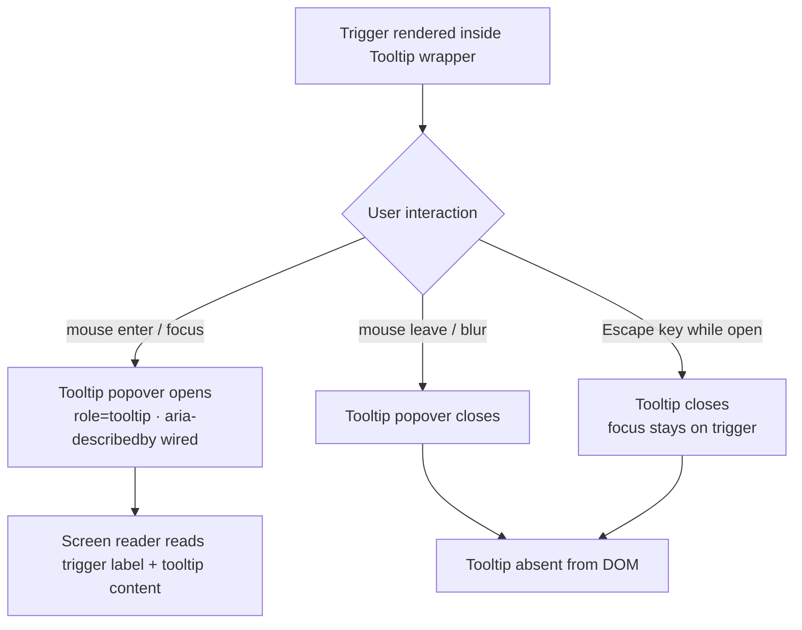

### Story 2.2: Tooltip

**File**: `docs/plans/stories/epic-2-story-2.2-tooltip.md`

**BUILDID**: CYCLE-2 | **AzureDevOps**: #23658 | **Epic**: 2 - P0 COMPLEX & OVERLAY COMPONENTS | **ID**: 2.2 | **Date**: 2026-10-12
**Wave**: 1
**Requires**: []
**Enables**: []
**Files Touched**:
  - src/components/Tooltip/Tooltip.tsx
  - src/components/Tooltip/Tooltip.types.ts
  - src/components/Tooltip/Tooltip.scss
  - src/components/Tooltip/Tooltip.stories.tsx
  - src/components/Tooltip/Tooltip.test.tsx
  - src/components/Tooltip/index.ts
  - src/hooks/useTooltip.ts
  - src/index.ts
**Roles Ref**: docs/requirements.md#roles--permissions-matrix — single-actor — no role variation
**QA Candidate**: Yes — **Observable:** the tooltip popover appears on pointer-enter and keyboard-focus of the trigger element and disappears on pointer-leave and blur; `role="tooltip"` is present on the popover element; the trigger element has `aria-describedby` pointing to the tooltip's `id`; keyboard Tab navigates to the trigger and shows the popover. **Mechanism:** `Tooltip` wraps a trigger (passed as `children`) and a popover `<div role="tooltip">` toggled via a `useTooltip` hook managing open state from `onMouseEnter`/`onMouseLeave`/`onFocus`/`onBlur` events; the popover is conditionally rendered in the DOM when open, with a stable `id` referenced by the trigger's `aria-describedby`; Escape closes the tooltip. **Authz & preconditions:** no RBAC — single actor; no access guard — purely informational. **Edge/idempotency:** tooltip does not open when trigger is disabled (engineer must disable the trigger); Escape closes the tooltip without moving focus; hovering in and out rapidly does not leave stale open state; tooltip content is display-only (not interactive). **Regression:** Chromatic snapshots cover open and closed states; unit tests assert open/close on mouse enter/leave, focus/blur, Escape key, aria-describedby wiring, and role="tooltip"; a11y audit verifies tooltip accessibility pattern.

---

#### 👤 User Reference

**Description**:
This story delivers the `Tooltip` component — a contextual help popover that appears when a user hovers over or focuses a trigger element. After this story, engineers can wrap any element with `<Tooltip content="...">` and the tooltip popover will appear automatically above the trigger on hover or keyboard focus, then disappear on mouse-leave or blur. The tooltip is accessible: the trigger element is linked to the popover via `aria-describedby`, screen readers announce the tooltip content when the trigger is focused, and pressing Escape closes the tooltip without losing focus on the trigger. The `HelpIcon` molecule (CYCLE-3) will compose this Tooltip with the Icon atom — this story delivers only the Tooltip mechanism.

**Acceptance Criteria** (plain-English):
- Importing `Tooltip` from `@annexus/ui` works with zero TypeScript errors
- Hovering the trigger element shows the tooltip popover; moving the mouse away hides it
- Keyboard-focusing the trigger shows the tooltip; Tab away or Escape hides it
- The tooltip text content is passed as the `content` prop
- The trigger element has `aria-describedby` pointing to the tooltip's accessible id
- The tooltip popover has `role="tooltip"` so screen readers read it as supplementary description
- Pressing Escape closes the tooltip while keeping focus on the trigger
- The tooltip does not itself receive focus — it is display-only
- All variants are browsable in Storybook with the a11y tab showing zero violations

**User Journey** (no role variation — single actor: Consumer / Frontend Engineer):
- **Import**: engineer writes `import { Tooltip } from '@annexus/ui'`; TypeScript surfaces `TooltipProps` with `content` and `children`.
- **Wrap a trigger**: `<Tooltip content="This is contextual help"><button>?</button></Tooltip>` — the trigger button now has `aria-describedby` wired automatically; no manual ARIA authoring needed.
- **Hover open**: user hovers the trigger — tooltip popover appears above with the content text; moving the mouse away closes it.
- **Keyboard open**: user Tabs to the trigger — tooltip opens; Tab away closes it; Escape also closes without losing trigger focus.
- **Screen reader**: when the trigger is focused, the screen reader announces the button's label AND the tooltip content (via `aria-describedby`).
- **Storybook**: engineer sees the Tooltip in open and closed states; a11y tab shows trigger has `aria-describedby` matching the tooltip `id` with `role="tooltip"`.

**Flow Diagram**:



---

#### 🤖 AI Agent Reference

**Must Read**:
- `docs/ui-ux/ui-ux-spec.md` — Tooltip in molecules: pointer + keyboard trigger; role="tooltip"; aria-describedby hookup
- `docs/architecture/design/01-patterns-and-standards-greenfield.md` — shared hooks in `src/hooks/`, BEM naming, CSS custom properties, CSF3, Vitest AAA

**Design Tokens**:
- **Colors**:
  - Tooltip background: `--annexus-color-gray-900: #181D27` (dark)
  - Tooltip text: `--annexus-color-white: #FFFFFF`
- **Elevation**: `--annexus-shadow-lg` (modal/dropdown level — Tooltip is an overlay)
- **Border radius**: `--annexus-radius-md: 4px`
- **Typography**: 12px/18px (xs scale), weight 400, `--annexus-font-family`
- **Spacing**: padding 6px 10px
- **Max width**: 240px (wraps long content)
- **Z-index**: `1000` (above all content, below modals if needed)

**Description**:
This story implements `Tooltip` as a **wrapper component** — it takes `children` (the trigger element) and a `content` prop (the tooltip text). The component renders a `<div>` wrapping both the cloned trigger (with injected `aria-describedby` and event handlers) and the conditionally-rendered `<div role="tooltip">` popover. A `useTooltip` hook in `src/hooks/useTooltip.ts` manages the open/closed boolean state from `mouseenter`/`mouseleave`/`focus`/`blur` events and the Escape key. The tooltip `id` is generated once on mount using a stable ID strategy (e.g. `useId` from React 18). The popover is positioned above the trigger via CSS `position: absolute` on the wrapper; advanced positioning (pointer-aware repositioning) is out of scope — position is always `top`.

**Acceptance Criteria** (comprehensive):
- `Tooltip` and `TooltipProps` exported from `@annexus/ui` barrel
- Renders the trigger (`children`) with `aria-describedby={tooltipId}` injected
- Popover `<div id={tooltipId} role="tooltip">` conditionally rendered (in DOM) when open
- Popover removed from DOM when closed (not just hidden with `display: none` — full unmount)
- `mouseenter` on trigger → open; `mouseleave` → close
- `focus` on trigger → open; `blur` → close
- `Escape` key while open → close; trigger retains focus
- Tooltip popover is NOT focusable (`tabIndex` not set; no interactive elements inside)
- Trigger's `aria-describedby` always points to the stable tooltip `id` (present even when closed — the trigger still describes itself to the tooltip even when not visible, as the DOM element may be absent; `aria-describedby` references a non-existent id which is valid per spec)
- `content` prop: string or React node
- `position` prop: `'top'` only (bottom/left/right deferred)
- Tooltip background: `--annexus-color-gray-900` (#181D27); text: `--annexus-color-white`; `border-radius: var(--annexus-radius-md)`; `box-shadow: var(--annexus-shadow-lg)`
- Vitest coverage ≥ 90%
- CSF3 stories: Default (open), WrappingAButton, WrappingAnIcon, LongContent
- Storybook a11y zero violations

**RBAC Enforcement**:
No role-differentiated access — single actor.

**System responses + error cases**:

| Trigger | Response | Side-effect |
|---------|----------|-------------|
| Mouse enters trigger | Tooltip popover appears in DOM (`role="tooltip"` element) | none |
| Mouse leaves trigger | Tooltip popover removed from DOM | none |
| Trigger receives keyboard focus | Tooltip opens | none |
| Trigger loses focus (Tab away or click elsewhere) | Tooltip closes | none |
| Escape key pressed while tooltip is open | Tooltip closes; `document.activeElement` remains on trigger | none |
| Escape key pressed while tooltip is closed | No effect | none |
| `content` is a long string (> 240px wide) | Tooltip wraps at max-width: 240px | none |
| Trigger is disabled (native `disabled` attribute) | Mouse/focus events may not fire on the disabled element — engineer wraps a `<span>` around disabled elements to receive events | none — Tooltip does not self-detect disabled state |
| Rapid hover in/out | Open state correctly reflects final pointer position (no stale open) | none |

**QA-observable behaviour**:
- Closed state: no element with `role="tooltip"` in the DOM (`document.querySelector('[role="tooltip"]')` returns `null`).
- Open state (hover/focus): `document.querySelector('[role="tooltip"]')` returns the popover element; its `textContent` equals the `content` prop value.
- Trigger element's `aria-describedby` attribute value equals the tooltip element's `id` attribute (verify that the id matches).
- After pressing Escape: tooltip removed from DOM; `document.activeElement` equals the trigger element (focus not displaced).
- Tooltip popover: computed `background-color` equals `rgb(24, 29, 39)` (`#181D27`); computed `color` equals `rgb(255, 255, 255)`.
- **What does NOT change**: tooltip has no internal state other than open/closed; no network requests; no side-effects on the parent component's state.

**Prerequisites**:
- CYCLE-1 complete: `--annexus-color-gray-900`, `--annexus-color-white`, `--annexus-shadow-lg`, `--annexus-radius-md` defined; `src/hooks/` directory exists; `src/index.ts` barrel exists
- Storybook 8.x, Vitest + RTL installed

**Context**:
- `docs/ui-ux/ui-ux-spec.md`
- `docs/architecture/design/01-patterns-and-standards-greenfield.md`

**Patterns**: wrapper component with cloned children, `useId` for stable ARIA ids, `useTooltip` shared hook, BEM naming, CSS custom properties — see `docs/architecture/design/01-patterns-and-standards-greenfield.md`

**Steps**:

1. **Create the component directory**:
   ```bash
   mkdir -p src/components/Tooltip
   ```

2. **Create `src/components/Tooltip/Tooltip.types.ts`**:
   ```typescript
   export interface TooltipProps {
     /** Tooltip popover content */
     content: React.ReactNode;
     /** The trigger element — receives injected aria-describedby and event handlers */
     children: React.ReactElement;
     /** Tooltip position relative to trigger — top only in this cycle */
     position?: 'top';
     className?: string;
   }
   ```

3. **Create `src/hooks/useTooltip.ts`**:
   ```typescript
   import { useState, useCallback } from 'react';

   export function useTooltip() {
     const [isOpen, setIsOpen] = useState(false);

     const open = useCallback(() => setIsOpen(true), []);
     const close = useCallback(() => setIsOpen(false), []);

     const handleKeyDown = useCallback((e: React.KeyboardEvent) => {
       if (e.key === 'Escape' && isOpen) {
         e.stopPropagation();
         setIsOpen(false);
       }
     }, [isOpen]);

     return { isOpen, open, close, handleKeyDown };
   }
   ```

4. **Create `src/components/Tooltip/Tooltip.tsx`**:
   ```tsx
   import React, { useId, cloneElement } from 'react';
   import clsx from 'clsx';
   import type { TooltipProps } from './Tooltip.types';
   import { useTooltip } from '../../hooks/useTooltip';
   import './Tooltip.scss';

   const Tooltip: React.FC<TooltipProps> = ({
     content,
     children,
     position = 'top',
     className,
   }) => {
     const id = `annexus-tooltip-${useId().replace(/:/g, '')}`;
     const { isOpen, open, close, handleKeyDown } = useTooltip();

     const trigger = cloneElement(children, {
       'aria-describedby': id,
       onMouseEnter: (e: React.MouseEvent) => {
         open();
         children.props.onMouseEnter?.(e);
       },
       onMouseLeave: (e: React.MouseEvent) => {
         close();
         children.props.onMouseLeave?.(e);
       },
       onFocus: (e: React.FocusEvent) => {
         open();
         children.props.onFocus?.(e);
       },
       onBlur: (e: React.FocusEvent) => {
         close();
         children.props.onBlur?.(e);
       },
       onKeyDown: (e: React.KeyboardEvent) => {
         handleKeyDown(e);
         children.props.onKeyDown?.(e);
       },
     });

     return (
       <div className={clsx('annexus-tooltip-wrapper', className)}>
         {trigger}
         {isOpen && (
           <div
             id={id}
             role="tooltip"
             className={clsx(
               'annexus-tooltip',
               `annexus-tooltip--${position}`
             )}
           >
             {content}
           </div>
         )}
       </div>
     );
   };

   Tooltip.displayName = 'Tooltip';

   export { Tooltip };
   ```

5. **Create `src/components/Tooltip/Tooltip.scss`**:
   ```scss
   .annexus-tooltip-wrapper {
     position: relative;
     display: inline-flex;
     align-items: center;
   }

   .annexus-tooltip {
     position: absolute;
     z-index: 1000;
     max-width: 240px;
     padding: 6px 10px;
     background-color: var(--annexus-color-gray-900, #181d27);
     color: var(--annexus-color-white, #ffffff);
     border-radius: var(--annexus-radius-md, 4px);
     box-shadow: var(
       --annexus-shadow-lg,
       0px 2px 2px -1px rgba(10, 13, 18, 0.04),
       0px 4px 6px -2px rgba(10, 13, 18, 0.03),
       0px 12px 16px -4px rgba(10, 13, 18, 0.08)
     );
     font-family: var(--annexus-font-family, 'Assistant', sans-serif);
     font-size: 12px;
     line-height: 18px;
     font-weight: 400;
     white-space: normal;
     word-wrap: break-word;
     pointer-events: none; // Tooltip itself never receives mouse events

     // ── Top position ───────────────────────────────────────────────────────
     &--top {
       bottom: calc(100% + 6px);
       left: 50%;
       transform: translateX(-50%);
     }
   }
   ```

6. **Create `src/components/Tooltip/Tooltip.stories.tsx`**:
   ```tsx
   import type { Meta, StoryObj } from '@storybook/react';
   import React from 'react';
   import { Tooltip } from './Tooltip';

   const meta: Meta<typeof Tooltip> = {
     title: 'Complex/Tooltip',
     component: Tooltip,
     parameters: { layout: 'centered' },
     tags: ['autodocs'],
   };

   export default meta;

   export const Default: StoryObj = {
     render: () => (
       <Tooltip content="This field affects your monthly benefit calculation.">
         <button type="button" style={{ padding: '8px 16px' }}>Hover or focus me</button>
       </Tooltip>
     ),
   };

   export const WrappingAnIcon: StoryObj = {
     render: () => (
       <Tooltip content="Your projected monthly income after inflation adjustment.">
         <button
           type="button"
           aria-label="Help"
           style={{ background: 'none', border: 'none', cursor: 'pointer', padding: '4px' }}
         >
           ?
         </button>
       </Tooltip>
     ),
   };

   export const LongContent: StoryObj = {
     render: () => (
       <Tooltip content="This is a longer tooltip description that wraps to a second line when the content exceeds the max width of 240 pixels.">
         <button type="button" style={{ padding: '8px 16px' }}>Hover me</button>
       </Tooltip>
     ),
   };
   ```

7. **Create `src/components/Tooltip/Tooltip.test.tsx`**:
   ```tsx
   import { describe, it, expect } from 'vitest';
   import { render, screen, act } from '@testing-library/react';
   import userEvent from '@testing-library/user-event';
   import { Tooltip } from './Tooltip';

   const wrapper = (
     <Tooltip content="Help text">
       <button type="button">Trigger</button>
     </Tooltip>
   );

   describe('Tooltip', () => {
     // ── Closed state ──────────────────────────────────────────────────────
     it('does not render tooltip popover by default (closed)', () => {
       render(wrapper);
       expect(screen.queryByRole('tooltip')).toBeNull();
     });

     // ── Trigger ARIA ──────────────────────────────────────────────────────
     it('injects aria-describedby on the trigger element', () => {
       render(wrapper);
       expect(screen.getByRole('button')).toHaveAttribute('aria-describedby');
     });

     // ── Mouse open/close ──────────────────────────────────────────────────
     it('opens on mouse enter', async () => {
       const user = userEvent.setup();
       render(wrapper);
       await user.hover(screen.getByRole('button'));
       expect(screen.getByRole('tooltip')).toBeInTheDocument();
       expect(screen.getByRole('tooltip')).toHaveTextContent('Help text');
     });

     it('closes on mouse leave', async () => {
       const user = userEvent.setup();
       render(wrapper);
       await user.hover(screen.getByRole('button'));
       await user.unhover(screen.getByRole('button'));
       expect(screen.queryByRole('tooltip')).toBeNull();
     });

     // ── Keyboard open/close ───────────────────────────────────────────────
     it('opens on trigger focus', async () => {
       const user = userEvent.setup();
       render(wrapper);
       await user.tab(); // Tab to focus the button
       expect(screen.getByRole('tooltip')).toBeInTheDocument();
     });

     it('closes on trigger blur (Tab away)', async () => {
       const user = userEvent.setup();
       render(wrapper);
       await user.tab();
       expect(screen.getByRole('tooltip')).toBeInTheDocument();
       await user.tab(); // Tab away
       expect(screen.queryByRole('tooltip')).toBeNull();
     });

     // ── Escape key ────────────────────────────────────────────────────────
     it('Escape closes the tooltip while keeping focus on trigger', async () => {
       const user = userEvent.setup();
       render(wrapper);
       await user.tab();
       expect(screen.getByRole('tooltip')).toBeInTheDocument();
       await user.keyboard('{Escape}');
       expect(screen.queryByRole('tooltip')).toBeNull();
       expect(document.activeElement).toBe(screen.getByRole('button'));
     });

     // ── Tooltip ARIA ──────────────────────────────────────────────────────
     it('tooltip has role="tooltip"', async () => {
       const user = userEvent.setup();
       render(wrapper);
       await user.hover(screen.getByRole('button'));
       expect(screen.getByRole('tooltip')).toHaveAttribute('role', 'tooltip');
     });

     it('trigger aria-describedby matches tooltip id', async () => {
       const user = userEvent.setup();
       render(wrapper);
       await user.hover(screen.getByRole('button'));
       const trigger = screen.getByRole('button');
       const tooltip = screen.getByRole('tooltip');
       expect(trigger.getAttribute('aria-describedby')).toBe(tooltip.getAttribute('id'));
     });

     // ── Content ───────────────────────────────────────────────────────────
     it('renders provided content in the popover', async () => {
       const user = userEvent.setup();
       render(
         <Tooltip content={<strong>Bold help</strong>}>
           <button type="button">Trigger</button>
         </Tooltip>
       );
       await user.hover(screen.getByRole('button'));
       expect(screen.getByRole('tooltip').querySelector('strong')).toBeInTheDocument();
     });
   });
   ```

8. **Create `src/components/Tooltip/index.ts`**:
   ```typescript
   export { Tooltip } from './Tooltip';
   export type { TooltipProps } from './Tooltip.types';
   ```

9. **Update `src/index.ts`** — append:
   ```typescript
   export * from './components/Tooltip';
   ```

10. **Run tests and verify coverage**:
    ```bash
    pnpm test --coverage --reporter=verbose src/components/Tooltip src/hooks/useTooltip.ts
    ```
    All tests green; coverage ≥ 90%. Paste output as evidence.

**Tests** (manual):
- Storybook → Complex/Tooltip → Default: hover the button — tooltip appears above; move mouse away — tooltip disappears
- Tab to the trigger: tooltip opens; Tab away: closes; Escape while open: closes, trigger still focused
- Inspect DOM while open: `role="tooltip"` on popover; trigger has `aria-describedby` matching popover `id`
- LongContent story: tooltip wraps at ~240px
- a11y tab: zero violations on all stories

**Quality**: ESLint 0 errors, `pnpm type-check` 0 errors, Vitest coverage ≥ 90%, Storybook a11y zero violations, Chromatic snapshots approved (open + closed states)

**OUT**:
- ❌ No bottom/left/right tooltip position variants — top only in this cycle
- ❌ No smart repositioning (flip when off-screen) — consumers handle layout constraints
- ❌ No delay before show/hide — instant open/close in this cycle
- ❌ `HelpIcon` molecule (composes Icon + Tooltip) — deferred to CYCLE-3

**Evidence**:
- Vitest coverage output (≥90%) for Tooltip + useTooltip
- Screenshot of Tooltip story open state with a11y tab showing role="tooltip" and zero violations
- Chromatic snapshot URL
