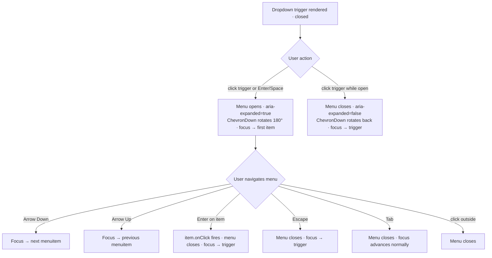

### Story 2.3: Dropdown / Header Navigation

**File**: `docs/plans/stories/epic-2-story-2.3-dropdown-nav.md`

**BUILDID**: CYCLE-2 | **AzureDevOps**: #23659 | **Epic**: 2 - P0 COMPLEX & OVERLAY COMPONENTS | **ID**: 2.3 | **Date**: 2026-10-12
**Wave**: 2
**Requires**: [1.5]
**Enables**: []
**Files Touched**:
  - src/components/Dropdown/Dropdown.tsx
  - src/components/Dropdown/Dropdown.types.ts
  - src/components/Dropdown/Dropdown.scss
  - src/components/Dropdown/Dropdown.stories.tsx
  - src/components/Dropdown/Dropdown.test.tsx
  - src/components/Dropdown/index.ts
  - src/index.ts
**Roles Ref**: docs/requirements.md#roles--permissions-matrix — single-actor — no role variation
**QA Candidate**: Yes — **Observable:** the Dropdown trigger button shows a `ChevronDown` icon that rotates 180° when open; the dropdown menu panel opens below the trigger on click or Enter; Arrow Down/Up navigate through menu items; Escape closes the menu and returns focus to the trigger; Tab away also closes the menu. **Mechanism:** `Dropdown` renders a `<div>` wrapper with a trigger `<button>` and a conditionally-rendered `<ul role="menu">` panel; the trigger button uses `aria-haspopup="menu"` and `aria-expanded`; each menu item renders as `<li role="menuitem">`; `ChevronDown` from Story 1.5 is imported as the indicator icon; open/close state managed internally with optional controlled mode; keyboard navigation uses a `keydown` handler on the menu panel. **Authz & preconditions:** no RBAC — single actor; requires Icon (Story 1.5) to be merged first (imports `ChevronDown`). **Edge/idempotency:** clicking the trigger while open closes the menu (toggle); pressing Escape while closed has no effect; Arrow Down from the last item wraps to the first (or stays — no wrap, simpler implementation); focus is placed on the first menu item when the menu opens via keyboard. **Regression:** Chromatic snapshots cover open and closed states; unit tests verify aria-haspopup, aria-expanded toggling, keyboard Arrow/Escape navigation, click-outside-to-close, and ChevronDown import; a11y audit verifies the menu role pattern.

---

#### 👤 User Reference

**Description**:
This story delivers the `Dropdown` component — the header navigation dropdown used in the Athene calculator's top navigation bar (max-width 1280px). After this story, engineers can import `Dropdown` from `@annexus/ui` to render a trigger button with a rotating chevron indicator. Clicking the trigger or pressing Enter/Space opens a menu panel with the provided navigation items. Full keyboard navigation is included: Arrow Down/Up move between items, Escape closes the menu and returns focus to the trigger, and Tab closes the menu and moves focus normally. This component directly imports the `ChevronDown` icon from Story 1.5 — that story must be merged before this branch starts.

**Acceptance Criteria** (plain-English):
- Importing `Dropdown` from `@annexus/ui` works with zero TypeScript errors
- Clicking the trigger button opens and closes the dropdown menu panel
- The `ChevronDown` icon rotates 180° when the menu is open
- The trigger has `aria-expanded="true/false"` and `aria-haspopup="menu"` at all times
- When the menu opens, focus moves to the first menu item
- Arrow Down moves focus to the next item; Arrow Up to the previous
- Pressing Escape closes the menu and returns focus to the trigger button
- Tab away also closes the menu
- Clicking outside the dropdown closes the menu
- All variants are browsable in Storybook with zero a11y violations

**User Journey** (no role variation — single actor: Consumer / Frontend Engineer):
- **Import**: engineer writes `import { Dropdown } from '@annexus/ui'`; TypeScript surfaces `DropdownProps` with `label`, `items`, `open`, `onOpenChange`, and standard HTML div attributes.
- **Render**: `<Dropdown label="Settings" items={[{label: 'Profile', onClick: ...}, ...]} />` renders a button labeled "Settings" with a down-chevron indicator; menu is initially closed.
- **Click open**: user clicks the trigger — menu panel slides open below; `ChevronDown` rotates 180°; `aria-expanded="true"` set; first item receives focus.
- **Keyboard navigate**: user presses Arrow Down to move to second item; Arrow Up to go back; pressing Enter on an item calls its `onClick` and closes the menu.
- **Escape close**: user presses Escape — menu closes; trigger regains focus; `ChevronDown` rotates back.
- **Click outside**: user clicks anywhere outside the dropdown — menu closes.

**Flow Diagram**:



---

#### 🤖 AI Agent Reference

**Must Read**:
- `docs/ui-ux/ui-ux-spec.md` — Dropdown/Nav in organisms; navigation: fixed-top-bar 1280px; keyboard nav Arrow keys/Escape/Enter
- `docs/ui-ux/03-inspiration.md` — container max-width 1280px; brand-primary nav background
- `docs/architecture/design/01-patterns-and-standards-greenfield.md` — BEM naming, CSS custom properties, ARIA menu pattern, CSF3, Vitest AAA
- **Story 1.5 must be merged** — Dropdown imports `ChevronDown` from `src/components/Icon`

**Design Tokens**:
- **Colors**:
  - Trigger bg: transparent (inherits nav bar background)
  - Trigger text: `--annexus-color-neutral-white: #FFFFFF` (used on dark nav bar)
  - Menu panel bg: `--annexus-color-neutral-white: #FFFFFF`
  - Menu item hover: `--annexus-color-gray-50: #FAFAFA`
  - Menu item text: `--annexus-color-gray-700: #404042`
  - Menu border: `--annexus-color-gray-200: #E9EAEB`
- **Elevation**: `--annexus-shadow-lg` (menu panel is an overlay)
- **Border radius**: menu panel `--annexus-radius-md: 4px`
- **Typography**: trigger label 14px/20px weight 600; menu item 14px/20px weight 400
- **Spacing**: trigger padding 8px 14px; menu item padding 8px 16px
- **ChevronDown**: imported from `src/components/Icon`, size 16

**Description**:
This story implements the `Dropdown` component with a trigger button and a `<ul role="menu">` panel. The trigger button uses `aria-haspopup="menu"` and `aria-expanded` (toggled on open). The menu panel renders as `<ul role="menu">` with each item as `<li role="menuitem">`. Focus management: when the menu opens via keyboard (Enter/Space on trigger), focus moves to the first menu item; `keydown` on the menu panel handles Arrow navigation and Escape. Click-outside detection uses a `useEffect` that attaches a `mousedown` listener to the document. The `ChevronDown` icon is imported from Story 1.5 (`src/components/Icon/ChevronDown`) and rotates via a CSS transform on the `--open` modifier class.

**Acceptance Criteria** (comprehensive):
- `Dropdown` and `DropdownProps` exported from `@annexus/ui` barrel
- Trigger renders `<button aria-haspopup="menu" aria-expanded="false">` when closed
- Trigger renders `aria-expanded="true"` when open
- `ChevronDown` icon imported from `src/components/Icon`; rotates `transform: rotate(180deg)` when open
- Menu panel: `<ul role="menu">` rendered inside the Dropdown wrapper when open; absent from DOM when closed
- Each item: `<li role="menuitem" tabIndex={-1}>` — not natively focusable via Tab but receives programmatic focus
- On open: first menu item receives `focus()` when opened via keyboard; click-to-open may also focus first item
- Arrow Down: moves focus to next `[role="menuitem"]`; at last item, stays on last (no wrap)
- Arrow Up: moves focus to previous item; at first item, stays on first
- Enter on menu item: calls `item.onClick()` and closes the menu; focus returns to trigger
- Escape: closes menu; trigger receives `focus()`
- Tab while menu is open: closes menu (blur event on menu panel or items triggers close)
- Click outside: `mousedown` event outside dropdown wrapper closes menu
- `items` prop: array of `{ label: string; onClick: () => void; disabled?: boolean }` — disabled items have `aria-disabled="true"` and skip Arrow key focus
- `label` prop: string label for the trigger button
- Trigger `type="button"` to prevent form submission
- Vitest coverage ≥ 90%
- CSF3 stories: Default, WithDisabledItem, InNavigationBar
- Storybook a11y zero violations

**RBAC Enforcement**:
No role-differentiated access — single actor.

**System responses + error cases**:

| Trigger | Response | Side-effect |
|---------|----------|-------------|
| Trigger clicked (menu closed) | Menu opens; `aria-expanded="true"`; ChevronDown rotates; first item focused | none |
| Trigger clicked (menu open) | Menu closes; `aria-expanded="false"`; ChevronDown rotates back; trigger focused | none |
| Arrow Down in open menu (not last item) | Focus moves to next menuitem | none |
| Arrow Down in open menu (last item) | Focus stays on last item | none |
| Arrow Up in open menu (not first item) | Focus moves to previous menuitem | none |
| Arrow Up in open menu (first item) | Focus stays on first item | none |
| Enter on enabled menu item | `item.onClick()` called; menu closes; trigger focused | none |
| Escape while menu is open | Menu closes; trigger focused | none |
| Tab while menu is open | Menu closes (blur); normal Tab order resumes | none |
| Click outside dropdown wrapper | Menu closes | none |
| Trigger clicked when all items disabled | Menu opens (trigger has no knowledge of item states) | none |

**QA-observable behaviour**:
- Closed: `trigger.getAttribute('aria-expanded')` equals `"false"`; no `[role="menu"]` in DOM.
- Open: `trigger.getAttribute('aria-expanded')` equals `"true"`; `document.querySelector('[role="menu"]')` returns the menu panel; `document.querySelectorAll('[role="menuitem"]').length` equals the number of items.
- After pressing Arrow Down once from first item: `document.activeElement` is the second `[role="menuitem"]`.
- After pressing Escape: `document.querySelector('[role="menu"]')` returns `null`; `document.activeElement` equals the trigger button.
- ChevronDown: when open, trigger's SVG element has computed `transform` including `rotate(180deg)`.
- **What does NOT change**: no network requests; no parent state mutation unless `onOpenChange` is provided; menu items' `onClick` callbacks are engineer-controlled.

**Prerequisites**:
- Story 1.5 (Icon — ChevronDown) merged to main branch before this story's branch starts
- CYCLE-1 complete: token CSS custom properties defined; `src/index.ts` barrel exists
- Storybook 8.x, Vitest + RTL installed

**Context**:
- `docs/ui-ux/ui-ux-spec.md`
- `docs/ui-ux/03-inspiration.md`
- `docs/architecture/design/01-patterns-and-standards-greenfield.md`
- `src/components/Icon/index.ts` — ChevronDown export

**Patterns**: ARIA menu pattern (`role="menu"` / `role="menuitem"`), click-outside via document `mousedown`, focus management on open, BEM naming, CSS custom properties, CSF3, Vitest AAA — see `docs/architecture/design/01-patterns-and-standards-greenfield.md`

**Steps**:

1. **Create the component directory**:
   ```bash
   mkdir -p src/components/Dropdown
   ```

2. **Create `src/components/Dropdown/Dropdown.types.ts`**:
   ```typescript
   export interface DropdownItem {
     label: string;
     onClick: () => void;
     disabled?: boolean;
   }

   export interface DropdownProps {
     /** Trigger button label */
     label: string;
     /** Menu items */
     items: DropdownItem[];
     /** Controlled open state — omit for uncontrolled */
     open?: boolean;
     onOpenChange?: (open: boolean) => void;
     className?: string;
   }
   ```

3. **Create `src/components/Dropdown/Dropdown.tsx`**:
   ```tsx
   import React, { useState, useRef, useEffect, useCallback } from 'react';
   import clsx from 'clsx';
   import { ChevronDown } from '../Icon/ChevronDown';
   import type { DropdownProps } from './Dropdown.types';
   import './Dropdown.scss';

   const Dropdown: React.FC<DropdownProps> = ({
     label,
     items,
     open: controlledOpen,
     onOpenChange,
     className,
   }) => {
     const isControlled = controlledOpen !== undefined;
     const [internalOpen, setInternalOpen] = useState(false);
     const isOpen = isControlled ? controlledOpen : internalOpen;

     const wrapperRef = useRef<HTMLDivElement>(null);
     const triggerRef = useRef<HTMLButtonElement>(null);
     const menuRef = useRef<HTMLUListElement>(null);

     const setOpen = useCallback(
       (next: boolean) => {
         if (!isControlled) setInternalOpen(next);
         onOpenChange?.(next);
       },
       [isControlled, onOpenChange]
     );

     const toggle = () => setOpen(!isOpen);

     const close = useCallback(() => {
       setOpen(false);
       triggerRef.current?.focus();
     }, [setOpen]);

     // Focus first item when menu opens
     useEffect(() => {
       if (isOpen) {
         const firstItem = menuRef.current?.querySelector<HTMLElement>('[role="menuitem"]:not([aria-disabled="true"])');
         firstItem?.focus();
       }
     }, [isOpen]);

     // Click outside to close
     useEffect(() => {
       const handleOutside = (e: MouseEvent) => {
         if (wrapperRef.current && !wrapperRef.current.contains(e.target as Node)) {
           setOpen(false);
         }
       };
       document.addEventListener('mousedown', handleOutside);
       return () => document.removeEventListener('mousedown', handleOutside);
     }, [setOpen]);

     const handleMenuKeyDown = (e: React.KeyboardEvent<HTMLUListElement>) => {
       const items = Array.from(
         menuRef.current?.querySelectorAll<HTMLElement>('[role="menuitem"]:not([aria-disabled="true"])') ?? []
       );
       const idx = items.indexOf(document.activeElement as HTMLElement);

       if (e.key === 'Escape') {
         e.preventDefault();
         close();
       } else if (e.key === 'ArrowDown') {
         e.preventDefault();
         items[Math.min(idx + 1, items.length - 1)]?.focus();
       } else if (e.key === 'ArrowUp') {
         e.preventDefault();
         items[Math.max(idx - 1, 0)]?.focus();
       }
     };

     return (
       <div
         ref={wrapperRef}
         className={clsx('annexus-dropdown', { 'annexus-dropdown--open': isOpen }, className)}
       >
         <button
           ref={triggerRef}
           type="button"
           aria-haspopup="menu"
           aria-expanded={isOpen}
           onClick={toggle}
           className="annexus-dropdown__trigger"
         >
           {label}
           <ChevronDown
             size={16}
             className={clsx('annexus-dropdown__chevron', {
               'annexus-dropdown__chevron--rotated': isOpen,
             })}
           />
         </button>

         {isOpen && (
           <ul
             ref={menuRef}
             role="menu"
             className="annexus-dropdown__menu"
             onKeyDown={handleMenuKeyDown}
           >
             {items.map((item, index) => (
               <li
                 key={index}
                 role="menuitem"
                 tabIndex={-1}
                 aria-disabled={item.disabled || undefined}
                 className={clsx('annexus-dropdown__item', {
                   'annexus-dropdown__item--disabled': item.disabled,
                 })}
                 onClick={() => {
                   if (!item.disabled) {
                     item.onClick();
                     setOpen(false);
                     triggerRef.current?.focus();
                   }
                 }}
                 onKeyDown={(e) => {
                   if (e.key === 'Enter' && !item.disabled) {
                     item.onClick();
                     setOpen(false);
                     triggerRef.current?.focus();
                   }
                 }}
               >
                 {item.label}
               </li>
             ))}
           </ul>
         )}
       </div>
     );
   };

   Dropdown.displayName = 'Dropdown';

   export { Dropdown };
   ```

4. **Create `src/components/Dropdown/Dropdown.scss`**:
   ```scss
   .annexus-dropdown {
     position: relative;
     display: inline-block;

     // ── Trigger ────────────────────────────────────────────────────────────
     &__trigger {
       display: inline-flex;
       align-items: center;
       gap: 6px;
       padding: 8px 14px;
       background-color: transparent;
       color: var(--annexus-color-neutral-white, #ffffff);
       border: none;
       border-radius: var(--annexus-radius-sm, 3px);
       font-family: var(--annexus-font-family-base, 'Assistant', sans-serif);
       font-size: 14px;
       line-height: 20px;
       font-weight: 600;
       cursor: pointer;
       white-space: nowrap;

       &:hover {
         background-color: rgba(255, 255, 255, 0.1);
       }

       &:focus-visible {
         outline: 2px solid var(--annexus-color-neutral-white, #ffffff);
         outline-offset: 2px;
       }
     }

     // ── ChevronDown icon ───────────────────────────────────────────────────
     &__chevron {
       transition: transform 0.2s ease;

       &--rotated {
         transform: rotate(180deg);
       }

       @media (prefers-reduced-motion: reduce) {
         transition-duration: 0ms;
       }
     }

     // ── Menu panel ─────────────────────────────────────────────────────────
     &__menu {
       position: absolute;
       top: calc(100% + 4px);
       left: 0;
       min-width: 180px;
       background-color: var(--annexus-color-neutral-white, #ffffff);
       border: 1px solid var(--annexus-color-gray-200, #e9eaeb);
       border-radius: var(--annexus-radius-md, 4px);
       box-shadow: var(
         --annexus-shadow-lg,
         0px 2px 2px -1px rgba(10, 13, 18, 0.04),
         0px 4px 6px -2px rgba(10, 13, 18, 0.03),
         0px 12px 16px -4px rgba(10, 13, 18, 0.08)
       );
       z-index: 1000;
       list-style: none;
       margin: 0;
       padding: 4px 0;
     }

     // ── Menu item ──────────────────────────────────────────────────────────
     &__item {
       padding: 8px 16px;
       font-family: var(--annexus-font-family-base, 'Assistant', sans-serif);
       font-size: 14px;
       line-height: 20px;
       font-weight: 400;
       color: var(--annexus-color-gray-700, #404042);
       cursor: pointer;
       outline: none;

       &:hover,
       &:focus {
         background-color: var(--annexus-color-gray-50, #fafafa);
       }

       &:focus-visible {
         background-color: var(--annexus-color-gray-50, #fafafa);
         outline: 2px solid var(--annexus-color-brand-primary, #11175e);
         outline-offset: -2px;
       }

       &--disabled {
         color: var(--annexus-color-gray-400, #a4a7ae);
         cursor: not-allowed;

         &:hover {
           background-color: transparent;
         }
       }
     }
   }
   ```

5. **Create `src/components/Dropdown/Dropdown.stories.tsx`**:
   ```tsx
   import type { Meta, StoryObj } from '@storybook/react';
   import React from 'react';
   import { Dropdown } from './Dropdown';

   const meta: Meta<typeof Dropdown> = {
     title: 'Complex/Dropdown',
     component: Dropdown,
     parameters: { layout: 'centered' },
     tags: ['autodocs'],
   };

   export default meta;

   const items = [
     { label: 'Profile', onClick: () => alert('Profile') },
     { label: 'Settings', onClick: () => alert('Settings') },
     { label: 'Help', onClick: () => alert('Help') },
     { label: 'Sign Out', onClick: () => alert('Sign Out') },
   ];

   export const Default: StoryObj = {
     render: () => (
       <div style={{ backgroundColor: '#11175E', padding: '12px 24px', borderRadius: '4px' }}>
         <Dropdown label="More Options" items={items} />
       </div>
     ),
   };

   export const WithDisabledItem: StoryObj = {
     render: () => (
       <div style={{ backgroundColor: '#11175E', padding: '12px 24px', borderRadius: '4px' }}>
         <Dropdown
           label="Navigation"
           items={[
             { label: 'Profile', onClick: () => {} },
             { label: 'Settings', onClick: () => {}, disabled: true },
             { label: 'Sign Out', onClick: () => {} },
           ]}
         />
       </div>
     ),
   };
   ```

6. **Create `src/components/Dropdown/Dropdown.test.tsx`**:
   ```tsx
   import { describe, it, expect, vi } from 'vitest';
   import { render, screen, within } from '@testing-library/react';
   import userEvent from '@testing-library/user-event';
   import { Dropdown } from './Dropdown';

   const items = [
     { label: 'Profile', onClick: vi.fn() },
     { label: 'Settings', onClick: vi.fn() },
     { label: 'Sign Out', onClick: vi.fn() },
   ];

   describe('Dropdown', () => {
     // ── Trigger ARIA ──────────────────────────────────────────────────────
     it('trigger has aria-haspopup="menu"', () => {
       render(<Dropdown label="Menu" items={items} />);
       expect(screen.getByRole('button', { name: /menu/i })).toHaveAttribute('aria-haspopup', 'menu');
     });

     it('trigger has aria-expanded="false" when closed', () => {
       render(<Dropdown label="Menu" items={items} />);
       expect(screen.getByRole('button', { name: /menu/i })).toHaveAttribute('aria-expanded', 'false');
     });

     // ── Open/close ────────────────────────────────────────────────────────
     it('opens menu on trigger click', async () => {
       const user = userEvent.setup();
       render(<Dropdown label="Menu" items={items} />);
       await user.click(screen.getByRole('button', { name: /menu/i }));
       expect(screen.getByRole('menu')).toBeInTheDocument();
       expect(screen.getByRole('button', { name: /menu/i })).toHaveAttribute('aria-expanded', 'true');
     });

     it('closes menu on second trigger click (toggle)', async () => {
       const user = userEvent.setup();
       render(<Dropdown label="Menu" items={items} />);
       await user.click(screen.getByRole('button', { name: /menu/i }));
       await user.click(screen.getByRole('button', { name: /menu/i }));
       expect(screen.queryByRole('menu')).toBeNull();
     });

     it('renders all menu items as menuitem', async () => {
       const user = userEvent.setup();
       render(<Dropdown label="Menu" items={items} />);
       await user.click(screen.getByRole('button', { name: /menu/i }));
       const menu = screen.getByRole('menu');
       expect(within(menu).getAllByRole('menuitem')).toHaveLength(3);
     });

     // ── Keyboard: Escape ──────────────────────────────────────────────────
     it('Escape closes menu and returns focus to trigger', async () => {
       const user = userEvent.setup();
       render(<Dropdown label="Menu" items={items} />);
       await user.click(screen.getByRole('button', { name: /menu/i }));
       await user.keyboard('{Escape}');
       expect(screen.queryByRole('menu')).toBeNull();
       expect(document.activeElement).toBe(screen.getByRole('button', { name: /menu/i }));
     });

     // ── Keyboard: Arrow navigation ────────────────────────────────────────
     it('Arrow Down moves focus to next menu item', async () => {
       const user = userEvent.setup();
       render(<Dropdown label="Menu" items={items} />);
       await user.click(screen.getByRole('button', { name: /menu/i }));
       // Focus should be on first item after open; Arrow Down → second item
       await user.keyboard('{ArrowDown}');
       expect(document.activeElement).toHaveTextContent('Settings');
     });

     // ── Item onClick ──────────────────────────────────────────────────────
     it('clicking a menu item calls onClick and closes menu', async () => {
       const onClick = vi.fn();
       const user = userEvent.setup();
       render(
         <Dropdown label="Menu" items={[{ label: 'Profile', onClick }]} />
       );
       await user.click(screen.getByRole('button', { name: /menu/i }));
       await user.click(screen.getByRole('menuitem', { name: 'Profile' }));
       expect(onClick).toHaveBeenCalledTimes(1);
       expect(screen.queryByRole('menu')).toBeNull();
     });

     // ── Disabled item ─────────────────────────────────────────────────────
     it('disabled item has aria-disabled="true" and does not call onClick', async () => {
       const onClick = vi.fn();
       const user = userEvent.setup();
       render(
         <Dropdown
           label="Menu"
           items={[{ label: 'Settings', onClick, disabled: true }]}
         />
       );
       await user.click(screen.getByRole('button', { name: /menu/i }));
       const disabledItem = screen.getByRole('menuitem', { name: 'Settings' });
       expect(disabledItem).toHaveAttribute('aria-disabled', 'true');
       await user.click(disabledItem);
       expect(onClick).not.toHaveBeenCalled();
     });

     // ── ChevronDown import ────────────────────────────────────────────────
     it('renders an SVG icon inside the trigger', () => {
       render(<Dropdown label="Menu" items={items} />);
       expect(screen.getByRole('button', { name: /menu/i }).querySelector('svg')).toBeInTheDocument();
     });
   });
   ```

7. **Create `src/components/Dropdown/index.ts`**:
   ```typescript
   export { Dropdown } from './Dropdown';
   export type { DropdownProps, DropdownItem } from './Dropdown.types';
   ```

8. **Update `src/index.ts`** — append:
   ```typescript
   export * from './components/Dropdown';
   ```

9. **Run tests and verify coverage**:
   ```bash
   pnpm test --coverage --reporter=verbose src/components/Dropdown
   ```
   All tests green; coverage ≥ 90%. Paste output as evidence.

**Tests** (manual):
- Storybook → Complex/Dropdown → Default: click trigger — menu opens; click again — closes; `ChevronDown` rotates
- Tab to trigger: Enter opens menu; Arrow Down/Up navigate; Escape closes (focus returns to trigger)
- Click outside open menu: menu closes
- WithDisabledItem: disabled "Settings" grayed out, click fires no event
- a11y tab: trigger has `aria-haspopup="menu"` and `aria-expanded`; menu items have `role="menuitem"`; zero violations

**Quality**: ESLint 0 errors, `pnpm type-check` 0 errors, Vitest coverage ≥ 90%, Storybook a11y zero violations, Chromatic snapshots approved

**OUT**:
- ❌ No multi-level nested submenus — flat list only
- ❌ No search/filter within the dropdown
- ❌ No smart repositioning (flip when off-screen) — menu always opens below
- ❌ `HeaderSection` organism (composes Dropdown + Logo) — deferred to CYCLE-3
- ❌ `GroupItem` subcomponent — deferred to CYCLE-3 P1

**Evidence**:
- Vitest coverage output (≥90%) for `src/components/Dropdown/**`
- Screenshot of open Dropdown story with a11y tab showing ARIA menu pattern and zero violations
- Chromatic snapshot URL
