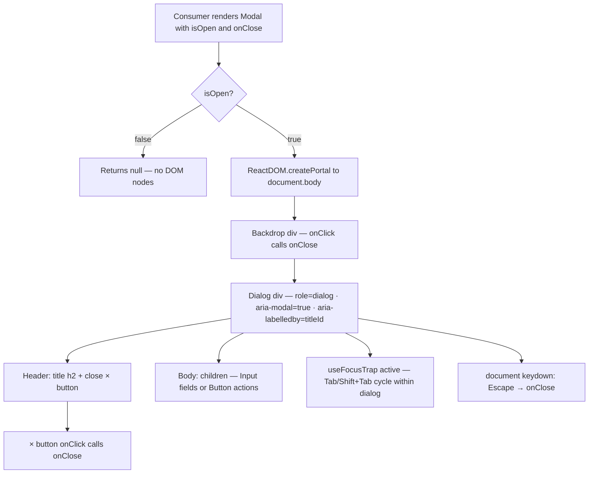

### Story 2.4: Modal

**File**: `docs/plans/stories/epic-2-story-2.4-modal.md`

**BUILDID**: CYCLE-2 | **AzureDevOps**: #23660 | **Epic**: 2 - P0 COMPLEX & OVERLAY COMPONENTS | **ID**: 2.4 | **Date**: 2026-10-12
**Wave**: 5
**Requires**: [1.1, 1.2, 3.6]
**Enables**: []
**Files Touched**:
  - src/components/Modal/Modal.tsx
  - src/components/Modal/Modal.types.ts
  - src/components/Modal/Modal.scss
  - src/components/Modal/Modal.stories.tsx
  - src/components/Modal/Modal.test.tsx
  - src/components/Modal/index.ts
  - src/hooks/useFocusTrap.ts
  - src/index.ts
**Roles Ref**: docs/requirements.md#roles--permissions-matrix — single-actor — no role variation
**QA Candidate**: Yes — **Observable:** the Modal renders as a centered overlay above a semi-transparent backdrop; focus moves into the dialog when it opens and is trapped there (Tab/Shift+Tab cycle only within focusable descendants); pressing Escape closes the modal and returns focus to the previously focused element; clicking the backdrop closes the modal; clicking anywhere inside the dialog does not close it; the dialog has `role="dialog"`, `aria-modal="true"`, and `aria-labelledby` pointing to the visible title element. **Mechanism:** `Modal` uses `ReactDOM.createPortal` to render into `document.body`, avoiding CSS stacking context issues; `useFocusTrap` hook attaches a `keydown` listener on the dialog container to intercept Tab/Shift+Tab and cycle focus among all focusable descendants; an Escape listener is registered on `document` when `isOpen` is true; the backdrop `<div>` calls `onClose` on click while the dialog `<div>` calls `e.stopPropagation()` to prevent bubbling; `document.body.style.overflow = 'hidden'` is applied while open to prevent background scroll. **Authz & preconditions:** no RBAC — single actor; requires Button (Story 1.1) and Input (Story 1.2) merged first (imports used in Storybook composition stories). **Edge/idempotency:** `isOpen=false` renders null (no DOM nodes); the close `×` button always calls `onClose`; clicking the dialog content surface does not trigger `onClose`; pressing Escape while `isOpen=false` has no effect; mounting the same props twice produces identical output (pure function). **Regression:** Chromatic snapshots cover `InputState` and `AddBenefitsState`; unit tests verify `role="dialog"`, `aria-modal`, `aria-labelledby`, Escape key, backdrop click, dialog click stopPropagation, close button, null render when closed, and className merging; Storybook a11y addon verifies accessible name, dialog role, and zero violations.

> **Styling (CR-001, 2026-10-20)**: wherever this story says `var(--annexus-*)`, `src/tokens/` or a hex value, implement it as a **design variable** instead. Add `$<section><Element><State><Property>` (camelCase, section-prefixed, never repeated) to `src/styles/design.variables.scss`, pointing to a color in `src/styles/pallete.color.scss`, and `@use '../../styles/design.variables' as *;` in the component SCSS. Component SCSS never uses hex values or palette variables. Every new design variable is also added to `src/styles/design.variables.module.scss` so it is exported to JS (`designVariables`). Fonts use `$fontFamilyBase` and section-named size/line-height/weight variables. Reference implementation: `src/components/Input/Input.scss`. Spec: Story 3.2.

---

#### 👤 User Reference

**Description**:
This story delivers the `Modal` component — a centered overlay dialog used in the Athene Income Wellness calculator. After this story, engineers can import `Modal` from `@annexus/ui` and render a fully accessible modal dialog with a focus trap, keyboard dismissal, and two Figma-specified content states. The Modal is always controlled: the parent provides `isOpen` and `onClose`. It composes `Button` (Story 1.1) and `Input` (Story 1.2) inside its `children` slot — two pre-configured usage states match the Figma design: **Input State** (a form with Input fields) and **Add Benefits State** (a confirmation layout with Button actions).

**Acceptance Criteria** (plain-English):
- Importing `Modal` from `@annexus/ui` works with zero TypeScript errors
- The Modal renders as a centered overlay with a semi-transparent backdrop when `isOpen={true}`
- Nothing renders to the DOM when `isOpen={false}`
- Focus is trapped inside the modal while it is open — Tab and Shift+Tab cycle within the dialog
- Pressing Escape closes the modal (calls `onClose`)
- Clicking the backdrop closes the modal (calls `onClose`)
- Clicking anywhere inside the dialog content does NOT close the modal
- The `×` close button always calls `onClose`
- The dialog carries `role="dialog"`, `aria-modal="true"`, and a visible accessible title linked via `aria-labelledby`
- All variants are browsable in Storybook with zero a11y violations

**User Journey** (no role variation — single actor: Consumer / Frontend Engineer):
- **Import**: engineer writes `import { Modal } from '@annexus/ui'`; TypeScript surfaces `ModalProps` with `isOpen`, `onClose`, `title`, `children`, and `className`.
- **Closed state**: `<Modal isOpen={false} onClose={fn} title="…">…</Modal>` renders nothing — no DOM nodes, no backdrop, no portal.
- **Open state**: `<Modal isOpen={true} onClose={fn} title="Add Benefits">…</Modal>` mounts into `document.body` via portal; backdrop covers the viewport; the dialog appears centered with the title "Add Benefits" in the header and the close `×` button.
- **Focus trap**: on open, focus moves to the first focusable element in the dialog; Tab cycles forward; Shift+Tab cycles backward; focus never escapes the dialog while it is open.
- **Dismiss**: user presses Escape → `onClose` is called → parent sets `isOpen={false}` → portal unmounts. User clicks backdrop → same result. User clicks the `×` button → same result.
- **Input State (Figma)**: dialog body contains two `Input` fields (First Name, Last Name) and a primary `Button` — engineer composes this via `children`.
- **Add Benefits State (Figma)**: dialog body contains descriptive text and a row of `Button` actions (Cancel, Add Benefits) — engineer composes this via `children`.

**Flow Diagram**:



---

#### 🤖 AI Agent Reference

**Must Read**:
- `docs/ui-ux/ui-ux-spec.md` — `responsive_behavior.components.modal` (lg: centered_overlay), design tokens (shadow-lg, radius-md, gray-200 border)
- `docs/architecture/design/01-patterns-and-standards-greenfield.md` — forwardRef pattern (§3.4), Controlled vs Uncontrolled (§3.5), import ordering (§3.2), CSF3, Vitest AAA, WCAG 2.2 AA checklist
- `src/components/Button/Button.tsx` — import for Storybook composition stories (wave 1, must be merged before this branch starts)
- `src/components/Input/Input.tsx` — import for Storybook composition stories (wave 1, must be merged before this branch starts)

**Design Tokens**:

| Token | CSS Variable | Value | Usage |
|-------|-------------|-------|-------|
| Overlay backdrop | — hardcoded | `rgba(0, 0, 0, 0.5)` | semi-transparent backdrop (no token defined — standard overlay pattern) |
| Modal background | `var(--annexus-color-neutral-white, #FFFFFF)` | #FFFFFF | dialog surface |
| Border | `var(--annexus-color-gray-200, #E9EAEB)` | #E9EAEB | dialog border |
| Shadow | `var(--annexus-shadow-lg)` | `0 2px 2px -1px rgba(10,13,18,0.04), 0 4px 6px -2px rgba(10,13,18,0.03), 0 12px 16px -4px rgba(10,13,18,0.08)` | dialog elevation |
| Border radius | `var(--annexus-radius-md, 4px)` | 4px | dialog corners |
| Title color | `var(--annexus-color-gray-900, #181D27)` | #181D27 | title text |
| Close button color | `var(--annexus-color-gray-500, #717680)` | #717680 | `×` close icon |
| Focus outline | `var(--annexus-color-brand-primary, #11175E)` | #11175E | focus-visible ring on close button |
| z-index (overlay) | — | 1000 | stacks above page content |
| Max width | — | 480px | dialog max-width (lg: centered_overlay) |
| Body scroll lock | — | `overflow: hidden` on `document.body` | prevents background scroll while open |

**Description**:
`Modal` is a controlled overlay dialog that renders via `ReactDOM.createPortal` into `document.body`. This avoids CSS stacking context issues — the dialog always appears above all page content regardless of where in the React tree `Modal` is mounted. The component is always controlled: `isOpen` and `onClose` are both required. The `title` prop sets the visible heading and is linked to the dialog's `aria-labelledby` attribute using a stable id derived from `useId()`. The body `overflow` is locked when the modal opens and restored on close or unmount. Focus management is delegated to `useFocusTrap` — a shared hook in `src/hooks/` that intercepts Tab/Shift+Tab to keep focus within the dialog. Escape dismissal is handled by a document-level `keydown` listener that is registered only while `isOpen` is true and cleaned up on close or unmount. The component uses `React.forwardRef` with the ref forwarded to the dialog `<div>` element; a local callback assigns both the forwarded ref and the internal trap ref to the same node.

**Acceptance Criteria** (comprehensive):
- `Modal` and `ModalProps` exported from `@annexus/ui` barrel
- Renders `null` (no DOM nodes, no portal) when `isOpen={false}`
- When `isOpen={true}`, mounts via `ReactDOM.createPortal` into `document.body`
- Backdrop `<div>` with `className="annexus-modal-overlay"` covers the full viewport (fixed, inset 0)
- Dialog `<div>` has `role="dialog"`, `aria-modal="true"`, `aria-labelledby={titleId}`; `titleId` links to the `<h2>` title element
- `title` prop renders as `<h2>` inside `annexus-modal__header`
- `×` close button has `aria-label="Close modal"`, minimum 24×24px tap target, `focus-visible` outline 2px `#11175E`
- `children` render inside `annexus-modal__body`
- `className` prop merges with `annexus-modal` base class on the dialog element
- `useFocusTrap` hook: queries focusable descendants; focuses first on enable; intercepts Tab (cycles forward) and Shift+Tab (cycles backward); never lets focus escape the dialog while open
- Escape key calls `onClose`; listener registered on `document` only while `isOpen=true`; cleaned up on close/unmount
- Backdrop click calls `onClose`; click on dialog content does NOT call `onClose` (stopPropagation)
- `document.body.style.overflow = 'hidden'` while open; restored to `''` on close/unmount
- Vitest coverage ≥ 90% for all Modal files and `useFocusTrap.ts`
- CSF3 stories: `InputState`, `AddBenefitsState`; both `isOpen={true}` with real Button/Input children
- Storybook a11y zero violations (accessible name, dialog role, focus management)

**RBAC Enforcement**:
No role-differentiated access — single actor.

**System responses + error cases**:

| Trigger | Response | Side-effect |
|---------|----------|-------------|
| `isOpen={false}` | Returns `null`; no DOM nodes created | none |
| `isOpen={true}` | Portal mounts into `document.body`; backdrop + dialog rendered; focus moves to first focusable element | `document.body.style.overflow = 'hidden'` |
| Escape key while open | `onClose()` called | listener removed; parent sets `isOpen=false`; portal unmounts |
| Backdrop click | `onClose()` called | portal unmounts (controlled by parent) |
| Dialog content click | `e.stopPropagation()` — `onClose()` NOT called | none |
| `×` close button click | `onClose()` called | same as Escape |
| Tab while open | Focus moves to next focusable element within dialog; wraps to first after last | none |
| Shift+Tab while open | Focus moves to previous focusable element within dialog; wraps to last before first | none |
| Component unmount while open | `document.body.style.overflow` restored to `''`; all listeners removed | no memory leak |

**QA-observable behaviour**:
- Closed: `document.body` contains no element with `role="dialog"`.
- Open: `screen.getByRole('dialog')` resolves; `dialog.getAttribute('aria-modal')` equals `"true"`; `dialog.getAttribute('aria-labelledby')` equals the id of the `<h2>` title element.
- Accessible name: `screen.getByRole('dialog', { name: 'My Title' })` resolves (title prop = "My Title").
- Escape: `fireEvent.keyDown(document, { key: 'Escape' })` → `onClose` spy called once.
- Backdrop click: `fireEvent.click(screen.getByTestId('modal-overlay'))` → `onClose` spy called once.
- Dialog click: `fireEvent.click(screen.getByRole('dialog'))` → `onClose` spy NOT called.
- Close button: `fireEvent.click(screen.getByRole('button', { name: 'Close modal' }))` → `onClose` spy called once.
- **What does NOT change**: dialog has no internal open/close state; all state is in the parent; portal node is always `document.body`.

**Prerequisites**:
- CYCLE-1 complete: `src/index.ts` barrel exists; Storybook 8.x, Vitest + RTL installed; `react-dom` available (peer dep)
- Button (Story 1.1) merged — imported in Storybook stories
- Input (Story 1.2) merged — imported in Storybook stories

**Context**:
- `docs/ui-ux/ui-ux-spec.md`
- `docs/architecture/design/01-patterns-and-standards-greenfield.md`

**Patterns**: `ReactDOM.createPortal` for overlay mounting; `React.forwardRef` on dialog element; `useFocusTrap` shared hook (tab-cycle); document-level keydown for Escape; body overflow lock; CSF3 — see `docs/architecture/design/01-patterns-and-standards-greenfield.md`

**Steps**:

1. **Create the component directory**:
   ```bash
   mkdir -p src/components/Modal
   ```

2. **Create `src/components/Modal/Modal.types.ts`**:
   ```typescript
   export interface ModalProps extends React.HTMLAttributes<HTMLDivElement> {
     /** Controls whether the modal is visible */
     isOpen: boolean;
     /** Called when the user dismisses the modal (Escape, backdrop click, close button) */
     onClose: () => void;
     /** Visible title text — also used for aria-labelledby accessible name */
     title: string;
     /** Modal body content — compose with Button and Input as needed */
     children: React.ReactNode;
   }
   ```

3. **Create `src/hooks/useFocusTrap.ts`**:
   ```typescript
   import { useEffect } from 'react';

   const FOCUSABLE = [
     'a[href]',
     'button:not([disabled]):not([aria-disabled="true"])',
     'input:not([disabled])',
     'select:not([disabled])',
     'textarea:not([disabled])',
     '[tabindex]:not([tabindex="-1"])',
   ].join(',');

   export function useFocusTrap(
     containerRef: React.RefObject<HTMLElement | null>,
     enabled: boolean,
   ): void {
     useEffect(() => {
       if (!enabled || !containerRef.current) return;

       const container = containerRef.current;
       const getFocusable = () =>
         Array.from(container.querySelectorAll<HTMLElement>(FOCUSABLE));

       // Move focus to first focusable element on enable
       getFocusable()[0]?.focus();

       const handleKeyDown = (e: KeyboardEvent) => {
         if (e.key !== 'Tab') return;
         const focusable = getFocusable();
         if (focusable.length === 0) return;
         const first = focusable[0];
         const last = focusable[focusable.length - 1];
         if (e.shiftKey) {
           if (document.activeElement === first) {
             e.preventDefault();
             last.focus();
           }
         } else {
           if (document.activeElement === last) {
             e.preventDefault();
             first.focus();
           }
         }
       };

       container.addEventListener('keydown', handleKeyDown);
       return () => container.removeEventListener('keydown', handleKeyDown);
     }, [enabled, containerRef]);
   }
   ```

4. **Create `src/components/Modal/Modal.tsx`**:
   ```tsx
   import React, { useEffect, useId, useRef } from 'react';
   import ReactDOM from 'react-dom';
   import clsx from 'clsx';
   import { useFocusTrap } from '../../hooks/useFocusTrap';
   import type { ModalProps } from './Modal.types';
   import './Modal.scss';

   const Modal = React.forwardRef<HTMLDivElement, ModalProps>(
     function Modal({ isOpen, onClose, title, children, className, ...rest }, forwardedRef) {
       const rawId = useId();
       const titleId = `annexus-modal-title-${rawId.replace(/:/g, '')}`;
       const dialogRef = useRef<HTMLDivElement>(null);

       // Assign both the forwarded ref and internal trap ref to the same node
       const assignRef = (node: HTMLDivElement | null) => {
         (dialogRef as React.MutableRefObject<HTMLDivElement | null>).current = node;
         if (typeof forwardedRef === 'function') {
           forwardedRef(node);
         } else if (forwardedRef) {
           (forwardedRef as React.MutableRefObject<HTMLDivElement | null>).current = node;
         }
       };

       useFocusTrap(dialogRef, isOpen);

       // Escape to close
       useEffect(() => {
         if (!isOpen) return;
         const handleKeyDown = (e: KeyboardEvent) => {
           if (e.key === 'Escape') onClose();
         };
         document.addEventListener('keydown', handleKeyDown);
         return () => document.removeEventListener('keydown', handleKeyDown);
       }, [isOpen, onClose]);

       // Body scroll lock
       useEffect(() => {
         if (isOpen) {
           document.body.style.overflow = 'hidden';
         }
         return () => {
           document.body.style.overflow = '';
         };
       }, [isOpen]);

       if (!isOpen) return null;

       return ReactDOM.createPortal(
         <div
           className="annexus-modal-overlay"
           data-testid="modal-overlay"
           onClick={onClose}
         >
           <div
             ref={assignRef}
             role="dialog"
             aria-modal="true"
             aria-labelledby={titleId}
             className={clsx('annexus-modal', className)}
             onClick={(e) => e.stopPropagation()}
             {...rest}
           >
             <div className="annexus-modal__header">
               <h2 id={titleId} className="annexus-modal__title">
                 {title}
               </h2>
               <button
                 type="button"
                 className="annexus-modal__close"
                 onClick={onClose}
                 aria-label="Close modal"
               >
                 ×
               </button>
             </div>
             <div className="annexus-modal__body">{children}</div>
           </div>
         </div>,
         document.body,
       );
     },
   );

   Modal.displayName = 'Modal';

   export { Modal };
   ```

5. **Create `src/components/Modal/Modal.scss`**:
   ```scss
   @use '../../styles/design.variables' as *;

   .annexus-modal-overlay {
     position: fixed;
     inset: 0;
     background-color: rgba(0, 0, 0, 0.5);
     z-index: 1000;
     display: flex;
     align-items: center;
     justify-content: center;
   }

   .annexus-modal {
     background: var(--annexus-color-neutral-white, #ffffff);
     border: 1px solid var(--annexus-color-gray-200, #e9eaeb);
     border-radius: var(--annexus-radius-md, 4px);
     box-shadow: var(
       --annexus-shadow-lg,
       0 2px 2px -1px rgba(10, 13, 18, 0.04),
       0 4px 6px -2px rgba(10, 13, 18, 0.03),
       0 12px 16px -4px rgba(10, 13, 18, 0.08)
     );
     max-width: 480px;
     width: calc(100% - 32px);
     padding: 24px;
     position: relative;

     &__header {
       display: flex;
       align-items: center;
       justify-content: space-between;
       margin-bottom: 16px;
     }

     &__title {
       font-size: 18px;
       font-weight: 600;
       line-height: 28px;
       color: var(--annexus-color-gray-900, #181d27);
       margin: 0;
     }

     &__close {
       background: none;
       border: none;
       cursor: pointer;
       padding: 4px;
       min-width: 24px;
       min-height: 24px;
       display: flex;
       align-items: center;
       justify-content: center;
       border-radius: var(--annexus-radius-sm, 3px);
       color: var(--annexus-color-gray-500, #717680);
       font-size: 20px;
       line-height: 1;

       &:hover {
         color: var(--annexus-color-gray-900, #181d27);
       }

       &:focus-visible {
         outline: 2px solid var(--annexus-color-brand-primary, #11175e);
         outline-offset: 2px;
       }
     }

     &__body {
       display: flex;
       flex-direction: column;
       gap: 16px;
     }
   }
   ```

6. **Create `src/components/Modal/Modal.stories.tsx`**:
   ```tsx
   import type { Meta, StoryObj } from '@storybook/react';
   import React, { useState } from 'react';
   import { Modal } from './Modal';
   import { Button } from '../Button/Button';
   import { Input } from '../Input/Input';

   const meta: Meta<typeof Modal> = {
     title: 'Organisms/Modal',
     component: Modal,
     parameters: { layout: 'fullscreen' },
     tags: ['autodocs'],
   };

   export default meta;
   type Story = StoryObj<typeof Modal>;

   // Input State (Figma) — form modal with Input fields and a save action
   export const InputState: Story = {
     render: () => {
       const [open, setOpen] = useState(true);
       return (
         <>
           <Button hierarchy="primary" size="md" onClick={() => setOpen(true)}>
             Open Modal
           </Button>
           <Modal
             isOpen={open}
             onClose={() => setOpen(false)}
             title="Update Information"
           >
             <Input id="first-name" label="First Name" placeholder="Enter first name" />
             <Input id="last-name" label="Last Name" placeholder="Enter last name" />
             <Button hierarchy="primary" size="md" onClick={() => setOpen(false)}>
               Save Changes
             </Button>
           </Modal>
         </>
       );
     },
   };

   // Add Benefits State (Figma) — confirmation modal with action buttons
   export const AddBenefitsState: Story = {
     render: () => {
       const [open, setOpen] = useState(true);
       return (
         <>
           <Button hierarchy="primary" size="md" onClick={() => setOpen(true)}>
             Add Benefits
           </Button>
           <Modal
             isOpen={open}
             onClose={() => setOpen(false)}
             title="Add Benefits"
           >
             <p style={{ margin: 0, color: '#717680', fontSize: '14px' }}>
               Select the benefits you would like to add to your annuity plan. Changes take effect immediately.
             </p>
             <div style={{ display: 'flex', gap: '8px', justifyContent: 'flex-end' }}>
               <Button
                 hierarchy="secondary-gray"
                 size="md"
                 onClick={() => setOpen(false)}
               >
                 Cancel
               </Button>
               <Button
                 hierarchy="primary"
                 size="md"
                 onClick={() => setOpen(false)}
               >
                 Add Benefits
               </Button>
             </div>
           </Modal>
         </>
       );
     },
   };
   ```

7. **Create `src/components/Modal/Modal.test.tsx`**:
   ```tsx
   import { describe, it, expect, vi, beforeEach } from 'vitest';
   import { render, screen, fireEvent } from '@testing-library/react';
   import { Modal } from './Modal';

   const defaultProps = {
     isOpen: true,
     onClose: vi.fn(),
     title: 'Test Modal',
   };

   beforeEach(() => {
     vi.clearAllMocks();
   });

   describe('Modal', () => {
     it('renders nothing when isOpen is false', () => {
       render(<Modal {...defaultProps} isOpen={false}><p>content</p></Modal>);
       expect(screen.queryByRole('dialog')).not.toBeInTheDocument();
     });

     it('renders the dialog when isOpen is true', () => {
       render(<Modal {...defaultProps}><p>content</p></Modal>);
       expect(screen.getByRole('dialog')).toBeInTheDocument();
     });

     it('has role="dialog" on the dialog element', () => {
       render(<Modal {...defaultProps}><p>content</p></Modal>);
       expect(screen.getByRole('dialog')).toBeInTheDocument();
     });

     it('has aria-modal="true" on the dialog element', () => {
       render(<Modal {...defaultProps}><p>content</p></Modal>);
       expect(screen.getByRole('dialog')).toHaveAttribute('aria-modal', 'true');
     });

     it('renders accessible dialog name from title prop', () => {
       render(<Modal {...defaultProps} title="Benefits Modal"><p>content</p></Modal>);
       expect(screen.getByRole('dialog', { name: 'Benefits Modal' })).toBeInTheDocument();
     });

     it('aria-labelledby on dialog references the h2 title element', () => {
       render(<Modal {...defaultProps}><p>content</p></Modal>);
       const dialog = screen.getByRole('dialog');
       const labelId = dialog.getAttribute('aria-labelledby')!;
       const titleEl = document.getElementById(labelId);
       expect(titleEl).not.toBeNull();
       expect(titleEl?.tagName).toBe('H2');
       expect(titleEl?.textContent).toBe('Test Modal');
     });

     it('calls onClose when Escape key is pressed', () => {
       const onClose = vi.fn();
       render(<Modal {...defaultProps} onClose={onClose}><p>content</p></Modal>);
       fireEvent.keyDown(document, { key: 'Escape' });
       expect(onClose).toHaveBeenCalledTimes(1);
     });

     it('calls onClose when backdrop is clicked', () => {
       const onClose = vi.fn();
       render(<Modal {...defaultProps} onClose={onClose}><p>content</p></Modal>);
       fireEvent.click(screen.getByTestId('modal-overlay'));
       expect(onClose).toHaveBeenCalledTimes(1);
     });

     it('does NOT call onClose when the dialog itself is clicked', () => {
       const onClose = vi.fn();
       render(<Modal {...defaultProps} onClose={onClose}><p>content</p></Modal>);
       fireEvent.click(screen.getByRole('dialog'));
       expect(onClose).not.toHaveBeenCalled();
     });

     it('calls onClose when the close button is clicked', () => {
       const onClose = vi.fn();
       render(<Modal {...defaultProps} onClose={onClose}><p>content</p></Modal>);
       fireEvent.click(screen.getByRole('button', { name: 'Close modal' }));
       expect(onClose).toHaveBeenCalledTimes(1);
     });

     it('applies base annexus-modal class on the dialog', () => {
       render(<Modal {...defaultProps}><p>content</p></Modal>);
       expect(screen.getByRole('dialog')).toHaveClass('annexus-modal');
     });

     it('merges custom className with annexus-modal', () => {
       render(<Modal {...defaultProps} className="my-modal"><p>content</p></Modal>);
       const dialog = screen.getByRole('dialog');
       expect(dialog).toHaveClass('annexus-modal');
       expect(dialog).toHaveClass('my-modal');
     });

     it('renders children inside the dialog body', () => {
       render(
         <Modal {...defaultProps}>
           <p data-testid="child">modal content</p>
         </Modal>,
       );
       expect(screen.getByTestId('child')).toBeInTheDocument();
     });
   });
   ```

8. **Create `src/components/Modal/index.ts`**:
   ```typescript
   export { Modal } from './Modal';
   export type { ModalProps } from './Modal.types';
   ```

9. **Update `src/index.ts`** — append:
   ```typescript
   export * from './components/Modal';
   ```

10. **Run tests and verify coverage**:
    ```bash
    pnpm test --coverage --reporter=verbose src/components/Modal src/hooks/useFocusTrap
    ```
    All tests green; coverage ≥ 90%. Paste output as evidence.

**Tests** (manual):
- Storybook → Organisms/Modal → InputState: Modal opens with two Input fields and a Save button; focus lands on first input; Tab cycles through fields, Save button, and close button; Shift+Tab reverses; Escape closes; backdrop click closes
- AddBenefitsState: Modal opens with description paragraph and Cancel/Add Benefits buttons; all same keyboard behaviors
- a11y tab: `role="dialog"`, accessible name "Update Information" / "Add Benefits" present; `aria-modal="true"`; zero violations
- Chromatic: snapshot captures InputState and AddBenefitsState with dialog centered on backdrop

**Quality**: ESLint 0 errors, `pnpm type-check` 0 errors, Vitest coverage ≥ 90% (Modal files + `useFocusTrap.ts`), Storybook a11y zero violations, Chromatic snapshot approved

**OUT**:
- ❌ No enter/exit animation or transition on the overlay or dialog
- ❌ No size variants (single max-width 480px centered overlay per lg Figma spec)
- ❌ No stacked modal support (modals do not layer on top of each other)
- ❌ No `sm` full-screen-sheet variant (responsive behavior noted in spec but deferred — CYCLE-3)
- ❌ No built-in form validation — validation is prop-driven via the `Input` component's `error` prop; the Modal has no knowledge of form state
- ❌ No `aria-describedby` on the dialog — engineers add a `<p>` to `children` when a description is needed; the Modal does not manage it
- ❌ No autofocus prop — `useFocusTrap` always focuses the first focusable descendant; override not exposed in this story

**Evidence**:
- Vitest coverage output (≥ 90%) for `src/components/Modal/**` and `src/hooks/useFocusTrap.ts`
- Screenshot of Modal Storybook stories (InputState + AddBenefitsState) with a11y tab showing `role="dialog"`, accessible name, zero violations
- Chromatic snapshot URL
