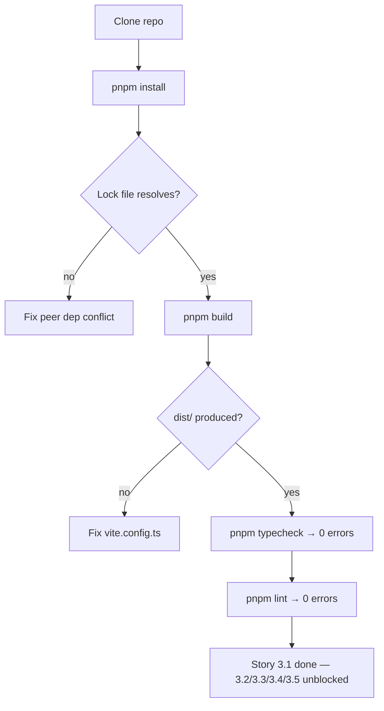

### Story 3.1: Repo Scaffold

**File**: `docs/plans/stories/epic-3-story-3.1-repo-scaffold.md`

**BUILDID**: CYCLE-1 | **AzureDevOps**: #23665 | **Epic**: 3 - FOUNDATION SETUP | **ID**: 3.1 | **Date**: 2026-10-12
**Wave**: 1
**Requires**: []
**Enables**: [3.2, 3.3, 3.4, 3.5, 3.6]
**Files Touched**:
  - package.json
  - tsconfig.json
  - vite.config.ts
  - .npmrc
  - .prettierrc
  - .eslintrc.cjs
  - pnpm-workspace.yaml
**Roles Ref**: docs/requirements.md#roles--permissions-matrix — single-actor — no role variation
**QA Candidate**: Yes — **Observable:** `pnpm install` completes without peer dependency errors; `pnpm build` produces four output files (`dist/index.es.js`, `dist/index.cjs.js`, `dist/index.d.ts`, `dist/style.css`); `pnpm typecheck` exits 0; `pnpm lint` exits 0; the `@annexus/ui` scope is correctly wired to GitHub Packages in `.npmrc`. **Mechanism:** Vite 6 in library mode (ESM + CJS dual output) driven by `vite.config.ts`; TypeScript `strict: true` in `tsconfig.json`; ESLint and Prettier configured to enforce the project's code standards; `.npmrc` redirects `@annexus` packages to `https://npm.pkg.github.com`. **Authz & preconditions:** no RBAC — single actor; requires GitHub repository `nubiabarba-3pg/annexus-design-system` to exist on main branch; Node.js 26 LTS installed. **Edge/idempotency:** running `pnpm install` twice produces the same lockfile; running `pnpm build` from a clean `dist/` directory always produces identical output. **Regression:** CI pipeline (Story 3.6) gates on `pnpm build`, `pnpm typecheck`, `pnpm lint` — any scaffold regression breaks CI.

---

#### 👤 User Reference

**Description**:
This story delivers the complete repository scaffold for `@annexus/ui` — the Annexus Design System package. After this story, the repo is a working Node.js project with TypeScript strict mode, Vite 6 library mode output (ESM + CJS), pnpm workspace, ESLint, Prettier, and GitHub Packages registry configuration. No components yet — just the infrastructure that lets DEV start working on Stories 3.2–3.5 in parallel. This is the single prerequisite for all other CYCLE-1 stories.

**Acceptance Criteria** (plain-English):
- `pnpm install` completes without warnings or peer dependency errors
- `pnpm build` produces `dist/index.es.js` (ESM), `dist/index.cjs.js` (CJS), `dist/index.d.ts` (types), `dist/style.css`
- `pnpm typecheck` exits 0 (zero TypeScript errors, strict mode)
- `pnpm lint` exits 0 (zero ESLint errors)
- `.npmrc` correctly scopes `@annexus` to GitHub Packages registry
- `package.json` `name` is `@annexus/ui`, `version` is `0.0.1`, `main`/`module`/`types` point to `dist/`
- TypeScript `strict: true`, `target: "ESNext"`, `moduleResolution: "bundler"`

**User Journey** (no role variation — single actor: DEV / Frontend Engineer):
- **Clone**: DEV clones `nubiabarba-3pg/annexus-design-system`, runs `pnpm install` — lock file resolves in < 2 min.
- **Build empty package**: `pnpm build` — Vite produces `dist/` with four files. The `dist/index.es.js` is an empty barrel export for now.
- **Type check**: `pnpm typecheck` — TypeScript strict passes on the empty src/index.ts.
- **Lint**: `pnpm lint` — ESLint passes on all config files.
- **Start next story**: DEV branches off and begins Story 3.2 (tokens) or 3.3 (Storybook) — both are unblocked once this story merges.

**Flow Diagram**:



---

#### 🤖 AI Agent Reference

**Must Read**:
- `docs/architecture/design/00-system-architecture-greenfield.md` — ADR-001 (pnpm), ADR-002 (Vite 6 library mode), ADR-003 (Node 26 LTS), ADR-005 (GitHub Packages)
- `docs/plans/builds/cycle-1/cycle-plan.md` — full scaffold scope and acceptance criteria

**Design Tokens**: N/A — no UI tokens in this story; tokens are delivered by Story 3.2.

**Description**:
This story creates the project skeleton. `package.json` declares the `@annexus/ui` package name, sets `"type": "module"`, maps `main`/`module`/`types`/`exports` to `dist/`, and lists React 18 + ReactDOM as peer dependencies. `vite.config.ts` uses `defineConfig` in `lib` mode: `entry: 'src/index.ts'`, formats `['es', 'cjs']`, external `['react', 'react-dom']`. `tsconfig.json` enables `strict`, `jsx: 'react-jsx'`, `moduleResolution: 'bundler'`, `declaration: true`, `outDir: 'dist'`. `.eslintrc.cjs` extends `plugin:@typescript-eslint/recommended` + `plugin:react-hooks/recommended`. `.prettierrc` enforces `singleQuote: true`, `semi: true`, `tabWidth: 2`. `.npmrc` adds `@annexus:registry=https://npm.pkg.github.com`. `pnpm-workspace.yaml` is a single-package workspace (no monorepo for now). `src/index.ts` is an empty file — the barrel grows per component story.

**Acceptance Criteria** (comprehensive):
- `package.json` name = `@annexus/ui`; version = `0.0.1`; type = `module`; peerDeps include `react@^18.0.0` and `react-dom@^18.0.0`
- `package.json` scripts: `build`, `dev`, `storybook`, `build-storybook`, `test`, `typecheck`, `lint`, `prepublishOnly`
- `vite.config.ts` lib entry = `src/index.ts`; formats = `['es', 'cjs']`; external = `['react', 'react/jsx-runtime', 'react-dom']`; `rollupOptions.output.assetFileNames` sets CSS output to `style.css`
- `tsconfig.json` `strict: true`; `target: "ESNext"`; `moduleResolution: "bundler"`; `jsx: "react-jsx"`; `declaration: true`; `declarationDir: "dist"`; `outDir: "dist"`; `include: ["src"]`
- `.eslintrc.cjs` extends `@typescript-eslint/recommended`; `react-hooks/recommended`; `react/react-in-jsx-scope` rule OFF (React 17+ JSX transform)
- `.npmrc` line: `@annexus:registry=https://npm.pkg.github.com`
- `src/index.ts` exists (empty or comment-only) — no export errors
- `pnpm build` exits 0; `dist/` contains exactly: `index.es.js`, `index.cjs.js`, `index.d.ts`, `style.css`
- `pnpm typecheck` exits 0
- `pnpm lint` exits 0

**RBAC Enforcement**: No role-differentiated access — single actor.

**System responses + error cases**:

| Trigger | Response | Side-effect |
|---------|----------|-------------|
| `pnpm install` (first run) | Lock file generated; node_modules populated | `pnpm-lock.yaml` committed |
| `pnpm build` (empty src) | Produces 4 dist files; empty ESM/CJS exports | `dist/` created |
| `pnpm typecheck` | TypeScript strict passes on empty barrel | none |
| `pnpm lint` | ESLint passes; no violations on config files | none |
| `.npmrc` missing | `pnpm publish` would push to npm public registry instead of GitHub Packages | Misconfigured CI publish |

**QA-observable behaviour**:
- `pnpm install`: exits 0; `node_modules/` created; `pnpm-lock.yaml` generated.
- `pnpm build`: exits 0; `ls dist/` shows `index.es.js`, `index.cjs.js`, `index.d.ts`, `style.css`.
- `pnpm typecheck`: exits 0; no output (clean).
- `pnpm lint`: exits 0; no warnings for config files.
- `.npmrc` check: `grep "@annexus" .npmrc` returns `@annexus:registry=https://npm.pkg.github.com`.
- **What does NOT change**: `src/` is still empty after this story; no React component code exists yet.

**Prerequisites**:
- GitHub repository `nubiabarba-3pg/annexus-design-system` exists with main branch
- Node.js 26 LTS installed locally and in CI environment
- pnpm installed globally (`npm i -g pnpm` or via Corepack)

**Context**:
- `docs/architecture/design/00-system-architecture-greenfield.md`
- `docs/plans/builds/cycle-1/cycle-plan.md`

**Patterns**: Vite 6 library mode (ESM + CJS dual output); TypeScript strict; pnpm workspace; GitHub Packages scoped registry

**Steps**:

1. **Initialize package.json**:
   ```json
   {
     "name": "@annexus/ui",
     "version": "0.0.1",
     "description": "Annexus Design System — React component library",
     "type": "module",
     "main": "./dist/index.cjs.js",
     "module": "./dist/index.es.js",
     "types": "./dist/index.d.ts",
     "exports": {
       ".": {
         "import": "./dist/index.es.js",
         "require": "./dist/index.cjs.js",
         "types": "./dist/index.d.ts"
       },
       "./style.css": "./dist/style.css"
     },
     "files": ["dist"],
     "scripts": {
       "build": "vite build",
       "dev": "vite build --watch",
       "storybook": "storybook dev -p 6006",
       "build-storybook": "storybook build",
       "test": "vitest run",
       "test:watch": "vitest",
       "coverage": "vitest run --coverage",
       "typecheck": "tsc --noEmit",
       "lint": "eslint src --ext ts,tsx --report-unused-disable-directives --max-warnings 0",
       "prepublishOnly": "pnpm run build && pnpm run typecheck"
     },
     "peerDependencies": {
       "react": "^18.0.0",
       "react-dom": "^18.0.0"
     },
     "devDependencies": {
       "@storybook/addon-a11y": "^8.0.0",
       "@storybook/addon-essentials": "^8.0.0",
       "@storybook/react": "^8.0.0",
       "@storybook/react-vite": "^8.0.0",
       "@testing-library/jest-dom": "^6.0.0",
       "@testing-library/react": "^16.0.0",
       "@testing-library/user-event": "^14.0.0",
       "@types/react": "^18.0.0",
       "@types/react-dom": "^18.0.0",
       "@typescript-eslint/eslint-plugin": "^7.0.0",
       "@typescript-eslint/parser": "^7.0.0",
       "@vitejs/plugin-react": "^4.0.0",
       "@vitest/coverage-v8": "^2.0.0",
       "clsx": "^2.1.0",
       "eslint": "^8.0.0",
       "eslint-plugin-react": "^7.0.0",
       "eslint-plugin-react-hooks": "^4.0.0",
       "jsdom": "^24.0.0",
       "prettier": "^3.0.0",
       "react": "^18.0.0",
       "react-dom": "^18.0.0",
       "sass": "^1.70.0",
       "storybook": "^8.0.0",
       "typescript": "^5.4.0",
       "vite": "^6.0.0",
       "vite-plugin-dts": "^3.0.0",
       "vitest": "^2.0.0"
     }
   }
   ```

2. **Create `vite.config.ts`**:
   ```typescript
   import { defineConfig } from 'vite';
   import react from '@vitejs/plugin-react';
   import dts from 'vite-plugin-dts';
   import { resolve } from 'path';

   export default defineConfig({
     plugins: [
       react(),
       dts({ include: ['src'], exclude: ['src/**/*.stories.tsx', 'src/**/*.test.tsx'] }),
     ],
     build: {
       lib: {
         entry: resolve(__dirname, 'src/index.ts'),
         formats: ['es', 'cjs'],
         fileName: (format) => `index.${format === 'es' ? 'es' : 'cjs'}.js`,
       },
       rollupOptions: {
         external: ['react', 'react/jsx-runtime', 'react-dom'],
         output: {
           globals: { react: 'React', 'react-dom': 'ReactDOM' },
           assetFileNames: (assetInfo) =>
             assetInfo.name === 'style.css' ? 'style.css' : assetInfo.name!,
         },
       },
     },
   });
   ```

3. **Create `tsconfig.json`**:
   ```json
   {
     "compilerOptions": {
       "target": "ESNext",
       "lib": ["ESNext", "DOM", "DOM.Iterable"],
       "module": "ESNext",
       "moduleResolution": "bundler",
       "jsx": "react-jsx",
       "strict": true,
       "noUnusedLocals": true,
       "noUnusedParameters": true,
       "noFallthroughCasesInSwitch": true,
       "declaration": true,
       "declarationDir": "dist",
       "outDir": "dist",
       "skipLibCheck": true,
       "allowSyntheticDefaultImports": true,
       "esModuleInterop": true
     },
     "include": ["src"],
     "exclude": ["node_modules", "dist", "**/*.stories.tsx", "**/*.test.tsx"]
   }
   ```

4. **Create `.npmrc`**:
   ```
   @annexus:registry=https://npm.pkg.github.com
   ```

5. **Create `.prettierrc`**:
   ```json
   {
     "singleQuote": true,
     "semi": true,
     "tabWidth": 2,
     "trailingComma": "all",
     "printWidth": 100
   }
   ```

6. **Create `.eslintrc.cjs`**:
   ```javascript
   module.exports = {
     root: true,
     env: { browser: true, es2020: true },
     extends: [
       'eslint:recommended',
       'plugin:@typescript-eslint/recommended',
       'plugin:react-hooks/recommended',
     ],
     ignorePatterns: ['dist', '.eslintrc.cjs'],
     parser: '@typescript-eslint/parser',
     plugins: ['react-refresh'],
     rules: {
       'react/react-in-jsx-scope': 'off',
       '@typescript-eslint/no-unused-vars': ['error', { argsIgnorePattern: '^_' }],
     },
   };
   ```

7. **Create `pnpm-workspace.yaml`**:
   ```yaml
   packages:
     - '.'
   ```

8. **Create `src/index.ts`** (empty barrel — grows per component story):
   ```typescript
   // @annexus/ui public API — exports added per component story
   ```

9. **Create `src/` directory structure**:
   ```bash
   mkdir -p src/components src/hooks src/utils src/types src/styles src/test
   ```

10. **Run verification**:
    ```bash
    pnpm install
    pnpm build
    pnpm typecheck
    pnpm lint
    ls dist/
    ```

**Tests** (manual — no Vitest tests for config files):
- `pnpm install` exits 0; no peer dep warnings
- `pnpm build` exits 0; `dist/` contains exactly 4 files
- `pnpm typecheck` exits 0
- `pnpm lint` exits 0
- `cat .npmrc` shows `@annexus:registry=https://npm.pkg.github.com`

**Quality**: `pnpm build` exits 0; `pnpm typecheck` exits 0; `pnpm lint` exits 0; no snapshot tests needed for scaffold

**OUT**:
- ❌ No React components in this story — `src/index.ts` is an empty barrel
- ❌ No SCSS token files — delivered by Story 3.2
- ❌ No Storybook configuration — delivered by Story 3.3
- ❌ No Vitest configuration — delivered by Story 3.4
- ❌ No CI/CD pipeline — delivered by Story 3.6

**Evidence**:
- Terminal output of `pnpm install` (exit 0, no warnings)
- Terminal output of `pnpm build` (exit 0; `ls dist/` showing 4 files)
- Terminal output of `pnpm typecheck` (exit 0, clean)
- Terminal output of `pnpm lint` (exit 0, no warnings)
