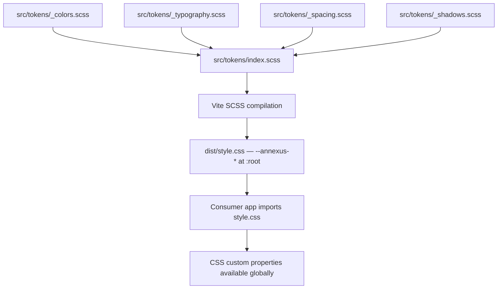

### Story 3.2: SCSS Design Tokens

**File**: `docs/plans/stories/epic-3-story-3.2-design-tokens.md`

**BUILDID**: CYCLE-1 | **AzureDevOps**: #23669 | **Epic**: 3 - FOUNDATION SETUP | **ID**: 3.2 | **Date**: 2026-10-12
**Wave**: 4
**Requires**: [3.1]
**Enables**: [3.6]
**Files Touched**:
  - src/tokens/_colors.scss
  - src/tokens/_typography.scss
  - src/tokens/_spacing.scss
  - src/tokens/_shadows.scss
  - src/tokens/index.scss
**Roles Ref**: docs/requirements.md#roles--permissions-matrix — single-actor — no role variation
**QA Candidate**: Yes — **Observable:** after `pnpm build`, `dist/style.css` contains CSS custom properties beginning with `--annexus-` at `:root`; opening a browser with the built CSS loaded shows all `--annexus-color-*`, `--annexus-font-*`, `--annexus-spacing-*`, and `--annexus-shadow-*` properties in DevTools → Elements → `:root`. **Mechanism:** Vite SCSS compilation processes `src/tokens/index.scss` (which `@forward`s the four partials) and emits CSS with all custom properties to `dist/style.css`. Each component's SCSS uses `@use '../../tokens/index' as tokens` and references `var(--annexus-*)` variables. **Authz & preconditions:** requires Story 3.1 (repo scaffold) merged; `sass` devDependency installed; Vite configured to handle `.scss` files. **Edge/idempotency:** building the same token files twice produces identical CSS output. **Regression:** any component story that imports `var(--annexus-color-brand-primary, #11175E)` depends on this story being merged first; Story 3.6 CI gate runs `pnpm build` which compiles tokens.

---

#### 👤 User Reference

**Description**:
This story delivers the SCSS design token system for `@annexus/ui` — all brand colors, typography scale, spacing scale, and shadow values defined as CSS custom properties at `:root` using the `--annexus-{category}-{scale}-{variant}` naming convention. After this story, component SCSS files can reference `var(--annexus-color-brand-primary)` instead of hardcoded hex values. All token values are extracted from the approved Figma design (file DjPqMQEOe6khkoqIVQ8a9u) and documented in `docs/ui-ux/ui-ux-spec.md`.

**Acceptance Criteria** (plain-English):
- All color tokens from `docs/ui-ux/ui-ux-spec.md` are defined as `--annexus-color-*` properties
- All typography tokens (font family, sizes, weights, line-heights) are defined as `--annexus-font-*`
- All spacing tokens are defined as `--annexus-spacing-*`
- All shadow tokens are defined as `--annexus-shadow-*`
- `dist/style.css` contains all properties scoped to `:root`
- All tokens visible in browser DevTools at `:root` after loading the built CSS

**User Journey** (no role variation — single actor: DEV / Frontend Engineer):
- **Import**: component SCSS writes `@use '../../tokens/index' as tokens;` at the top.
- **Reference**: uses `color: var(--annexus-color-brand-primary, #11175E);` — the fallback ensures component renders even if `style.css` is not loaded.
- **Build**: `pnpm build` compiles tokens into `dist/style.css`.
- **Consumer app**: imports `@annexus/ui/style.css` once at app root — all custom properties available globally.

**Flow Diagram**:



---

#### 🤖 AI Agent Reference

**Must Read**:
- `docs/ui-ux/ui-ux-spec.md` — `design_tokens` section: exact color values, font values, shadow values, border-radius values, touch target values
- `docs/architecture/design/01-patterns-and-standards-greenfield.md` — token naming convention `--annexus-{category}-{scale}-{variant}`, SCSS module system

**Design Tokens**: This story IS the design token system — it defines all tokens for all other stories.

**Description**:
Four SCSS partials under `src/tokens/` define all design tokens as CSS custom properties at `:root`. A barrel `src/tokens/index.scss` forwards all four partials so component SCSS files need only one import. The naming convention is `--annexus-{category}-{scale}-{variant}` — e.g., `--annexus-color-brand-primary`, `--annexus-color-gray-200`, `--annexus-font-size-sm`, `--annexus-shadow-lg`. All values extracted from `docs/ui-ux/ui-ux-spec.md`.

**Acceptance Criteria** (comprehensive):
- `_colors.scss`: defines `--annexus-color-brand-primary: #11175E`, `--annexus-color-brand-hover: #1B3E80`, `--annexus-color-brand-cta: #0167AC`, `--annexus-color-semantic-success: #079455`, `--annexus-color-semantic-error: #B73B3B`, `--annexus-color-neutral-white: #FFFFFF`, `--annexus-color-neutral-black: #222222`, all 9 gray scale values (50 through 900)
- `_typography.scss`: defines `--annexus-font-family-base: 'Assistant', sans-serif`, font-size scale (xs/sm/md/lg/xl/2xl), font-weight scale (regular/medium/semibold/bold), line-height scale
- `_spacing.scss`: defines spacing scale (1–12 steps mapped to px/rem values) as `--annexus-spacing-{N}`
- `_shadows.scss`: defines `--annexus-shadow-xs`, `--annexus-shadow-xs-skeuomorphic`, `--annexus-shadow-lg`; also `--annexus-radius-sm: 3px`, `--annexus-radius-md: 4px`, `--annexus-radius-full: 9999px`
- `index.scss` uses `@forward` for all four partials (not `@import` — SCSS modules)
- `dist/style.css` contains all properties at `:root {}` after `pnpm build`
- All component stories referencing these tokens render without fallback values visible

**RBAC Enforcement**: No role-differentiated access — single actor.

**System responses + error cases**:

| Trigger | Response | Side-effect |
|---------|----------|-------------|
| `pnpm build` with all 4 partials | `dist/style.css` contains all `--annexus-*` custom properties | none |
| Component uses `var(--annexus-color-brand-primary, #11175E)` | Resolves to `#11175E` from `:root` when `style.css` loaded | none |
| Consumer forgets to import `style.css` | Fallback value `#11175E` renders — no broken styles | Visual warning in console expected |
| Token partial missing from index.scss | `pnpm build` fails — `@forward` not found | Fix: add missing `@forward` |

**QA-observable behaviour**:
- `pnpm build` exits 0; `dist/style.css` exists and is non-empty.
- Browser DevTools → Elements → `:root`: shows `--annexus-color-brand-primary: #11175E` (and 30+ other properties).
- `grep --annexus-color-brand-primary dist/style.css` returns a match.
- `grep --annexus-shadow-lg dist/style.css` returns a match.
- **What does NOT change**: tokens are CSS custom properties — they have no JavaScript representation; they don't affect TypeScript types.

**Prerequisites**:
- Story 3.1 merged: `vite.config.ts` configured, `sass` devDependency installed, `src/tokens/` directory created

**Context**:
- `docs/ui-ux/ui-ux-spec.md` — `design_tokens` block (canonical source for all values)
- `docs/architecture/design/01-patterns-and-standards-greenfield.md` — naming convention and SCSS module usage

**Patterns**: SCSS module system (`@use`/`@forward`); CSS custom properties at `:root`; fallback values in `var()` calls

**Steps**:

1. **Create `src/tokens/_colors.scss`**:
   ```scss
   // Brand colors
   :root {
     --annexus-color-brand-primary: #11175E;
     --annexus-color-brand-hover: #1B3E80;
     --annexus-color-brand-cta: #0167AC;
     --annexus-color-brand-700: #044638;

     // Semantic
     --annexus-color-semantic-success: #079455;
     --annexus-color-semantic-error: #B73B3B;
     --annexus-color-control-off: #CED6DB;

     // Neutral
     --annexus-color-neutral-white: #FFFFFF;
     --annexus-color-neutral-black: #222222;

     // Gray scale
     --annexus-color-gray-50: #FAFAFA;
     --annexus-color-gray-100: #F5F5F5;
     --annexus-color-gray-200: #E9EAEB;
     --annexus-color-gray-300: #D5D7DA;
     --annexus-color-gray-400: #A4A7AE;
     --annexus-color-gray-500: #717680;
     --annexus-color-gray-600: #535862;
     --annexus-color-gray-700: #414651;
     --annexus-color-gray-800: #252B37;
     --annexus-color-gray-900: #181D27;
   }
   ```

2. **Create `src/tokens/_typography.scss`**:
   ```scss
   :root {
     --annexus-font-family-base: 'Assistant', sans-serif;

     // Size scale
     --annexus-font-size-xs: 0.75rem;   // 12px
     --annexus-font-size-sm: 0.875rem;  // 14px
     --annexus-font-size-md: 1rem;      // 16px
     --annexus-font-size-lg: 1.125rem;  // 18px
     --annexus-font-size-xl: 1.25rem;   // 20px
     --annexus-font-size-2xl: 1.5rem;   // 24px

     // Weight scale
     --annexus-font-weight-regular: 400;
     --annexus-font-weight-medium: 500;
     --annexus-font-weight-semibold: 600;
     --annexus-font-weight-bold: 700;

     // Line-height scale
     --annexus-line-height-xs: 1.125rem;  // 18px
     --annexus-line-height-sm: 1.25rem;   // 20px
     --annexus-line-height-md: 1.5rem;    // 24px
     --annexus-line-height-lg: 1.75rem;   // 28px
   }
   ```

3. **Create `src/tokens/_spacing.scss`**:
   ```scss
   :root {
     --annexus-spacing-1: 0.25rem;   // 4px
     --annexus-spacing-2: 0.5rem;    // 8px
     --annexus-spacing-3: 0.75rem;   // 12px
     --annexus-spacing-4: 1rem;      // 16px
     --annexus-spacing-5: 1.25rem;   // 20px
     --annexus-spacing-6: 1.5rem;    // 24px
     --annexus-spacing-8: 2rem;      // 32px
     --annexus-spacing-10: 2.5rem;   // 40px
     --annexus-spacing-12: 3rem;     // 48px
   }
   ```

4. **Create `src/tokens/_shadows.scss`**:
   ```scss
   :root {
     --annexus-shadow-xs: 0 1px 2px rgba(10, 13, 18, 0.05);
     --annexus-shadow-xs-skeuomorphic:
       0 1px 2px rgba(16, 24, 40, 0.05),
       inset 0 -2px 0 rgba(10, 13, 18, 0.05),
       inset 0 0 0 1px rgba(10, 13, 18, 0.18);
     --annexus-shadow-lg:
       0 2px 2px -1px rgba(10, 13, 18, 0.04),
       0 4px 6px -2px rgba(10, 13, 18, 0.03),
       0 12px 16px -4px rgba(10, 13, 18, 0.08);

     // Border radius
     --annexus-radius-sm: 3px;
     --annexus-radius-md: 4px;
     --annexus-radius-full: 9999px;

     // Touch targets
     --annexus-touch-target-min: 24px;
     --annexus-touch-target-control: 44px;
   }
   ```

5. **Create `src/tokens/index.scss`**:
   ```scss
   @forward 'colors';
   @forward 'typography';
   @forward 'spacing';
   @forward 'shadows';
   ```

6. **Verify build**:
   ```bash
   pnpm build
   grep 'annexus-color-brand-primary' dist/style.css
   grep 'annexus-shadow-lg' dist/style.css
   ```

**Tests** (manual):
- `pnpm build` exits 0; `dist/style.css` non-empty
- Open a simple HTML file that imports `dist/style.css`; open DevTools → `:root` — all `--annexus-*` properties visible
- Count: at least 30 custom properties defined

**Quality**: `pnpm build` exits 0; `pnpm typecheck` exits 0; all values match `docs/ui-ux/ui-ux-spec.md`

**OUT**:
- ❌ No JavaScript token exports (tokens are CSS-only; no `tokens.ts` object)
- ❌ No dark-mode token overrides (no dark mode per architecture ADR)
- ❌ No component-specific tokens (component SCSS uses global tokens via `var()`)

**Evidence**:
- Terminal output of `pnpm build` (exit 0)
- Screenshot of browser DevTools showing `--annexus-color-brand-primary: #11175E` at `:root`
- `grep` output confirming key token names in `dist/style.css`
