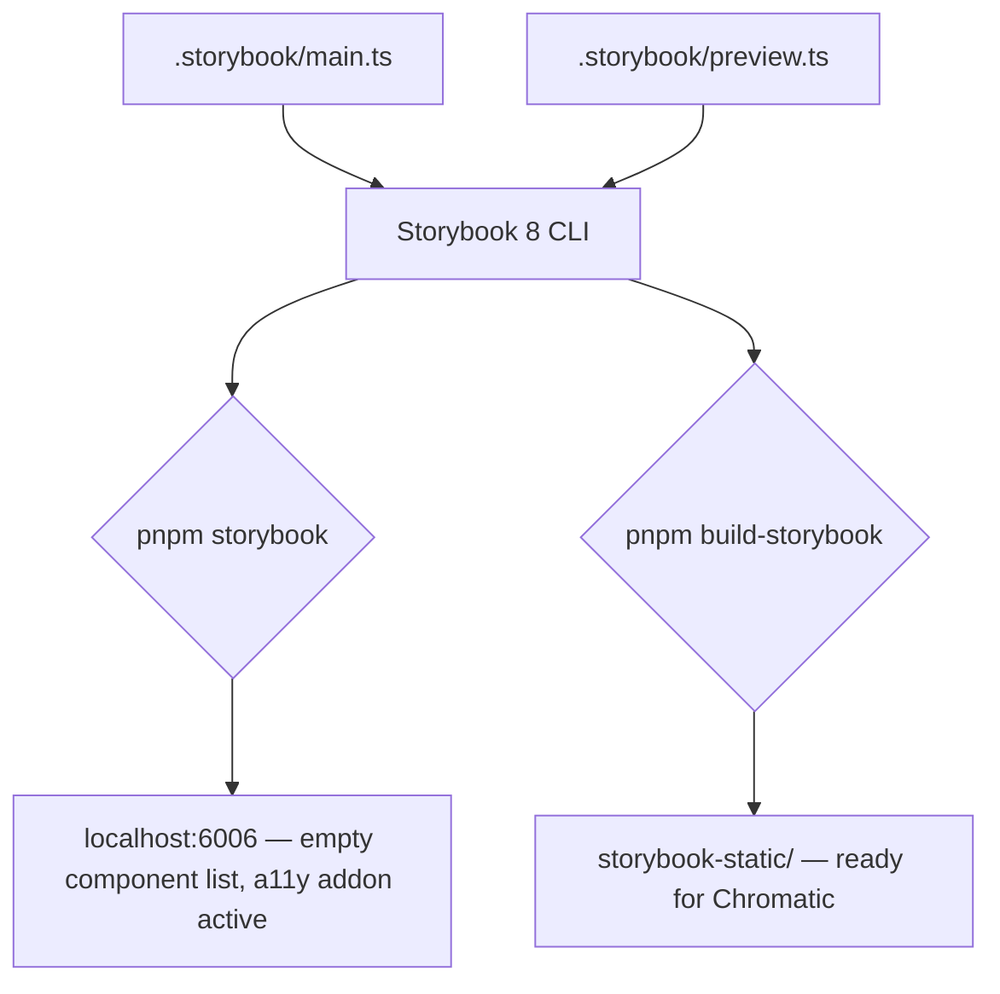

### Story 3.3: Storybook 8.x Setup

**File**: `docs/plans/stories/epic-3-story-3.3-storybook.md`

**BUILDID**: CYCLE-1 | **AzureDevOps**: #23668 | **Epic**: 3 - FOUNDATION SETUP | **ID**: 3.3 | **Date**: 2026-10-12
**Wave**: 2
**Requires**: [3.1]
**Enables**: [3.6]
**Files Touched**:
  - .storybook/main.ts
  - .storybook/preview.ts
**Roles Ref**: docs/requirements.md#roles--permissions-matrix — single-actor — no role variation
**QA Candidate**: Yes — **Observable:** `pnpm storybook` launches on `http://localhost:6006` with zero console errors; the Storybook UI shows an empty component list (no stories yet); the a11y addon tab is visible in the addons panel; `pnpm build-storybook` exits 0 and produces a `storybook-static/` directory. **Mechanism:** `main.ts` registers `@storybook/react-vite` as the framework, wires the a11y and essentials addons, and points the stories glob to `src/**/*.stories.tsx`; `preview.ts` imports `src/styles.scss` so global styles are available in every story. **Authz & preconditions:** requires Story 3.1 (repo scaffold with Storybook devDeps). **Edge/idempotency:** running `pnpm storybook` twice on the same config always produces the same empty UI. **Regression:** Story 3.6 CI gate runs `pnpm build-storybook`; every component story added in CYCLE-2+ depends on this config being correct.

---

#### 👤 User Reference

**Description**:
This story delivers the Storybook 8.x configuration for `@annexus/ui`. After this story, running `pnpm storybook` launches a local Storybook server on port 6006 with the a11y addon active. No stories exist yet — the component list is empty. The configuration is correct and ready to display CSF3 stories as soon as components are added in CYCLE-2. `pnpm build-storybook` must also pass for CI integration in Story 3.6.

**Acceptance Criteria** (plain-English):
- `pnpm storybook` launches on port 6006 with zero console errors
- The a11y addon tab is visible in the Storybook addons panel
- The autodocs feature is enabled
- `pnpm build-storybook` exits 0 and produces `storybook-static/`
- Design token CSS is imported in `preview.ts` so all component stories have access to `--annexus-*` properties

**User Journey** (no role variation — single actor: DEV):
- **Start**: `pnpm storybook` → browser opens at `http://localhost:6006` → empty component sidebar → no errors.
- **a11y tab**: click any future story → "Accessibility" tab appears in addons panel.
- **Build**: `pnpm build-storybook` → `storybook-static/` ready for Chromatic upload.

**Flow Diagram**:



---

#### 🤖 AI Agent Reference

**Must Read**:
- `docs/architecture/design/01-patterns-and-standards-greenfield.md` — CSF3 requirement, a11y addon requirement, autodocs requirement
- `docs/plans/builds/cycle-1/cycle-plan.md` — Storybook acceptance criteria

**Design Tokens**: N/A — this story configures Storybook; token import in `preview.ts` ensures all future stories have CSS custom properties.

**Description**:
Two files: `.storybook/main.ts` and `.storybook/preview.ts`. `main.ts` uses the `@storybook/react-vite` framework (same Vite config as the library build, sharing the SCSS preprocessor setup), registers `@storybook/addon-essentials` and `@storybook/addon-a11y`, and sets the stories glob. `preview.ts` imports `'../src/styles.scss'` so global styles are compiled and available in all stories; component SCSS pulls its own design variables through `@use`.

**Acceptance Criteria** (comprehensive):
- `.storybook/main.ts` framework is `@storybook/react-vite`
- `.storybook/main.ts` addons include `@storybook/addon-essentials` and `@storybook/addon-a11y`
- `.storybook/main.ts` stories glob: `['../src/**/*.stories.@(js|jsx|ts|tsx)']`
- `.storybook/main.ts` docs: `{ autodocs: 'tag' }` (enables autodocs for stories tagged `['autodocs']`)
- `.storybook/preview.ts` imports global styles: `import '../src/styles.scss'`
- `pnpm storybook` launches on port 6006; zero console errors; empty sidebar
- `pnpm build-storybook` exits 0; `storybook-static/index.html` exists
- a11y addon visible in addons panel of any story

**RBAC Enforcement**: No role-differentiated access — single actor.

**System responses + error cases**:

| Trigger | Response | Side-effect |
|---------|----------|-------------|
| `pnpm storybook` | Storybook launches on port 6006 with empty sidebar | HMR active for story files |
| `pnpm build-storybook` | `storybook-static/` produced; exits 0 | Ready for Chromatic upload |
| Story file added in CYCLE-2 | Storybook hot-reloads; new component appears in sidebar | none |
| a11y addon active | Accessibility tab visible in addons panel for every story | axe-core runs on each story |
| Token SCSS missing from preview.ts | `--annexus-*` properties absent in stories; fallback values render | Visual regressions |

**QA-observable behaviour**:
- `pnpm storybook` exits without error; browser shows Storybook at `http://localhost:6006`.
- Sidebar: "No stories" or empty component list (correct — no stories yet).
- Console: zero errors, zero warnings from Storybook config.
- `pnpm build-storybook` exits 0; `ls storybook-static/` shows `index.html`.
- **What does NOT change**: no component code is added; no stories are written in this story.

**Prerequisites**:
- Story 3.1 merged: `@storybook/react-vite`, `@storybook/addon-a11y`, `@storybook/addon-essentials`, `storybook` packages installed

**Context**:
- `docs/architecture/design/01-patterns-and-standards-greenfield.md` — CSF3, a11y addon, autodocs
- `docs/plans/builds/cycle-1/cycle-plan.md`

**Patterns**: `@storybook/react-vite` framework (shares Vite config); CSF3 stories pattern; a11y addon for WCAG 2.2 AA validation

**Steps**:

1. **Create `.storybook/main.ts`**:
   ```typescript
   import type { StorybookConfig } from '@storybook/react-vite';

   const config: StorybookConfig = {
     stories: ['../src/**/*.stories.@(js|jsx|ts|tsx)'],
     addons: [
       '@storybook/addon-essentials',
       '@storybook/addon-a11y',
     ],
     framework: {
       name: '@storybook/react-vite',
       options: {},
     },
     docs: {
       autodocs: 'tag',
     },
   };

   export default config;
   ```

2. **Create `.storybook/preview.ts`**:
   ```typescript
   import type { Preview } from '@storybook/react';
   import '../src/styles.scss';

   const preview: Preview = {
     parameters: {
       controls: {
         matchers: {
           color: /(background|color)$/i,
           date: /Date$/i,
         },
       },
       a11y: {
         // axe-core configuration — runs on every story
         config: {},
       },
     },
   };

   export default preview;
   ```

3. **Run and verify**:
   ```bash
   pnpm storybook
   # Open http://localhost:6006 — confirm empty sidebar, no errors
   # Ctrl+C

   pnpm build-storybook
   ls storybook-static/
   ```

**Tests** (manual):
- `pnpm storybook` opens; zero console errors; empty component list
- `pnpm build-storybook` exits 0; `storybook-static/index.html` exists
- a11y addon tab visible when any story is selected (verify after adding first component in CYCLE-2)

**Quality**: `pnpm storybook` exits cleanly; `pnpm build-storybook` exits 0; no TypeScript errors in `.storybook/` files

**OUT**:
- ❌ No component stories in this story — sidebar is empty
- ❌ No Chromatic connection yet (wired in Story 3.6 CI/CD)
- ❌ No custom Storybook theme or branding

**Evidence**:
- Terminal output of `pnpm build-storybook` (exit 0)
- Screenshot of `http://localhost:6006` showing Storybook with empty sidebar and zero console errors
