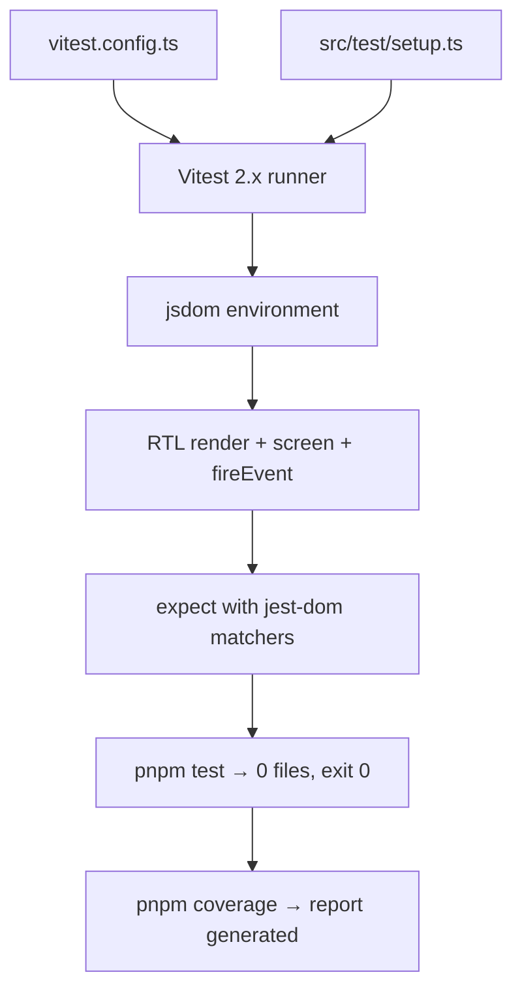

### Story 3.4: Vitest + RTL Setup

**File**: `docs/plans/stories/epic-3-story-3.4-vitest.md`

**BUILDID**: CYCLE-1 | **AzureDevOps**: #23666 | **Epic**: 3 - FOUNDATION SETUP | **ID**: 3.4 | **Date**: 2026-10-12
**Wave**: 2
**Requires**: [3.1]
**Enables**: [3.6]
**Files Touched**:
  - vitest.config.ts
  - src/test/setup.ts
**Roles Ref**: docs/requirements.md#roles--permissions-matrix — single-actor — no role variation
**QA Candidate**: Yes — **Observable:** `pnpm test` exits 0 with a coverage report generated showing 0 test files (baseline — no components yet); `pnpm coverage` exits 0 and produces a coverage report; the coverage threshold gates (lines/branches/functions/statements ≥ 90%) pass on an empty test suite (0/0 = 100%). **Mechanism:** `vitest.config.ts` sets `environment: 'jsdom'`, `setupFiles: ['./src/test/setup.ts']`, `coverage.provider: 'v8'`, and threshold gates; `setup.ts` imports `@testing-library/jest-dom` to extend Vitest's `expect` with DOM matchers. **Authz & preconditions:** requires Story 3.1 (vitest, @testing-library/*, jsdom devDeps installed). **Regression:** every component test file added in CYCLE-2+ depends on this config; if coverage falls below 90% threshold, `pnpm test` fails CI.

---

#### 👤 User Reference

**Description**:
This story configures Vitest 2.x with React Testing Library 16.x and `@testing-library/jest-dom` for the `@annexus/ui` package. After this story, running `pnpm test` produces a baseline coverage report with 0 test files (expected — no components yet). The coverage thresholds (≥ 90% lines/branches/functions/statements) are set and will enforce quality as component stories are added.

**Acceptance Criteria** (plain-English):
- `pnpm test` exits 0 with a coverage report showing 0 test files
- `pnpm coverage` exits 0 and generates a coverage report
- Coverage thresholds: lines ≥ 90%, branches ≥ 90%, functions ≥ 90%, statements ≥ 90%
- RTL `render`, `screen`, `fireEvent` importable in test files without extra configuration
- `expect(element).toBeInTheDocument()` works in test files (jest-dom matchers)
- `jsdom` environment active (no `window is not defined` errors in tests)

**User Journey** (no role variation — single actor: DEV):
- **Add test file**: create `Button.test.tsx`; import from `@testing-library/react`; use `expect(...).toBeInTheDocument()` — works immediately, no additional imports.
- **Run tests**: `pnpm test` — all tests run in jsdom environment.
- **Coverage gate**: `pnpm coverage` — coverage report; if any file < 90% threshold, test run fails.

**Flow Diagram**:



---

#### 🤖 AI Agent Reference

**Must Read**:
- `docs/architecture/design/01-patterns-and-standards-greenfield.md` — Vitest AAA pattern, coverage thresholds, RTL usage
- `docs/plans/builds/cycle-1/cycle-plan.md` — test acceptance criteria

**Design Tokens**: N/A — no UI tokens in this story.

**Description**:
`vitest.config.ts` extends the Vite config (shared SCSS/React plugin setup) and adds the test environment. Key settings: `environment: 'jsdom'`; `setupFiles: ['./src/test/setup.ts']`; `globals: true` (so `describe`/`it`/`expect` are available without imports in test files); `coverage.provider: 'v8'`; `coverage.include: ['src/components/**', 'src/hooks/**', 'src/utils/**']`; `coverage.exclude: ['src/**/*.stories.tsx', 'src/test/**']`; coverage thresholds at 90% for all four metrics. `src/test/setup.ts` imports `@testing-library/jest-dom/vitest` to register all DOM matchers globally.

**Acceptance Criteria** (comprehensive):
- `vitest.config.ts` imports `defineConfig` from `vitest/config`; environment = `jsdom`; globals = true; setupFiles = `['./src/test/setup.ts']`
- Coverage provider = `v8`; include = `['src/components/**', 'src/hooks/**', 'src/utils/**']`; exclude = `['**/*.stories.tsx', 'src/test/**', 'src/index.ts']`
- Coverage thresholds: lines ≥ 90, branches ≥ 90, functions ≥ 90, statements ≥ 90
- `src/test/setup.ts` contains `import '@testing-library/jest-dom/vitest'`
- `pnpm test` exits 0 (0 test files = baseline pass)
- `pnpm coverage` exits 0 with coverage report generated

**RBAC Enforcement**: No role-differentiated access — single actor.

**System responses + error cases**:

| Trigger | Response | Side-effect |
|---------|----------|-------------|
| `pnpm test` (no test files) | Exits 0; report shows 0 tests, 0 files | none |
| `pnpm coverage` (no src files) | Exits 0; coverage 100% on empty set | none |
| Component added below 90% coverage | `pnpm test` exits 1; coverage threshold failure reported | CI gate fails |
| `expect(el).toBeInTheDocument()` in test | jest-dom matcher resolves; no import needed | none |
| jsdom environment | `window`, `document`, `HTMLElement` all available | none |

**QA-observable behaviour**:
- `pnpm test` exits 0; terminal output shows "No test files found" or "0 passed".
- `pnpm coverage` exits 0; `coverage/` directory produced with `index.html`.
- In a test file: `import { render, screen } from '@testing-library/react'` works; `expect(screen.getByText('test')).toBeInTheDocument()` resolves without error.
- `globals: true` means no `import { describe, it, expect } from 'vitest'` needed in test files.

**Prerequisites**:
- Story 3.1 merged: `vitest`, `@vitest/coverage-v8`, `@testing-library/react`, `@testing-library/jest-dom`, `@testing-library/user-event`, `jsdom` installed

**Context**:
- `docs/architecture/design/01-patterns-and-standards-greenfield.md` — Vitest AAA pattern

**Patterns**: Vitest + RTL; jsdom environment; jest-dom custom matchers; coverage thresholds via `coverage.thresholds`

**Steps**:

1. **Create `vitest.config.ts`**:
   ```typescript
   import { defineConfig } from 'vitest/config';
   import react from '@vitejs/plugin-react';

   export default defineConfig({
     plugins: [react()],
     test: {
       globals: true,
       environment: 'jsdom',
       setupFiles: ['./src/test/setup.ts'],
       include: ['src/**/*.test.{ts,tsx}'],
       exclude: ['node_modules', 'dist', 'storybook-static'],
       coverage: {
         provider: 'v8',
         include: ['src/components/**', 'src/hooks/**', 'src/utils/**'],
         exclude: [
           'src/**/*.stories.tsx',
           'src/test/**',
           'src/index.ts',
           'src/types/**',
           'src/styles/**',
         ],
         thresholds: {
           lines: 90,
           branches: 90,
           functions: 90,
           statements: 90,
         },
       },
     },
   });
   ```

2. **Create `src/test/setup.ts`**:
   ```typescript
   import '@testing-library/jest-dom/vitest';
   ```

3. **Run verification**:
   ```bash
   pnpm test
   pnpm coverage
   ```

**Tests** (manual):
- `pnpm test` exits 0; shows 0 test files (baseline)
- `pnpm coverage` exits 0; `coverage/index.html` generated

**Quality**: `pnpm test` exits 0; `pnpm typecheck` exits 0 for `vitest.config.ts`

**OUT**:
- ❌ No test files written in this story (component tests are per-component story)
- ❌ No snapshot test configuration (no snapshot tests per architecture ADR)
- ❌ No Playwright / E2E setup (unit tests only in this design system)

**Evidence**:
- Terminal output of `pnpm test` (exit 0, 0 files)
- Terminal output of `pnpm coverage` (exit 0, coverage report generated)
