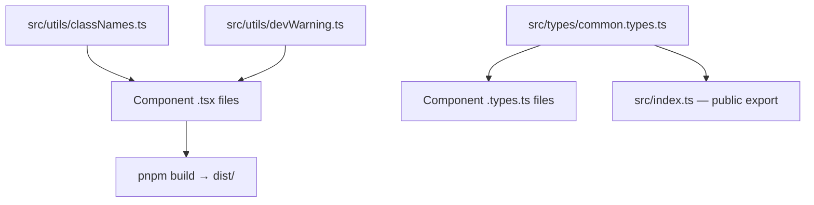

### Story 3.5: Shared Utilities and Types

**File**: `docs/plans/stories/epic-3-story-3.5-shared-utils.md`

**BUILDID**: CYCLE-1 | **AzureDevOps**: #23667 | **Epic**: 3 - FOUNDATION SETUP | **ID**: 3.5 | **Date**: 2026-10-12
**Wave**: 4
**Requires**: [3.1]
**Enables**: [3.6]
**Files Touched**:
  - src/utils/classNames.ts
  - src/utils/devWarning.ts
  - src/types/common.types.ts
  - src/index.ts
**Roles Ref**: docs/requirements.md#roles--permissions-matrix — single-actor — no role variation
**QA Candidate**: Yes — **Observable:** `pnpm typecheck` exits 0 for all four files; `pnpm test` for the `classNames.ts` unit tests exits 0 with 100% coverage; `devWarning` logs a console.warn only when `process.env.NODE_ENV !== 'production'`; all shared types (`Size`, `Variant`, `BaseProps`) are importable in component `.types.ts` files without errors. **Mechanism:** `classNames.ts` is a thin wrapper for conditional class joining (equivalent to `clsx` but without the external dep — or using clsx directly); `devWarning.ts` guards against invalid prop combinations at dev time only; `common.types.ts` provides reusable union types that multiple component type files extend. **Authz & preconditions:** requires Story 3.1 merged. **Regression:** every component story that uses `classNames` or imports from `common.types.ts` depends on this story.

---

#### 👤 User Reference

**Description**:
This story delivers the shared utility functions and TypeScript types that all component stories will use. `classNames.ts` conditionally joins CSS class names (thin wrapper around `clsx` which is already a devDependency). `devWarning.ts` emits `console.warn` for invalid prop combinations in development mode only — used by components to catch misuse early. `common.types.ts` defines reusable TypeScript types (`Size`, `Variant`, `BaseProps`) that multiple component type files extend. `src/index.ts` is updated to export these types as part of the public API.

**Acceptance Criteria** (plain-English):
- `classNames('a', false && 'b', 'c')` returns `'a c'`
- `devWarning(false, 'Component', 'Missing required prop')` logs to console.warn in dev only
- `Size`, `Variant`, `BaseProps` types importable from `@annexus/ui`
- `src/index.ts` exports shared types
- All files pass `pnpm typecheck`

**User Journey** (no role variation — single actor: DEV):
- **classNames**: `import { classNames } from '../../utils/classNames'` in any component → `classNames('btn', isDisabled && 'btn--disabled')` — no null/undefined in output.
- **devWarning**: `import { devWarning } from '../../utils/devWarning'` → `devWarning(condition, 'Button', 'hierarchy and disabled together is invalid')` — only fires in dev.
- **Types**: `import type { Size, BaseProps } from '../../types/common.types'` → used in component `.types.ts` files.

**Flow Diagram**:



---

#### 🤖 AI Agent Reference

**Must Read**:
- `docs/architecture/design/01-patterns-and-standards-greenfield.md` — shared utilities section, devWarning pattern, common types usage

**Design Tokens**: N/A — no UI tokens in this story.

**Description**:
`classNames.ts` re-exports `clsx` under a project-local name (or wraps it) — component files use `classNames(...)` rather than importing `clsx` directly, making the utility swappable. `devWarning.ts` checks `process.env.NODE_ENV !== 'production'` and calls `console.warn` with a formatted message. `common.types.ts` defines: `Size` union (`'sm' | 'md' | 'lg'`), `Tone` union (`'neutral' | 'info' | 'success' | 'warning' | 'danger'`), `BaseProps` interface (`className?: string; style?: React.CSSProperties`). `src/index.ts` gets public type exports added.

**Acceptance Criteria** (comprehensive):
- `classNames.ts` wraps `clsx`: `export const classNames = clsx` or equivalent — handles strings, falsy values, arrays
- `devWarning.ts` signature: `export function devWarning(condition: boolean, component: string, message: string): void` — warns if condition is `false` and NODE_ENV ≠ production
- `common.types.ts` exports: `Size` (`'sm' | 'md' | 'lg'`), `Tone` (`'neutral' | 'info' | 'success' | 'warning' | 'danger'`), `BaseProps` (`className?: string; style?: React.CSSProperties; 'data-testid'?: string`)
- `src/index.ts` exports: `export type { Size, Tone, BaseProps } from './types/common.types'`
- `pnpm typecheck` exits 0 for all files
- Vitest unit test for `classNames`: covers truthy, falsy, array, conditional inputs

**RBAC Enforcement**: No role-differentiated access — single actor.

**System responses + error cases**:

| Trigger | Response | Side-effect |
|---------|----------|-------------|
| `classNames('a', false, 'b')` | Returns `'a b'` | none |
| `classNames(undefined, null, 'c')` | Returns `'c'` | none |
| `devWarning(false, 'Button', 'msg')` in dev | `console.warn('[Button] msg')` | Visible in browser console |
| `devWarning(false, 'Button', 'msg')` in prod | No-op — condition guarded by NODE_ENV | none |
| `devWarning(true, ...)` | No-op — condition met, no warning needed | none |

**QA-observable behaviour**:
- `classNames('a', false && 'b', 'c')` → `'a c'` (no double spaces, no `false`).
- `devWarning(false, 'Button', 'test msg')` in test env: `console.warn` called once with `'[Button] test msg'`.
- `Size` type: `const s: Size = 'md'` compiles; `const s: Size = 'xl'` TypeScript error.
- `BaseProps` type: component props interface `extends BaseProps` compiles.

**Prerequisites**:
- Story 3.1 merged: `clsx` devDependency installed; TypeScript configured

**Context**:
- `docs/architecture/design/01-patterns-and-standards-greenfield.md`

**Patterns**: thin utility wrapper (swappable); dev-only guard; union types for shared prop shapes

**Steps**:

1. **Create `src/utils/classNames.ts`**:
   ```typescript
   export { clsx as classNames } from 'clsx';
   ```

2. **Create `src/utils/devWarning.ts`**:
   ```typescript
   export function devWarning(condition: boolean, component: string, message: string): void {
     if (!condition && process.env.NODE_ENV !== 'production') {
       console.warn(`[${component}] ${message}`);
     }
   }
   ```

3. **Create `src/types/common.types.ts`**:
   ```typescript
   import type { CSSProperties } from 'react';

   export type Size = 'sm' | 'md' | 'lg';

   export type Tone = 'neutral' | 'info' | 'success' | 'warning' | 'danger';

   export interface BaseProps {
     className?: string;
     style?: CSSProperties;
     'data-testid'?: string;
   }
   ```

4. **Update `src/index.ts`** — add shared type exports:
   ```typescript
   // @annexus/ui public API — exports added per component story
   export type { Size, Tone, BaseProps } from './types/common.types';
   ```

5. **Create `src/utils/classNames.test.ts`**:
   ```typescript
   import { describe, it, expect } from 'vitest';
   import { classNames } from './classNames';

   describe('classNames', () => {
     it('joins truthy strings', () => {
       expect(classNames('a', 'b')).toBe('a b');
     });
     it('ignores falsy values', () => {
       expect(classNames('a', false, undefined, null, 'b')).toBe('a b');
     });
     it('handles conditional expression', () => {
       const active = false;
       expect(classNames('btn', active && 'btn--active')).toBe('btn');
     });
     it('handles single class', () => {
       expect(classNames('only')).toBe('only');
     });
     it('returns empty string for all falsy', () => {
       expect(classNames(false, undefined)).toBe('');
     });
   });
   ```

6. **Run verification**:
   ```bash
   pnpm typecheck
   pnpm test src/utils/classNames.test.ts
   ```

**Tests** (manual):
- `pnpm typecheck` exits 0 for all four new files
- `pnpm test src/utils/` — 5 classNames tests pass; coverage 100%

**Quality**: `pnpm typecheck` exits 0; `pnpm test` 5 tests green; coverage 100% for utils

**OUT**:
- ❌ No `cn` alias — consistent use of `classNames` across all components
- ❌ No runtime type validation (TypeScript provides compile-time safety)
- ❌ No shared animation utilities (animation is per-component SCSS)

**Evidence**:
- Terminal output of `pnpm typecheck` (exit 0)
- Terminal output of `pnpm test src/utils/classNames.test.ts` (5 tests pass)
