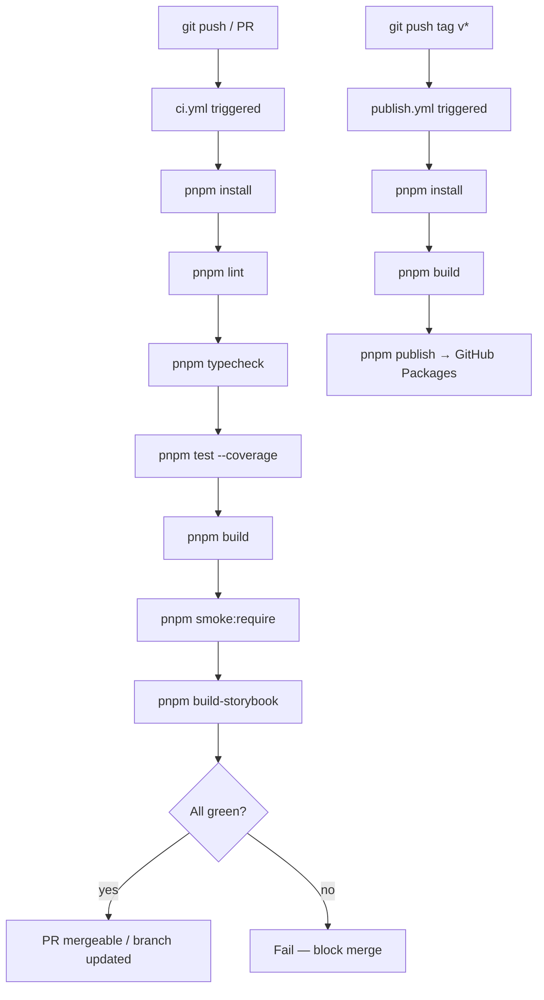

### Story 3.6: CI/CD Pipeline

**File**: `docs/plans/stories/epic-3-story-3.6-cicd.md`

**BUILDID**: CYCLE-1 | **AzureDevOps**: #23670 | **Epic**: 3 - FOUNDATION SETUP | **ID**: 3.6 | **Date**: 2026-10-13
**Wave**: 3
**Requires**: [CR-1.1, 3.2, 3.3, 3.4, 3.5]
**Enables**: []
**Files Touched**:
  - .github/workflows/ci.yml
  - .github/workflows/publish.yml
  - README.md
**Roles Ref**: docs/requirements.md#roles--permissions-matrix — single-actor — no role variation
**QA Candidate**: Yes — **Observable:** pushing to any branch triggers `ci.yml`; the GitHub Actions tab shows six sequential steps (lint → typecheck → test → build → smoke:require → build-storybook) all passing (green); merging to `main` also triggers the same pipeline; pushing a tag matching `v*` triggers `publish.yml` which publishes to GitHub Packages; `README.md` documents install and usage. **Mechanism:** `ci.yml` uses `actions/setup-node@v4` with `node-version: '20'` and `cache: 'pnpm'`; `publish.yml` uses `NODE_AUTH_TOKEN: ${{ secrets.GITHUB_TOKEN }}` against the GitHub Packages registry. **Authz & preconditions:** requires Stories CR-1.1 and 3.2–3.5 merged (all scripts available: lint, typecheck, test, build, smoke:require, build-storybook). **Regression:** any subsequent story that breaks lint/typecheck/test/build will fail CI, preventing merge to main.

---

#### 👤 User Reference

**Description**:
This story wires the GitHub Actions CI/CD pipeline for `@annexus/ui`. Two workflow files: `ci.yml` runs on every push and pull request (lint → typecheck → test with coverage → build → smoke:require → build-storybook); `publish.yml` runs on version tag push (`v*`) and publishes the built package to GitHub Packages. A `README.md` stub documents how to install and use the package. After this story, every code change is automatically validated and releases are a single `git tag` away.

**Acceptance Criteria** (plain-English):
- `ci.yml` triggers on push to any branch and on pull_request targeting main
- `ci.yml` steps: pnpm install → lint → typecheck → test (with coverage) → build → smoke:require → build-storybook — all exit 0
- `publish.yml` triggers on `push: tags: ['v*']`
- `publish.yml` publishes to `https://npm.pkg.github.com` using `GITHUB_TOKEN`
- `README.md` documents install (`pnpm add @annexus/ui`) and peer dependency requirements
- All six CI steps visible as green checks in GitHub Actions tab

**User Journey** (no role variation — single actor: DEV):
- **Push branch**: `git push origin feature/my-component` → GitHub Actions runs `ci.yml` → all checks green.
- **Open PR**: CI runs again on PR; merge blocked until all checks pass.
- **Release**: `git tag v0.1.0 && git push origin v0.1.0` → `publish.yml` triggers → package published to GitHub Packages.
- **Consume**: `pnpm add @annexus/ui` in a consuming app (with `.npmrc` pointing to GitHub Packages).

**Flow Diagram**:



---

#### 🤖 AI Agent Reference

**Must Read**:
- `docs/architecture/design/00-system-architecture-greenfield.md` — ADR-005 (GitHub Packages), CI/CD pipeline requirements
- `docs/plans/builds/cycle-1/cycle-plan.md` — CI/CD acceptance criteria

**Design Tokens**: N/A — no UI tokens in this story.

**Description**:
`ci.yml` uses the `ubuntu-latest` runner, installs pnpm via `pnpm/action-setup@v4`, sets up Node 20 with pnpm cache, then runs all six quality gates as sequential steps (each step has a clear `name:` for GitHub UI visibility). `publish.yml` also uses `ubuntu-latest`, runs pnpm install + build, then `pnpm publish --no-git-checks` with `NODE_AUTH_TOKEN` set to `${{ secrets.GITHUB_TOKEN }}` and registry-url pointing to `https://npm.pkg.github.com`. The `package.json` `publishConfig` field aligns with this registry. `README.md` covers: package description, prerequisites (Node 20+, `.npmrc` pointing to GitHub Packages), install command, peer deps, basic usage (importing a component), and a link to Storybook.

**Acceptance Criteria** (comprehensive):
- `ci.yml` triggers: `on: push` (all branches) + `on: pull_request: branches: [main]`
- `ci.yml` jobs: single `ci` job on `ubuntu-latest`; steps: checkout → pnpm setup → node setup with cache → install → lint → typecheck → test → build → smoke:require → build-storybook
- `ci.yml` test step runs `pnpm coverage` (not `pnpm test`) to enforce coverage thresholds
- `publish.yml` triggers: `on: push: tags: ['v*']`
- `publish.yml` permissions: `contents: read; packages: write`
- `publish.yml` uses `NODE_AUTH_TOKEN: ${{ secrets.GITHUB_TOKEN }}`; `registry-url: 'https://npm.pkg.github.com'`; `scope: '@annexus'`
- `package.json` has `"publishConfig": { "registry": "https://npm.pkg.github.com" }`
- `README.md` has install instructions, peer dep list, and basic import example
- `ci.yml` runs `pnpm smoke:require` after Build, so a CommonJS entry that exposes nothing fails CI
- All CI steps exit 0 on a clean main branch after Stories CR-1.1 and 3.2–3.5 are merged

**RBAC Enforcement**: No role-differentiated access — single actor.

**System responses + error cases**:

| Trigger | Response | Side-effect |
|---------|----------|-------------|
| Push to feature branch | `ci.yml` runs all six steps | GitHub commit status updated |
| Any step fails | CI fails; subsequent steps skipped | PR blocked from merge |
| Coverage below 90% | `pnpm coverage` exits 1 (threshold gate) | CI fails |
| `git push origin v0.1.0` | `publish.yml` runs; package published | Package visible at `https://github.com/nubiabarba-3pg/annexus-design-system/packages` |
| `GITHUB_TOKEN` missing | publish fails with auth error | Fix: ensure `permissions: packages: write` set |
| `pnpm publish` without `--no-git-checks` on CI | Fails if git dirty check runs | Fix: use `--no-git-checks` flag in CI |

**QA-observable behaviour**:
- GitHub Actions tab → `ci` workflow → all steps show green checkmarks.
- PR status checks: "ci / CI" appears as a required check.
- Tag push → `publish` workflow → Packages tab shows `@annexus/ui` at the tagged version.
- `cat README.md` → shows package name, install command, usage example.

**Prerequisites**:
- Stories CR-1.1 and 3.2–3.5 merged: all pnpm scripts available and working (CR-1.1 provides `smoke:require`)
- GitHub repository `nubiabarba-3pg/annexus-design-system` exists with Actions enabled
- GitHub token has `packages: write` permission (built-in GITHUB_TOKEN, no extra secrets needed)

**Context**:
- `docs/architecture/design/00-system-architecture-greenfield.md` — ADR-005 GitHub Packages

**Patterns**: GitHub Actions; pnpm cache via `actions/setup-node`; separate ci vs. publish workflows; coverage threshold as CI gate

**Steps**:

1. **Add `publishConfig` to `package.json`** — insert alongside existing fields:
   ```json
   "publishConfig": {
     "registry": "https://npm.pkg.github.com"
   }
   ```

2. **Create `.github/workflows/ci.yml`**:
   ```yaml
   name: CI

   on:
     push:
       branches: ['**']
     pull_request:
       branches: [main]

   jobs:
     ci:
       name: CI
       runs-on: ubuntu-latest

       steps:
         - name: Checkout
           uses: actions/checkout@v4

         - name: Setup pnpm
           uses: pnpm/action-setup@v4
           with:
             version: latest

         - name: Setup Node
           uses: actions/setup-node@v4
           with:
             node-version: '20'
             cache: 'pnpm'

         - name: Install dependencies
           run: pnpm install --frozen-lockfile

         - name: Lint
           run: pnpm lint

         - name: Typecheck
           run: pnpm typecheck

         - name: Test (with coverage)
           run: pnpm coverage

         - name: Build
           run: pnpm build

         - name: Smoke check CommonJS entry
           run: pnpm smoke:require

         - name: Build Storybook
           run: pnpm build-storybook
   ```

3. **Create `.github/workflows/publish.yml`**:
   ```yaml
   name: Publish

   on:
     push:
       tags:
         - 'v*'

   permissions:
     contents: read
     packages: write

   jobs:
     publish:
       name: Publish to GitHub Packages
       runs-on: ubuntu-latest

       steps:
         - name: Checkout
           uses: actions/checkout@v4

         - name: Setup pnpm
           uses: pnpm/action-setup@v4
           with:
             version: latest

         - name: Setup Node
           uses: actions/setup-node@v4
           with:
             node-version: '20'
             cache: 'pnpm'
             registry-url: 'https://npm.pkg.github.com'
             scope: '@annexus'

         - name: Install dependencies
           run: pnpm install --frozen-lockfile

         - name: Build
           run: pnpm build

         - name: Publish
           run: pnpm publish --no-git-checks
           env:
             NODE_AUTH_TOKEN: ${{ secrets.GITHUB_TOKEN }}
   ```

4. **Create `README.md`**:
   ```markdown
   # @annexus/ui

   Annexus Design System — React component library.

   ## Prerequisites

   - Node.js 20+
   - pnpm 9+
   - `.npmrc` in your project root:
     ```
     @annexus:registry=https://npm.pkg.github.com
     //npm.pkg.github.com/:_authToken=YOUR_GITHUB_TOKEN
     ```

   ## Install

   ```bash
   pnpm add @annexus/ui
   ```

   Peer dependencies (install separately):

   ```bash
   pnpm add react react-dom
   ```

   ## Usage

   Import the global styles once at your app root:

   ```tsx
   import '@annexus/ui/style.css';
   ```

   Use components:

   ```tsx
   import { Button } from '@annexus/ui';

   export function App() {
     return <Button hierarchy="primary" label="Get started" onClick={() => {}} />;
   }
   ```

   ## Development

   ```bash
   pnpm install
   pnpm storybook       # Component explorer at http://localhost:6006
   pnpm test            # Unit tests
   pnpm coverage        # Tests + coverage report
   pnpm build           # Build dist/
   pnpm typecheck       # TypeScript strict check
   pnpm lint            # ESLint
   ```

   ## License

   Private — Annexus internal use only.
   ```

5. **Run verification**:
   ```bash
   # Verify CI locally (dry run — real verification is via GitHub Actions)
   pnpm lint && pnpm typecheck && pnpm coverage && pnpm build && pnpm smoke:require && pnpm build-storybook
   echo "All CI steps passed locally"
   ```

**Tests** (manual):
- Push a branch → GitHub Actions tab shows `ci` workflow running → all 6 steps green
- `pnpm build-storybook` exits 0 locally (confirms last CI step works)
- Tag push (after CYCLE-2 components exist) → `publish` workflow runs → package visible in GitHub Packages

**Quality**: All CI scripts exit 0 locally before pushing; `pnpm coverage` enforces 90% threshold gate

**OUT**:
- ❌ No Chromatic visual diffing in this story (Chromatic token/config added in a future enhancement)
- ❌ No caching of `node_modules` beyond pnpm store (pnpm cache via setup-node is sufficient)
- ❌ No deploy-to-staging step (library package, not a web app)
- ❌ No semantic-release automation (releases are manual `git tag`)

**Evidence**:
- GitHub Actions tab screenshot showing all 6 CI steps green on main branch
- Terminal output of local dry-run: `pnpm lint && pnpm typecheck && pnpm coverage && pnpm build && pnpm smoke:require && pnpm build-storybook` (all exit 0)

---

## Change log

### 2026-10-21 — Updated for docs/requirements.md::Functional Requirements (CR-1)

**Trigger:** drift run; entry-mode 2A plain-English.
**Pre-edit status:** planned   ← R14(b) carve-out

**Sections modified:**
- Header `**Requires**` — `3.1` replaced by `CR-1.1` (3.1 superseded by CR-1.1)
- `**QA Candidate**`, User Reference (Description, Acceptance Criteria, Flow Diagram) — CI step list adds `smoke:require`
- AI Agent Reference (Description, Acceptance Criteria, System responses, Prerequisites, Steps 2 and 5, Tests, Evidence) — `ci.yml` gains the "Smoke check CommonJS entry" step; five steps → six

**Delta:**

| Aspect | Before | After |
| :-- | :-- | :-- |
| CI steps | lint → typecheck → test → build → build-storybook (5) | lint → typecheck → test → build → smoke:require → build-storybook (6) |
| Requires | [3.1, 3.2, 3.3, 3.4, 3.5] | [CR-1.1, 3.2, 3.3, 3.4, 3.5] |

**Reason no CR was drafted:** foundation story was `status: planned` at edit time (R14(b) carve-out — no shipped or in-flight code to preserve).
