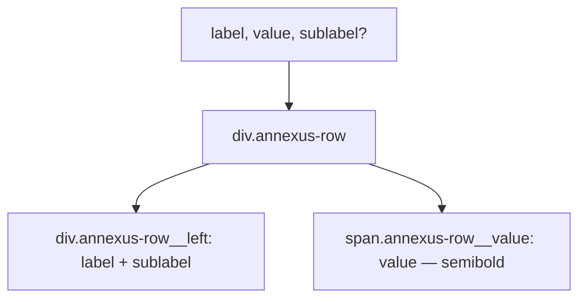

### Story 4.10: Row Component

**File**: `docs/plans/stories/epic-4-story-4.10-row.md`

**BUILDID**: CYCLE-3 | **AzureDevOps**: #23691 | **Epic**: 4 - P1 COMPOSITION | **ID**: 4.10 | **Date**: 2026-10-13
**Wave**: 6
**Requires**: [3.1, 3.2, 3.3, 3.4, 3.5]
**Enables**: []
**Files Touched**:
  - src/components/Row/Row.tsx
  - src/components/Row/Row.types.ts
  - src/components/Row/Row.module.scss
  - src/components/Row/Row.stories.tsx
  - src/components/Row/Row.test.tsx
  - src/components/Row/index.ts
  - src/index.ts
**Roles Ref**: docs/requirements.md#roles--permissions-matrix — single-actor — no role variation
**QA Candidate**: Yes — **Observable:** `pnpm storybook` shows Row stories with a label on the left and a value on the right, with optional sub-label; `pnpm test src/components/Row` exits 0 with ≥ 90% coverage; `pnpm typecheck` exits 0. **Mechanism:** Row is a summary data row — a flex layout with a left text block (label + optional sublabel) and a right value. Used in summary panels, benefit breakdowns, and detail lists. Stateless, pure presentational. **Authz & preconditions:** requires CYCLE-1 fully merged.

---

#### 👤 User Reference

**Description**:
Row renders a single data display row with a `label` on the left and a `value` on the right. An optional `sublabel` appears beneath the main label in smaller text. Used throughout summary panels (TopSummary, BottomSummary) to display key-value pairs such as "Monthly Premium — $245.00" or "Coverage Amount — $500,000". Distinct from AddonRow in that Row has no control slot and no border styling — it is a pure data row for read-only summary display.

**Acceptance Criteria** (plain-English):
- Renders a flex row with `label` on the left and `value` on the right
- Optional `sublabel` renders beneath the label in smaller muted text
- Value is visually emphasized (semibold)
- `className` prop merges with base class
- `pnpm test` exits 0; ≥ 90% coverage

**User Journey** (no role variation — single actor: DEV):
- `<Row label="Monthly Premium" value="$245.00" />`
- `<Row label="Plan" sublabel="Gold tier" value="$180/mo" />`

**Flow Diagram**:



---

#### 🤖 AI Agent Reference

**Must Read**:
- `docs/architecture/design/01-patterns-and-standards-greenfield.md` — BEM, SCSS modules
- `docs/ui-ux/ui-ux-spec.md` — Row / summary row visual spec

**Design Tokens**:
- `--annexus-font-size-md` — label and value font size
- `--annexus-font-size-sm` — sublabel font size
- `--annexus-font-weight-semibold` — value font weight
- `--annexus-font-weight-regular` — label font weight
- `--annexus-color-neutral-black` — label and value color
- `--annexus-color-gray-600` — sublabel color
- `--annexus-spacing-3` — vertical padding per row
- `--annexus-spacing-1` — gap between label and sublabel

**Description**:
`RowProps`: `label: string`, `value: string`, `sublabel?: string`, plus `BaseProps`. Component renders `<div className="annexus-row">` with flex layout. Left: `<div className="annexus-row__left">` containing `<span className="annexus-row__label">{label}</span>` and conditional `<span className="annexus-row__sublabel">{sublabel}</span>`. Right: `<span className="annexus-row__value">{value}</span>`. No `role` attribute — this is content layout, not interactive.

**Acceptance Criteria** (comprehensive):
- `RowProps`: `label: string; value: string; sublabel?: string` + `BaseProps`
- Renders `<div>` with class `annexus-row`
- Left block: label span + conditional sublabel span
- Right: value span with semibold weight
- `sublabel` only renders when provided
- `className` merged via `classNames`

**RBAC Enforcement**: No role-differentiated access — single actor.

**System responses + error cases**:

| Trigger | Response | Side-effect |
|---------|----------|-------------|
| `sublabel` omitted | No sublabel span | none |
| Long `value` string | Truncates or wraps right side | Consumer responsibility |

**QA-observable behaviour**:
- `screen.getByText(label)` — resolves.
- `screen.getByText(value)` — resolves.
- `screen.queryByText(sublabel)` — null when not provided.

**Prerequisites**:
- Stories 3.1–3.5 merged

**Steps**:

1. **Create `src/components/Row/Row.types.ts`**:
   ```typescript
   import type { BaseProps } from '../../types/common.types';

   export interface RowProps extends BaseProps {
     label: string;
     value: string;
     sublabel?: string;
   }
   ```

2. **Create `src/components/Row/Row.module.scss`**:
   ```scss
   .annexus-row {
     display: flex;
     justify-content: space-between;
     align-items: center;
     padding: var(--annexus-spacing-3) 0;

     &__left {
       display: flex;
       flex-direction: column;
       gap: var(--annexus-spacing-1);
     }

     &__label {
       font-size: var(--annexus-font-size-md);
       color: var(--annexus-color-neutral-black);
     }

     &__sublabel {
       font-size: var(--annexus-font-size-sm);
       color: var(--annexus-color-gray-600);
     }

     &__value {
       font-size: var(--annexus-font-size-md);
       font-weight: var(--annexus-font-weight-semibold);
       color: var(--annexus-color-neutral-black);
       flex-shrink: 0;
     }
   }
   ```

3. **Create `src/components/Row/Row.tsx`**:
   ```tsx
   import React from 'react';
   import { classNames } from '../../utils/classNames';
   import styles from './Row.module.scss';
   import type { RowProps } from './Row.types';

   export function Row({ label, value, sublabel, className, style, 'data-testid': testId }: RowProps) {
     return (
       <div
         className={classNames(styles['annexus-row'], className)}
         style={style}
         data-testid={testId}
       >
         <div className={styles['annexus-row__left']}>
           <span className={styles['annexus-row__label']}>{label}</span>
           {sublabel && <span className={styles['annexus-row__sublabel']}>{sublabel}</span>}
         </div>
         <span className={styles['annexus-row__value']}>{value}</span>
       </div>
     );
   }
   ```

4. **Create `src/components/Row/index.ts`**:
   ```typescript
   export { Row } from './Row';
   export type { RowProps } from './Row.types';
   ```

5. **Create `src/components/Row/Row.stories.tsx`**:
   ```tsx
   import type { Meta, StoryObj } from '@storybook/react';
   import { Row } from './Row';

   const meta: Meta<typeof Row> = {
     title: 'Components/Row',
     component: Row,
     tags: ['autodocs'],
   };
   export default meta;

   type Story = StoryObj<typeof Row>;

   export const Default: Story = {
     args: { label: 'Monthly Premium', value: '$245.00' },
   };

   export const WithSublabel: Story = {
     args: { label: 'Plan', sublabel: 'Gold tier', value: '$180/mo' },
   };
   ```

6. **Create `src/components/Row/Row.test.tsx`**:
   ```tsx
   import { render, screen } from '@testing-library/react';
   import { Row } from './Row';

   describe('Row', () => {
     it('renders label and value', () => {
       render(<Row label="Premium" value="$245" />);
       expect(screen.getByText('Premium')).toBeInTheDocument();
       expect(screen.getByText('$245')).toBeInTheDocument();
     });
     it('renders sublabel when provided', () => {
       render(<Row label="Plan" value="$180" sublabel="Gold tier" />);
       expect(screen.getByText('Gold tier')).toBeInTheDocument();
     });
     it('does not render sublabel when omitted', () => {
       render(<Row label="Plan" value="$180" />);
       expect(screen.queryByText('Gold tier')).toBeNull();
     });
     it('applies custom className', () => {
       const { container } = render(<Row label="L" value="V" className="custom" />);
       expect(container.firstChild).toHaveClass('custom');
     });
     it('forwards data-testid', () => {
       render(<Row label="L" value="V" data-testid="row" />);
       expect(screen.getByTestId('row')).toBeInTheDocument();
     });
   });
   ```

7. **Update `src/index.ts`**:
   ```typescript
   export { Row } from './components/Row';
   export type { RowProps } from './components/Row';
   ```

8. **Run verification**:
   ```bash
   pnpm typecheck
   pnpm test src/components/Row
   ```

**Tests**: 5 unit tests; `pnpm typecheck` exits 0

**Quality**: ≥ 90% coverage; `pnpm typecheck` exits 0

**OUT**:
- ❌ No control slot (use AddonRow for rows with controls)
- ❌ No border styling (Row is content layout; borders added by container if needed)

**Evidence**:
- Terminal output of `pnpm test src/components/Row` (5 tests pass)
- Terminal output of `pnpm typecheck` (exit 0)
