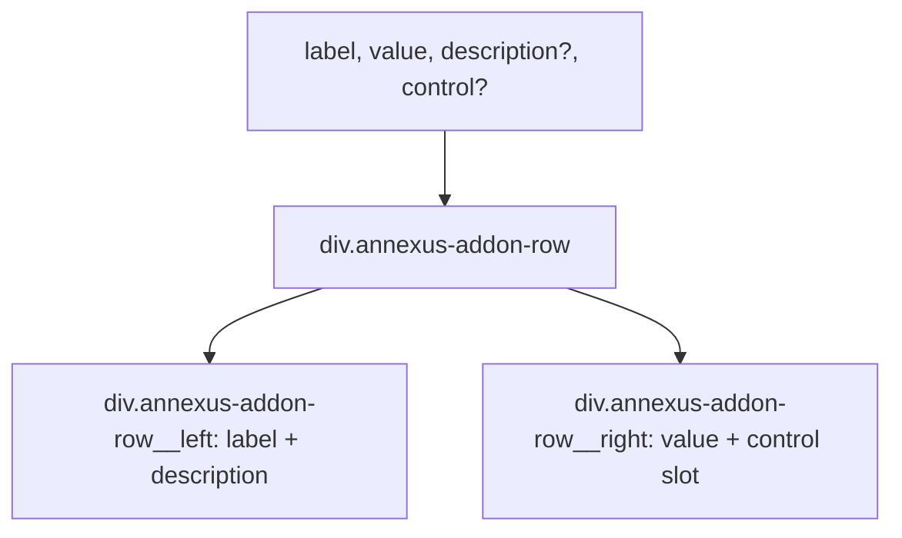

### Story 4.4: AddonRow Component

**File**: `docs/plans/stories/epic-4-story-4.4-addon-row.md`

**BUILDID**: CYCLE-3 | **AzureDevOps**: #23685 | **Epic**: 4 - P1 COMPOSITION | **ID**: 4.4 | **Date**: 2026-10-13
**Wave**: 6
**Requires**: [1.1, 1.2, 1.3, 1.4, 1.5, 1.6, 2.1, 2.2, 2.3, 2.4]
**Enables**: []
**Files Touched**:
  - src/components/AddonRow/AddonRow.tsx
  - src/components/AddonRow/AddonRow.types.ts
  - src/components/AddonRow/AddonRow.module.scss
  - src/components/AddonRow/AddonRow.stories.tsx
  - src/components/AddonRow/AddonRow.test.tsx
  - src/components/AddonRow/index.ts
  - src/index.ts
**Roles Ref**: docs/requirements.md#roles--permissions-matrix — single-actor — no role variation
**QA Candidate**: Yes — **Observable:** `pnpm storybook` shows AddonRow stories with label, value, optional badge, and optional toggle control; `pnpm test src/components/AddonRow` exits 0 with ≥ 90% coverage; `pnpm typecheck` exits 0. **Mechanism:** AddonRow is a list-row composition — left side: label + optional description; right side: value display + optional control slot. Stateless: toggle state managed by consumer. **Authz & preconditions:** requires CYCLE-1 fully merged.

> **Styling (CR-001, 2026-10-20)**: wherever this story says `var(--annexus-*)`, `src/tokens/` or a hex value, implement it as a **design variable** instead. Add `$<section><Element><State><Property>` (camelCase, section-prefixed, never repeated) to `src/styles/design.variables.scss`, pointing to a color in `src/styles/pallete.color.scss`, and `@use '../../styles/design.variables' as *;` in the component SCSS. Component SCSS never uses hex values or palette variables. Every new design variable is also added to `src/styles/design.variables.module.scss` so it is exported to JS (`designVariables`). Fonts use `$fontFamilyBase` and section-named size/line-height/weight variables. Reference implementation: `src/components/Input/Input.scss`. Spec: Story 3.2.

---

#### 👤 User Reference

**Description**:
AddonRow renders a single row in an insurance addon list. Left side shows the addon name and optional description. Right side shows a formatted value (e.g., premium amount) and an optional control slot (typically a Toggle or Badge). This is a display composition — no internal state, no event handlers beyond forwarded `onToggle`.

**Acceptance Criteria** (plain-English):
- Renders a row with `label` on the left and `value` on the right
- Optional `description` renders beneath the label in smaller text
- Optional `control` slot renders to the right of the value
- Consistent padding and border separating rows (border-bottom)
- `className` prop merges with base class
- `pnpm test` exits 0; ≥ 90% coverage

**User Journey** (no role variation — single actor: DEV):
- `<AddonRow label="Critical Illness" value="$45/mo" description="Covers 36 conditions" control={<Toggle checked={on} onChange={setOn} />} />`

**Flow Diagram**:



---

#### 🤖 AI Agent Reference

**Must Read**:
- `docs/architecture/design/01-patterns-and-standards-greenfield.md` — BEM, SCSS modules
- `docs/ui-ux/ui-ux-spec.md` — AddonRow visual spec

**Design Tokens**:
- `--annexus-spacing-4` — row vertical padding
- `--annexus-spacing-6` — row horizontal padding (if any)
- `--annexus-font-size-md` — label font size
- `--annexus-font-size-sm` — description + value font size
- `--annexus-font-weight-medium` — label weight
- `--annexus-color-gray-200` — border-bottom color
- `--annexus-color-gray-600` — description text color
- `--annexus-color-neutral-black` — label color

**Description**:
`AddonRowProps`: `label: string` (required), `value: string` (required), `description?: string`, `control?: React.ReactNode`, plus `BaseProps`. Component renders a `<div role="row">` (within a list context, for accessibility). Inner layout: flex row with left block (label + description) and right block (value + optional control). Border-bottom separates rows. No `forwardRef` needed.

**Acceptance Criteria** (comprehensive):
- `AddonRowProps`: `label: string; value: string; description?: string; control?: React.ReactNode` + `BaseProps`
- Renders `<div>` with class `annexus-addon-row` and `border-bottom`
- Left div: class `annexus-addon-row__left`; `<span>` for label, `<span>` for description (conditional)
- Right div: class `annexus-addon-row__right`; value `<span>`, control slot (conditional)
- `className` merged via `classNames`

**RBAC Enforcement**: No role-differentiated access — single actor.

**System responses + error cases**:

| Trigger | Response | Side-effect |
|---------|----------|-------------|
| `description` omitted | No description span renders | none |
| `control` omitted | No control div renders | none |
| Long `label` text | Wraps within left block; right side does not overflow | none |

**QA-observable behaviour**:
- `screen.getByText(label)` — resolves.
- `screen.getByText(value)` — resolves.
- `screen.queryByText(description)` — null when not provided.

**Prerequisites**:
- Stories 3.1–3.5 merged

**Steps**:

1. **Create `src/components/AddonRow/AddonRow.types.ts`**:
   ```typescript
   import type { BaseProps } from '../../types/common.types';

   export interface AddonRowProps extends BaseProps {
     label: string;
     value: string;
     description?: string;
     control?: React.ReactNode;
   }
   ```

2. **Create `src/components/AddonRow/AddonRow.module.scss`**:
   ```scss
   .annexus-addon-row {
     display: flex;
     justify-content: space-between;
     align-items: center;
     padding: var(--annexus-spacing-4) 0;
     border-bottom: 1px solid var(--annexus-color-gray-200);

     &__left {
       display: flex;
       flex-direction: column;
       gap: var(--annexus-spacing-1);
     }

     &__label {
       font-size: var(--annexus-font-size-md);
       font-weight: var(--annexus-font-weight-medium);
       color: var(--annexus-color-neutral-black);
     }

     &__description {
       font-size: var(--annexus-font-size-sm);
       color: var(--annexus-color-gray-600);
     }

     &__right {
       display: flex;
       align-items: center;
       gap: var(--annexus-spacing-3);
       flex-shrink: 0;
     }

     &__value {
       font-size: var(--annexus-font-size-sm);
       color: var(--annexus-color-neutral-black);
     }
   }
   ```

3. **Create `src/components/AddonRow/AddonRow.tsx`**:
   ```tsx
   import React from 'react';
   import { classNames } from '../../utils/classNames';
   import styles from './AddonRow.module.scss';
   import type { AddonRowProps } from './AddonRow.types';

   export function AddonRow({ label, value, description, control, className, style, 'data-testid': testId }: AddonRowProps) {
     return (
       <div
         className={classNames(styles['annexus-addon-row'], className)}
         style={style}
         data-testid={testId}
       >
         <div className={styles['annexus-addon-row__left']}>
           <span className={styles['annexus-addon-row__label']}>{label}</span>
           {description && (
             <span className={styles['annexus-addon-row__description']}>{description}</span>
           )}
         </div>
         <div className={styles['annexus-addon-row__right']}>
           <span className={styles['annexus-addon-row__value']}>{value}</span>
           {control}
         </div>
       </div>
     );
   }
   ```

4. **Create `src/components/AddonRow/index.ts`**:
   ```typescript
   export { AddonRow } from './AddonRow';
   export type { AddonRowProps } from './AddonRow.types';
   ```

5. **Create `src/components/AddonRow/AddonRow.stories.tsx`**:
   ```tsx
   import type { Meta, StoryObj } from '@storybook/react';
   import { AddonRow } from './AddonRow';

   const meta: Meta<typeof AddonRow> = {
     title: 'Components/AddonRow',
     component: AddonRow,
     tags: ['autodocs'],
   };
   export default meta;

   type Story = StoryObj<typeof AddonRow>;

   export const Default: Story = {
     args: { label: 'Critical Illness', value: '$45/mo' },
   };

   export const WithDescription: Story = {
     args: {
       label: 'Critical Illness',
       value: '$45/mo',
       description: 'Covers 36 critical illness conditions',
     },
   };

   export const WithControl: Story = {
     args: {
       label: 'Critical Illness',
       value: '$45/mo',
       description: 'Covers 36 critical illness conditions',
       control: <input type="checkbox" defaultChecked />,
     },
   };
   ```

6. **Create `src/components/AddonRow/AddonRow.test.tsx`**:
   ```tsx
   import { render, screen } from '@testing-library/react';
   import { AddonRow } from './AddonRow';

   describe('AddonRow', () => {
     it('renders label and value', () => {
       render(<AddonRow label="Illness" value="$45/mo" />);
       expect(screen.getByText('Illness')).toBeInTheDocument();
       expect(screen.getByText('$45/mo')).toBeInTheDocument();
     });
     it('renders description when provided', () => {
       render(<AddonRow label="Illness" value="$45/mo" description="36 conditions" />);
       expect(screen.getByText('36 conditions')).toBeInTheDocument();
     });
     it('does not render description when omitted', () => {
       render(<AddonRow label="Illness" value="$45/mo" />);
       expect(screen.queryByText('36 conditions')).toBeNull();
     });
     it('renders control slot', () => {
       render(<AddonRow label="L" value="V" control={<button>Toggle</button>} />);
       expect(screen.getByRole('button', { name: 'Toggle' })).toBeInTheDocument();
     });
     it('does not render control when omitted', () => {
       render(<AddonRow label="L" value="V" />);
       expect(screen.queryByRole('button')).toBeNull();
     });
     it('applies custom className', () => {
       const { container } = render(<AddonRow label="L" value="V" className="custom" />);
       expect(container.firstChild).toHaveClass('custom');
     });
     it('forwards data-testid', () => {
       render(<AddonRow label="L" value="V" data-testid="row" />);
       expect(screen.getByTestId('row')).toBeInTheDocument();
     });
   });
   ```

7. **Update `src/index.ts`**:
   ```typescript
   export { AddonRow } from './components/AddonRow';
   export type { AddonRowProps } from './components/AddonRow';
   ```

8. **Run verification**:
   ```bash
   pnpm typecheck
   pnpm test src/components/AddonRow
   ```

**Tests**: 7 unit tests; `pnpm typecheck` exits 0

**Quality**: ≥ 90% coverage; `pnpm typecheck` exits 0

**OUT**:
- ❌ No expand/collapse (accordion behavior is a separate pattern)
- ❌ No drag-to-reorder

**Evidence**:
- Terminal output of `pnpm test src/components/AddonRow` (7 tests pass)
- Terminal output of `pnpm typecheck` (exit 0)
