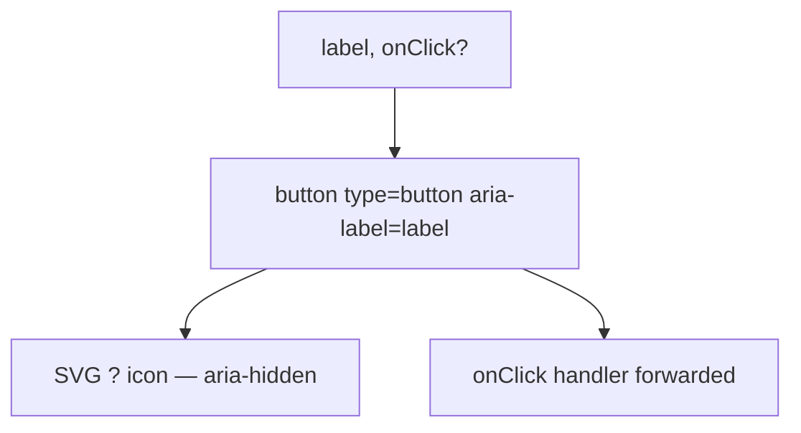

### Story 4.5: HelpIcon Component

**File**: `docs/plans/stories/epic-4-story-4.5-help-icon.md`

**BUILDID**: CYCLE-3 | **AzureDevOps**: #23684 | **Epic**: 4 - P1 COMPOSITION | **ID**: 4.5 | **Date**: 2026-10-13
**Wave**: 6
**Requires**: [3.1, 3.2, 3.3, 3.4, 3.5]
**Enables**: []
**Files Touched**:
  - src/components/HelpIcon/HelpIcon.tsx
  - src/components/HelpIcon/HelpIcon.types.ts
  - src/components/HelpIcon/HelpIcon.module.scss
  - src/components/HelpIcon/HelpIcon.stories.tsx
  - src/components/HelpIcon/HelpIcon.test.tsx
  - src/components/HelpIcon/index.ts
  - src/index.ts
**Roles Ref**: docs/requirements.md#roles--permissions-matrix — single-actor — no role variation
**QA Candidate**: Yes — **Observable:** `pnpm storybook` shows a HelpIcon story with a "?" circle icon and a tooltip-like label on hover; `pnpm test src/components/HelpIcon` exits 0 with ≥ 90% coverage; `pnpm typecheck` exits 0. HelpIcon is keyboard-focusable and announces its label to screen readers via `aria-label`. **Mechanism:** HelpIcon renders an SVG "?" icon inside a `<button>` element, with an `aria-label` for screen reader access. No Tooltip dependency — the label is surfaced via `aria-label` only (CSS-only hover tooltip is optional). **Authz & preconditions:** requires CYCLE-1 fully merged.

---

#### 👤 User Reference

**Description**:
HelpIcon renders a circular "?" icon button used inline with form labels and panel headers to provide contextual help text. It is keyboard-focusable and announces its `label` prop as an accessible name. Clicking or focusing the icon surfaces the help text — either via an `onClick` handler (consumer opens a modal) or via a CSS tooltip (title attribute). The component does not manage tooltip state — that is the consumer's responsibility.

**Acceptance Criteria** (plain-English):
- Renders a `<button type="button">` with a "?" SVG icon
- `aria-label` set to the `label` prop for screen reader accessibility
- Keyboard-focusable; visible focus ring using brand color
- Optional `onClick` handler forwarded
- `className` prop merges with base class
- `pnpm test` exits 0; ≥ 90% coverage

**User Journey** (no role variation — single actor: DEV):
- `<HelpIcon label="What is critical illness cover?" onClick={() => openModal()} />`
- Screen reader announces "What is critical illness cover?"
- Keyboard user can Tab to the icon and press Enter/Space.

**Flow Diagram**:



---

#### 🤖 AI Agent Reference

**Must Read**:
- `docs/architecture/design/01-patterns-and-standards-greenfield.md` — icon button pattern, focus ring, accessibility
- `docs/ui-ux/ui-ux-spec.md` — HelpIcon visual spec

**Design Tokens**:
- `--annexus-color-brand-cta` — icon color and border
- `--annexus-color-brand-hover` — hover state
- `--annexus-touch-target-min` (24px) — minimum touch target size
- `--annexus-radius-full` — circular shape
- `--annexus-font-size-sm` — icon "?" character size (if text-based)

**Description**:
`HelpIconProps`: `label: string` (required — used as `aria-label`), `onClick?: React.MouseEventHandler<HTMLButtonElement>`, plus `BaseProps`. Component renders `<button type="button" aria-label={label} className="annexus-help-icon" onClick={onClick}>`. Inside: an inline SVG circle with "?" text or path (aria-hidden). The button is sized to `var(--annexus-touch-target-min)` (24px minimum) with `border-radius: var(--annexus-radius-full)` making it circular. Focus ring via `:focus-visible` outline using brand color.

**Acceptance Criteria** (comprehensive):
- `HelpIconProps`: `label: string; onClick?: React.MouseEventHandler<HTMLButtonElement>` + `BaseProps`
- Renders `<button type="button">` with `aria-label={label}`, class `annexus-help-icon`
- SVG icon has `aria-hidden="true"` and `focusable="false"`
- Button has `:focus-visible` outline (not `:focus`) for keyboard accessibility
- `onClick` called when button is clicked
- Minimum size: 24×24px via CSS
- `className` merged via `classNames`

**RBAC Enforcement**: No role-differentiated access — single actor.

**System responses + error cases**:

| Trigger | Response | Side-effect |
|---------|----------|-------------|
| Click | `onClick` called (if provided) | Consumer handles modal/tooltip |
| No `onClick` | Button renders; click is no-op | none |
| Keyboard Enter/Space | Same as click | WCAG 2.2 AA |
| Screen reader focus | Announces `label` text | none |

**QA-observable behaviour**:
- `screen.getByRole('button', { name: label })` — resolves.
- Click fires `onClick` handler once.
- SVG has `aria-hidden="true"`.

**Prerequisites**:
- Stories 3.1–3.5 merged

**Steps**:

1. **Create `src/components/HelpIcon/HelpIcon.types.ts`**:
   ```typescript
   import type { BaseProps } from '../../types/common.types';

   export interface HelpIconProps extends BaseProps {
     label: string;
     onClick?: React.MouseEventHandler<HTMLButtonElement>;
   }
   ```

2. **Create `src/components/HelpIcon/HelpIcon.module.scss`**:
   ```scss
   .annexus-help-icon {
     display: inline-flex;
     align-items: center;
     justify-content: center;
     width: var(--annexus-touch-target-min);
     height: var(--annexus-touch-target-min);
     border-radius: var(--annexus-radius-full);
     border: 1.5px solid var(--annexus-color-brand-cta);
     background: transparent;
     color: var(--annexus-color-brand-cta);
     cursor: pointer;
     padding: 0;
     transition: border-color 150ms ease, color 150ms ease;

     &:hover {
       border-color: var(--annexus-color-brand-hover);
       color: var(--annexus-color-brand-hover);
     }

     &:focus-visible {
       outline: 2px solid var(--annexus-color-brand-cta);
       outline-offset: 2px;
     }
   }
   ```

3. **Create `src/components/HelpIcon/HelpIcon.tsx`**:
   ```tsx
   import React from 'react';
   import { classNames } from '../../utils/classNames';
   import styles from './HelpIcon.module.scss';
   import type { HelpIconProps } from './HelpIcon.types';

   export function HelpIcon({ label, onClick, className, style, 'data-testid': testId }: HelpIconProps) {
     return (
       <button
         type="button"
         aria-label={label}
         onClick={onClick}
         className={classNames(styles['annexus-help-icon'], className)}
         style={style}
         data-testid={testId}
       >
         <svg
           width="12"
           height="12"
           viewBox="0 0 12 12"
           fill="currentColor"
           aria-hidden="true"
           focusable="false"
         >
           <text x="6" y="10" textAnchor="middle" fontSize="12" fontWeight="600">?</text>
         </svg>
       </button>
     );
   }
   ```

4. **Create `src/components/HelpIcon/index.ts`**:
   ```typescript
   export { HelpIcon } from './HelpIcon';
   export type { HelpIconProps } from './HelpIcon.types';
   ```

5. **Create `src/components/HelpIcon/HelpIcon.stories.tsx`**:
   ```tsx
   import type { Meta, StoryObj } from '@storybook/react';
   import { HelpIcon } from './HelpIcon';

   const meta: Meta<typeof HelpIcon> = {
     title: 'Components/HelpIcon',
     component: HelpIcon,
     tags: ['autodocs'],
   };
   export default meta;

   type Story = StoryObj<typeof HelpIcon>;

   export const Default: Story = {
     args: { label: 'What is critical illness cover?' },
   };

   export const WithClickHandler: Story = {
     args: {
       label: 'Learn more about premiums',
       onClick: () => alert('Help clicked'),
     },
   };
   ```

6. **Create `src/components/HelpIcon/HelpIcon.test.tsx`**:
   ```tsx
   import { render, screen } from '@testing-library/react';
   import userEvent from '@testing-library/user-event';
   import { HelpIcon } from './HelpIcon';

   describe('HelpIcon', () => {
     it('renders button with aria-label', () => {
       render(<HelpIcon label="Help text" />);
       expect(screen.getByRole('button', { name: 'Help text' })).toBeInTheDocument();
     });
     it('SVG is aria-hidden', () => {
       const { container } = render(<HelpIcon label="Help" />);
       const svg = container.querySelector('svg');
       expect(svg?.getAttribute('aria-hidden')).toBe('true');
     });
     it('calls onClick when clicked', async () => {
       const onClick = vi.fn();
       render(<HelpIcon label="Help" onClick={onClick} />);
       await userEvent.click(screen.getByRole('button'));
       expect(onClick).toHaveBeenCalledOnce();
     });
     it('does not throw when onClick omitted', async () => {
       render(<HelpIcon label="Help" />);
       await userEvent.click(screen.getByRole('button'));
     });
     it('applies custom className', () => {
       render(<HelpIcon label="Help" className="custom" />);
       expect(screen.getByRole('button').className).toContain('custom');
     });
     it('forwards data-testid', () => {
       render(<HelpIcon label="Help" data-testid="help" />);
       expect(screen.getByTestId('help')).toBeInTheDocument();
     });
   });
   ```

7. **Update `src/index.ts`**:
   ```typescript
   export { HelpIcon } from './components/HelpIcon';
   export type { HelpIconProps } from './components/HelpIcon';
   ```

8. **Run verification**:
   ```bash
   pnpm typecheck
   pnpm test src/components/HelpIcon
   ```

**Tests**: 6 unit tests; `pnpm typecheck` exits 0

**Quality**: ≥ 90% coverage; `pnpm typecheck` exits 0

**OUT**:
- ❌ No built-in tooltip popup (consumer manages tooltip via Tooltip component or modal)
- ❌ No title attribute tooltip (relies on aria-label for accessibility)

**Evidence**:
- Terminal output of `pnpm test src/components/HelpIcon` (6 tests pass)
- Terminal output of `pnpm typecheck` (exit 0)
