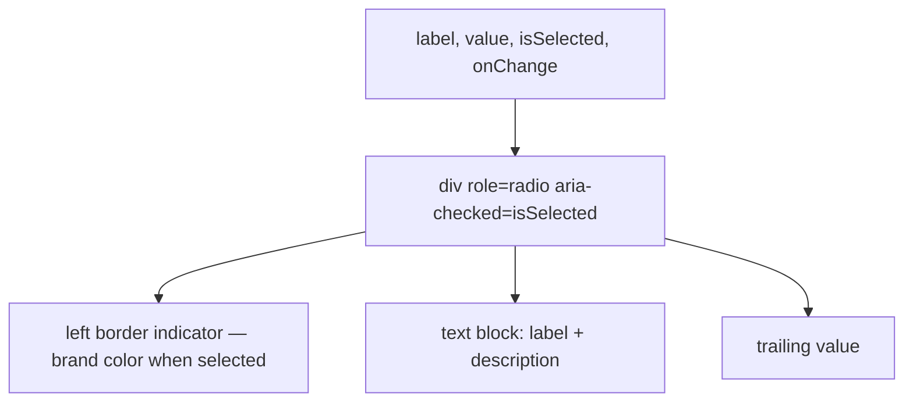

### Story 4.6: GroupItem Component

**File**: `docs/plans/stories/epic-4-story-4.6-group-item.md`

**BUILDID**: CYCLE-3 | **AzureDevOps**: #23689 | **Epic**: 4 - P1 COMPOSITION | **ID**: 4.6 | **Date**: 2026-10-13
**Wave**: 6
**Requires**: [1.1, 1.2, 1.3, 1.4, 1.5, 1.6, 2.1, 2.2, 2.3, 2.4]
**Enables**: []
**Files Touched**:
  - src/components/GroupItem/GroupItem.tsx
  - src/components/GroupItem/GroupItem.types.ts
  - src/components/GroupItem/GroupItem.module.scss
  - src/components/GroupItem/GroupItem.stories.tsx
  - src/components/GroupItem/GroupItem.test.tsx
  - src/components/GroupItem/index.ts
  - src/index.ts
**Roles Ref**: docs/requirements.md#roles--permissions-matrix — single-actor — no role variation
**QA Candidate**: Yes — **Observable:** `pnpm storybook` shows GroupItem stories for a radio-style selection row (selected and unselected states); `pnpm test src/components/GroupItem` exits 0 with ≥ 90% coverage; `pnpm typecheck` exits 0. **Mechanism:** GroupItem is a clickable row used within a group selection context (e.g., coverage tier picker). It renders a radio-button-like UI — visually styled as a full-width card row with a leading selection indicator. Stateless: selected state and onChange managed by parent. **Authz & preconditions:** requires CYCLE-1 fully merged.

> **Styling (CR-001, 2026-10-20)**: wherever this story says `var(--annexus-*)`, `src/tokens/` or a hex value, implement it as a **design variable** instead. Add `$<section><Element><State><Property>` (camelCase, section-prefixed, never repeated) to `src/styles/design.variables.scss`, pointing to a color in `src/styles/pallete.color.scss`, and `@use '../../styles/design.variables' as *;` in the component SCSS. Component SCSS never uses hex values or palette variables. Every new design variable is also added to `src/styles/design.variables.module.scss` so it is exported to JS (`designVariables`). Fonts use `$fontFamilyBase` and section-named size/line-height/weight variables. Reference implementation: `src/components/Input/Input.scss`. Spec: Story 3.2.

---

#### 👤 User Reference

**Description**:
GroupItem renders a single selectable row within a mutually exclusive group (like a radio button group). It displays a label, an optional description, and an optional trailing value. When selected, it shows a brand-colored left border and background highlight. The component is stateless — `isSelected` and `onChange` are props. Multiple GroupItems are composed by the consuming page to form a radio group.

**Acceptance Criteria** (plain-English):
- Renders a clickable row with `label` text
- `isSelected` prop applies selected visual state (brand border + background)
- Optional `description` renders beneath the label
- Optional `trailingValue` renders on the right
- Accessible: `role="radio"`, `aria-checked={isSelected}`
- `onChange` called with item `value` when clicked
- `pnpm test` exits 0; ≥ 90% coverage

**User Journey** (no role variation — single actor: DEV):
- Parent renders `<div role="radiogroup">` with multiple GroupItems.
- `<GroupItem label="Bronze" value="bronze" isSelected={selected === 'bronze'} onChange={setSelected} />`

**Flow Diagram**:



---

#### 🤖 AI Agent Reference

**Must Read**:
- `docs/architecture/design/01-patterns-and-standards-greenfield.md` — radio group pattern, ARIA, BEM
- `docs/ui-ux/ui-ux-spec.md` — GroupItem visual spec

**Design Tokens**:
- `--annexus-color-brand-primary` — selected left border and background tint
- `--annexus-color-gray-100` — unselected background
- `--annexus-color-neutral-white` — selected background (or very light brand tint)
- `--annexus-spacing-4` — vertical padding
- `--annexus-spacing-6` — horizontal padding
- `--annexus-font-size-md` — label font size
- `--annexus-font-size-sm` — description font size
- `--annexus-radius-md` — border radius
- `--annexus-color-gray-200` — border color (unselected)

**Description**:
`GroupItemProps`: `label: string`, `value: string`, `isSelected: boolean`, `onChange: (value: string) => void`, `description?: string`, `trailingValue?: string`, plus `BaseProps`. Component renders `<div role="radio" aria-checked={isSelected} tabIndex={0} onClick={() => onChange(value)} onKeyDown={(e) => { if (e.key === 'Enter' || e.key === ' ') onChange(value); }}>`. Selected state adds modifier class `annexus-group-item--selected`. Keyboard activation via Enter/Space for WCAG compliance.

**Acceptance Criteria** (comprehensive):
- `GroupItemProps`: `label, value, isSelected, onChange` + optional `description, trailingValue` + `BaseProps`
- Renders `<div role="radio" aria-checked={isSelected} tabIndex={0}>`
- Click → `onChange(value)` called
- Enter/Space keydown → `onChange(value)` called
- `isSelected=true` → class `annexus-group-item--selected` applied
- `description` renders conditionally
- `trailingValue` renders conditionally on right
- `className` merged via `classNames`

**RBAC Enforcement**: No role-differentiated access — single actor.

**System responses + error cases**:

| Trigger | Response | Side-effect |
|---------|----------|-------------|
| Click | `onChange(value)` | Parent updates selection |
| Enter key | `onChange(value)` | WCAG keyboard access |
| Space key | `onChange(value)` | WCAG keyboard access |
| `isSelected=true` | Selected class applied | Visual indicator |

**QA-observable behaviour**:
- `screen.getByRole('radio', { name: label })` — resolves.
- `aria-checked="true"` when `isSelected=true`.
- `onChange` called with correct `value` on click.

**Prerequisites**:
- Stories 3.1–3.5 merged

**Steps**:

1. **Create `src/components/GroupItem/GroupItem.types.ts`**:
   ```typescript
   import type { BaseProps } from '../../types/common.types';

   export interface GroupItemProps extends BaseProps {
     label: string;
     value: string;
     isSelected: boolean;
     onChange: (value: string) => void;
     description?: string;
     trailingValue?: string;
   }
   ```

2. **Create `src/components/GroupItem/GroupItem.module.scss`**:
   ```scss
   .annexus-group-item {
     display: flex;
     justify-content: space-between;
     align-items: center;
     padding: var(--annexus-spacing-4) var(--annexus-spacing-6);
     border: 1px solid var(--annexus-color-gray-200);
     border-radius: var(--annexus-radius-md);
     background-color: var(--annexus-color-gray-100);
     cursor: pointer;
     transition: border-color 150ms ease, background-color 150ms ease;

     &--selected {
       border-color: var(--annexus-color-brand-primary);
       background-color: var(--annexus-color-neutral-white);
       border-left-width: 3px;
     }

     &:focus-visible {
       outline: 2px solid var(--annexus-color-brand-cta);
       outline-offset: 2px;
     }

     &__text {
       display: flex;
       flex-direction: column;
       gap: var(--annexus-spacing-1);
     }

     &__label {
       font-size: var(--annexus-font-size-md);
       font-weight: var(--annexus-font-weight-medium);
       color: var(--annexus-color-neutral-black);
     }

     &__description {
       font-size: var(--annexus-font-size-sm);
       color: var(--annexus-color-gray-600);
     }

     &__trailing {
       font-size: var(--annexus-font-size-sm);
       color: var(--annexus-color-gray-700);
       flex-shrink: 0;
     }
   }
   ```

3. **Create `src/components/GroupItem/GroupItem.tsx`**:
   ```tsx
   import React from 'react';
   import { classNames } from '../../utils/classNames';
   import styles from './GroupItem.module.scss';
   import type { GroupItemProps } from './GroupItem.types';

   export function GroupItem({
     label, value, isSelected, onChange, description, trailingValue,
     className, style, 'data-testid': testId,
   }: GroupItemProps) {
     const handleKeyDown = (e: React.KeyboardEvent) => {
       if (e.key === 'Enter' || e.key === ' ') {
         e.preventDefault();
         onChange(value);
       }
     };

     return (
       <div
         role="radio"
         aria-checked={isSelected}
         tabIndex={0}
         onClick={() => onChange(value)}
         onKeyDown={handleKeyDown}
         className={classNames(
           styles['annexus-group-item'],
           isSelected && styles['annexus-group-item--selected'],
           className,
         )}
         style={style}
         data-testid={testId}
       >
         <div className={styles['annexus-group-item__text']}>
           <span className={styles['annexus-group-item__label']}>{label}</span>
           {description && (
             <span className={styles['annexus-group-item__description']}>{description}</span>
           )}
         </div>
         {trailingValue && (
           <span className={styles['annexus-group-item__trailing']}>{trailingValue}</span>
         )}
       </div>
     );
   }
   ```

4. **Create `src/components/GroupItem/index.ts`**:
   ```typescript
   export { GroupItem } from './GroupItem';
   export type { GroupItemProps } from './GroupItem.types';
   ```

5. **Create `src/components/GroupItem/GroupItem.stories.tsx`**:
   ```tsx
   import type { Meta, StoryObj } from '@storybook/react';
   import { GroupItem } from './GroupItem';

   const meta: Meta<typeof GroupItem> = {
     title: 'Components/GroupItem',
     component: GroupItem,
     tags: ['autodocs'],
   };
   export default meta;

   type Story = StoryObj<typeof GroupItem>;

   export const Unselected: Story = {
     args: { label: 'Bronze', value: 'bronze', isSelected: false, onChange: () => {} },
   };

   export const Selected: Story = {
     args: { label: 'Gold', value: 'gold', isSelected: true, onChange: () => {} },
   };

   export const WithDetails: Story = {
     args: {
       label: 'Silver',
       value: 'silver',
       isSelected: false,
       onChange: () => {},
       description: 'Mid-tier coverage',
       trailingValue: '$120/mo',
     },
   };
   ```

6. **Create `src/components/GroupItem/GroupItem.test.tsx`**:
   ```tsx
   import { render, screen } from '@testing-library/react';
   import userEvent from '@testing-library/user-event';
   import { GroupItem } from './GroupItem';

   const baseProps = { label: 'Bronze', value: 'bronze', isSelected: false, onChange: vi.fn() };

   describe('GroupItem', () => {
     it('renders radio with accessible name', () => {
       render(<GroupItem {...baseProps} />);
       expect(screen.getByRole('radio', { name: 'Bronze' })).toBeInTheDocument();
     });
     it('aria-checked false when not selected', () => {
       render(<GroupItem {...baseProps} />);
       expect(screen.getByRole('radio')).toHaveAttribute('aria-checked', 'false');
     });
     it('aria-checked true when selected', () => {
       render(<GroupItem {...baseProps} isSelected={true} />);
       expect(screen.getByRole('radio')).toHaveAttribute('aria-checked', 'true');
     });
     it('calls onChange on click', async () => {
       const onChange = vi.fn();
       render(<GroupItem {...baseProps} onChange={onChange} />);
       await userEvent.click(screen.getByRole('radio'));
       expect(onChange).toHaveBeenCalledWith('bronze');
     });
     it('calls onChange on Enter key', async () => {
       const onChange = vi.fn();
       render(<GroupItem {...baseProps} onChange={onChange} />);
       screen.getByRole('radio').focus();
       await userEvent.keyboard('{Enter}');
       expect(onChange).toHaveBeenCalledWith('bronze');
     });
     it('renders description', () => {
       render(<GroupItem {...baseProps} description="Mid cover" />);
       expect(screen.getByText('Mid cover')).toBeInTheDocument();
     });
     it('renders trailing value', () => {
       render(<GroupItem {...baseProps} trailingValue="$45/mo" />);
       expect(screen.getByText('$45/mo')).toBeInTheDocument();
     });
     it('applies selected class when isSelected', () => {
       const { container } = render(<GroupItem {...baseProps} isSelected={true} />);
       expect(container.firstChild?.toString()).not.toBeNull();
     });
     it('forwards data-testid', () => {
       render(<GroupItem {...baseProps} data-testid="gi" />);
       expect(screen.getByTestId('gi')).toBeInTheDocument();
     });
   });
   ```

7. **Update `src/index.ts`**:
   ```typescript
   export { GroupItem } from './components/GroupItem';
   export type { GroupItemProps } from './components/GroupItem';
   ```

8. **Run verification**:
   ```bash
   pnpm typecheck
   pnpm test src/components/GroupItem
   ```

**Tests**: 9 unit tests; `pnpm typecheck` exits 0

**Quality**: ≥ 90% coverage; `pnpm typecheck` exits 0

**OUT**:
- ❌ No keyboard arrow navigation (arrow navigation is managed by the parent radiogroup container)
- ❌ No disabled state (not required per spec)

**Evidence**:
- Terminal output of `pnpm test src/components/GroupItem` (9 tests pass)
- Terminal output of `pnpm typecheck` (exit 0)
