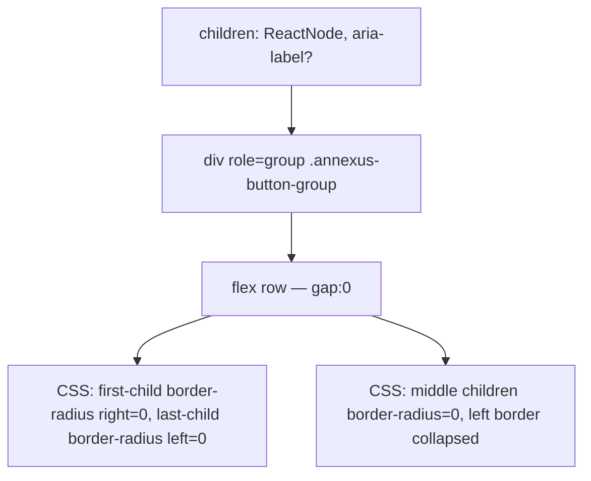

### Story 4.9: ButtonGroup Component

**File**: `docs/plans/stories/epic-4-story-4.9-button-group.md`

**BUILDID**: CYCLE-3 | **AzureDevOps**: #23693 | **Epic**: 4 - P1 COMPOSITION | **ID**: 4.9 | **Date**: 2026-10-13
**Wave**: 6
**Requires**: [3.1, 3.2, 3.3, 3.4, 3.5]
**Enables**: []
**Files Touched**:
  - src/components/ButtonGroup/ButtonGroup.tsx
  - src/components/ButtonGroup/ButtonGroup.types.ts
  - src/components/ButtonGroup/ButtonGroup.module.scss
  - src/components/ButtonGroup/ButtonGroup.stories.tsx
  - src/components/ButtonGroup/ButtonGroup.test.tsx
  - src/components/ButtonGroup/index.ts
  - src/index.ts
**Roles Ref**: docs/requirements.md#roles--permissions-matrix — single-actor — no role variation
**QA Candidate**: Yes — **Observable:** `pnpm storybook` shows ButtonGroup stories with 2–3 buttons joined side-by-side with shared borders; `pnpm test src/components/ButtonGroup` exits 0 with ≥ 90% coverage; `pnpm typecheck` exits 0. **Mechanism:** ButtonGroup is a layout wrapper — it renders a flex row with `gap: 0` and removes the border-radius from the inner/outer edges of adjacent children via CSS `:first-child`/`:last-child`/`:not(:first-child)` selectors. Accepts `React.ReactNode` children (typically Button components). **Authz & preconditions:** requires CYCLE-1 fully merged.

---

#### 👤 User Reference

**Description**:
ButtonGroup wraps multiple Button components in a visually connected horizontal group. Borders between buttons are collapsed so the group reads as a single control. The component is a pure layout wrapper — it does not manage button state or selection. Children must be Button components from `@annexus/ui` for correct visual joining (border collapsing relies on CSS child selectors).

**Acceptance Criteria** (plain-English):
- Renders children in a flex row with collapsed borders (no gap)
- Inner buttons lose left/right border-radius on adjacent edges
- First and last children retain their outer border-radius
- `role="group"` on the container with optional `aria-label`
- `className` prop merges with base class
- `pnpm test` exits 0; ≥ 90% coverage

**User Journey** (no role variation — single actor: DEV):
- ```tsx
  <ButtonGroup aria-label="View options">
    <Button hierarchy="secondary" label="List" />
    <Button hierarchy="secondary" label="Grid" />
    <Button hierarchy="secondary" label="Map" />
  </ButtonGroup>
  ```

**Flow Diagram**:



---

#### 🤖 AI Agent Reference

**Must Read**:
- `docs/architecture/design/01-patterns-and-standards-greenfield.md` — ButtonGroup pattern, ARIA group role
- `docs/ui-ux/ui-ux-spec.md` — ButtonGroup visual spec

**Design Tokens**:
- No additional tokens — border collapsing uses `margin-left: -1px` on non-first children to collapse shared borders
- Border-radius manipulation via `> *:first-child`, `> *:last-child` CSS child selectors

**Description**:
`ButtonGroupProps`: `children: React.ReactNode`, `aria-label?: string`, plus `BaseProps`. Container: `<div role="group" aria-label={aria-label} className="annexus-button-group">`. CSS targets direct children: `> *:not(:first-child) { margin-left: -1px; }` to collapse borders; `> *:first-child { border-top-right-radius: 0; border-bottom-right-radius: 0; }` etc. This is a generic wrapper — it works with any children but is intended for Button.

**Acceptance Criteria** (comprehensive):
- `ButtonGroupProps`: `children: React.ReactNode; 'aria-label'?: string` + `BaseProps`
- Renders `<div role="group">` with class `annexus-button-group`
- CSS collapses adjacent button borders via negative margin and child selectors
- `aria-label` forwarded to `role="group"` element
- `className` merged via `classNames`
- Children render correctly

**RBAC Enforcement**: No role-differentiated access — single actor.

**System responses + error cases**:

| Trigger | Response | Side-effect |
|---------|----------|-------------|
| 2 children | Left button: right edge flat; right button: left edge flat | Visually joined |
| 3 children | First: right flat; middle: both flat; last: left flat | Visually joined |
| 1 child | Full border-radius preserved | No joining needed |
| Non-Button children | CSS still applies (may look incorrect — documented consumer responsibility) | none |

**QA-observable behaviour**:
- `screen.getByRole('group')` — resolves.
- `aria-label` present when provided.
- Children render within the group.

**Prerequisites**:
- Stories 3.1–3.5 merged

**Steps**:

1. **Create `src/components/ButtonGroup/ButtonGroup.types.ts`**:
   ```typescript
   import type { BaseProps } from '../../types/common.types';

   export interface ButtonGroupProps extends BaseProps {
     children: React.ReactNode;
     'aria-label'?: string;
   }
   ```

2. **Create `src/components/ButtonGroup/ButtonGroup.module.scss`**:
   ```scss
   .annexus-button-group {
     display: inline-flex;
     flex-direction: row;

     > * {
       border-radius: 0;

       &:focus-visible {
         position: relative;
         z-index: 1;
       }
     }

     > *:first-child {
       border-top-left-radius: var(--annexus-radius-md);
       border-bottom-left-radius: var(--annexus-radius-md);
     }

     > *:last-child {
       border-top-right-radius: var(--annexus-radius-md);
       border-bottom-right-radius: var(--annexus-radius-md);
     }

     > *:not(:first-child) {
       margin-left: -1px;
     }
   }
   ```

3. **Create `src/components/ButtonGroup/ButtonGroup.tsx`**:
   ```tsx
   import React from 'react';
   import { classNames } from '../../utils/classNames';
   import styles from './ButtonGroup.module.scss';
   import type { ButtonGroupProps } from './ButtonGroup.types';

   export function ButtonGroup({ children, 'aria-label': ariaLabel, className, style, 'data-testid': testId }: ButtonGroupProps) {
     return (
       <div
         role="group"
         aria-label={ariaLabel}
         className={classNames(styles['annexus-button-group'], className)}
         style={style}
         data-testid={testId}
       >
         {children}
       </div>
     );
   }
   ```

4. **Create `src/components/ButtonGroup/index.ts`**:
   ```typescript
   export { ButtonGroup } from './ButtonGroup';
   export type { ButtonGroupProps } from './ButtonGroup.types';
   ```

5. **Create `src/components/ButtonGroup/ButtonGroup.stories.tsx`**:
   ```tsx
   import type { Meta, StoryObj } from '@storybook/react';
   import { ButtonGroup } from './ButtonGroup';

   const meta: Meta<typeof ButtonGroup> = {
     title: 'Components/ButtonGroup',
     component: ButtonGroup,
     tags: ['autodocs'],
   };
   export default meta;

   export const TwoButtons: StoryObj<typeof ButtonGroup> = {
     render: () => (
       <ButtonGroup aria-label="View options">
         <button type="button">List</button>
         <button type="button">Grid</button>
       </ButtonGroup>
     ),
   };

   export const ThreeButtons: StoryObj<typeof ButtonGroup> = {
     render: () => (
       <ButtonGroup aria-label="View options">
         <button type="button">List</button>
         <button type="button">Grid</button>
         <button type="button">Map</button>
       </ButtonGroup>
     ),
   };
   ```

6. **Create `src/components/ButtonGroup/ButtonGroup.test.tsx`**:
   ```tsx
   import { render, screen } from '@testing-library/react';
   import { ButtonGroup } from './ButtonGroup';

   describe('ButtonGroup', () => {
     it('renders group role', () => {
       render(<ButtonGroup><button>A</button></ButtonGroup>);
       expect(screen.getByRole('group')).toBeInTheDocument();
     });
     it('forwards aria-label', () => {
       render(<ButtonGroup aria-label="Options"><button>A</button></ButtonGroup>);
       expect(screen.getByRole('group', { name: 'Options' })).toBeInTheDocument();
     });
     it('renders children', () => {
       render(
         <ButtonGroup>
           <button>A</button>
           <button>B</button>
         </ButtonGroup>
       );
       expect(screen.getByRole('button', { name: 'A' })).toBeInTheDocument();
       expect(screen.getByRole('button', { name: 'B' })).toBeInTheDocument();
     });
     it('renders correct number of children', () => {
       render(
         <ButtonGroup>
           <button>A</button>
           <button>B</button>
           <button>C</button>
         </ButtonGroup>
       );
       expect(screen.getAllByRole('button')).toHaveLength(3);
     });
     it('applies custom className', () => {
       render(<ButtonGroup className="custom"><button>A</button></ButtonGroup>);
       expect(screen.getByRole('group').className).toContain('custom');
     });
     it('forwards data-testid', () => {
       render(<ButtonGroup data-testid="bg"><button>A</button></ButtonGroup>);
       expect(screen.getByTestId('bg')).toBeInTheDocument();
     });
   });
   ```

7. **Update `src/index.ts`**:
   ```typescript
   export { ButtonGroup } from './components/ButtonGroup';
   export type { ButtonGroupProps } from './components/ButtonGroup';
   ```

8. **Run verification**:
   ```bash
   pnpm typecheck
   pnpm test src/components/ButtonGroup
   ```

**Tests**: 6 unit tests; `pnpm typecheck` exits 0

**Quality**: ≥ 90% coverage; `pnpm typecheck` exits 0

**OUT**:
- ❌ No active/selected state management (consumer manages selection via Button props)
- ❌ No vertical orientation (horizontal only per spec)

**Evidence**:
- Terminal output of `pnpm test src/components/ButtonGroup` (6 tests pass)
- Terminal output of `pnpm typecheck` (exit 0)
