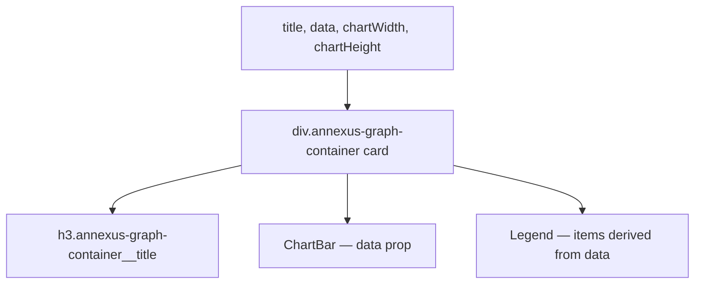

### Story 5.2: GraphContainer Component

**File**: `docs/plans/stories/epic-5-story-5.2-graph-container.md`

**BUILDID**: CYCLE-4 | **AzureDevOps**: #23699 | **Epic**: 5 - P2 COMPLEX + v1.0 | **ID**: 5.2 | **Date**: 2026-10-13
**Wave**: 8
**Requires**: [5.1]
**Enables**: []
**Files Touched**:
  - src/components/GraphContainer/GraphContainer.tsx
  - src/components/GraphContainer/GraphContainer.types.ts
  - src/components/GraphContainer/GraphContainer.module.scss
  - src/components/GraphContainer/GraphContainer.stories.tsx
  - src/components/GraphContainer/GraphContainer.test.tsx
  - src/components/GraphContainer/index.ts
  - src/index.ts
**Roles Ref**: docs/requirements.md#roles--permissions-matrix — single-actor — no role variation
**QA Candidate**: Yes — **Observable:** `pnpm storybook` shows a GraphContainer story with a title, a ChartBar chart, and a Legend beneath it, all in a card-style container; `pnpm test src/components/GraphContainer` exits 0 with ≥ 90% coverage; `pnpm typecheck` exits 0. **Mechanism:** GraphContainer composes ChartBar + Legend inside a titled card. It accepts `data` (shared between chart and legend) and derives the `LegendItem[]` from the data. **Authz & preconditions:** requires Story 5.1 (ChartBar) merged; Wave 8.

> **Styling (CR-001, 2026-10-20)**: wherever this story says `var(--annexus-*)`, `src/tokens/` or a hex value, implement it as a **design variable** instead. Add `$<section><Element><State><Property>` (camelCase, section-prefixed, never repeated) to `src/styles/design.variables.scss`, pointing to a color in `src/styles/pallete.color.scss`, and `@use '../../styles/design.variables' as *;` in the component SCSS. Component SCSS never uses hex values or palette variables. Every new design variable is also added to `src/styles/design.variables.module.scss` so it is exported to JS (`designVariables`). Fonts use `$fontFamilyBase` and section-named size/line-height/weight variables. Reference implementation: `src/components/Input/Input.scss`. Spec: Story 3.2.

---

#### 👤 User Reference

**Description**:
GraphContainer is a card component that wraps a ChartBar with a title and a Legend. It accepts the same `ChartBarDataPoint[]` data as ChartBar and automatically derives the Legend items (color + label) from the data — no separate legend prop needed. Used in the dashboard to display time-series premium data with a color-coded legend beneath the chart.

**Acceptance Criteria** (plain-English):
- Renders a card with a `title` heading, a ChartBar, and a Legend
- Legend items are derived automatically from the `data` array (one legend item per data point)
- `chartWidth` and `chartHeight` props control chart dimensions
- Card uses design tokens for border, shadow, and padding
- `className` prop merges with base class
- `pnpm test` exits 0; ≥ 90% coverage

**User Journey** (no role variation — single actor: DEV):
- ```tsx
  <GraphContainer
    title="Premium Breakdown"
    data={[
      { label: 'Base', value: 180, color: '#11175E' },
      { label: 'Rider', value: 60, color: '#0167AC' },
    ]}
    chartWidth={320}
    chartHeight={200}
  />
  ```
- Renders the chart and a two-item legend (blue "Base", blue-cta "Rider") inside a card.

**Flow Diagram**:



---

#### 🤖 AI Agent Reference

**Must Read**:
- `docs/architecture/design/01-patterns-and-standards-greenfield.md` — card pattern, BEM, composition
- `docs/ui-ux/ui-ux-spec.md` — GraphContainer visual spec
- Story 5.1 (ChartBar) — `ChartBarDataPoint` type and `ChartBar` component interface

**Design Tokens**:
- `--annexus-shadow-lg` — card box shadow
- `--annexus-radius-md` — card border radius
- `--annexus-spacing-4` — card padding
- `--annexus-color-neutral-white` — card background
- `--annexus-color-gray-200` — card border
- `--annexus-font-size-md` — title font size
- `--annexus-font-weight-semibold` — title weight
- `--annexus-spacing-3` — gap between chart and legend

**Description**:
`GraphContainerProps`: `title: string`, `data: ChartBarDataPoint[]`, `chartWidth?: number` (default `300`), `chartHeight?: number` (default `200`), plus `BaseProps`. Derives `legendItems: LegendItem[]` inline: `data.map(d => ({ color: d.color, label: d.label }))`. Renders `<div className="annexus-graph-container">` containing an `<h3>` title, `<ChartBar>`, and `<Legend>`. The `aria-label` passed to ChartBar is `\`${title} chart\``.

**Acceptance Criteria** (comprehensive):
- `GraphContainerProps`: `title, data, chartWidth=300, chartHeight=200` + `BaseProps`
- Renders card div with `annexus-graph-container` class
- `<h3>` with title text
- `<ChartBar data={data} aria-label={title + ' chart'} width={chartWidth} height={chartHeight} />`
- `<Legend items={data.map(d => ({ color: d.color, label: d.label }))} />`
- Card styled with shadow, border, radius, white background
- `className` merged on root div

**RBAC Enforcement**: No role-differentiated access — single actor.

**System responses + error cases**:

| Trigger | Response | Side-effect |
|---------|----------|-------------|
| `data=[]` | Empty chart + empty legend render inside card | none |
| Single data point | One bar + one legend item | none |

**QA-observable behaviour**:
- `screen.getByRole('heading', { level: 3, name: title })` — resolves.
- `screen.getByRole('img', { name: title + ' chart' })` — resolves (ChartBar SVG).
- `screen.getByRole('list')` — resolves (Legend ul).

**Prerequisites**:
- Story 5.1 (ChartBar) merged

**Steps**:

1. **Create `src/components/GraphContainer/GraphContainer.types.ts`**:
   ```typescript
   import type { BaseProps } from '../../types/common.types';
   import type { ChartBarDataPoint } from '../ChartBar/ChartBar.types';

   export interface GraphContainerProps extends BaseProps {
     title: string;
     data: ChartBarDataPoint[];
     chartWidth?: number;
     chartHeight?: number;
   }
   ```

2. **Create `src/components/GraphContainer/GraphContainer.module.scss`**:
   ```scss
   .annexus-graph-container {
     background-color: var(--annexus-color-neutral-white);
     border: 1px solid var(--annexus-color-gray-200);
     border-radius: var(--annexus-radius-md);
     box-shadow: var(--annexus-shadow-lg);
     padding: var(--annexus-spacing-4);
     display: flex;
     flex-direction: column;
     gap: var(--annexus-spacing-3);

     &__title {
       margin: 0;
       font-size: var(--annexus-font-size-md);
       font-weight: var(--annexus-font-weight-semibold);
       color: var(--annexus-color-neutral-black);
     }
   }
   ```

3. **Create `src/components/GraphContainer/GraphContainer.tsx`**:
   ```tsx
   import React from 'react';
   import { classNames } from '../../utils/classNames';
   import { ChartBar } from '../ChartBar/ChartBar';
   import { Legend } from '../Legend/Legend';
   import styles from './GraphContainer.module.scss';
   import type { GraphContainerProps } from './GraphContainer.types';

   export function GraphContainer({
     title, data, chartWidth = 300, chartHeight = 200,
     className, style, 'data-testid': testId,
   }: GraphContainerProps) {
     const legendItems = data.map((d) => ({ color: d.color, label: d.label }));

     return (
       <div
         className={classNames(styles['annexus-graph-container'], className)}
         style={style}
         data-testid={testId}
       >
         <h3 className={styles['annexus-graph-container__title']}>{title}</h3>
         <ChartBar
           data={data}
           aria-label={`${title} chart`}
           width={chartWidth}
           height={chartHeight}
         />
         <Legend items={legendItems} />
       </div>
     );
   }
   ```

4. **Create `src/components/GraphContainer/index.ts`**:
   ```typescript
   export { GraphContainer } from './GraphContainer';
   export type { GraphContainerProps } from './GraphContainer.types';
   ```

5. **Create `src/components/GraphContainer/GraphContainer.stories.tsx`**:
   ```tsx
   import type { Meta, StoryObj } from '@storybook/react';
   import { GraphContainer } from './GraphContainer';

   const meta: Meta<typeof GraphContainer> = {
     title: 'Components/GraphContainer',
     component: GraphContainer,
     tags: ['autodocs'],
   };
   export default meta;

   type Story = StoryObj<typeof GraphContainer>;

   export const Default: Story = {
     args: {
       title: 'Premium Breakdown',
       data: [
         { label: 'Base', value: 180, color: '#11175E' },
         { label: 'Critical Illness', value: 45, color: '#0167AC' },
         { label: 'Rider', value: 20, color: '#079455' },
       ],
       chartWidth: 320,
       chartHeight: 200,
     },
   };

   export const SingleSeries: Story = {
     args: {
       title: 'Base Premium',
       data: [{ label: 'Jan', value: 245, color: '#11175E' }],
       chartWidth: 320,
       chartHeight: 200,
     },
   };
   ```

6. **Create `src/components/GraphContainer/GraphContainer.test.tsx`**:
   ```tsx
   import { render, screen } from '@testing-library/react';
   import { GraphContainer } from './GraphContainer';

   const data = [
     { label: 'Base', value: 180, color: '#11175E' },
     { label: 'Rider', value: 60, color: '#0167AC' },
   ];

   describe('GraphContainer', () => {
     it('renders title as h3', () => {
       render(<GraphContainer title="Premiums" data={data} />);
       expect(screen.getByRole('heading', { level: 3, name: 'Premiums' })).toBeInTheDocument();
     });
     it('renders ChartBar SVG', () => {
       render(<GraphContainer title="Premiums" data={data} />);
       expect(screen.getByRole('img', { name: 'Premiums chart' })).toBeInTheDocument();
     });
     it('renders Legend', () => {
       render(<GraphContainer title="Premiums" data={data} />);
       expect(screen.getByRole('list')).toBeInTheDocument();
     });
     it('legend has correct items', () => {
       render(<GraphContainer title="Premiums" data={data} />);
       expect(screen.getByText('Base')).toBeInTheDocument();
       expect(screen.getByText('Rider')).toBeInTheDocument();
     });
     it('renders with empty data', () => {
       render(<GraphContainer title="Empty" data={[]} />);
       expect(screen.getByRole('heading', { level: 3, name: 'Empty' })).toBeInTheDocument();
     });
     it('applies custom className', () => {
       const { container } = render(<GraphContainer title="T" data={[]} className="custom" />);
       expect(container.firstChild).toHaveClass('custom');
     });
     it('forwards data-testid', () => {
       render(<GraphContainer title="T" data={[]} data-testid="gc" />);
       expect(screen.getByTestId('gc')).toBeInTheDocument();
     });
   });
   ```

7. **Update `src/index.ts`**:
   ```typescript
   export { GraphContainer } from './components/GraphContainer';
   export type { GraphContainerProps } from './components/GraphContainer';
   ```

8. **Run verification**:
   ```bash
   pnpm typecheck
   pnpm test src/components/GraphContainer
   ```

**Tests**: 7 unit tests; `pnpm typecheck` exits 0

**Quality**: ≥ 90% coverage; `pnpm typecheck` exits 0

**OUT**:
- ❌ No tabs or series toggle within the container (single chart view only)
- ❌ No time range selector (FrequencySelector added by consuming page if needed)

**Evidence**:
- Terminal output of `pnpm test src/components/GraphContainer` (7 tests pass)
- Terminal output of `pnpm typecheck` (exit 0)
