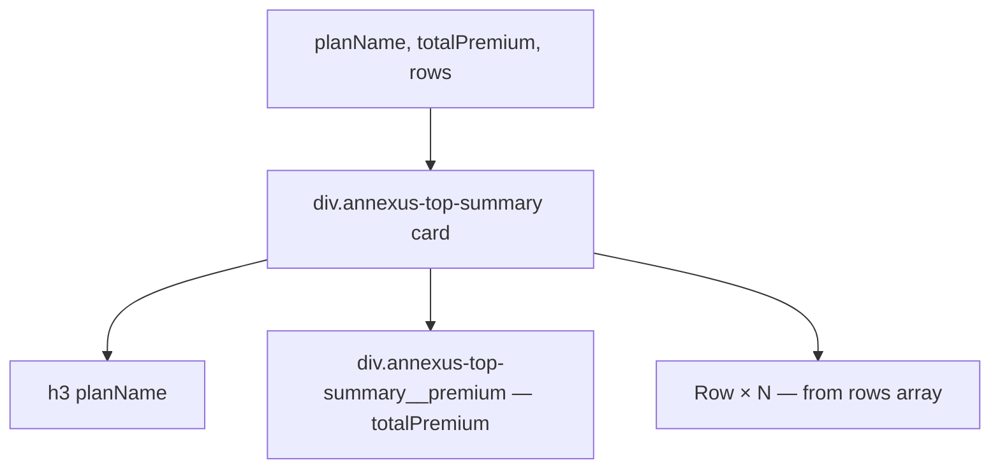

### Story 5.3: TopSummary Component

**File**: `docs/plans/stories/epic-5-story-5.3-top-summary.md`

**BUILDID**: CYCLE-4 | **AzureDevOps**: #23696 | **Epic**: 5 - P2 COMPLEX + v1.0 | **ID**: 5.3 | **Date**: 2026-10-13
**Wave**: 7
**Requires**: [3.1, 3.2, 3.3, 3.4, 3.5]
**Enables**: []
**Files Touched**:
  - src/components/TopSummary/TopSummary.tsx
  - src/components/TopSummary/TopSummary.types.ts
  - src/components/TopSummary/TopSummary.module.scss
  - src/components/TopSummary/TopSummary.stories.tsx
  - src/components/TopSummary/TopSummary.test.tsx
  - src/components/TopSummary/index.ts
  - src/index.ts
**Roles Ref**: docs/requirements.md#roles--permissions-matrix — single-actor — no role variation
**QA Candidate**: Yes — **Observable:** `pnpm storybook` shows a TopSummary story with a plan name, total premium display, and a list of key coverage metrics; `pnpm test src/components/TopSummary` exits 0 with ≥ 90% coverage; `pnpm typecheck` exits 0. **Mechanism:** TopSummary is a summary card — pure presentational composition of Row components within a branded card. No state, no hooks. **Authz & preconditions:** requires CYCLE-1 fully merged; Wave 7 (parallel with ChartBar).

---

#### 👤 User Reference

**Description**:
TopSummary renders the upper summary panel of the quote results page. It displays the selected plan name, total monthly premium (large, prominent), and a list of key metrics (coverage amount, policy term, etc.) using Row components. It is a read-only display card — no interactive elements.

**Acceptance Criteria** (plain-English):
- Renders a card with `planName` as a heading
- Renders `totalPremium` prominently as the primary value
- Renders a list of `rows` (label/value pairs) using Row components
- Card uses design tokens for styling (border, shadow, padding)
- `className` prop merges with base class
- `pnpm test` exits 0; ≥ 90% coverage

**User Journey** (no role variation — single actor: DEV):
- ```tsx
  <TopSummary
    planName="Gold Plan"
    totalPremium="$245.00/mo"
    rows={[
      { label: 'Coverage Amount', value: '$500,000' },
      { label: 'Policy Term', value: '20 years' },
    ]}
  />
  ```

**Flow Diagram**:



---

#### 🤖 AI Agent Reference

**Must Read**:
- `docs/architecture/design/01-patterns-and-standards-greenfield.md` — card pattern, BEM
- `docs/ui-ux/ui-ux-spec.md` — TopSummary visual spec

**Design Tokens**:
- `--annexus-shadow-lg` — card shadow
- `--annexus-radius-md` — card border radius
- `--annexus-spacing-4` — card padding
- `--annexus-color-neutral-white` — card background
- `--annexus-color-gray-200` — card border
- `--annexus-font-size-2xl` — totalPremium font size
- `--annexus-font-weight-bold` — totalPremium weight
- `--annexus-color-brand-primary` — totalPremium color
- `--annexus-font-size-md` — planName font size
- `--annexus-spacing-3` — gap between sections

**Description**:
`TopSummaryRow`: `{ label: string; value: string; sublabel?: string }` — maps to `RowProps`. `TopSummaryProps`: `planName: string`, `totalPremium: string`, `rows: TopSummaryRow[]`, plus `BaseProps`. Renders a card div containing `<h3>{planName}</h3>`, a styled `<div>` with the total premium in brand color, then a list of `<Row>` components.

**Acceptance Criteria** (comprehensive):
- `TopSummaryRow`: `{ label: string; value: string; sublabel?: string }`
- `TopSummaryProps`: `planName, totalPremium, rows` + `BaseProps`
- `<h3>` for planName (accessible heading)
- Premium div styled large + brand-colored
- One `<Row>` per entry in `rows`
- Card border + shadow via tokens
- `className` merged on root div

**RBAC Enforcement**: No role-differentiated access — single actor.

**System responses + error cases**:

| Trigger | Response | Side-effect |
|---------|----------|-------------|
| `rows=[]` | Card renders with plan name and premium, no rows | none |
| Long `planName` | Wraps within heading | none |

**QA-observable behaviour**:
- `screen.getByRole('heading', { level: 3, name: planName })` — resolves.
- `screen.getByText(totalPremium)` — resolves.
- Row labels and values in the document.

**Prerequisites**:
- Stories 3.1–3.5 merged

**Steps**:

1. **Create `src/components/TopSummary/TopSummary.types.ts`**:
   ```typescript
   import type { BaseProps } from '../../types/common.types';

   export interface TopSummaryRow {
     label: string;
     value: string;
     sublabel?: string;
   }

   export interface TopSummaryProps extends BaseProps {
     planName: string;
     totalPremium: string;
     rows: TopSummaryRow[];
   }
   ```

2. **Create `src/components/TopSummary/TopSummary.module.scss`**:
   ```scss
   .annexus-top-summary {
     background-color: var(--annexus-color-neutral-white);
     border: 1px solid var(--annexus-color-gray-200);
     border-radius: var(--annexus-radius-md);
     box-shadow: var(--annexus-shadow-lg);
     padding: var(--annexus-spacing-4);
     display: flex;
     flex-direction: column;
     gap: var(--annexus-spacing-3);

     &__plan-name {
       margin: 0;
       font-size: var(--annexus-font-size-md);
       font-weight: var(--annexus-font-weight-medium);
       color: var(--annexus-color-gray-700);
     }

     &__premium {
       font-size: var(--annexus-font-size-2xl);
       font-weight: var(--annexus-font-weight-bold);
       color: var(--annexus-color-brand-primary);
     }

     &__rows {
       display: flex;
       flex-direction: column;
     }
   }
   ```

3. **Create `src/components/TopSummary/TopSummary.tsx`**:
   ```tsx
   import React from 'react';
   import { classNames } from '../../utils/classNames';
   import { Row } from '../Row/Row';
   import styles from './TopSummary.module.scss';
   import type { TopSummaryProps } from './TopSummary.types';

   export function TopSummary({ planName, totalPremium, rows, className, style, 'data-testid': testId }: TopSummaryProps) {
     return (
       <div
         className={classNames(styles['annexus-top-summary'], className)}
         style={style}
         data-testid={testId}
       >
         <h3 className={styles['annexus-top-summary__plan-name']}>{planName}</h3>
         <div className={styles['annexus-top-summary__premium']}>{totalPremium}</div>
         <div className={styles['annexus-top-summary__rows']}>
           {rows.map((row, i) => (
             <Row key={i} label={row.label} value={row.value} sublabel={row.sublabel} />
           ))}
         </div>
       </div>
     );
   }
   ```

4. **Create `src/components/TopSummary/index.ts`**:
   ```typescript
   export { TopSummary } from './TopSummary';
   export type { TopSummaryProps, TopSummaryRow } from './TopSummary.types';
   ```

5. **Create `src/components/TopSummary/TopSummary.stories.tsx`**:
   ```tsx
   import type { Meta, StoryObj } from '@storybook/react';
   import { TopSummary } from './TopSummary';

   const meta: Meta<typeof TopSummary> = {
     title: 'Components/TopSummary',
     component: TopSummary,
     tags: ['autodocs'],
   };
   export default meta;

   export const Default: StoryObj<typeof TopSummary> = {
     args: {
       planName: 'Gold Plan',
       totalPremium: '$245.00/mo',
       rows: [
         { label: 'Coverage Amount', value: '$500,000' },
         { label: 'Policy Term', value: '20 years' },
         { label: 'Entry Age', value: '35 years' },
       ],
     },
   };

   export const NoRows: StoryObj<typeof TopSummary> = {
     args: { planName: 'Silver Plan', totalPremium: '$180.00/mo', rows: [] },
   };
   ```

6. **Create `src/components/TopSummary/TopSummary.test.tsx`**:
   ```tsx
   import { render, screen } from '@testing-library/react';
   import { TopSummary } from './TopSummary';

   const baseProps = {
     planName: 'Gold Plan',
     totalPremium: '$245/mo',
     rows: [{ label: 'Coverage', value: '$500k' }],
   };

   describe('TopSummary', () => {
     it('renders plan name as h3', () => {
       render(<TopSummary {...baseProps} />);
       expect(screen.getByRole('heading', { level: 3, name: 'Gold Plan' })).toBeInTheDocument();
     });
     it('renders total premium', () => {
       render(<TopSummary {...baseProps} />);
       expect(screen.getByText('$245/mo')).toBeInTheDocument();
     });
     it('renders rows', () => {
       render(<TopSummary {...baseProps} />);
       expect(screen.getByText('Coverage')).toBeInTheDocument();
       expect(screen.getByText('$500k')).toBeInTheDocument();
     });
     it('renders with empty rows', () => {
       render(<TopSummary {...baseProps} rows={[]} />);
       expect(screen.getByRole('heading', { level: 3 })).toBeInTheDocument();
     });
     it('applies custom className', () => {
       const { container } = render(<TopSummary {...baseProps} className="custom" />);
       expect(container.firstChild).toHaveClass('custom');
     });
     it('forwards data-testid', () => {
       render(<TopSummary {...baseProps} data-testid="ts" />);
       expect(screen.getByTestId('ts')).toBeInTheDocument();
     });
   });
   ```

7. **Update `src/index.ts`**:
   ```typescript
   export { TopSummary } from './components/TopSummary';
   export type { TopSummaryProps, TopSummaryRow } from './components/TopSummary';
   ```

8. **Run verification**:
   ```bash
   pnpm typecheck
   pnpm test src/components/TopSummary
   ```

**Tests**: 6 unit tests; `pnpm typecheck` exits 0

**Quality**: ≥ 90% coverage; `pnpm typecheck` exits 0

**OUT**:
- ❌ No edit/inline controls (read-only summary display)
- ❌ No graph embedded in TopSummary (GraphContainer is a separate component)

**Evidence**:
- Terminal output of `pnpm test src/components/TopSummary` (6 tests pass)
- Terminal output of `pnpm typecheck` (exit 0)
