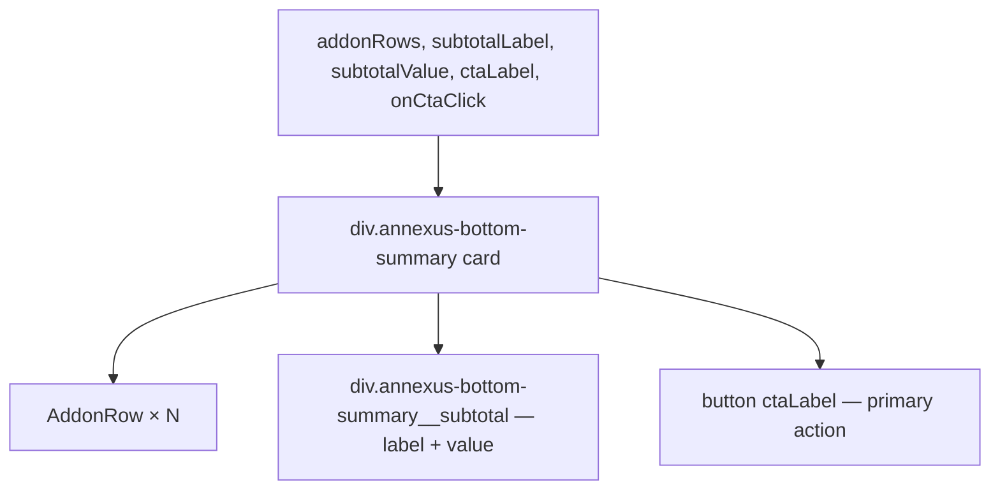

### Story 5.4: BottomSummary Component

**File**: `docs/plans/stories/epic-5-story-5.4-bottom-summary.md`

**BUILDID**: CYCLE-4 | **AzureDevOps**: #23698 | **Epic**: 5 - P2 COMPLEX + v1.0 | **ID**: 5.4 | **Date**: 2026-10-13
**Wave**: 7
**Requires**: [3.1, 3.2, 3.3, 3.4, 3.5]
**Enables**: []
**Files Touched**:
  - src/components/BottomSummary/BottomSummary.tsx
  - src/components/BottomSummary/BottomSummary.types.ts
  - src/components/BottomSummary/BottomSummary.module.scss
  - src/components/BottomSummary/BottomSummary.stories.tsx
  - src/components/BottomSummary/BottomSummary.test.tsx
  - src/components/BottomSummary/index.ts
  - src/index.ts
**Roles Ref**: docs/requirements.md#roles--permissions-matrix — single-actor — no role variation
**QA Candidate**: Yes — **Observable:** `pnpm storybook` shows BottomSummary with addon rows, a subtotal, and a CTA button; `pnpm test src/components/BottomSummary` exits 0 with ≥ 90% coverage; `pnpm typecheck` exits 0. **Mechanism:** BottomSummary composes AddonRow components with a subtotal display and a primary action button. Stateless. **Authz & preconditions:** requires CYCLE-1 fully merged; Wave 7.

---

#### 👤 User Reference

**Description**:
BottomSummary renders the lower summary panel showing the addon breakdown and the final premium subtotal. It lists addon rows (each with label, value, and an optional toggle control slot), followed by a total row and a primary CTA button (e.g., "Get Quote"). The component is stateless — addon toggle state is managed by the consumer.

**Acceptance Criteria** (plain-English):
- Renders a card with a list of `addonRows` using AddonRow components
- Renders a `subtotal` label and value at the bottom of the list
- Renders a CTA button using the `ctaLabel` prop and `onCtaClick` handler
- Card uses design tokens for styling
- `className` prop merges with base class
- `pnpm test` exits 0; ≥ 90% coverage

**User Journey** (no role variation — single actor: DEV):
- ```tsx
  <BottomSummary
    addonRows={[
      { label: 'Critical Illness', value: '$45/mo', control: <Toggle checked={on} onChange={set} /> },
    ]}
    subtotalLabel="Total Monthly Premium"
    subtotalValue="$290.00"
    ctaLabel="Get Quote"
    onCtaClick={() => navigate('/quote')}
  />
  ```

**Flow Diagram**:



---

#### 🤖 AI Agent Reference

**Must Read**:
- `docs/architecture/design/01-patterns-and-standards-greenfield.md` — card pattern, BEM
- `docs/ui-ux/ui-ux-spec.md` — BottomSummary visual spec

**Design Tokens**:
- `--annexus-shadow-lg` — card shadow
- `--annexus-radius-md` — card border radius
- `--annexus-spacing-4` — card padding
- `--annexus-color-neutral-white` — card background
- `--annexus-color-gray-200` — card border and subtotal separator
- `--annexus-font-size-lg` — subtotal value font size
- `--annexus-font-weight-bold` — subtotal value weight
- `--annexus-color-brand-primary` — subtotal value color
- `--annexus-spacing-3` — gap between sections

**Description**:
`BottomSummaryAddonRow`: `{ label: string; value: string; description?: string; control?: React.ReactNode }` — maps to `AddonRowProps`. `BottomSummaryProps`: `addonRows: BottomSummaryAddonRow[]`, `subtotalLabel: string`, `subtotalValue: string`, `ctaLabel: string`, `onCtaClick: () => void`, plus `BaseProps`. CTA button: a simple styled `<button type="button" onClick={onCtaClick}>` with primary styling (not importing Button component — avoids cross-P0 circular dep risk; simpler direct styling in SCSS).

**Acceptance Criteria** (comprehensive):
- `BottomSummaryAddonRow`: `{ label, value, description?, control? }`
- `BottomSummaryProps`: `addonRows, subtotalLabel, subtotalValue, ctaLabel, onCtaClick` + `BaseProps`
- Renders card div with addon rows, subtotal section, and CTA button
- Each addon row: `<AddonRow label value description control />`
- Subtotal: two spans (label + value) separated from addons by a border-top
- CTA button: `role="button"`, `onClick={onCtaClick}`, `{ctaLabel}` text
- `className` merged on root div

**RBAC Enforcement**: No role-differentiated access — single actor.

**System responses + error cases**:

| Trigger | Response | Side-effect |
|---------|----------|-------------|
| `addonRows=[]` | Only subtotal + CTA render | none |
| CTA clicked | `onCtaClick()` called | Consumer handles navigation |

**QA-observable behaviour**:
- `screen.getByText(subtotalValue)` — resolves.
- `screen.getByRole('button', { name: ctaLabel })` — resolves.
- Addon row labels in the document.

**Prerequisites**:
- Stories 3.1–3.5 merged

**Steps**:

1. **Create `src/components/BottomSummary/BottomSummary.types.ts`**:
   ```typescript
   import type { BaseProps } from '../../types/common.types';

   export interface BottomSummaryAddonRow {
     label: string;
     value: string;
     description?: string;
     control?: React.ReactNode;
   }

   export interface BottomSummaryProps extends BaseProps {
     addonRows: BottomSummaryAddonRow[];
     subtotalLabel: string;
     subtotalValue: string;
     ctaLabel: string;
     onCtaClick: () => void;
   }
   ```

2. **Create `src/components/BottomSummary/BottomSummary.module.scss`**:
   ```scss
   .annexus-bottom-summary {
     background-color: var(--annexus-color-neutral-white);
     border: 1px solid var(--annexus-color-gray-200);
     border-radius: var(--annexus-radius-md);
     box-shadow: var(--annexus-shadow-lg);
     padding: var(--annexus-spacing-4);
     display: flex;
     flex-direction: column;
     gap: var(--annexus-spacing-3);

     &__addons {
       display: flex;
       flex-direction: column;
     }

     &__subtotal {
       display: flex;
       justify-content: space-between;
       align-items: center;
       padding-top: var(--annexus-spacing-3);
       border-top: 2px solid var(--annexus-color-gray-200);
     }

     &__subtotal-label {
       font-size: var(--annexus-font-size-md);
       font-weight: var(--annexus-font-weight-medium);
       color: var(--annexus-color-neutral-black);
     }

     &__subtotal-value {
       font-size: var(--annexus-font-size-lg);
       font-weight: var(--annexus-font-weight-bold);
       color: var(--annexus-color-brand-primary);
     }

     &__cta {
       width: 100%;
       padding: var(--annexus-spacing-3) var(--annexus-spacing-4);
       background-color: var(--annexus-color-brand-cta);
       color: var(--annexus-color-neutral-white);
       border: none;
       border-radius: var(--annexus-radius-md);
       font-size: var(--annexus-font-size-md);
       font-weight: var(--annexus-font-weight-semibold);
       cursor: pointer;
       transition: background-color 150ms ease;

       &:hover {
         background-color: var(--annexus-color-brand-hover);
       }

       &:focus-visible {
         outline: 2px solid var(--annexus-color-brand-cta);
         outline-offset: 2px;
       }
     }
   }
   ```

3. **Create `src/components/BottomSummary/BottomSummary.tsx`**:
   ```tsx
   import React from 'react';
   import { classNames } from '../../utils/classNames';
   import { AddonRow } from '../AddonRow/AddonRow';
   import styles from './BottomSummary.module.scss';
   import type { BottomSummaryProps } from './BottomSummary.types';

   export function BottomSummary({
     addonRows, subtotalLabel, subtotalValue, ctaLabel, onCtaClick,
     className, style, 'data-testid': testId,
   }: BottomSummaryProps) {
     return (
       <div
         className={classNames(styles['annexus-bottom-summary'], className)}
         style={style}
         data-testid={testId}
       >
         <div className={styles['annexus-bottom-summary__addons']}>
           {addonRows.map((row, i) => (
             <AddonRow
               key={i}
               label={row.label}
               value={row.value}
               description={row.description}
               control={row.control}
             />
           ))}
         </div>
         <div className={styles['annexus-bottom-summary__subtotal']}>
           <span className={styles['annexus-bottom-summary__subtotal-label']}>{subtotalLabel}</span>
           <span className={styles['annexus-bottom-summary__subtotal-value']}>{subtotalValue}</span>
         </div>
         <button
           type="button"
           onClick={onCtaClick}
           className={styles['annexus-bottom-summary__cta']}
         >
           {ctaLabel}
         </button>
       </div>
     );
   }
   ```

4. **Create `src/components/BottomSummary/index.ts`**:
   ```typescript
   export { BottomSummary } from './BottomSummary';
   export type { BottomSummaryProps, BottomSummaryAddonRow } from './BottomSummary.types';
   ```

5. **Create `src/components/BottomSummary/BottomSummary.stories.tsx`**:
   ```tsx
   import type { Meta, StoryObj } from '@storybook/react';
   import { BottomSummary } from './BottomSummary';

   const meta: Meta<typeof BottomSummary> = {
     title: 'Components/BottomSummary',
     component: BottomSummary,
     tags: ['autodocs'],
   };
   export default meta;

   export const Default: StoryObj<typeof BottomSummary> = {
     args: {
       addonRows: [
         { label: 'Critical Illness', value: '$45/mo', description: '36 conditions' },
         { label: 'Waiver of Premium', value: '$10/mo' },
       ],
       subtotalLabel: 'Total Monthly Premium',
       subtotalValue: '$290.00',
       ctaLabel: 'Get Quote',
       onCtaClick: () => {},
     },
   };

   export const NoAddons: StoryObj<typeof BottomSummary> = {
     args: {
       addonRows: [],
       subtotalLabel: 'Base Premium',
       subtotalValue: '$245.00',
       ctaLabel: 'Proceed',
       onCtaClick: () => {},
     },
   };
   ```

6. **Create `src/components/BottomSummary/BottomSummary.test.tsx`**:
   ```tsx
   import { render, screen } from '@testing-library/react';
   import userEvent from '@testing-library/user-event';
   import { BottomSummary } from './BottomSummary';

   const baseProps = {
     addonRows: [{ label: 'Illness', value: '$45' }],
     subtotalLabel: 'Total',
     subtotalValue: '$290',
     ctaLabel: 'Get Quote',
     onCtaClick: vi.fn(),
   };

   describe('BottomSummary', () => {
     it('renders addon row labels', () => {
       render(<BottomSummary {...baseProps} />);
       expect(screen.getByText('Illness')).toBeInTheDocument();
     });
     it('renders subtotal label and value', () => {
       render(<BottomSummary {...baseProps} />);
       expect(screen.getByText('Total')).toBeInTheDocument();
       expect(screen.getByText('$290')).toBeInTheDocument();
     });
     it('renders CTA button', () => {
       render(<BottomSummary {...baseProps} />);
       expect(screen.getByRole('button', { name: 'Get Quote' })).toBeInTheDocument();
     });
     it('calls onCtaClick on button click', async () => {
       const onCtaClick = vi.fn();
       render(<BottomSummary {...baseProps} onCtaClick={onCtaClick} />);
       await userEvent.click(screen.getByRole('button', { name: 'Get Quote' }));
       expect(onCtaClick).toHaveBeenCalledOnce();
     });
     it('renders with empty addon rows', () => {
       render(<BottomSummary {...baseProps} addonRows={[]} />);
       expect(screen.getByText('Total')).toBeInTheDocument();
     });
     it('applies custom className', () => {
       const { container } = render(<BottomSummary {...baseProps} className="custom" />);
       expect(container.firstChild).toHaveClass('custom');
     });
     it('forwards data-testid', () => {
       render(<BottomSummary {...baseProps} data-testid="bs" />);
       expect(screen.getByTestId('bs')).toBeInTheDocument();
     });
   });
   ```

7. **Update `src/index.ts`**:
   ```typescript
   export { BottomSummary } from './components/BottomSummary';
   export type { BottomSummaryProps, BottomSummaryAddonRow } from './components/BottomSummary';
   ```

8. **Run verification**:
   ```bash
   pnpm typecheck
   pnpm test src/components/BottomSummary
   ```

**Tests**: 7 unit tests; `pnpm typecheck` exits 0

**Quality**: ≥ 90% coverage; `pnpm typecheck` exits 0

**OUT**:
- ❌ No split/multi-step CTA flow (single CTA button only)
- ❌ No print/download action (out of scope for this component)

**Evidence**:
- Terminal output of `pnpm test src/components/BottomSummary` (7 tests pass)
- Terminal output of `pnpm typecheck` (exit 0)
