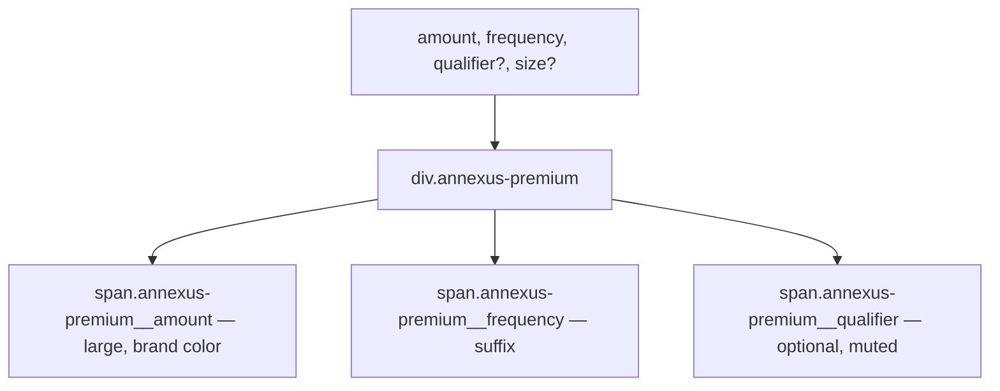

### Story 5.5: Premium Component

**File**: `docs/plans/stories/epic-5-story-5.5-premium.md`

**BUILDID**: CYCLE-4 | **AzureDevOps**: #23694 | **Epic**: 5 - P2 COMPLEX + v1.0 | **ID**: 5.5 | **Date**: 2026-10-13
**Wave**: 7
**Requires**: [4.1, 4.2, 4.3, 4.4, 4.5, 4.6, 4.7, 4.8, 4.9, 4.10, 4.11]
**Enables**: []
**Files Touched**:
  - src/components/Premium/Premium.tsx
  - src/components/Premium/Premium.types.ts
  - src/components/Premium/Premium.module.scss
  - src/components/Premium/Premium.stories.tsx
  - src/components/Premium/Premium.test.tsx
  - src/components/Premium/index.ts
  - src/index.ts
**Roles Ref**: docs/requirements.md#roles--permissions-matrix — single-actor — no role variation
**QA Candidate**: Yes — **Observable:** `pnpm storybook` shows Premium stories with a large currency amount, a frequency label, and an optional "per life" qualifier; `pnpm test src/components/Premium` exits 0 with ≥ 90% coverage; `pnpm typecheck` exits 0. **Mechanism:** Premium is a display-only component for showing a formatted premium amount with frequency and optional qualifier text. Pure presentational, no state. **Authz & preconditions:** requires CYCLE-1 fully merged; Wave 7.

> **Styling (CR-001, 2026-10-20)**: wherever this story says `var(--annexus-*)`, `src/tokens/` or a hex value, implement it as a **design variable** instead. Add `$<section><Element><State><Property>` (camelCase, section-prefixed, never repeated) to `src/styles/design.variables.scss`, pointing to a color in `src/styles/pallete.color.scss`, and `@use '../../styles/design.variables' as *;` in the component SCSS. Component SCSS never uses hex values or palette variables. Every new design variable is also added to `src/styles/design.variables.module.scss` so it is exported to JS (`designVariables`). Fonts use `$fontFamilyBase` and section-named size/line-height/weight variables. Reference implementation: `src/components/Input/Input.scss`. Spec: Story 3.2.

---

#### 👤 User Reference

**Description**:
The Premium component renders a formatted insurance premium amount — a large currency value, a frequency label (e.g., "/mo", "/yr"), and an optional qualifier (e.g., "per life assured"). Used in quote cards, summary panels, and proposal headers to display the computed premium in a visually prominent way. Read-only, no interactive behavior.

**Acceptance Criteria** (plain-English):
- Renders `amount` in large, brand-colored text
- Renders `frequency` as a smaller suffix (e.g., "/mo")
- Optional `qualifier` renders beneath as muted text
- `size` prop: `'lg'` (default, large display) | `'sm'` (compact inline)
- `className` prop merges with base class
- `pnpm test` exits 0; ≥ 90% coverage

**User Journey** (no role variation — single actor: DEV):
- `<Premium amount="$245.00" frequency="/mo" qualifier="per life assured" />`
- `<Premium amount="$2,940" frequency="/yr" size="sm" />`

**Flow Diagram**:



---

#### 🤖 AI Agent Reference

**Must Read**:
- `docs/architecture/design/01-patterns-and-standards-greenfield.md` — BEM, display text patterns
- `docs/ui-ux/ui-ux-spec.md` — Premium visual spec

**Design Tokens**:
- `--annexus-font-size-2xl` — amount font size (lg size)
- `--annexus-font-size-lg` — amount font size (sm size)
- `--annexus-font-size-sm` — frequency font size
- `--annexus-font-size-xs` — qualifier font size
- `--annexus-font-weight-bold` — amount weight
- `--annexus-color-brand-primary` — amount color
- `--annexus-color-gray-600` — frequency and qualifier color
- `--annexus-spacing-1` — gap between amount + frequency

**Description**:
`PremiumSize = 'lg' | 'sm'`. `PremiumProps`: `amount: string`, `frequency: string`, `qualifier?: string`, `size?: PremiumSize` (default `'lg'`), plus `BaseProps`. Component renders `<div className="annexus-premium annexus-premium--{size}">`. Inner layout: flex row for amount + frequency inline; qualifier below. SCSS modifier `--sm` reduces font sizes.

**Acceptance Criteria** (comprehensive):
- `PremiumSize = 'lg' | 'sm'`
- `PremiumProps`: `amount, frequency, qualifier?, size='lg'` + `BaseProps`
- Renders `<div>` with `annexus-premium` + `annexus-premium--{size}` classes
- Amount span: `{amount}` in brand color, large font
- Frequency span inline: `{frequency}` in gray, smaller font
- Qualifier: renders below when provided, muted text
- `className` merged on root div

**RBAC Enforcement**: No role-differentiated access — single actor.

**System responses + error cases**:

| Trigger | Response | Side-effect |
|---------|----------|-------------|
| `qualifier` omitted | No qualifier element | none |
| `size='sm'` | Smaller font sizes applied | none |
| `amount='$0.00'` | Renders zero value | none |

**QA-observable behaviour**:
- `screen.getByText(amount)` — resolves.
- `screen.getByText(frequency)` — resolves.
- `screen.queryByText(qualifier)` — null when not provided.

**Prerequisites**:
- Stories 3.1–3.5 merged

**Steps**:

1. **Create `src/components/Premium/Premium.types.ts`**:
   ```typescript
   import type { BaseProps } from '../../types/common.types';

   export type PremiumSize = 'lg' | 'sm';

   export interface PremiumProps extends BaseProps {
     amount: string;
     frequency: string;
     qualifier?: string;
     size?: PremiumSize;
   }
   ```

2. **Create `src/components/Premium/Premium.module.scss`**:
   ```scss
   .annexus-premium {
     display: flex;
     flex-direction: column;
     gap: var(--annexus-spacing-1);

     &__main {
       display: flex;
       align-items: baseline;
       gap: 2px;
     }

     &__amount {
       font-weight: var(--annexus-font-weight-bold);
       color: var(--annexus-color-brand-primary);
     }

     &__frequency {
       font-size: var(--annexus-font-size-sm);
       color: var(--annexus-color-gray-600);
     }

     &__qualifier {
       font-size: var(--annexus-font-size-xs);
       color: var(--annexus-color-gray-600);
     }

     &--lg &__amount {
       font-size: var(--annexus-font-size-2xl);
     }

     &--sm &__amount {
       font-size: var(--annexus-font-size-lg);
     }
   }
   ```

3. **Create `src/components/Premium/Premium.tsx`**:
   ```tsx
   import React from 'react';
   import { classNames } from '../../utils/classNames';
   import styles from './Premium.module.scss';
   import type { PremiumProps } from './Premium.types';

   export function Premium({ amount, frequency, qualifier, size = 'lg', className, style, 'data-testid': testId }: PremiumProps) {
     return (
       <div
         className={classNames(
           styles['annexus-premium'],
           styles[`annexus-premium--${size}`],
           className,
         )}
         style={style}
         data-testid={testId}
       >
         <div className={styles['annexus-premium__main']}>
           <span className={styles['annexus-premium__amount']}>{amount}</span>
           <span className={styles['annexus-premium__frequency']}>{frequency}</span>
         </div>
         {qualifier && <span className={styles['annexus-premium__qualifier']}>{qualifier}</span>}
       </div>
     );
   }
   ```

4. **Create `src/components/Premium/index.ts`**:
   ```typescript
   export { Premium } from './Premium';
   export type { PremiumProps, PremiumSize } from './Premium.types';
   ```

5. **Create `src/components/Premium/Premium.stories.tsx`**:
   ```tsx
   import type { Meta, StoryObj } from '@storybook/react';
   import { Premium } from './Premium';

   const meta: Meta<typeof Premium> = {
     title: 'Components/Premium',
     component: Premium,
     tags: ['autodocs'],
   };
   export default meta;

   type Story = StoryObj<typeof Premium>;

   export const Large: Story = {
     args: { amount: '$245.00', frequency: '/mo', qualifier: 'per life assured' },
   };

   export const Small: Story = {
     args: { amount: '$2,940', frequency: '/yr', size: 'sm' },
   };

   export const NoQualifier: Story = {
     args: { amount: '$180.00', frequency: '/mo' },
   };
   ```

6. **Create `src/components/Premium/Premium.test.tsx`**:
   ```tsx
   import { render, screen } from '@testing-library/react';
   import { Premium } from './Premium';

   describe('Premium', () => {
     it('renders amount', () => {
       render(<Premium amount="$245.00" frequency="/mo" />);
       expect(screen.getByText('$245.00')).toBeInTheDocument();
     });
     it('renders frequency', () => {
       render(<Premium amount="$245.00" frequency="/mo" />);
       expect(screen.getByText('/mo')).toBeInTheDocument();
     });
     it('renders qualifier when provided', () => {
       render(<Premium amount="$245.00" frequency="/mo" qualifier="per life" />);
       expect(screen.getByText('per life')).toBeInTheDocument();
     });
     it('does not render qualifier when omitted', () => {
       render(<Premium amount="$245.00" frequency="/mo" />);
       expect(screen.queryByText('per life')).toBeNull();
     });
     it('applies lg modifier by default', () => {
       const { container } = render(<Premium amount="$245" frequency="/mo" />);
       expect(container.firstChild?.toString()).toContain('lg');
     });
     it('applies sm modifier when size=sm', () => {
       const { container } = render(<Premium amount="$245" frequency="/mo" size="sm" />);
       expect(container.firstChild?.toString()).toContain('sm');
     });
     it('applies custom className', () => {
       const { container } = render(<Premium amount="$245" frequency="/mo" className="custom" />);
       expect(container.firstChild).toHaveClass('custom');
     });
     it('forwards data-testid', () => {
       render(<Premium amount="$245" frequency="/mo" data-testid="p" />);
       expect(screen.getByTestId('p')).toBeInTheDocument();
     });
   });
   ```

7. **Update `src/index.ts`**:
   ```typescript
   export { Premium } from './components/Premium';
   export type { PremiumProps, PremiumSize } from './components/Premium';
   ```

8. **Run verification**:
   ```bash
   pnpm typecheck
   pnpm test src/components/Premium
   ```

**Tests**: 8 unit tests; `pnpm typecheck` exits 0

**Quality**: ≥ 90% coverage; `pnpm typecheck` exits 0

**OUT**:
- ❌ No currency formatting logic (amount is passed pre-formatted as a string)
- ❌ No animated count-up (AnimatedValues story handles animation separately)

**Evidence**:
- Terminal output of `pnpm test src/components/Premium` (8 tests pass)
- Terminal output of `pnpm typecheck` (exit 0)
